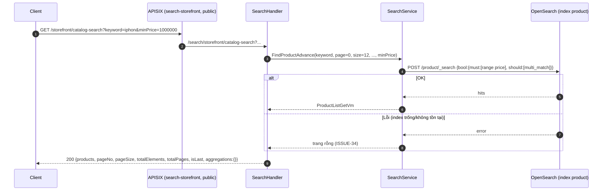
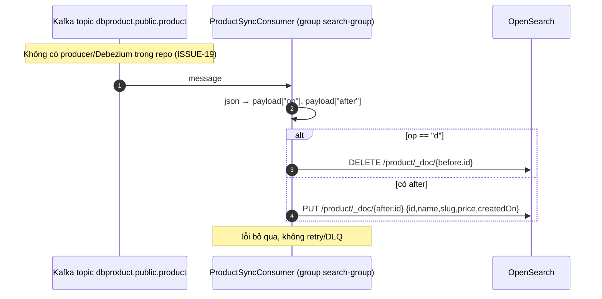

# FEAT-14 — Tìm kiếm full-text & gợi ý

> **Phiên bản:** 1.0 · **Trạng thái:** Final · **Cập nhật:** 2026-11-12 · **Phạm vi:** Ứng dụng (as-is)

| Thuộc tính | Giá trị |
| :--- | :--- |
| ID | FEAT-14 |
| Business Requirement | BR-14 |
| Trạng thái | 🟡 **Một phần** — search-service có 2 API public (`catalog-search`, `search_suggest`) trên OpenSearch index `product` và consumer Kafka đồng bộ dữ liệu; nhưng index không bao giờ được nạp (không có nguồn sự kiện khớp schema — ISSUE-19), lỗi bị nuốt thành kết quả rỗng, và storefront không gọi search-service (ISSUE-78). |
| Actor | Guest, Customer (dự kiến); Hệ thống (consumer Kafka) |
| Ứng dụng / Service | `services/search-service`, OpenSearch, Kafka; APISIX route `search-storefront` |
| Issue liên quan | ISSUE-16, ISSUE-19, ISSUE-34, ISSUE-36, ISSUE-48, ISSUE-58, ISSUE-78 |

## 1. Mô tả & mục tiêu nghiệp vụ

Cung cấp tìm kiếm sản phẩm toàn văn có lọc (thương hiệu, danh mục, thuộc tính, khoảng giá), phân trang và gợi ý tên sản phẩm khi gõ (autocomplete). Dữ liệu dự kiến được đồng bộ từ DB sản phẩm sang OpenSearch qua sự kiện CDC (Debezium) trên Kafka topic `dbproduct.public.product`.

## 2. User stories

| ID | Story |
| :--- | :--- |
| US-14.1 | Là **khách**, tôi muốn tìm sản phẩm theo từ khóa, chấp nhận lỗi chính tả nhẹ. |
| US-14.2 | Là **khách**, tôi muốn lọc kết quả theo thương hiệu, danh mục, thuộc tính, khoảng giá. |
| US-14.3 | Là **khách**, tôi muốn thấy tối đa 10 gợi ý tên sản phẩm khi gõ. |
| US-14.4 | Là **hệ thống**, tôi muốn index được cập nhật khi sản phẩm thêm/sửa/xóa. |

## 3. Tiền điều kiện / Hậu điều kiện

- Tiền điều kiện: OpenSearch tại `OPENSEARCH_URL` (compose `http://opensearch:9200`, user/pass rỗng); Kafka `KAFKA_SERVERS`; topic `PRODUCT_TOPIC_NAME` (mặc định `dbproduct.public.product`) có message Debezium (`services/search-service/main.go:27-32`).
- Hậu điều kiện: tìm kiếm chỉ đọc; consumer ghi/xóa document trong index `product`.

## 4. Luồng nghiệp vụ

### 4.1 Luồng chính — Tìm kiếm nâng cao

1. Client gọi `GET /storefront/catalog-search?keyword&page&size&brand&category&attribute&minPrice&maxPrice&sortType` qua APISIX route public `search-storefront` (rewrite `/search/storefront/catalog-search`, `deploy/apisix/apisix.yaml:93-102`).
2. `SearchHandler.CatalogSearch` (`services/search-service/internal/handler/search_handler.go:50-84`): `page` mặc định 0, `size` mặc định 12 (số không parse được → mặc định); `sortType` mặc định `DEFAULT`; `minPrice`/`maxPrice` parse float, lỗi → bỏ qua.
3. `SearchService.FindProductAdvance` (`services/search-service/internal/service/search_service.go:24-192`):
   - Client OpenSearch `nil` → trang rỗng.
   - `keyword` (trim khác rỗng) → `should: multi_match {fields: name^3, brand^2, categories; fuzziness: AUTO}`.
   - `brand` → `must: term brand.keyword`; `category` → `must: term categories`; `attribute` → `must: term attributes`; giá → `must: range price {gte, lte}`.
   - Không điều kiện nào → `match_all`.
   - `from = page × size`, `size`, `track_total_hits=true`, index `product`.
   - **Không dùng `sortType`**, không aggregation (ISSUE-34).
4. Lỗi OpenSearch (index chưa có, mất kết nối…) → log cảnh báo, trả **trang rỗng 200** (ISSUE-34).
5. Map hit → `ProductGetVm {id, name, slug, thumbnailId, price, isAllowedToOrder, isPublished, isFeatured, isVisibleIndividually}`; `totalPages = ceil(total/size)`, `isLast = page+1 >= totalPages`; `aggregations = {}`.

### 4.2 Luồng thay thế — Gợi ý

`GET /storefront/search_suggest?keyword=` → `SearchSuggest` (`search_handler.go:86-94`) → `AutoComplete` (`search_service.go:194-239`): keyword rỗng hoặc client nil → `{productNames: []}`; ngược lại `match_phrase_prefix name`, `size 10`, `_source [id, name]`; lỗi → danh sách rỗng.

### 4.3 Luồng thay thế — Đồng bộ index (consumer)

`ProductSyncConsumer.Start` (`services/search-service/internal/consumer/product_sync_consumer.go:30-87`) chạy goroutine với `kafka.Reader` (group `search-group`, `MinBytes 10KB`, `MaxBytes 10MB`):
1. `ReadMessage` lỗi → ngủ 2 s, thử lại.
2. JSON lỗi → bỏ qua message.
3. Đọc `op` và `after` ở **cấp gốc** của payload.
4. `op == "d"` → `before.id` → `DeleteProduct(id)`.
5. Ngược lại nếu có `after` → `IndexProduct({id: after.id, name: after.name, slug: after.slug, price: after.price, createdOn: now})` (các trường khác mặc định `false`/rỗng).
6. Lỗi index/xóa bị bỏ qua; offset vẫn commit (ReadMessage với GroupID tự commit).

Trên thực tế không có Debezium connector trong repo và bảng nguồn là `products(product_id, product_title, price_unit…)` → index rỗng (ISSUE-19).

### 4.4 Luồng ngoại lệ

| Tình huống | Hành vi |
| :--- | :--- |
| Index `product` chưa tồn tại | Search lỗi 404 từ OpenSearch → trả trang rỗng 200. |
| `size` rất lớn (`from + size > 10000`) hoặc `page` âm | OpenSearch từ chối → trang rỗng 200. |
| `size = 0` | `totalPages = 0`; trả 0 sản phẩm. |
| Có cả `keyword` và bộ lọc | `keyword` chỉ ảnh hưởng điểm số, không lọc (ISSUE-58). |
| Message Debezium có envelope `{schema, payload}` | `op`/`after` không ở gốc → bỏ qua (ISSUE-19). |
| Kafka không sẵn sàng | Consumer thử lại mỗi 2 s; API vẫn hoạt động. |

## 5. Sequence diagram

## 6. Màn hình & route (UI)

Chưa có UI dùng search-service. Ô tìm kiếm ở header và trang `/products` gửi `search` tới product-service `GET /api/products` (bị bỏ qua — ISSUE-48), không gọi `catalog-search`/`search_suggest`; không có autocomplete (ISSUE-78). Xem FEAT-06.

## 7. API sử dụng

| Method | Path gateway | Path service | Auth | Query | Response |
| :--- | :--- | :--- | :--- | :--- | :--- |
| GET | `/storefront/catalog-search` | `/search/storefront/catalog-search`, `/storefront/catalog-search` | Public | `keyword`, `page`(0), `size`(12), `brand`, `category`, `attribute`, `minPrice`, `maxPrice`, `sortType`(bỏ qua) | `200 ProductListGetVm` |
| GET | `/storefront/search_suggest` | `/search/storefront/search_suggest` | Public | `keyword` | `200 {productNames:[{id, name}]}` |
| GET | `/search/v3/api-docs/*` | — | Public | — | Route chết (ISSUE-16) |

Model: `services/search-service/internal/model/search.go` (`ProductDoc`, `ProductGetVm`, `ProductListGetVm`, `ProductNameListVm`).

## 8. Dữ liệu

Index OpenSearch `product`, document `ProductDoc` (`search.go:5-19`): `id`, `name`, `slug`, `price`, `isPublished`, `isVisibleIndividually`, `isAllowedToOrder`, `isFeatured`, `thumbnailMediaId?`, `brand`, `categories[]`, `attributes[]`, `createdOn`. Service không tạo mapping → dynamic mapping (chuỗi = `text` + `keyword`). Consumer chỉ điền `id`, `name`, `slug`, `price`, `createdOn` → các bộ lọc brand/category/attribute không có dữ liệu để khớp.

## 9. Business rules & validation

| ID | Quy tắc | Nguồn |
| :--- | :--- | :--- |
| BR-14.1 | Keyword khớp `name` (×3), `brand` (×2), `categories`, fuzziness AUTO. | `search_service.go:47-55` |
| BR-14.2 | Bộ lọc là `must` (AND); keyword là `should`. | `:57-92` |
| BR-14.3 | Giá: `gte minPrice`, `lte maxPrice` (bao gồm biên). | `:73-84` |
| BR-14.4 | Phân trang offset `page × size`; không giới hạn `size`. | `:94-98` |
| BR-14.5 | Gợi ý: tối đa 10, `match_phrase_prefix` trên `name`. | `:199-207` |
| BR-14.6 | Lỗi OpenSearch → kết quả rỗng thay vì lỗi. | `:119-131,219-222` |

## 10. Xử lý lỗi

Chỉ lỗi encode JSON truy vấn mới trả 500 (`ErrorVm`); mọi lỗi OpenSearch thành 200 rỗng. Health luôn UP với component `opensearch` (ISSUE-36).

## 11. i18n (key chính)

Không áp dụng (không có UI). Liên quan gián tiếp: `header_searchPlaceholder`, `products_searchResults` (FEAT-06).

## 12. Acceptance criteria (Given / When / Then — theo hành vi hiện tại)

| # | Given | When | Then |
| :--- | :--- | :--- | :--- |
| AC-14.1 | Index `product` không tồn tại | `GET /storefront/catalog-search?keyword=phone` | `200 {products:[], totalElements:0, totalPages:0, isLast:true, aggregations:{}}`. |
| AC-14.2 | Index có doc `{name:"iPhone 15", price: 2e7}` | `?keyword=iphon` | Trả doc (fuzzy). |
| AC-14.3 | Như trên + doc `{name:"Galaxy", price: 3e7}` | `?keyword=iphone&minPrice=1000000` | Trả **cả hai** doc (keyword trong `should` bị vô hiệu khi có `must`) (ISSUE-58). |
| AC-14.4 | — | `?sortType=PRICE_ASC` | Thứ tự không đổi (bỏ qua). |
| AC-14.5 | — | `GET /storefront/search_suggest?keyword=` | `200 {"productNames":[]}`. |
| AC-14.6 | Index có "iPhone 15" | `search_suggest?keyword=iph` | `{"productNames":[{"id":..,"name":"iPhone 15"}]}`. |
| AC-14.7 | Message Kafka `{"op":"c","after":{"id":5,"name":"A","slug":"a","price":10}}` | Consumer nhận | Doc id 5 được index. |
| AC-14.8 | Message Debezium chuẩn `{"schema":{...},"payload":{"op":"c",...}}` | Consumer nhận | Bị bỏ qua. |
| AC-14.9 | Khách gõ từ khóa ở header storefront | Gửi | Điều hướng `/products?search=...`; search-service không được gọi. |

## 13. Giới hạn & vấn đề đã biết

| Issue | Ảnh hưởng |
| :--- | :--- |
| ISSUE-19 (High) | Không có nguồn sự kiện khớp schema → index không bao giờ được nạp. |
| ISSUE-34 (Medium) | `sortType` bỏ qua, aggregations rỗng, lỗi thành trang rỗng. |
| ISSUE-58 (Medium) | Keyword bị vô hiệu khi có bộ lọc; `term` trên trường text. |
| **ISSUE-78** (Medium) | Storefront không dùng search-service (tìm kiếm đi vào product-service, bị bỏ qua). |
| ISSUE-36 (Low) | Health luôn UP. |
| ISSUE-16 (Low) | Route api-docs chết. |

Khác: không có mapping index tường minh, không giới hạn `size`, consumer không retry/DLQ và commit offset kể cả khi index lỗi.

## 14. Test hiện có

`services/search-service/main_test.go:29-54` — health; `catalog-search` với keyword/giá và prefix `/search`; `search_suggest` (client OpenSearch `nil` → 200). Không có test consumer hay truy vấn thật (ISSUE-46).

## 15. Tham chiếu source

- `services/search-service/main.go`
- `services/search-service/internal/handler/search_handler.go`
- `services/search-service/internal/service/search_service.go`
- `services/search-service/internal/consumer/product_sync_consumer.go`
- `services/search-service/internal/model/search.go`
- `deploy/apisix/apisix.yaml:93-102,133-135`
- `docker-compose.yml` (service `search-service`: `OPENSEARCH_URL`, `KAFKA_SERVERS`)
- `frontend/apps/web/src/lib/components/header.svelte:88-98`; `frontend/apps/web/src/routes/products/+page.svelte:147-157`
