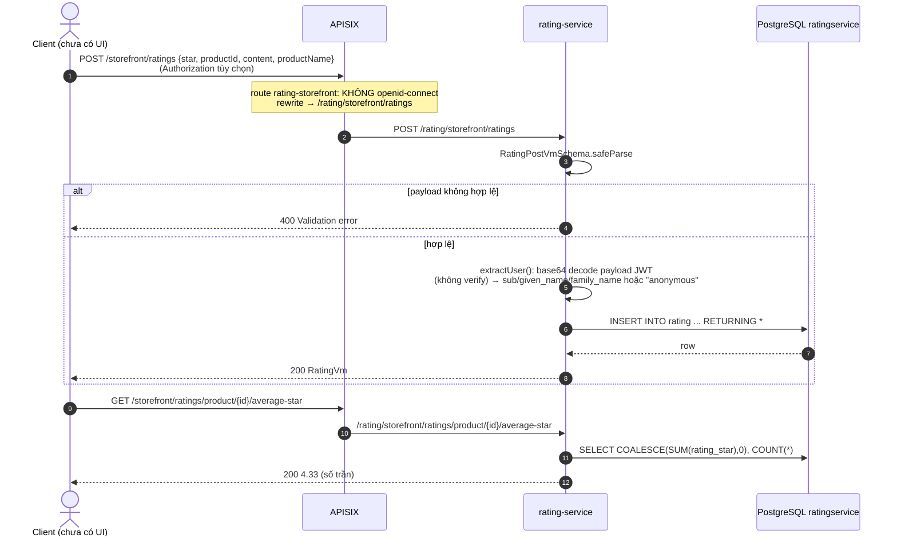
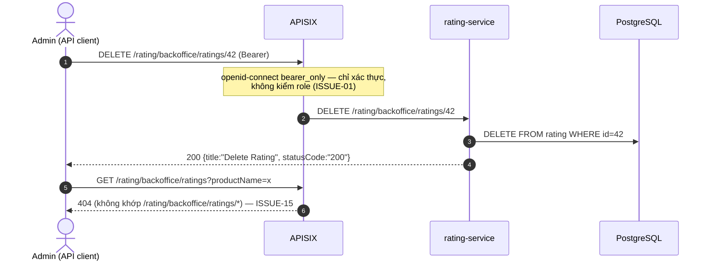
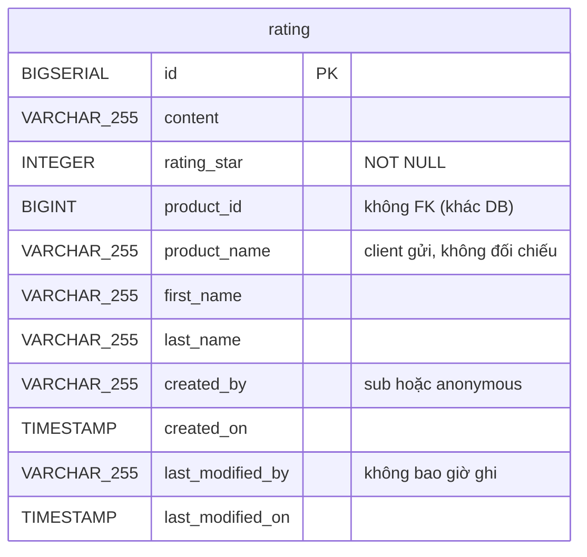

# FEAT-15 — Đánh giá sản phẩm (Ratings & Reviews)

> **Phiên bản:** 1.0 · **Trạng thái:** Final · **Cập nhật:** 2026-11-12 · **Phạm vi:** Ứng dụng (as-is)

| Thuộc tính | Giá trị |
| :--- | :--- |
| ID | FEAT-15 |
| Business Requirement | BR-15 |
| Trạng thái | 🟡 **Một phần** — rating-service có API tạo/xem/lọc/xóa/tính điểm trung bình, nhưng **không có UI** ở web/admin, POST tạo đánh giá để public tại gateway và danh tính người đánh giá lấy từ token không xác minh chữ ký. |
| Actor | Guest / Customer (storefront API), Admin (backoffice API), Hệ thống |
| Ứng dụng / Service | rating-service (Bun + Hono + Drizzle, port 8089, DB `ratingservice`), APISIX |
| Issue liên quan | ISSUE-01, ISSUE-03, ISSUE-15, ISSUE-16, ISSUE-28, ISSUE-29, ISSUE-36, ISSUE-43, ISSUE-46, ISSUE-62, ISSUE-65 |

## 1. Mô tả & mục tiêu nghiệp vụ

Cho phép khách hàng chấm điểm (1–5 sao) và viết nhận xét ngắn cho một sản phẩm; storefront hiển thị danh sách đánh giá và điểm trung bình theo sản phẩm; quản trị viên tìm kiếm/lọc và xóa đánh giá vi phạm.

Hiện trạng: toàn bộ logic nằm trong `services/rating-service`. Không có màn hình nào ở `frontend/apps/web` hay `frontend/apps/admin` gọi các API này; type `Rating` ở `frontend/packages/lib/src/types.ts:120-127` không được dùng và **lệch** với payload thật (`ratingValue`/`comment`/`userId`/`createdAt` so với `star`/`content`/`createdBy`/`createdOn`) — xem ISSUE-43.

## 2. User stories

| ID | Là… | Tôi muốn… | Để… | Hiện trạng |
| :--- | :--- | :--- | :--- | :--- |
| US-15.1 | Customer | gửi đánh giá 1–5 sao kèm nhận xét cho một sản phẩm | chia sẻ trải nghiệm | API có (`POST /storefront/ratings`), chưa có UI |
| US-15.2 | Guest/Customer | xem danh sách đánh giá của sản phẩm, mới nhất trước, có phân trang | tham khảo trước khi mua | API có, chưa có UI |
| US-15.3 | Guest/Customer | xem điểm sao trung bình của sản phẩm | đánh giá nhanh chất lượng | API có, chưa có UI |
| US-15.4 | Admin | lọc đánh giá theo tên sản phẩm, tên khách, nội dung, khoảng thời gian | kiểm duyệt | API có, list không đi qua được gateway (ISSUE-15) |
| US-15.5 | Admin | xóa một đánh giá | gỡ nội dung vi phạm | API có, không kiểm tra role (ISSUE-01) |

## 3. Tiền điều kiện / Hậu điều kiện

**Tiền điều kiện**
- rating-service chạy và kết nối được PostgreSQL DB `ratingservice` (`docker-compose.yml:298-315`). Bảng `rating` được tạo lúc khởi động bằng `CREATE TABLE IF NOT EXISTS` (`services/rating-service/src/db.ts:46-67`); lỗi chỉ log warning (ISSUE-28).
- Với backoffice qua gateway: request có Bearer token hợp lệ Keycloak (route `rating-backoffice`, `deploy/apisix/apisix.yaml:328-339`).
- Với storefront: **không cần** token (route `rating-storefront`, `deploy/apisix/apisix.yaml:83-92`).

**Hậu điều kiện**
- Tạo: 1 bản ghi mới trong `rating`, `created_on = CURRENT_TIMESTAMP`, `created_by = sub` của token hoặc `anonymous`.
- Xóa: bản ghi bị xóa vật lý (hard delete). Không có audit.

## 4. Luồng nghiệp vụ

### 4.1 Luồng chính

**A. Gửi đánh giá (US-15.1)**
1. Client gọi `POST /storefront/ratings` (gateway) → APISIX rewrite thành `/rating/storefront/ratings` → rating-service (`apisix.yaml:83-92`).
2. Handler đọc JSON body, validate bằng `RatingPostVmSchema` (`src/types.ts:3-8`, `src/index.ts:119-125`).
3. `extractUser` (`src/index.ts:39-58`) tách header `Authorization: Bearer <jwt>`, **base64-decode phần payload không xác minh chữ ký**, lấy `sub` → `userId`, `given_name`/`name` → `firstName`, `family_name` → `lastName`. Không có/không parse được → `anonymous` / `Customer` / `""`.
4. `RatingService.createRating` insert vào bảng `rating` và trả `RatingVm` (`src/service.ts:94-116`), HTTP 200.

**B. Xem đánh giá theo sản phẩm (US-15.2)**
1. `GET /storefront/ratings/products/{productId}?pageNo=&pageSize=` (`src/index.ts:102-116`).
2. `productId` parse int; mặc định `pageNo=0`, `pageSize=5`.
3. Service đếm tổng, lấy trang sắp xếp `created_on DESC`, `LIMIT pageSize OFFSET pageNo*pageSize` (`src/service.ts:21-48`). Trả `{ ratingList, totalElements, totalPages }`.

**C. Điểm trung bình (US-15.3)**
1. `GET /storefront/ratings/product/{productId}/average-star` (lưu ý: `product` số ít, khác path B) (`src/index.ts:136-147`).
2. `SUM(rating_star)/COUNT(*)` làm tròn 2 chữ số; không có đánh giá → `0.0` (`src/service.ts:127-144`). Response là **số JSON trần** (vd `4.33`).

**D. Lọc đánh giá backoffice (US-15.4)**
1. `GET /rating/backoffice/ratings?productName=&customerName=&message=&createdFrom=&createdTo=&pageNo=&pageSize=` (`src/index.ts:62-85`).
2. Mặc định: chuỗi rỗng; `createdFrom = 1970-01-01T00:00:00.000Z`; `createdTo = now`; `pageNo=0`; `pageSize=5`.
3. Điều kiện (AND): `LOWER(product_name) LIKE %x%`, `LOWER(first_name || ' ' || last_name) LIKE %x%`, `LOWER(content) LIKE %x%`, `created_on BETWEEN from AND to` (`src/service.ts:50-92`).

**E. Xóa đánh giá (US-15.5)**
1. `DELETE /rating/backoffice/ratings/{id}` (`src/index.ts:88-99`) → `DELETE FROM rating WHERE id = ?` → luôn trả `{ title: "Delete Rating", message: "...successfully", statusCode: "200" }` (`src/service.ts:118-125`).

### 4.2 Luồng thay thế

| # | Điều kiện | Hành vi hiện tại |
| :--- | :--- | :--- |
| A1 | Không gửi token khi POST | Đánh giá vẫn được tạo với `created_by = "anonymous"`, `first_name = "Customer"` (ISSUE-03). |
| A2 | Token không đúng định dạng 3 phần / payload không phải JSON | Bị nuốt lỗi (`catch {}`), xử lý như A1. |
| A3 | `content`/`productName` bỏ trống | Zod default `""`. |
| B1 | Sản phẩm chưa có đánh giá | `ratingList: []`, `totalElements: 0`, `totalPages: 0`. |
| C1 | `productId` không phải số | Trả `0.0` với HTTP 200 (không phải 400) (`src/index.ts:139-141`). |
| D1 | Không truyền filter nào | Trả toàn bộ, mới nhất trước, 5 bản ghi/trang. |
| E1 | `id` không tồn tại | Vẫn trả 200 "processed successfully". |

### 4.3 Luồng ngoại lệ

| # | Tình huống | Kết quả |
| :--- | :--- | :--- |
| X1 | Body thiếu `star`/`productId` hoặc `star` ngoài 1..5, không phải số nguyên | 400 `{ statusCode: "400", message: "Validation error", errors: [...zod issues] }` |
| X2 | Body không phải JSON hợp lệ | `c.req.json()` ném lỗi → 500 `{ statusCode: "500", message }` |
| X3 | `content` > 255 ký tự | Zod không giới hạn; PostgreSQL từ chối (`VARCHAR(255)`) → 500 (ISSUE-62) |
| X4 | `productId`/`id` không phải số ở path list/delete | 400 `Invalid productId` / `Invalid ID` |
| X5 | `pageNo` âm hoặc `pageSize` không phải số | `OFFSET` âm / `LIMIT NaN` → lỗi DB → 500 (ISSUE-62) |
| X6 | `createdFrom`/`createdTo` không phải ngày hợp lệ | `new Date()` = Invalid Date → lỗi truy vấn → 500 |
| X7 | DB không kết nối | 500 cho mọi endpoint, trừ average-star luôn trả `0.0`; health vẫn `UP` (ISSUE-36) |
| X8 | Gọi `GET /rating/backoffice/ratings` qua gateway | 404 tại APISIX vì route chỉ khớp `/rating/backoffice/ratings/*` (ISSUE-15) |

## 5. Sequence diagram





## 6. Màn hình & route (UI)

Chưa có UI. Không có route nào ở `frontend/apps/web/src/routes` hay `frontend/apps/admin/src/routes` dùng rating; `frontend/packages/lib/src/server/api.ts` không có client cho rating.

## 7. API sử dụng

| Method | Path qua gateway | Path trong service | Auth gateway | Request | Response |
| :--- | :--- | :--- | :--- | :--- | :--- |
| POST | `/storefront/ratings` | `/rating/storefront/ratings` (cũng có ở `/storefront/ratings`) | Không | `RatingPostVm` | 200 `RatingVm` |
| GET | `/storefront/ratings/products/{productId}?pageNo&pageSize` | `/rating/storefront/ratings/products/{productId}` | Không | — | 200 `RatingListVm` |
| GET | `/storefront/ratings/product/{productId}/average-star` | `/rating/storefront/ratings/product/{productId}/average-star` | Không | — | 200 `number` |
| GET | `/rating/backoffice/ratings` (**404 ở gateway**) | `/rating/backoffice/ratings` | Bearer | query filter | 200 `RatingListVm` |
| DELETE | `/rating/backoffice/ratings/{id}` | `/rating/backoffice/ratings/{id}` | Bearer | — | 200 `ResponeStatusVm` |
| GET | `/rating/actuator/health` | `/actuator/health`, `/rating/actuator/health` | (không route) | — | `{status:"UP"}` cố định |

Service đăng ký route hai lần — dưới prefix `/rating` và ở root (`src/index.ts:150-154`). Route `openapi-rating` (`apisix.yaml:130-132`) trỏ tới endpoint không tồn tại (ISSUE-16).

**Schema**

```ts
// RatingPostVm (src/types.ts:3-8)
{ content?: string = "", star: int 1..5, productId: int, productName?: string = "" }
// RatingVm (src/types.ts:12-22)
{ id, content, star, productId, productName, createdBy, lastName, firstName, createdOn /* ISO */ }
// RatingListVm
{ ratingList: RatingVm[], totalElements: number, totalPages: number }
```

## 8. Dữ liệu



Nguồn: `services/rating-service/src/db.ts:49-61`, `src/schema.ts:4-16`. Không có index phụ, không có ràng buộc unique (user, product).

## 9. Business rules & validation

| # | Quy tắc | Nơi áp dụng | Ghi chú |
| :--- | :--- | :--- | :--- |
| BR15-1 | `star` bắt buộc, số nguyên trong [1, 5] | `src/types.ts:5` | Zod `int().min(1).max(5)` |
| BR15-2 | `productId` bắt buộc, số nguyên | `src/types.ts:6` | Không kiểm sản phẩm có tồn tại ở product-service |
| BR15-3 | `content`, `productName` tùy chọn, mặc định `""` | `src/types.ts:4,7` | Không giới hạn độ dài ở tầng API; DB giới hạn 255 |
| BR15-4 | Danh tính người đánh giá lấy từ JWT payload (không verify) | `src/index.ts:39-58` | ISSUE-03 |
| BR15-5 | Không giới hạn số đánh giá/người/sản phẩm, không yêu cầu đã mua | — | ISSUE-62 |
| BR15-6 | Danh sách sắp xếp `created_on DESC`; `pageSize` mặc định 5 | `src/service.ts:39,83` | Không giới hạn `pageSize` tối đa |
| BR15-7 | Điểm trung bình = tổng sao / số đánh giá, làm tròn 2 chữ số; 0 nếu chưa có | `src/service.ts:127-144` | |
| BR15-8 | Lọc backoffice dùng `LIKE` không phân biệt hoa thường, khoảng thời gian bao gồm hai đầu | `src/service.ts:67-73` | Ký tự `%`/`_` trong input không được escape |

## 10. Xử lý lỗi

Định dạng lỗi riêng của service Bun: `{ statusCode: "<code>", message, errors? }` (ISSUE-29). Mọi exception trong handler → 500 kèm `err.message` (có thể lộ thông điệp lỗi DB). `average-star` nuốt mọi lỗi và trả `0.0`.

## 11. i18n (key chính)

Chưa có UI → không có key i18n.

## 12. Acceptance criteria (Given / When / Then — theo hành vi hiện tại)

| # | Given | When | Then |
| :--- | :--- | :--- | :--- |
| AC-15.1 | Không có header Authorization | `POST /storefront/ratings` `{star:5, productId:1}` | 200; `createdBy = "anonymous"`, `firstName = "Customer"` |
| AC-15.2 | Token Keycloak có `sub=U`, `given_name=An` | POST hợp lệ | 200; `createdBy = U`, `firstName = "An"` |
| AC-15.3 | Token tự chế (chữ ký sai) với `sub=X` | POST hợp lệ | 200; `createdBy = X` (không bị từ chối) |
| AC-15.4 | — | POST `{star: 6, productId: 1}` hoặc `{}` | 400 `Validation error` |
| AC-15.5 | Sản phẩm 1 có 7 đánh giá | `GET /storefront/ratings/products/1?pageNo=1&pageSize=5` | 2 bản ghi cũ nhất, `totalElements=7`, `totalPages=2` |
| AC-15.6 | Sản phẩm có sao 5, 4, 4 | GET average-star | `4.33` |
| AC-15.7 | — | GET average-star với `productId=abc` | 200 `0` |
| AC-15.8 | Bearer hợp lệ của user thường (role USER) | `DELETE /rating/backoffice/ratings/{id}` | 200, bản ghi bị xóa (không kiểm role) |
| AC-15.9 | — | DELETE id không tồn tại | 200 "processed successfully" |
| AC-15.10 | Bearer hợp lệ | `GET /rating/backoffice/ratings` qua gateway | 404 từ APISIX |
| AC-15.11 | — | `GET /storefront/ratings/products/xyz` | 400 `Invalid productId` |

## 13. Giới hạn & vấn đề đã biết

- **ISSUE-03**: POST public, danh tính từ token không verify → spam/giả mạo đánh giá.
- **ISSUE-01**: backoffice xóa/lọc không kiểm role ADMIN.
- **ISSUE-15**: list backoffice không truy cập được qua gateway.
- **ISSUE-62**: thiếu validate độ dài/phân trang → 500; không chống trùng đánh giá; xóa không tồn tại vẫn 200; không kiểm `productId` tồn tại.
- **ISSUE-28 / ISSUE-36**: tạo bảng lúc khởi động, health luôn UP.
- **ISSUE-43**: type `Rating` ở frontend không dùng và sai schema.
- Không có chức năng sửa đánh giá, không có trạng thái duyệt/ẩn, không có trả lời của shop, không cập nhật `last_modified_*`.
- `product_name` do client gửi → có thể không khớp tên sản phẩm thật.

## 14. Test hiện có

`services/rating-service/src/index.test.ts:4-49` — 6 test gọi `app.fetch` trực tiếp: health (2), average-star trả 200, productId không hợp lệ → 400, POST `{}` → 400, DELETE id không phải số → 400. Không có test với DB thật, không test danh tính/phân trang/lọc (ISSUE-46).

## 15. Tham chiếu source

- `services/rating-service/src/index.ts:39-58` (extractUser), `:60-148` (routes), `:150-154` (đăng ký prefix)
- `services/rating-service/src/service.ts:21-144`
- `services/rating-service/src/types.ts:3-34`
- `services/rating-service/src/db.ts:46-67`, `src/schema.ts:4-16`
- `deploy/apisix/apisix.yaml:83-92` (rating-storefront), `:328-339` (rating-backoffice), `:130-132` (openapi-rating)
- `docker-compose.yml:298-315`
- `frontend/packages/lib/src/types.ts:120-127` (type Rating không dùng)
