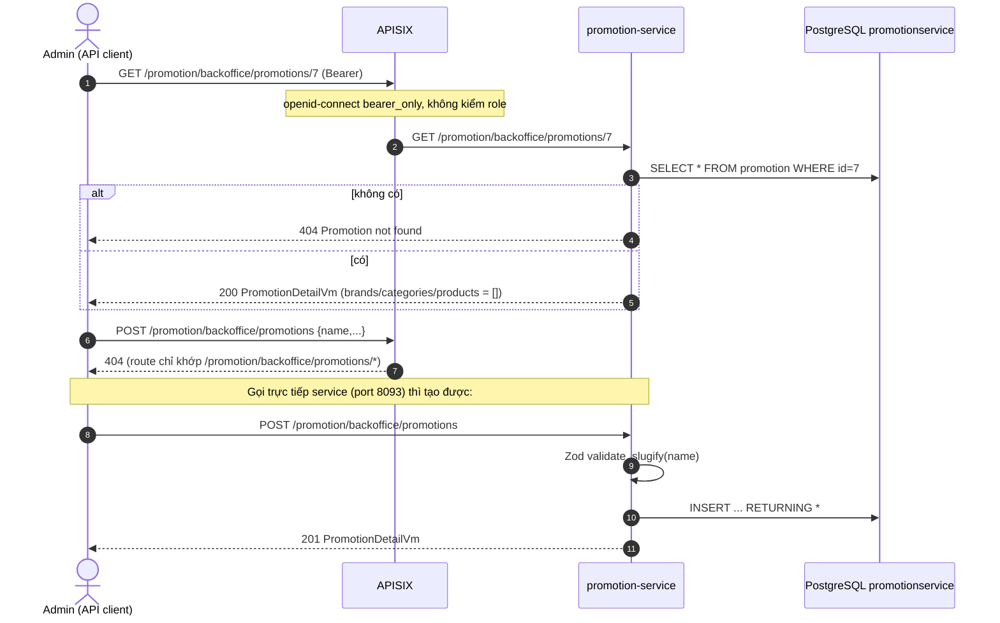
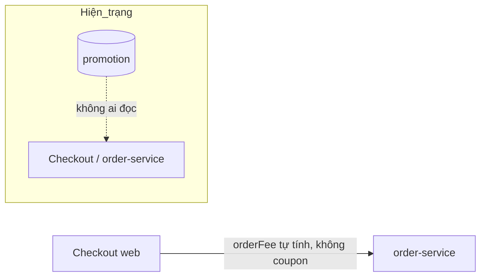
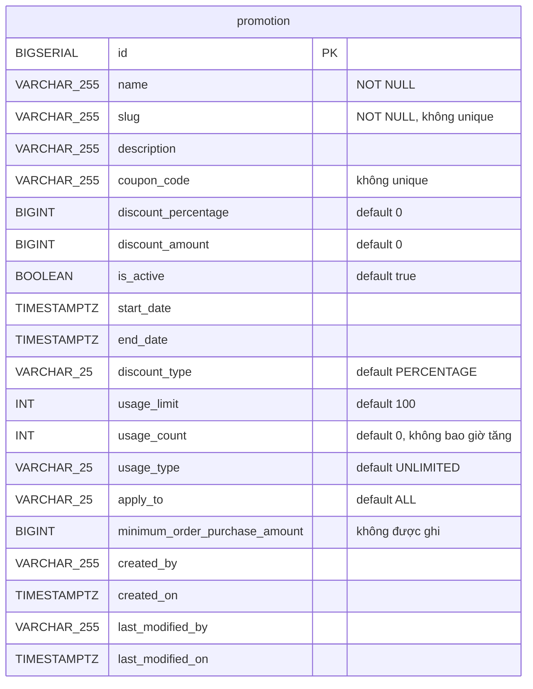

# FEAT-16 — Quản lý khuyến mãi (Promotion management)

> **Phiên bản:** 1.0 · **Trạng thái:** Final · **Cập nhật:** 2026-11-12 · **Phạm vi:** Ứng dụng (as-is)

| Thuộc tính | Giá trị |
| :--- | :--- |
| ID | FEAT-16 |
| Business Requirement | BR-16 |
| Trạng thái | 🟡 **Một phần** — promotion-service có CRUD khuyến mãi (backoffice API) nhưng **không có UI**, không có API áp dụng/kiểm tra coupon, khuyến mãi không ảnh hưởng giá đơn hàng; list/create/update không gọi được qua gateway. |
| Actor | Admin (backoffice API) |
| Ứng dụng / Service | promotion-service (Bun + Hono + Drizzle, port 8093, DB `promotionservice`), APISIX |
| Issue liên quan | ISSUE-01, ISSUE-15, ISSUE-16, ISSUE-21, ISSUE-28, ISSUE-29, ISSUE-30, ISSUE-36, ISSUE-45, ISSUE-46, ISSUE-62, ISSUE-65 |

## 1. Mô tả & mục tiêu nghiệp vụ

Mục tiêu: quản trị viên định nghĩa chương trình khuyến mãi (theo phần trăm hoặc số tiền, có mã coupon, thời gian hiệu lực, giới hạn lượt dùng, phạm vi áp dụng) để giảm giá cho khách khi đặt hàng.

Hiện trạng: chỉ có **lưu trữ dữ liệu khuyến mãi** (tạo, sửa, xóa, xem, lọc theo tên/mã). Không có luồng nào đọc khuyến mãi khi tính giá: checkout (`frontend/apps/web/src/routes/checkout/checkout.remote.ts`) và order-service không gọi promotion-service (ISSUE-21, ISSUE-30). Các trường `brands`, `categories`, `products` trong response luôn là mảng rỗng (`services/promotion-service/src/service.ts:24-26`). README gốc mô tả "coupon" như tính năng đầy đủ — không đúng (ISSUE-45).

## 2. User stories

| ID | Là… | Tôi muốn… | Hiện trạng |
| :--- | :--- | :--- | :--- |
| US-16.1 | Admin | tạo khuyến mãi với tên, mã coupon, loại giảm, mức giảm, thời gian, giới hạn lượt dùng | API có; qua gateway 404 (ISSUE-15) |
| US-16.2 | Admin | xem danh sách khuyến mãi có phân trang, lọc theo tên và mã coupon | API có; qua gateway 404; filter ngày bị bỏ qua (ISSUE-30) |
| US-16.3 | Admin | xem chi tiết 1 khuyến mãi | API có, qua gateway OK |
| US-16.4 | Admin | sửa khuyến mãi | API có (`PUT` không id trên path); qua gateway 404 |
| US-16.5 | Admin | xóa khuyến mãi | API có, qua gateway OK |
| US-16.6 | Customer | nhập mã coupon khi checkout để được giảm giá | **Chưa có** |

## 3. Tiền điều kiện / Hậu điều kiện

**Tiền điều kiện**: promotion-service chạy (`docker-compose.yml:342-359`), DB `promotionservice` có bảng `promotion` (tạo lúc khởi động, `src/db.ts:46-71`). Qua gateway cần Bearer token hợp lệ (route `promotion-backoffice`, `deploy/apisix/apisix.yaml:340-351`) — không cần role ADMIN (ISSUE-01).

**Hậu điều kiện**: bản ghi `promotion` được tạo/cập nhật/xóa vật lý. `usage_count` luôn 0; `minimum_order_purchase_amount` luôn giữ default 0; `created_by`/`last_modified_by` không được ghi.

## 4. Luồng nghiệp vụ

### 4.1 Luồng chính

**Tạo khuyến mãi**
1. `POST /promotion/backoffice/promotions` với JSON `PromotionPostVm` (`src/index.ts:85-97`).
2. Validate bằng `PromotionPostVmSchema` (`src/types.ts:3-17`) — chỉ `name` bắt buộc; các trường khác có default.
3. `slug = req.slug || slugify(name)` — `slugify` lowercase, xóa ký tự không phải `\w`/space, thay khoảng trắng bằng `-` (`src/service.ts:30-35`); ký tự tiếng Việt có dấu bị **xóa** (vd "Khuyến mãi Tết" → `khuyn-mi-tt`).
4. Insert; `startDate`/`endDate` chuyển `new Date(...)` nếu có. Trả **201** `PromotionDetailVm` (`src/service.ts:88-110`).

**Danh sách**
1. `GET /promotion/backoffice/promotions?pageNo=0&pageSize=5&promotionName=&couponCode=&startDate=&endDate=` (`src/index.ts:47-68`).
2. Lọc `LOWER(name) LIKE %name%` AND `LOWER(coupon_code) LIKE %code%`; sắp xếp `id DESC`; phân trang `LIMIT/OFFSET` (`src/service.ts:38-80`). `startDate`/`endDate` được nhận nhưng **không dùng**.
3. Trả `{ promotionDetailVmList, totalElements, totalPages }`.

**Chi tiết**: `GET /promotion/backoffice/promotions/{id}` → 200 hoặc 404 `Promotion not found` (`src/index.ts:71-82`).

**Cập nhật**: `PUT /promotion/backoffice/promotions` với body có `id` (`PromotionPutVmSchema`, `src/types.ts:21-23`). Cập nhật **toàn bộ** trường (trường không gửi nhận default của schema, vd `isActive` về `true`, `usageLimit` về `100`), set `last_modified_on` (`src/service.ts:112-136`).

**Xóa**: `DELETE /promotion/backoffice/promotions/{id}` → 200 body rỗng (`src/index.ts:115-125`).

### 4.2 Luồng thay thế

| # | Điều kiện | Hành vi |
| :--- | :--- | :--- |
| A1 | Không gửi `slug` | Tự sinh từ `name` (mất dấu tiếng Việt). |
| A2 | Không gửi `startDate`/`endDate` | Lưu `NULL` (không giới hạn). |
| A3 | `startDate` > `endDate`, coupon trùng | Vẫn lưu (ISSUE-30). |
| A4 | `discountType`/`applyTo`/`usageType` giá trị tùy ý (vd `"ABC"`) | Lưu nếu ≤ 25 ký tự; dài hơn → 500. |
| A5 | Xóa id không tồn tại | 200. |

### 4.3 Luồng ngoại lệ

| # | Tình huống | Kết quả |
| :--- | :--- | :--- |
| X1 | Thiếu `name` hoặc `name = ""`; kiểu sai (vd `discountPercentage: 10.5`) | 400 `{statusCode:"400", message:"Validation error", errors}` |
| X2 | Body không phải JSON | 500 |
| X3 | `PUT` với `id` không tồn tại | `returning()` rỗng → `mapRow(undefined)` ném TypeError → 500 (thay vì 404) (ISSUE-62) |
| X4 | `startDate` không phải ngày hợp lệ | Invalid Date → lỗi DB → 500 |
| X5 | Lỗi DB khi **list** | Bị nuốt trong `try/catch`, trả danh sách rỗng 200 (`src/service.ts:73-79`) |
| X6 | ID path không phải số | 400 `Invalid ID` |
| X7 | Gọi list/create/update qua gateway (`/promotion/backoffice/promotions` không có segment sau) | 404 tại APISIX (ISSUE-15) |

## 5. Sequence diagram

## 6. Màn hình & route (UI)

Chưa có UI. Admin không có mục "Promotions" trong sidebar (`frontend/apps/admin/src/routes/+layout.svelte:39-48`); web checkout không có ô nhập coupon.

## 7. API sử dụng

| Method | Path qua gateway | Path trong service | Gateway | Body / Query | Response |
| :--- | :--- | :--- | :--- | :--- | :--- |
| GET | `/promotion/backoffice/promotions` | `/promotion/backoffice/promotions` hoặc `/backoffice/promotions` | **404** (ISSUE-15) | `pageNo`(0), `pageSize`(5), `promotionName`, `couponCode`, `startDate`*, `endDate`* (*bị bỏ qua) | 200 `PromotionListVm` |
| GET | `/promotion/backoffice/promotions/{id}` | idem | Bearer | — | 200 / 404 |
| POST | `/promotion/backoffice/promotions` | idem | **404** | `PromotionPostVm` | 201 |
| PUT | `/promotion/backoffice/promotions` | idem | **404** | `PromotionPutVm` | 200 |
| DELETE | `/promotion/backoffice/promotions/{id}` | idem | Bearer | — | 200 rỗng |
| GET | — | `/actuator/health`, `/promotion/actuator/health` | — | — | `UP` cố định |

**PromotionPostVm** (`src/types.ts:3-17`):

| Trường | Kiểu | Bắt buộc | Default |
| :--- | :--- | :--- | :--- |
| `name` | string, min 1 | ✔ | — |
| `slug` | string | | `slugify(name)` |
| `description` | string | | `""` |
| `couponCode` | string | | `""` |
| `usageLimit` | int | | 100 |
| `discountType` | string tự do | | `PERCENTAGE` |
| `applyTo` | string tự do | | `ALL` |
| `usageType` | string tự do | | `UNLIMITED` |
| `discountPercentage` | int | | 0 (không giới hạn 0–100) |
| `discountAmount` | int | | 0 (cho phép âm) |
| `isActive` | boolean | | true |
| `startDate`, `endDate` | string (ISO) | | null |

`PromotionDetailVm` thêm `id`, `usageCount`, `brands: []`, `categories: []`, `products: []` (`src/types.ts:27-46`).

## 8. Dữ liệu

Nguồn: `services/promotion-service/src/db.ts:49-70`, `src/schema.ts:4-25`. Không có bảng liên kết promotion↔product/category/brand.

## 9. Business rules & validation

| # | Quy tắc hiện có | Nguồn |
| :--- | :--- | :--- |
| BR16-1 | `name` bắt buộc, không rỗng | `src/types.ts:4` |
| BR16-2 | Các số (`usageLimit`, `discountPercentage`, `discountAmount`) phải là số nguyên JSON | `src/types.ts:8,12,13` |
| BR16-3 | `slug` tự sinh khi thiếu | `src/service.ts:89,113` |
| BR16-4 | List sắp xếp `id DESC`, lọc LIKE không phân biệt hoa thường | `src/service.ts:51-66` |
| BR16-5 | PUT ghi đè toàn bộ trường (không phải PATCH) | `src/service.ts:112-136` |

**Quy tắc chưa có** (ISSUE-30): giới hạn % trong 0–100, `discountAmount ≥ 0`, `startDate < endDate`, coupon unique, enum hợp lệ cho `discountType/applyTo/usageType`, `minimumOrderPurchaseAmount`, kiểm `usageLimit` khi dùng, kiểm `isActive`/thời gian khi áp dụng.

## 10. Xử lý lỗi

Format `{ statusCode, message, errors? }` (ISSUE-29). Lỗi không bắt → 500 kèm `err.message`. List nuốt lỗi DB (trả rỗng) → che giấu sự cố.

## 11. i18n (key chính)

Chưa có UI → không áp dụng.

## 12. Acceptance criteria (Given / When / Then — theo hành vi hiện tại)

| # | Given | When | Then |
| :--- | :--- | :--- | :--- |
| AC-16.1 | Gọi trực tiếp service | POST `{name:"Summer Sale"}` | 201; `slug="summer-sale"`, `discountType="PERCENTAGE"`, `usageLimit=100`, `isActive=true` |
| AC-16.2 | — | POST `{}` | 400 Validation error |
| AC-16.3 | — | POST `{name:"X", discountPercentage:150, startDate:"2026-12-31", endDate:"2026-01-01"}` | 201 (không chặn) |
| AC-16.4 | Có 7 khuyến mãi | GET list `pageNo=1&pageSize=5` | 2 bản ghi có id nhỏ nhất, `totalPages=2` |
| AC-16.5 | Có khuyến mãi bắt đầu 2025 | GET list `startDate=2026-01-01` | Vẫn trả bản ghi đó (filter ngày bị bỏ qua) |
| AC-16.6 | — | PUT `{id: 99999, name:"x"}` | 500 |
| AC-16.7 | Bearer user thường | `DELETE /promotion/backoffice/promotions/1` qua gateway | 200, đã xóa |
| AC-16.8 | Bearer hợp lệ | `GET /promotion/backoffice/promotions` qua gateway | 404 APISIX |
| AC-16.9 | Khách checkout | — | Không có cách nhập coupon; `orderFee` không trừ khuyến mãi |

## 13. Giới hạn & vấn đề đã biết

- **ISSUE-30**: thiếu validate, filter ngày bỏ qua, `usage_count` không tăng, không API apply coupon.
- **ISSUE-21**: checkout/order không tính khuyến mãi.
- **ISSUE-15**: endpoint gốc 404 qua gateway; **ISSUE-01**: không kiểm role.
- **ISSUE-62**: PUT id không tồn tại → 500; xóa không tồn tại → 200; `slugify` xóa ký tự có dấu.
- **ISSUE-28/36/29/16**: schema lúc khởi động, health giả, format lỗi riêng, route OpenAPI chết.
- **ISSUE-45**: README mô tả coupon như đã hoàn thiện.

## 14. Test hiện có

`services/promotion-service/src/index.test.ts:16-36` — list trả 200 (không cần DB vì lỗi bị nuốt), id không phải số → 400, POST `{}` → 400. Không test tạo/sửa/xóa thực tế (ISSUE-46).

## 15. Tham chiếu source

- `services/promotion-service/src/index.ts:45-126` (routes promotion), `:255-259` (đăng ký `/promotion` + root)
- `services/promotion-service/src/service.ts:6-141`
- `services/promotion-service/src/types.ts:3-52`
- `services/promotion-service/src/db.ts:46-71`, `src/schema.ts:4-25`
- `deploy/apisix/apisix.yaml:340-351` (promotion-backoffice), `:136-138` (openapi-promotion)
- `docker-compose.yml:342-359`
