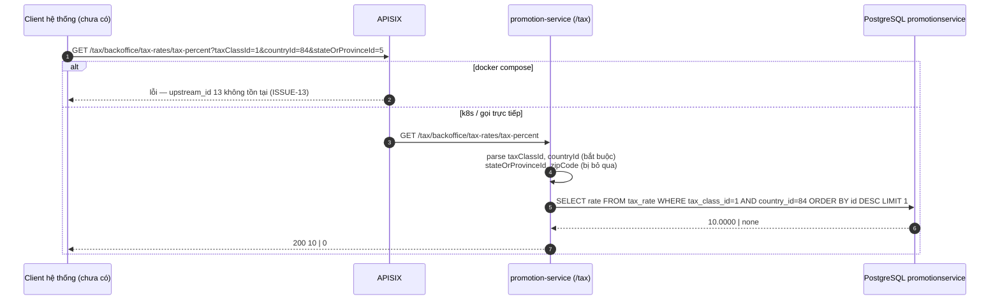
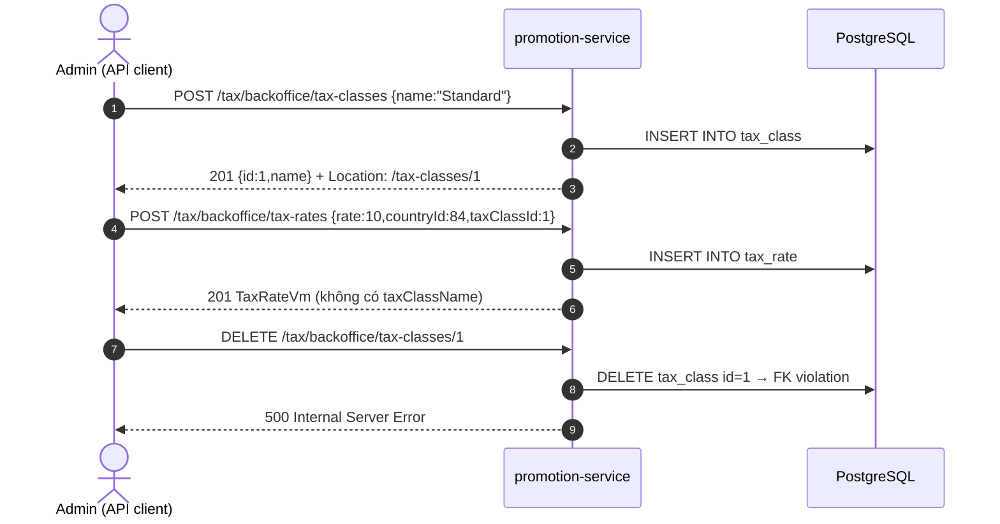
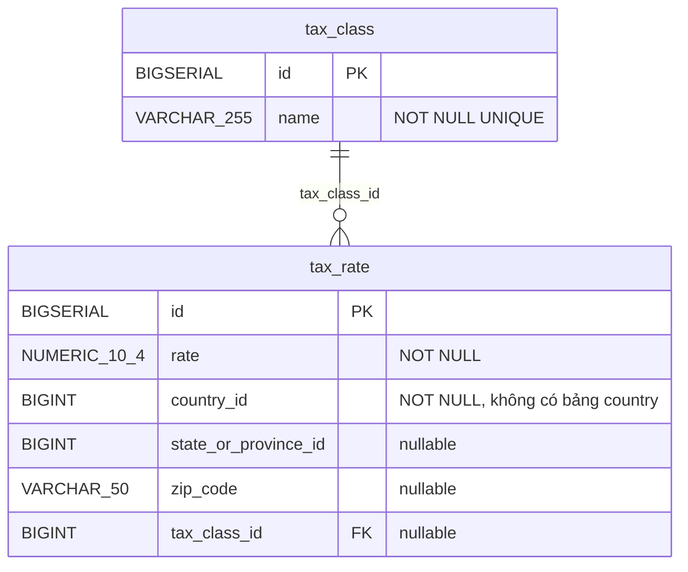

# FEAT-17 — Quản lý thuế (Tax classes / Tax rates / Tax percent)

> **Phiên bản:** 1.0 · **Trạng thái:** Final · **Cập nhật:** 2026-11-12 · **Phạm vi:** Ứng dụng (as-is)

| Thuộc tính | Giá trị |
| :--- | :--- |
| ID | FEAT-17 |
| Business Requirement | BR-17 |
| Trạng thái | 🟡 **Một phần** — module thuế nằm trong promotion-service với CRUD tax class / tax rate và API tra cứu tỷ lệ thuế; **không có UI**, không gọi được qua gateway khi chạy docker compose (upstream 13 không tồn tại), tra cứu bỏ qua tỉnh/zip, không luồng nào dùng thuế khi tính tiền. |
| Actor | Admin (backoffice API), Hệ thống (tra cứu thuế) |
| Ứng dụng / Service | promotion-service (module tax, prefix `/tax`, port 8093, DB `promotionservice`), APISIX |
| Issue liên quan | ISSUE-01, ISSUE-13, ISSUE-15, ISSUE-16, ISSUE-21, ISSUE-27, ISSUE-28, ISSUE-29, ISSUE-31, ISSUE-46, ISSUE-62, ISSUE-65 |

## 1. Mô tả & mục tiêu nghiệp vụ

Mục tiêu: định nghĩa **loại thuế** (tax class, vd "Standard", "Reduced") và **mức thuế** (tax rate) theo quốc gia / tỉnh / mã bưu chính; cung cấp API tra cứu tỷ lệ thuế cho một (hoặc nhiều) tax class tại một địa điểm để tính thuế đơn hàng.

Hiện trạng: không có tax-service riêng — DB `taxservice` được tạo (`deploy/postgres/init/create-all-databases.sql:11`) nhưng **không dùng**; bảng `tax_class`, `tax_rate` nằm trong DB `promotionservice` (`services/promotion-service/src/db.ts:72-87`). Sản phẩm không có trường tax class; checkout không tính thuế (ISSUE-21, ISSUE-31).

## 2. User stories

| ID | Là… | Tôi muốn… | Hiện trạng |
| :--- | :--- | :--- | :--- |
| US-17.1 | Admin | tạo/sửa/xóa/xem tax class (tên duy nhất) | API có, chưa có UI |
| US-17.2 | Admin | xem tax class có phân trang | API có |
| US-17.3 | Admin | tạo/sửa/xóa/xem tax rate gắn với tax class + quốc gia (+ tỉnh, zip tùy chọn) | API có |
| US-17.4 | Hệ thống | tra cứu % thuế cho 1 tax class tại quốc gia/tỉnh/zip | API có; chỉ khớp class + country (ISSUE-31) |
| US-17.5 | Hệ thống | tra cứu hàng loạt tax rate cho nhiều tax class | API có; chỉ khớp country |
| US-17.6 | Customer | thấy thuế trên đơn hàng | **Chưa có** |

## 3. Tiền điều kiện / Hậu điều kiện

- promotion-service chạy; bảng `tax_class`, `tax_rate` được tạo lúc khởi động.
- Qua gateway (compose): route `tax-classes`/`tax-rates` trỏ `upstream_id: 13` **không được định nghĩa** (`deploy/apisix/apisix.yaml:352-375`; danh sách upstream `:1-45` chỉ có 1–6, 8–12) → mọi request lỗi (ISSUE-13). Trên k8s, route tax trỏ sang promotion-service (`deploy/k8s/gateway/02-routes.yaml`, mục `tax-service`).
- Không có route gateway nào cho `/tax/backoffice/tax-rates/tax-percent` riêng — nó khớp `/tax/backoffice/tax-rates/*` (yêu cầu Bearer).
- Hậu điều kiện: bản ghi được ghi/xóa vật lý; tra cứu không ghi gì.

## 4. Luồng nghiệp vụ

### 4.1 Luồng chính

**Tax class**
1. `POST /tax/backoffice/tax-classes` `{ name }` → validate `TaxClassPostVmSchema` (`name` min 1) → insert → **201** `{id, name}` + header `Location: /tax-classes/{id}` (`src/index.ts:152-159`).
2. `GET /tax/backoffice/tax-classes` → toàn bộ, sắp xếp `id ASC` (`src/index.ts:147-150`, `src/tax-service.ts:44-47`).
3. `GET /tax/backoffice/tax-classes/paging?pageNo=0&pageSize=10` → `{ taxClasses, pageNo, pageSize, totalElements, totalPages, isLast }` (`src/tax-service.ts:74-106`).
4. `GET /tax/backoffice/tax-classes/{id}` → 200 / 404 `Tax class not found`.
5. `PUT /tax/backoffice/tax-classes/{id}` `{ name }` → **204** / 404 (`src/index.ts:161-170`).
6. `DELETE /tax/backoffice/tax-classes/{id}` → **204** / 404 (`src/index.ts:172-178`).

**Tax rate**
1. `POST /tax/backoffice/tax-rates` `{ rate, countryId, stateOrProvinceId?, zipCode?, taxClassId }` → 201 + `Location: /tax-rates/{id}` (`src/index.ts:226-233`, `src/tax-service.ts:130-149`).
2. `GET /tax/backoffice/tax-rates` → toàn bộ, LEFT JOIN tax_class để có `taxClassName` (`src/tax-service.ts:110-117`).
3. `GET /tax/backoffice/tax-rates/paging` → `{ taxRates, pageNo, pageSize, totalElements, totalPages, isLast }`.
4. `GET/PUT/DELETE /tax/backoffice/tax-rates/{id}` → 200/204 hoặc 404.

**Tra cứu % thuế (US-17.4)**
1. `GET /tax/backoffice/tax-rates/tax-percent?taxClassId=&countryId=&stateOrProvinceId=&zipCode=` (`src/index.ts:188-198`).
2. `taxClassId`, `countryId` bắt buộc (số). `stateOrProvinceId`, `zipCode` được parse nhưng **không dùng** trong truy vấn.
3. `SELECT rate WHERE tax_class_id = ? AND country_id = ? ORDER BY id DESC LIMIT 1` → trả số (vd `10`), không có → `0` (`src/tax-service.ts:195-209`).

**Tra cứu hàng loạt (US-17.5)**
1. `GET /tax/backoffice/tax-rates/location-based-batch?taxClassIds=1,2&countryId=84` (`src/index.ts:200-211`).
2. Tách `taxClassIds` theo dấu phẩy, bỏ phần tử không phải số. Trả **mọi** tax rate có `country_id = ?` và `tax_class_id IN (...)` (có thể nhiều rate/class) (`src/tax-service.ts:211-231`).

### 4.2 Luồng thay thế

| # | Điều kiện | Hành vi |
| :--- | :--- | :--- |
| A1 | Nhiều rate cùng class + country (khác tỉnh/zip) | `tax-percent` lấy rate có `id` lớn nhất, bất kể tỉnh/zip. |
| A2 | `taxClassIds` toàn ký tự không hợp lệ (vd `a,b`) | Mảng rỗng → `[]` 200. |
| A3 | `rate` âm hoặc > 100 | Vẫn lưu (không ràng buộc). Ý nghĩa đơn vị (% hay hệ số) không được định nghĩa trong code; tên API "tax-percent" gợi ý là %. |
| A4 | Tax rate với `taxClassId` không tồn tại | FK `tax_class_id REFERENCES tax_class(id)` từ chối → 500. |
| A5 | Phân trang khi DB lỗi | Tax class paging nuốt lỗi trả rỗng; tax rate paging **không** nuốt → 500. |

### 4.3 Luồng ngoại lệ

| # | Tình huống | Kết quả |
| :--- | :--- | :--- |
| X1 | Payload sai (thiếu `name`, `rate` không phải số, `countryId` không nguyên) | 400 `{ message: "Invalid payload" }` (không trả chi tiết lỗi) |
| X2 | `name` tax class trùng | Vi phạm UNIQUE → exception không bắt → 500 text `Internal Server Error` của Hono (ISSUE-62) |
| X3 | Xóa tax class đang được tax rate tham chiếu | Vi phạm FK → 500 |
| X4 | Body không phải JSON | 500 |
| X5 | ID path không phải số | 400 `Invalid tax class ID` / `Invalid tax rate ID` |
| X6 | Thiếu `taxClassId`/`countryId` ở tax-percent, thiếu `taxClassIds`/`countryId` ở batch | 400 `... are required` |
| X7 | Gọi qua gateway docker compose | Lỗi do upstream 13 không tồn tại (ISSUE-13) |

Các route tax **không có** `try/catch` (khác route promotion) → lỗi DB trả 500 dạng text mặc định của Hono.

## 5. Sequence diagram

## 6. Màn hình & route (UI)

Chưa có UI (không có trang Tax trong admin; `/settings` chỉ là placeholder — xem FEAT-26).

## 7. API sử dụng

Mọi route được đăng ký cả dưới `/tax` và ở root (`src/index.ts:261-265`). Gateway (compose) chỉ định nghĩa `/tax/backoffice/tax-classes/*` và `/tax/backoffice/tax-rates/*` (Bearer) — path gốc `/tax/backoffice/tax-classes` không có segment sau sẽ 404 kể cả khi upstream đúng (ISSUE-15).

| Method | Path (service, prefix `/tax`) | Mô tả | Response |
| :--- | :--- | :--- | :--- |
| GET | `/backoffice/tax-classes` | Tất cả tax class | `TaxClassVm[]` |
| GET | `/backoffice/tax-classes/paging?pageNo&pageSize` | Phân trang (default 0/10) | `TaxClassListVm` |
| GET | `/backoffice/tax-classes/{id}` | Chi tiết | 200 / 404 |
| POST | `/backoffice/tax-classes` | Tạo | 201 + Location |
| PUT | `/backoffice/tax-classes/{id}` | Sửa | 204 / 404 |
| DELETE | `/backoffice/tax-classes/{id}` | Xóa | 204 / 404 / 500 (FK) |
| GET | `/backoffice/tax-rates` | Tất cả tax rate (kèm `taxClassName`) | `TaxRateVm[]` |
| GET | `/backoffice/tax-rates/paging` | Phân trang | `TaxRateListVm` |
| GET | `/backoffice/tax-rates/tax-percent` | Tra cứu % | `number` |
| GET | `/backoffice/tax-rates/location-based-batch` | Tra cứu nhiều class | `TaxRateVm[]` |
| GET | `/backoffice/tax-rates/{id}` | Chi tiết | 200 / 404 |
| POST | `/backoffice/tax-rates` | Tạo | 201 + Location |
| PUT | `/backoffice/tax-rates/{id}` | Sửa (ghi đè toàn bộ) | 204 / 404 |
| DELETE | `/backoffice/tax-rates/{id}` | Xóa | 204 / 404 |
| GET | `/tax/actuator/health` | Health | `UP` cố định |

**Schema** (`src/tax-types.ts`): `TaxClassPostVm { name: string(min 1) }`; `TaxRatePostVm { rate: number, countryId: int, stateOrProvinceId?: int|null, zipCode?: string|null, taxClassId: int }`; `TaxRateVm { id, rate, countryId, stateOrProvinceId, zipCode, taxClassId, taxClassName? }`; ListVm có `isLast = pageNo >= totalPages - 1`.

## 8. Dữ liệu

`country_id`/`state_or_province_id` là số tự do — không có bảng quốc gia/tỉnh để đối chiếu. `rate` kiểu NUMERIC(10,4) trả về dạng `Number(...)` (ISSUE-27).

## 9. Business rules & validation

| # | Quy tắc | Nguồn |
| :--- | :--- | :--- |
| BR17-1 | Tên tax class bắt buộc, duy nhất (ràng buộc DB) | `src/tax-types.ts:3-5`, `src/db.ts:73-76` |
| BR17-2 | Tax rate phải có `rate` (số), `countryId` (nguyên), `taxClassId` (nguyên, tồn tại) | `src/tax-types.ts:23-29`, FK `src/db.ts:85` |
| BR17-3 | `rate` độ chính xác tối đa 4 chữ số thập phân, 10 chữ số tổng | `src/db.ts:81` |
| BR17-4 | Tra cứu thuế khớp **chỉ** `taxClassId` + `countryId`, lấy rate mới nhất (`id` lớn nhất) | `src/tax-service.ts:201-208` |
| BR17-5 | Không có rate phù hợp → thuế 0 | `src/tax-service.ts:207` |
| BR17-6 | Phân trang mặc định `pageSize=10`; không giới hạn tối đa | `src/index.ts:133-134,182-183` |

## 10. Xử lý lỗi

Format lỗi tax: `{ message }` (khác format `{statusCode,message}` của promotion trong cùng service — ISSUE-29). Exception không bắt → `500 Internal Server Error` (text/plain). Payload sai chỉ báo `Invalid payload` không có chi tiết.

## 11. i18n (key chính)

Chưa có UI → không áp dụng.

## 12. Acceptance criteria (Given / When / Then — theo hành vi hiện tại)

| # | Given | When | Then |
| :--- | :--- | :--- | :--- |
| AC-17.1 | Gọi trực tiếp service | POST tax class `{name:"Standard"}` | 201 + `Location: /tax-classes/{id}` |
| AC-17.2 | Đã có "Standard" | POST `{name:"Standard"}` | 500 |
| AC-17.3 | Rate A(class 1, country 84, state 5, id 1, 8%) và B(class 1, country 84, state 7, id 2, 10%) | tax-percent `taxClassId=1&countryId=84&stateOrProvinceId=5` | `10` (không phải 8) |
| AC-17.4 | Không có rate | tax-percent class 9 country 1 | `0` |
| AC-17.5 | — | tax-percent thiếu `countryId` | 400 |
| AC-17.6 | Class 1 có rate | DELETE class 1 | 500 |
| AC-17.7 | docker compose | `GET /tax/backoffice/tax-classes/1` qua APISIX | Lỗi upstream (ISSUE-13) |
| AC-17.8 | — | PUT tax rate id không tồn tại | 404 `Tax rate not found` |
| AC-17.9 | Khách checkout | — | Không có thuế trong tổng tiền |

## 13. Giới hạn & vấn đề đã biết

- **ISSUE-13**: upstream 13 không tồn tại ở compose → không gọi được qua gateway.
- **ISSUE-31**: bỏ qua tỉnh/zip; DB `taxservice` thừa.
- **ISSUE-21**: không tích hợp vào checkout/order; sản phẩm không có tax class.
- **ISSUE-62**: route tax không bắt exception (trùng tên, FK) → 500; thông báo lỗi validate không chi tiết; không kiểm phạm vi `rate`.
- **ISSUE-01 / ISSUE-15 / ISSUE-16 / ISSUE-28 / ISSUE-29**.
- API tra cứu nằm dưới `/backoffice` và cần Bearer → storefront/BFF không có endpoint public để tính thuế.

## 14. Test hiện có

`services/promotion-service/src/index.test.ts:12-54`: health `/tax/actuator/health`, tax-percent thiếu tham số → 400, batch thiếu tham số → 400, tax-classes paging → 200 (lỗi DB bị nuốt). Không test CRUD thực (ISSUE-46).

## 15. Tham chiếu source

- `services/promotion-service/src/index.ts:130-253` (routes tax), `:261-265`
- `services/promotion-service/src/tax-service.ts:13-232`
- `services/promotion-service/src/tax-types.ts:1-50`
- `services/promotion-service/src/db.ts:72-87`, `src/schema.ts:27-39`
- `deploy/apisix/apisix.yaml:352-375` (tax routes, upstream 13), `:139-141`
- `deploy/postgres/init/create-all-databases.sql:11`
