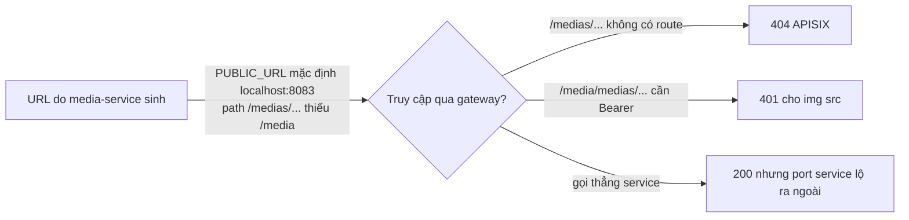
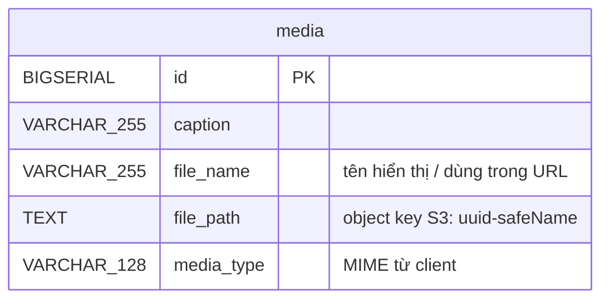

# FEAT-18 — Quản lý media (upload / stream)

> **Phiên bản:** 1.0 · **Trạng thái:** Final · **Cập nhật:** 2026-11-12 · **Phạm vi:** Ứng dụng (as-is)

| Thuộc tính | Giá trị |
| :--- | :--- |
| ID | FEAT-18 |
| Business Requirement | BR-18 |
| Trạng thái | 🟡 **Một phần** — media-service upload file lên RustFS (S3) và lưu metadata, xem/xóa/stream được; nhưng **không có UI** (admin nhập `imageUrl` dạng text), URL file sinh ra không dùng được qua gateway, không giới hạn kích thước/loại file, bucket không tự tạo. |
| Actor | Admin (API), Hệ thống |
| Ứng dụng / Service | media-service (Bun + Hono + Drizzle, port 8083, DB `mediaservice`), RustFS (S3-compatible, port 9000/9001), APISIX |
| Issue liên quan | ISSUE-01, ISSUE-15, ISSUE-16, ISSUE-28, ISSUE-29, ISSUE-32, ISSUE-36, ISSUE-46, ISSUE-63, ISSUE-65 |

## 1. Mô tả & mục tiêu nghiệp vụ

Lưu trữ hình ảnh/tệp cho sản phẩm, danh mục… trên object storage; trả metadata và URL để frontend hiển thị.

Hiện trạng: media-service hoạt động độc lập. product-service lưu `image_url VARCHAR(255)` dạng chuỗi tự do, **không** tham chiếu `media.id`; form admin sản phẩm/danh mục chỉ có ô nhập "URL hình ảnh" (`frontend/apps/admin/src/routes/products/+page.svelte:281-287`, `categories/+page.svelte:180-186`). Không có client media trong `frontend/packages/lib/src/server/api.ts`.

## 2. User stories

| ID | Là… | Tôi muốn… | Hiện trạng |
| :--- | :--- | :--- | :--- |
| US-18.1 | Admin | upload một file (kèm caption, tên file tùy chọn) | API có (multipart), qua gateway 404 (ISSUE-15) |
| US-18.2 | Admin/Hệ thống | lấy metadata + URL của một media | API có |
| US-18.3 | Hệ thống | lấy metadata nhiều media theo danh sách id | API có, qua gateway 404 |
| US-18.4 | Người dùng | tải/xem nội dung file | API có (stream), URL sinh ra sai prefix và cần Bearer (ISSUE-63) |
| US-18.5 | Admin | xóa media (cả object S3 và metadata) | API có |
| US-18.6 | Admin | chọn/upload ảnh trong form sản phẩm | **Chưa có** |

## 3. Tiền điều kiện / Hậu điều kiện

**Tiền điều kiện**
- RustFS chạy (`docker-compose.yml:99-121`), bucket `STORAGE_BUCKET` **đã tồn tại**. Compose không có job tạo bucket; `initStorage` chỉ `list` thử và log cảnh báo nhắc `storage-init` (không tồn tại) (`services/media-service/src/storage.ts:18-31`, ISSUE-32).
- Biến môi trường: `STORAGE_ENDPOINT`, `STORAGE_REGION`, `STORAGE_ACCESS_KEY`, `STORAGE_SECRET_KEY`, `STORAGE_BUCKET`, `PUBLIC_URL` (không set trong compose → default `http://localhost:8083`) (`src/storage.ts:3-7`, `src/service.ts:21`, `docker-compose.yml:317-341`). Giá trị secret: xem `.env` (không ghi ở đây).
- Qua gateway: Bearer token (route `media`, `deploy/apisix/apisix.yaml:316-327`).

**Hậu điều kiện**
- Upload: object key `<uuid>-<tên an toàn>` trong bucket + 1 dòng `media`.
- Xóa: object bị `unlink` (lỗi chỉ log) + dòng `media` bị xóa.

## 4. Luồng nghiệp vụ

### 4.1 Luồng chính

**Upload (US-18.1)**
1. `POST /media/medias` `multipart/form-data` với field `multipartFile` (hoặc `file`), `caption?`, `fileNameOverride?` (`src/index.ts:42-57`).
2. Không phải `File` → 400 `File is required`.
3. `saveMedia` (`src/service.ts:33-57`): `fileName = fileNameOverride.trim() || file.name || "upload.bin"`; `mediaType = file.type || application/octet-stream`; key = `crypto.randomUUID() + "-" + fileName` với ký tự ngoài `[a-zA-Z0-9._-]` thay bằng `_`.
4. Đọc **toàn bộ** file vào bộ nhớ (`file.arrayBuffer()`), `s3.write(key, bytes, {type})` (một lần PUT, không multipart) (`src/storage.ts:33-35`).
5. Insert `media(caption, file_name, file_path=key, media_type)` → 200 `{ id, caption, fileName, mediaType }` (không có `url`).

**Xem metadata (US-18.2/18.3)**
- `GET /media/medias/{id}` → `{ id, caption, fileName, mediaType, url }`, `url = ${PUBLIC_URL}/medias/{id}/file/{encodeURIComponent(fileName)}` (`src/service.ts:23-25,70-84`).
- `GET /media/medias?ids=1,2,3` → mảng `MediaVm`; id không hợp lệ bị lọc bỏ; không tìm thấy gì → 404 `No medias found` (`src/index.ts:91-110`).

**Stream file (US-18.4)**
1. `GET /media/medias/{id}/file/{fileName}` (`src/index.ts:113-130`).
2. Tìm media; nếu `file_name` khác `fileName` (so sánh **không phân biệt hoa thường**) → 404.
3. Kiểm object tồn tại (`file.exists()`), trả `ReadableStream` với `Content-Type = media_type`, `Content-Disposition: attachment; filename="<fileName>"` (`src/storage.ts:45-51`).

**Xóa (US-18.5)**
1. `DELETE /media/medias/{id}` → lấy `file_path`, `s3.unlink` (nuốt lỗi), `DELETE FROM media` → **204** (`src/service.ts:59-68`).

### 4.2 Luồng thay thế

| # | Điều kiện | Hành vi |
| :--- | :--- | :--- |
| A1 | Gửi `fileNameOverride` | Dùng làm `file_name` (ảnh hưởng URL và tên tải về). |
| A2 | Xóa id không tồn tại | 204. |
| A3 | Object đã mất trên S3 nhưng metadata còn | `GET .../file/...` → 404 `File not found`; `GET /medias/{id}` vẫn trả metadata + URL. |
| A4 | `ids` gồm cả id tồn tại và không | Trả các bản ghi tìm thấy (200). |

### 4.3 Luồng ngoại lệ

| # | Tình huống | Kết quả |
| :--- | :--- | :--- |
| X1 | Bucket chưa tạo / RustFS không truy cập được | `s3.write` ném lỗi → 500 `{statusCode:"500", message}` |
| X2 | Upload S3 thành công nhưng insert DB lỗi | 500; object mồ côi trên S3 (không rollback) |
| X3 | File rất lớn | Không giới hạn kích thước → đọc hết vào RAM (rủi ro OOM, ISSUE-32) |
| X4 | `caption`/`fileName` > 255 ký tự | Lỗi DB → 500 (object đã upload, mồ côi) |
| X5 | `ids` thiếu | 400 `ids query param is required` |
| X6 | id path không phải số | 400 `Invalid ID` |
| X7 | Gọi `POST /media/medias` hoặc `GET /media/medias?ids=` qua gateway | 404 — route chỉ khớp `/media/medias/*` (ISSUE-15) |
| X8 | Mở URL trả về trong `` từ browser | Không hoạt động: URL trỏ `PUBLIC_URL/medias/...` (thiếu prefix `/media`, mặc định localhost:8083) và route gateway yêu cầu Bearer (ISSUE-63) |

## 5. Sequence diagram

```mermaid
sequenceDiagram
    autonumber
    actor A as Admin (API client)
    participant MS as media-service
    participant S3 as RustFS bucket
    participant DB as PostgreSQL mediaservice

    A->>MS: POST /media/medias (multipart: multipartFile, caption)
    MS->>MS: kiểm tra File, tính fileName, mediaType, key=uuid-safeName
    MS->>MS: file.arrayBuffer() (toàn bộ vào RAM)
    MS->>S3: PUT key (Content-Type)
    alt S3 lỗi (bucket chưa có)
        MS-->>A: 500
    else OK
        MS->>DB: INSERT media RETURNING *
        MS-->>A: 200 {id, caption, fileName, mediaType}
    end

    A->>MS: GET /media/medias/{id}
    MS->>DB: SELECT
    MS-->>A: {..., url: PUBLIC_URL/medias/{id}/file/{name}}

    actor B as Browser
    B->>MS: GET /medias/{id}/file/{name} (trực tiếp port 8083)
    MS->>DB: SELECT; so khớp fileName (case-insensitive)
    MS->>S3: exists? → stream
    MS-->>B: 200 stream, Content-Disposition: attachment
```



## 6. Màn hình & route (UI)

Chưa có UI upload. Admin chỉ có trường text `imageUrl` cho sản phẩm và danh mục (FEAT-23, FEAT-24); ảnh hiển thị bằng `` với URL bất kỳ.

## 7. API sử dụng

Đăng ký dưới `/media` và root (`src/index.ts:133-137`).

| Method | Path qua gateway | Path service | Gateway | Request | Response |
| :--- | :--- | :--- | :--- | :--- | :--- |
| POST | `/media/medias` | `/media/medias`, `/medias` | **404** | multipart `multipartFile`/`file`, `caption`, `fileNameOverride` | 200 `NoFileMediaVm` |
| GET | `/media/medias?ids=` | idem | **404** | `ids` CSV | 200 `MediaVm[]` / 404 |
| GET | `/media/medias/{id}` | idem | Bearer | — | 200 `MediaVm` / 404 |
| DELETE | `/media/medias/{id}` | idem | Bearer | — | 204 |
| GET | `/media/medias/{id}/file/{fileName}` | idem | Bearer | — | 200 stream / 404 |
| GET | — | `/actuator/health`, `/media/actuator/health` | — | — | `{status:"UP", components:{db,storage}}` cố định |

## 8. Dữ liệu



Nguồn: `src/db.ts:46-61`, `src/schema.ts:4-10`. Không có cột kích thước, người tạo, thời gian, checksum.

## 9. Business rules & validation

| # | Quy tắc | Nguồn |
| :--- | :--- | :--- |
| BR18-1 | Upload bắt buộc có field file (`multipartFile` ưu tiên, fallback `file`) | `src/index.ts:45-48` |
| BR18-2 | Object key duy nhất nhờ UUID; tên được làm sạch `[^a-zA-Z0-9._-]` → `_` | `src/service.ts:27-30` |
| BR18-3 | MIME lấy từ client (`file.type`), không kiểm tra nội dung | `src/service.ts:35` |
| BR18-4 | Không giới hạn kích thước, không whitelist loại file | ISSUE-32 |
| BR18-5 | Stream yêu cầu `fileName` trong URL khớp `file_name` (không phân biệt hoa thường) | `src/service.ts:108-110` |
| BR18-6 | Luôn trả `Content-Disposition: attachment` (trình duyệt tải về thay vì hiển thị khi mở trực tiếp) | `src/index.ts:124` |

## 10. Xử lý lỗi

`{ statusCode, message }` (ISSUE-29); mọi exception → 500 kèm `err.message`. Lỗi xóa object S3 chỉ log warning. Health luôn UP kể cả khi S3/DB hỏng (ISSUE-36).

## 11. i18n (key chính)

Chưa có UI → không áp dụng.

## 12. Acceptance criteria (Given / When / Then — theo hành vi hiện tại)

| # | Given | When | Then |
| :--- | :--- | :--- | :--- |
| AC-18.1 | Bucket tồn tại, gọi trực tiếp service | POST multipart `multipartFile=a.png` | 200 `{id, fileName:"a.png", mediaType:"image/png"}` |
| AC-18.2 | — | POST JSON `{}` | 400 `File is required` |
| AC-18.3 | Bucket chưa tạo | POST hợp lệ | 500 |
| AC-18.4 | Media id 5 tên `A.png` | `GET /medias/5/file/a.png` | 200 stream (khớp không phân biệt hoa thường) |
| AC-18.5 | Media id 5 | `GET /medias/5/file/other.png` | 404 `File not found` |
| AC-18.6 | `PUBLIC_URL` không set | `GET /medias/5` | `url = http://localhost:8083/medias/5/file/A.png` |
| AC-18.7 | Bearer hợp lệ | `GET /media/medias/5` qua gateway | 200 |
| AC-18.8 | Bearer hợp lệ | `POST /media/medias` qua gateway | 404 |
| AC-18.9 | — | `DELETE /medias/999999` | 204 |

## 13. Giới hạn & vấn đề đã biết

- **ISSUE-32**: không giới hạn size/MIME, đọc cả file vào RAM, không multipart upload, `PUBLIC_URL` không set, không tạo bucket.
- **ISSUE-63**: URL sinh ra thiếu `/media` và route gateway bắt Bearer → không dùng làm `` công khai; `Content-Disposition: attachment`.
- **ISSUE-15**: upload và lấy nhiều media 404 qua gateway; **ISSUE-01**: không kiểm role.
- Không liên kết media với product/category; không có UI upload.
- Upload không giao dịch: lỗi DB để lại object mồ côi.

## 14. Test hiện có

`services/media-service/src/index.test.ts:4-41`: health (2), list thiếu `ids` → 400, id không hợp lệ → 400, POST JSON không file → 400. Không test upload/stream với S3 (ISSUE-46).

## 15. Tham chiếu source

- `services/media-service/src/index.ts:40-137`
- `services/media-service/src/service.ts:21-119`
- `services/media-service/src/storage.ts:1-51`
- `services/media-service/src/db.ts:46-61`, `src/schema.ts:4-10`
- `deploy/apisix/apisix.yaml:316-327` (media), `:127-129`
- `docker-compose.yml:99-121` (rustfs), `:317-341` (media-service)
