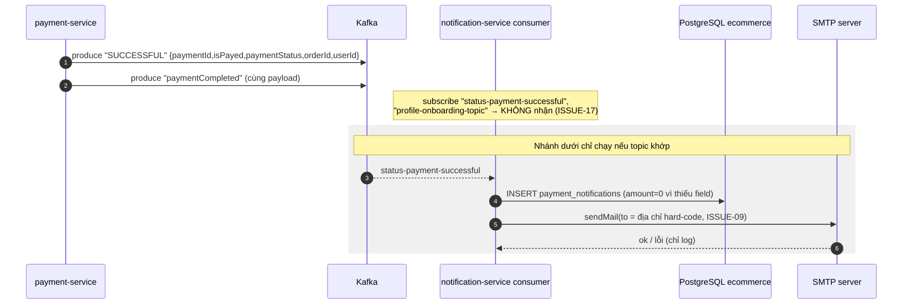
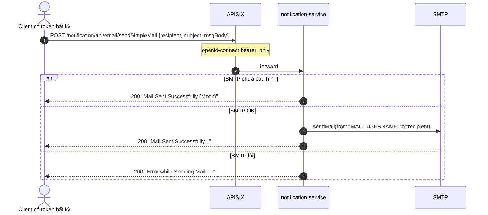
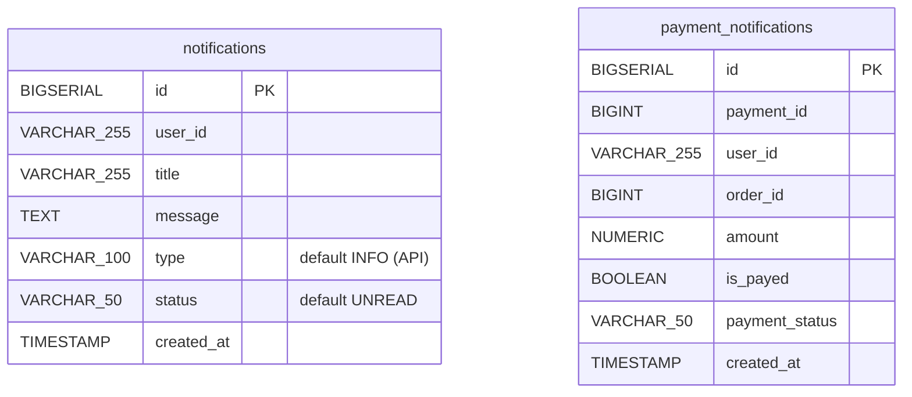

# FEAT-19 — Thông báo & email (Notifications & Email)

> **Phiên bản:** 1.0 · **Trạng thái:** Final · **Cập nhật:** 2026-11-12 · **Phạm vi:** Ứng dụng (as-is)

| Thuộc tính | Giá trị |
| :--- | :--- |
| ID | FEAT-19 |
| Business Requirement | BR-19 |
| Trạng thái | 🟡 **Một phần** — notification-service có HTTP API gửi email/CRUD thông báo và Kafka consumer, nhưng consumer nghe **sai topic** nên không nhận sự kiện nào; email thanh toán gửi tới địa chỉ hard-code; không có UI; danh sách thông báo không lọc theo user. |
| Actor | Hệ thống (Kafka consumer), Client có token (HTTP API) |
| Ứng dụng / Service | notification-service (Bun + Hono + Drizzle + kafkajs + nodemailer, port 8090, DB `ecommerce`), Kafka, SMTP (mặc định Gmail), payment-service (producer) |
| Issue liên quan | ISSUE-01, ISSUE-09, ISSUE-15, ISSUE-17, ISSUE-18, ISSUE-28, ISSUE-33, ISSUE-36, ISSUE-43, ISSUE-46, ISSUE-64, ISSUE-80, ISSUE-65 |

## 1. Mô tả & mục tiêu nghiệp vụ

Mục tiêu: gửi email cho khách (chào mừng khi đăng ký, xác nhận thanh toán), lưu thông báo trong ứng dụng và lịch sử thông báo thanh toán.

Hiện trạng (as-is):
- **Email**: 3 endpoint HTTP gửi email văn bản qua SMTP (nodemailer). Không cấu hình `MAIL_USERNAME`/`MAIL_PASSWORD` → gửi "mock" (chỉ log) (`services/notification-service/src/mailer.ts:9-33`).
- **Kafka**: subscribe `profile-onboarding-topic` và `status-payment-successful` (`src/kafka.ts:23`); payment-service lại publish vào `SUCCESSFUL` và `paymentCompleted` (`services/payment-service/internal/service/payment_service.go:18-21,108-118`) → **không message nào tới** (ISSUE-17). Không ai produce `profile-onboarding-topic`.
- **Thông báo in-app**: CRUD bảng `notifications`, nhưng không có UI, không lọc theo user (ISSUE-33). Type `Notification` frontend không dùng (ISSUE-43).

## 2. User stories

| ID | Là… | Tôi muốn… | Hiện trạng |
| :--- | :--- | :--- | :--- |
| US-19.1 | Customer | nhận email xác nhận khi thanh toán thành công | ⛔ topic lệch; nếu khớp thì email gửi tới địa chỉ hard-code (ISSUE-09) |
| US-19.2 | Customer mới | nhận email chào mừng | ⛔ không có producer |
| US-19.3 | Hệ thống/Service khác | gửi email tùy ý qua API | ✅ API có (open relay — ISSUE-64) |
| US-19.4 | Customer | xem thông báo của tôi | 🟡 API trả **mọi** thông báo; không có UI |
| US-19.5 | Admin/Hệ thống | xem lịch sử thông báo thanh toán | 🟡 API có, list 404 qua gateway |

## 3. Tiền điều kiện / Hậu điều kiện

**Tiền điều kiện**: notification-service chạy (`docker-compose.yml:383-405`) với `POSTGRES_DB=ecommerce` (DB dùng chung, không phải DB riêng — ISSUE-33), `KAFKA_SERVERS`, tùy chọn `MAIL_HOST` (default `smtp.gmail.com`), `MAIL_PORT` (587), `MAIL_USERNAME`, `MAIL_PASSWORD`, `PAYMENT_KAFKA_CONSUMER_GROUP_ID` (default `notification-group`). Qua gateway cần Bearer (`deploy/apisix/apisix.yaml:280-315`).

**Hậu điều kiện**: email đã gửi (hoặc log mock); dòng mới trong `notifications`/`payment_notifications`.

## 4. Luồng nghiệp vụ

### 4.1 Luồng chính

**A. Sự kiện thanh toán (thiết kế trong code)** — `src/kafka.ts:27-56`
1. Khi khởi động, `initKafka()` (không await, `src/index.ts:198`) kết nối Kafka, consumer group `notification-group`, subscribe 2 topic, `fromBeginning: false`.
2. Message trên `status-payment-successful`: parse JSON → insert `payment_notifications(payment_id, user_id, order_id, amount, is_payed, payment_status)` với default `amount=0`, `isPayed=true`, `paymentStatus="SUCCESS"`.
3. Gửi email tới **một địa chỉ cá nhân hard-code** (`src/kafka.ts:52`, ISSUE-09), subject `Payment Successful in Order with userId: <userId>`, body text gồm `IsPayed`, `Status`, thời gian.
4. Message trên `profile-onboarding-topic`: gửi email tới `recipient`/`email` trong payload (fallback `customer@ecommerce.local`), subject/body từ payload hoặc mặc định "Welcome to Ecommerce!".

> Thực tế: payment-service publish `KafkaPaymentDto {paymentId, isPayed, paymentStatus, orderId, userId}` (không có `amount`) vào topic `SUCCESSFUL`/`paymentCompleted` → bước 2–4 **không bao giờ chạy** (ISSUE-17, ISSUE-80).

**B. Gửi email qua HTTP** — `src/index.ts:42-72`
- `POST /notification/api/email/sendSimpleMail` body `{recipient, subject, msgBody}` → `sendEmail` → text `Mail Sent Successfully...`.
- `POST /notification/api/email/sendMailWithAttachment` — giống hệt sendSimpleMail; trường `attachment` **bị bỏ qua** (ISSUE-33).
- `POST /notification/api/email/sendMail?to=&subject=&body=` — tham số qua query string (subject default `Notification`).

**C. Thông báo in-app** — `src/index.ts:75-122`
- `GET /api/notifications` → **toàn bộ** bảng, `id DESC`.
- `GET /api/notifications/{id}` → 200 / 404 body rỗng.
- `POST /api/notifications` `{userId, title, message, type, status}` → 201 (default `type=INFO`, `status=UNREAD`).
- `DELETE /api/notifications/{id}` → `true`.

**D. Thông báo thanh toán** — `src/index.ts:125-185`
- `GET /api/payment-notifications`, `GET /api/payment-notifications/{paymentId}` (khớp `payment_id` **hoặc** `id`), `POST` (200, không phải 201), `DELETE /{paymentId}` (xóa theo `payment_id` hoặc `id` → có thể xóa nhầm bản ghi khác) → 204.

### 4.2 Luồng thay thế

| # | Điều kiện | Hành vi |
| :--- | :--- | :--- |
| A1 | Không cấu hình SMTP | `sendEmail` trả `Mail Sent Successfully (Mock)`, chỉ log. |
| A2 | Kafka không sẵn sàng lúc khởi động | Log warning, service chạy tiếp **không có consumer**; không retry kết nối lại (ISSUE-65). |
| A3 | `sendMail` thiếu `to` | Gọi SMTP với recipient rỗng → nodemailer lỗi → trả 200 text `Error while Sending Mail: ...` (hoặc mock nếu không SMTP). |
| A4 | DB lỗi khi list | Trả `[]` 200. |

### 4.3 Luồng ngoại lệ

| # | Tình huống | Kết quả |
| :--- | :--- | :--- |
| X1 | SMTP từ chối/timeout | `sendEmail` bắt lỗi, trả chuỗi `Error while Sending Mail: <msg>` → HTTP **200** (ISSUE-64) |
| X2 | Body không phải JSON ở sendSimpleMail | 500 text `Error: ...` |
| X3 | Message Kafka không phải JSON / insert lỗi | Log error, message bị bỏ qua (offset vẫn commit) — không retry/DLQ (ISSUE-80) |
| X4 | `GET /api/notifications/abc` | `parseInt` → NaN → truy vấn lỗi → 500 body rỗng |
| X5 | Gọi `GET/POST /notification/api/notifications` (không segment sau) qua gateway | 404 — route chỉ `/notification/api/notifications/*` (ISSUE-15); tương tự `payment-notifications` |

## 5. Sequence diagram

## 6. Màn hình & route (UI)

Chưa có UI (không có chuông thông báo ở web header, không có trang notifications ở admin).

## 7. API sử dụng

Đăng ký dưới `/notification` và root (`src/index.ts:188-192`).

| Method | Path (gateway = service, prefix `/notification`) | Gateway | Request | Response |
| :--- | :--- | :--- | :--- | :--- |
| POST | `/notification/api/email/sendSimpleMail` | Bearer | `{recipient, subject, msgBody}` | 200 text |
| POST | `/notification/api/email/sendMailWithAttachment` | Bearer | như trên (+`attachment` bị bỏ qua) | 200 text |
| POST | `/notification/api/email/sendMail?to&subject&body` | Bearer | query | 200 text |
| GET | `/notification/api/notifications` | **404** | — | `Notification[]` |
| GET | `/notification/api/notifications/{id}` | Bearer | — | 200 / 404 |
| POST | `/notification/api/notifications` | **404** | `{userId,title,message,type,status}` | 201 |
| DELETE | `/notification/api/notifications/{id}` | Bearer | — | `true` |
| GET | `/notification/api/payment-notifications` | **404** | — | `PaymentNotification[]` |
| GET | `/notification/api/payment-notifications/{paymentId}` | Bearer | — | 200 / 404 |
| POST | `/notification/api/payment-notifications` | **404** | `{paymentId,userId,orderId,amount,isPayed,paymentStatus}` | 200 |
| DELETE | `/notification/api/payment-notifications/{paymentId}` | Bearer | — | 204 |

**Kafka**

| Topic | Vai trò | Producer thực tế | Payload kỳ vọng |
| :--- | :--- | :--- | :--- |
| `status-payment-successful` | consume | **không có** (payment publish `SUCCESSFUL`) | `{paymentId,userId,orderId,amount,isPayed,paymentStatus}` |
| `profile-onboarding-topic` | consume | **không có** | `{recipient\|email, subject, msgBody}` |

## 8. Dữ liệu

Nguồn: `src/db.ts:46-75`, `src/schema.ts:4-23`. Bảng nằm trong DB dùng chung `ecommerce` (`docker-compose.yml`, `POSTGRES_DB: ecommerce`).

## 9. Business rules & validation

| # | Quy tắc | Nguồn |
| :--- | :--- | :--- |
| BR19-1 | Email chỉ dạng text, `from = MAIL_USERNAME` | `src/mailer.ts:36-41` |
| BR19-2 | TLS ngầm định khi `MAIL_PORT=465`, ngược lại STARTTLS | `src/mailer.ts:15` |
| BR19-3 | Không cấu hình SMTP → mock, vẫn báo thành công | `src/mailer.ts:30-33` |
| BR19-4 | Không validate body (recipient, độ dài, định dạng email) | `src/index.ts:42-72` |
| BR19-5 | Thông báo mới mặc định `type=INFO`, `status=UNREAD`; không có API đánh dấu đã đọc | `src/index.ts:104-105` |
| BR19-6 | Consumer chỉ đọc message mới (`fromBeginning:false`) | `src/kafka.ts:23` |

## 10. Xử lý lỗi

Không có format thống nhất: email trả `text/plain`; notifications trả JSON hoặc body rỗng; lỗi Kafka chỉ log. Lỗi SMTP bị che thành HTTP 200. Health luôn UP, không kiểm Kafka/SMTP/DB (ISSUE-36).

## 11. i18n (key chính)

Chưa có UI. Nội dung email hard-code tiếng Anh trong `src/kafka.ts:37-38,53-54`.

## 12. Acceptance criteria (Given / When / Then — theo hành vi hiện tại)

| # | Given | When | Then |
| :--- | :--- | :--- | :--- |
| AC-19.1 | SMTP chưa cấu hình | POST sendSimpleMail hợp lệ | 200 `Mail Sent Successfully (Mock)` |
| AC-19.2 | SMTP sai mật khẩu | POST sendSimpleMail | 200 `Error while Sending Mail: ...` |
| AC-19.3 | Khách thanh toán thành công (payment-service tạo payment) | — | Không có bản ghi `payment_notifications`, không có email (topic lệch) |
| AC-19.4 | Có message JSON trên `status-payment-successful` | consumer xử lý | Insert `amount=0` nếu thiếu; email gửi tới địa chỉ hard-code, không phải khách |
| AC-19.5 | User A và B mỗi người 1 thông báo | A gọi `GET /api/notifications` (trực tiếp service) | Trả cả 2 thông báo |
| AC-19.6 | Bearer hợp lệ | `GET /notification/api/notifications` qua gateway | 404 |
| AC-19.7 | Bearer user thường | POST sendMail `to=bất kỳ@domain` | Email gửi đi từ tài khoản hệ thống (open relay) |
| AC-19.8 | Kafka down lúc khởi động | Kafka lên lại sau đó | Consumer không tự kết nối lại |

## 13. Giới hạn & vấn đề đã biết

- **ISSUE-17**: lệch tên topic; không ai produce onboarding. **ISSUE-18**: payment publish mọi lần tạo payment.
- **ISSUE-09**: email thanh toán tới địa chỉ cá nhân hard-code.
- **ISSUE-33**: không lọc theo user, không mark-as-read, attachment bị bỏ qua, DB dùng chung.
- **ISSUE-64**: email API là open relay cho mọi token. **ISSUE-65**: lỗi SMTP trả 200, DELETE không tồn tại vẫn thành công, payment-notifications khớp `payment_id OR id`.
- **ISSUE-65**: consumer không reconnect nếu Kafka chưa sẵn sàng. **ISSUE-80**: lỗi xử lý message bị nuốt (không retry/DLQ, offset vẫn commit); payload payment thiếu `amount` → luôn lưu 0.
- **ISSUE-15**: endpoint gốc 404 qua gateway; **ISSUE-01**: không kiểm role.
- Không có template HTML/đa ngôn ngữ cho email.

## 14. Test hiện có

`services/notification-service/src/index.test.ts:4-53`: health (2), sendSimpleMail & sendMail trả chứa "Mail Sent Successfully" (mock), list notifications trả mảng (lỗi DB → `[]`). Không test Kafka consumer (ISSUE-46).

## 15. Tham chiếu source

- `services/notification-service/src/index.ts:40-198`
- `services/notification-service/src/kafka.ts:6-65`
- `services/notification-service/src/mailer.ts:1-47`
- `services/notification-service/src/db.ts:46-75`, `src/schema.ts:4-26`
- `services/payment-service/internal/service/payment_service.go:18-21,103-118`; `services/payment-service/internal/model/` (`KafkaPaymentDto`)
- `deploy/apisix/apisix.yaml:280-315`, `:124-126`
- `docker-compose.yml:383-405`
