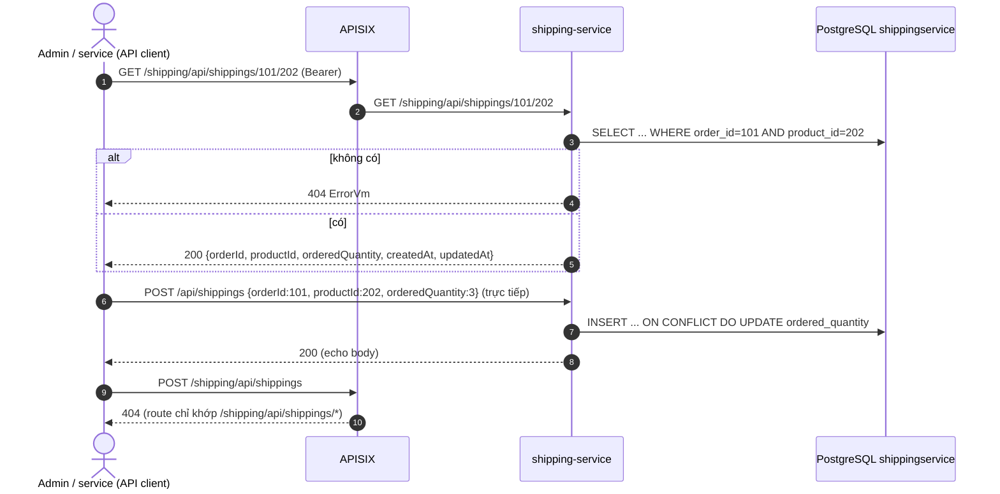
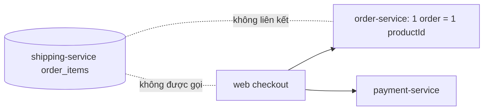
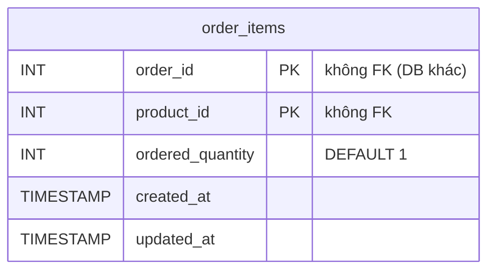

# FEAT-20 — Dòng hàng vận chuyển (Shipping order items)

> **Phiên bản:** 1.0 · **Trạng thái:** Final · **Cập nhật:** 2026-11-12 · **Phạm vi:** Ứng dụng (as-is)

| Thuộc tính | Giá trị |
| :--- | :--- |
| ID | FEAT-20 |
| Business Requirement | BR-20 |
| Trạng thái | 🟡 **Một phần** — shipping-service chỉ là CRUD bảng `order_items (order_id, product_id, ordered_quantity)`; không có vận đơn, đơn vị vận chuyển, phí ship, tracking hay trạng thái giao hàng; không tích hợp với order-service; không có UI (admin `/shipping` là placeholder). |
| Actor | Hệ thống / Admin (API) |
| Ứng dụng / Service | shipping-service (Go + chi + bob/pgx, port 8087, DB `shippingservice`), APISIX |
| Issue liên quan | ISSUE-01, ISSUE-02, ISSUE-15, ISSUE-16, ISSUE-20, ISSUE-22, ISSUE-28, ISSUE-29, ISSUE-35, ISSUE-36, ISSUE-45, ISSUE-46, ISSUE-81 |

## 1. Mô tả & mục tiêu nghiệp vụ

Mục tiêu dài hạn: quản lý giao hàng cho đơn. Hiện trạng: service lưu "order item" — cặp (đơn hàng, sản phẩm) với số lượng đặt. Đây là phần **duy nhất** trong hệ thống lưu số lượng theo dòng sản phẩm, nhưng không ai ghi vào: checkout của web (FEAT-09) chỉ gọi order-service và payment-service. Order-service không có bảng order items (ISSUE-20). README mô tả carrier/tracking/fee — chưa có (ISSUE-45).

## 2. User stories

| ID | Là… | Tôi muốn… | Hiện trạng |
| :--- | :--- | :--- | :--- |
| US-20.1 | Hệ thống | ghi các dòng (orderId, productId, quantity) của một đơn | API có (upsert); không ai gọi |
| US-20.2 | Admin | xem tất cả dòng hàng vận chuyển | API có; 404 qua gateway |
| US-20.3 | Admin | xem / xóa một dòng theo (orderId, productId) | API có |
| US-20.4 | Admin | cập nhật số lượng | API có (PUT = upsert) |
| US-20.5 | Customer/Admin | theo dõi trạng thái giao hàng, phí ship, mã vận đơn | **Chưa có** |

## 3. Tiền điều kiện / Hậu điều kiện

- shipping-service chạy (`docker-compose.yml:260-277`); `InitSchema` tạo bảng `order_items` khi khởi động (`services/shipping-service/internal/repository/shipping_repo.go:28-45`). Không kết nối được DB → service vẫn chạy với pool `nil`, mọi thao tác ghi trả "thành công" giả (ISSUE-28).
- Gateway: route `shipping` `uri: /shipping/api/shippings/*` + Bearer, không proxy-rewrite (`deploy/apisix/apisix.yaml:268-279`).
- Middleware `UserClaims` parse JWT không verify nhưng handler không dùng claims (`main.go:85-86`, ISSUE-02).

## 4. Luồng nghiệp vụ

### 4.1 Luồng chính

Route đăng ký cho hai base `/shipping/api/shippings` và `/api/shippings` (`internal/handler/shipping_handler.go:28-42`).

1. **Danh sách**: `GET {base}` → `SELECT ... ORDER BY order_id DESC` → `{ "collection": [OrderItemDto...] }` (`shipping_handler.go:48-57`, `shipping_repo.go:57-74`).
2. **Xem 1 dòng**: `GET {base}/{orderId}/{productId}` → 200 `OrderItemDto` hoặc 404 `order item not found for orderId: X, productId: Y` (`shipping_handler.go:59-81`, `internal/service/shipping_service.go:26-35`).
3. **Xem theo body**: `GET {base}/find` body JSON `{orderId, productId}` (GET có body — ISSUE-35) (`shipping_handler.go:83-100`).
4. **Tạo**: `POST {base}` body `OrderItemDto` → `INSERT ... ON CONFLICT (order_id, product_id) DO UPDATE SET ordered_quantity, updated_at` → 200 trả lại **chính body request** (không có `createdAt/updatedAt`) (`shipping_repo.go:98-119`, `shipping_service.go:37-43`).
5. **Cập nhật**: `PUT {base}` — gọi y hệt Save (upsert) (`shipping_service.go:45-47`).
6. **Xóa**: `DELETE {base}/{orderId}/{productId}` hoặc `DELETE {base}/delete` body `{orderId, productId}` → 200 `true` (`shipping_handler.go:132-165`).

### 4.2 Luồng thay thế

| # | Điều kiện | Hành vi |
| :--- | :--- | :--- |
| A1 | POST với cặp khóa đã tồn tại | Cập nhật `ordered_quantity` (không lỗi trùng). |
| A2 | PUT với cặp khóa chưa tồn tại | **Tạo mới** (upsert). |
| A3 | Body thiếu `orderedQuantity` | Go zero-value → lưu `0` (DEFAULT 1 không áp dụng vì giá trị được truyền tường minh). |
| A4 | Xóa cặp khóa không tồn tại | 200 `true`. |
| A5 | DB không kết nối | List `[]`, FindByID 404, Save/Delete 200 (giả). |

### 4.3 Luồng ngoại lệ

| # | Tình huống | Kết quả |
| :--- | :--- | :--- |
| X1 | `orderId`/`productId` path không phải số | 400 `{statusCode:"400", title:"Bad request", detail:"Invalid orderId"}` |
| X2 | Body JSON sai | 400 `Invalid request body` |
| X3 | Lỗi DB | 500 `{statusCode:"500", title:"Internal server error", detail:<err>}` |
| X4 | `GET/POST/PUT /shipping/api/shippings` (không segment sau) qua gateway | 404 APISIX (ISSUE-15) |
| X5 | `orderedQuantity` âm, `orderId=0` | Được lưu (ISSUE-81) |

## 5. Sequence diagram

## 6. Màn hình & route (UI)

Chưa có UI. Admin `/shipping` hiển thị component "Tính năng đang phát triển" (FEAT-26).

## 7. API sử dụng

| Method | Path service | Qua gateway | Request | Response |
| :--- | :--- | :--- | :--- | :--- |
| GET | `/shipping/api/shippings` | **404** | — | `{collection: OrderItemDto[]}` |
| GET | `/shipping/api/shippings/find` | Bearer | body `OrderItemId` | 200/404 |
| GET | `/shipping/api/shippings/{orderId}/{productId}` | Bearer | — | 200/404 |
| POST | `/shipping/api/shippings` | **404** | `OrderItemDto` | 200 |
| PUT | `/shipping/api/shippings` | **404** | `OrderItemDto` | 200 |
| DELETE | `/shipping/api/shippings/delete` | Bearer | body `OrderItemId` | 200 `true` |
| DELETE | `/shipping/api/shippings/{orderId}/{productId}` | Bearer | — | 200 `true` |
| GET | `/actuator/health`, `/shipping/actuator/health` | — | — | `UP` cố định |

Tất cả cũng có dưới `/api/shippings` (không prefix). `OrderItemDto` (`internal/model/shipping.go:10-16`): `{orderId:int, productId:int, orderedQuantity:int, createdAt?, updatedAt?}`.

## 8. Dữ liệu

Nguồn: `shipping_repo.go:32-41`. Không có cột địa chỉ, carrier, tracking, trạng thái, phí.

## 9. Business rules & validation

| # | Quy tắc | Nguồn |
| :--- | :--- | :--- |
| BR20-1 | Khóa chính (order_id, product_id) — 1 dòng / sản phẩm / đơn | `shipping_repo.go:39` |
| BR20-2 | POST và PUT đều là upsert | `shipping_repo.go:111-115`, `shipping_service.go:45-47` |
| BR20-3 | Không validate giá trị (số lượng ≥ 1, id > 0) | ISSUE-81 |
| BR20-4 | Không kiểm tra order/product tồn tại | — |
| BR20-5 | List sắp xếp `order_id DESC`, không phân trang | `shipping_repo.go:61-65` |

## 10. Xử lý lỗi

Dùng `ErrorVm {statusCode, title, detail}` (`services/shared/response/response.go:5-34`) — khác envelope `ApiResponse` của auth-service (ISSUE-29). `detail` của 500 chứa nguyên thông điệp lỗi DB.

## 11. i18n (key chính)

Admin chỉ có `shipping_title`, `shipping_metaTitle`, `sidebar_shipping` cho trang placeholder (`frontend/apps/admin/messages/vi.json`). Không có UI nghiệp vụ.

## 12. Acceptance criteria (Given / When / Then — theo hành vi hiện tại)

| # | Given | When | Then |
| :--- | :--- | :--- | :--- |
| AC-20.1 | DB OK, gọi trực tiếp | POST `{orderId:101, productId:202, orderedQuantity:3}` | 200 echo body; bản ghi tồn tại |
| AC-20.2 | Đã có (101,202,3) | POST `{101,202,5}` | 200; số lượng = 5 |
| AC-20.3 | Chưa có (1,1) | PUT `{orderId:1, productId:1}` | 200; tạo mới với số lượng 0 |
| AC-20.4 | — | `GET /api/shippings/abc/def` | 400 |
| AC-20.5 | — | `DELETE /api/shippings/9/9` (không tồn tại) | 200 `true` |
| AC-20.6 | Bearer hợp lệ | `GET /shipping/api/shippings` qua gateway | 404 |
| AC-20.7 | Khách đặt hàng ở web | — | Không có bản ghi `order_items` nào được tạo |

## 13. Giới hạn & vấn đề đã biết

- **ISSUE-20 / ISSUE-22**: order không có dòng hàng/địa chỉ; shipping-service không được dùng trong checkout.
- **ISSUE-81**: thiếu validate, PUT = upsert, xóa không tồn tại vẫn `true`, GET/DELETE có body.
- **ISSUE-15**: list/create/update 404 qua gateway; **ISSUE-01/02**: không kiểm role, claims không verify.
- **ISSUE-28 / ISSUE-36**: chạy khi không có DB, health luôn UP.
- **ISSUE-45**: README mô tả carrier/tracking/fee không có thật.

## 14. Test hiện có

`services/shipping-service/main_test.go:40-68` — chạy với pool `nil`: health (2 path), list 200 (2 path), POST/PUT 200, DELETE 200, path không phải số → 400. Không test với DB thật (ISSUE-46).

## 15. Tham chiếu source

- `services/shipping-service/main.go:26-113`
- `services/shipping-service/internal/handler/shipping_handler.go:23-165`
- `services/shipping-service/internal/service/shipping_service.go:12-51`
- `services/shipping-service/internal/repository/shipping_repo.go:28-134`
- `services/shipping-service/internal/model/shipping.go:5-20`
- `services/shared/response/response.go`, `api_response.go:67-75`
- `deploy/apisix/apisix.yaml:268-279`, `:118-120`
- `docker-compose.yml:260-277`
