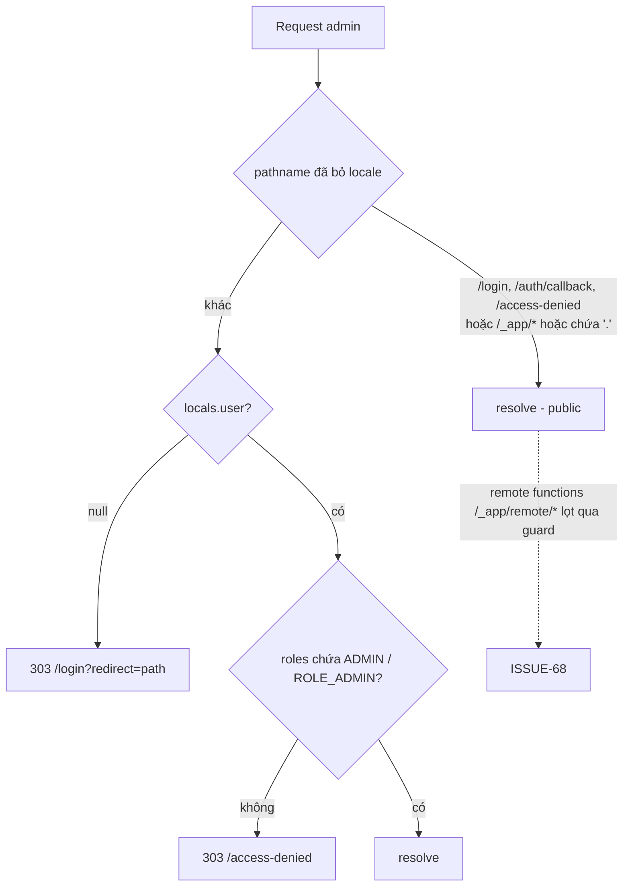
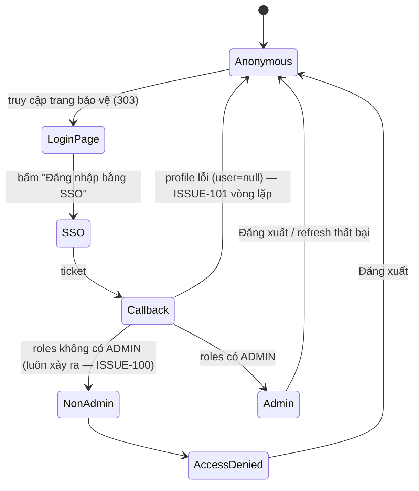

# FEAT-21 — Kiểm soát truy cập backoffice (Admin access control)

> **Phiên bản:** 1.0 · **Trạng thái:** Final · **Cập nhật:** 2026-11-12 · **Phạm vi:** Ứng dụng (as-is)

| Thuộc tính | Giá trị |
| :--- | :--- |
| ID | FEAT-21 |
| Business Requirement | BR-21 |
| Trạng thái | 🟡 **Một phần** — admin app có guard toàn cục (`handleAdminGuard`) + trang `/access-denied`; nhưng role được đọc từ profile auth-service vốn **không trả `roles`** → với backend thật **mọi người** (kể cả admin) bị chuyển tới `/access-denied` (ISSUE-100); guard bỏ qua endpoint remote function (ISSUE-68); backend **không** kiểm tra role (ISSUE-01). |
| Actor | Admin, Customer (bị chặn), Guest (bị chuyển về login) |
| Ứng dụng / Service | `frontend/apps/admin` (SvelteKit BFF, port 3001), `@ecommerce/lib/server` (session), auth-service (`/api/v1/users/me`), Keycloak, APISIX |
| Issue liên quan | ISSUE-01, ISSUE-02, ISSUE-08, ISSUE-11, ISSUE-14, ISSUE-66, ISSUE-67, ISSUE-68, ISSUE-69, ISSUE-100, ISSUE-101, ISSUE-102 |

## 1. Mô tả & mục tiêu nghiệp vụ

Chỉ người có vai trò quản trị (`ADMIN` hoặc `ROLE_ADMIN`) mới được vào backoffice. Khách chưa đăng nhập được đưa tới trang đăng nhập SSO với đường dẫn quay lại; người đã đăng nhập nhưng không phải admin thấy trang "Không có quyền truy cập" và chỉ có thể đăng xuất.

Kiểm soát này **chỉ tồn tại ở tầng frontend admin** (server hook của SvelteKit). Gateway APISIX chỉ xác thực token (`bearer_only`), các service không đọc role (ISSUE-01); một số route ghi (sản phẩm/danh mục) thậm chí không cần token (ISSUE-102).

## 2. User stories

| ID | Là… | Tôi muốn… | Hiện trạng |
| :--- | :--- | :--- | :--- |
| US-21.1 | Guest | khi mở bất kỳ trang admin nào được chuyển tới `/login?redirect=<trang>` | ✅ |
| US-21.2 | Admin | sau đăng nhập SSO quay lại đúng trang đã yêu cầu | ✅ (cookie `auth_redirect`, `safeRedirect`) |
| US-21.3 | Customer (không phải admin) | thấy trang "Không có quyền truy cập" và nút đăng xuất | ✅ |
| US-21.4 | Admin | vào được dashboard và các module | ⛔ với backend thật: `roles` luôn rỗng (ISSUE-100); user chỉ có trong Keycloak → không có profile (ISSUE-101) |
| US-21.5 | Hệ thống | API backoffice từ chối người không phải admin | ⛔ không có kiểm tra role ở gateway/service (ISSUE-01) |

## 3. Tiền điều kiện / Hậu điều kiện

**Tiền điều kiện**
- Cookie phiên do FEAT-01/FEAT-03 tạo: `access_token`, `refresh_token`, `session_user` (JSON `SessionUser`), `session_expires` — httpOnly, `sameSite=lax`, path `/` (`frontend/packages/lib/src/server/session.ts:4-49`).
- `session_user.roles` được lấy **một lần** lúc callback từ `GET /api/v1/users/me` qua `toSessionUser` (`frontend/apps/admin/src/routes/auth/callback/+page.server.ts:19-27`, `session.ts:13-21`).

**Hậu điều kiện**
- Request được phép: tiếp tục render.
- Guest: 303 → `/login?redirect=<path+query>` (localized).
- Không phải admin: 303 → `/access-denied` (localized).

## 4. Luồng nghiệp vụ

### 4.1 Luồng chính

`handle = sequence(handleParaglide, handleSession, handleAdminGuard)` (`frontend/apps/admin/src/hooks.server.ts:79`).

1. **handleParaglide** (`hooks.server.ts:19-30`): xác định locale (URL → cookie → `vi`), thay `%paraglide.lang%`/`%paraglide.dir%` trong HTML.
2. **handleSession** (`hooks.server.ts:32-51`): đọc `session_user`; nếu có và `shouldRefresh` (thiếu access token hoặc còn < 30 giây) → gọi `POST /api/v1/auth/refresh`; thành công → ghi cookie mới (giữ `session_user`); thất bại → `clearSession`. Gán `event.locals.user`.
3. **handleAdminGuard** (`hooks.server.ts:58-77`):
   - Tính `pathname` đã bỏ prefix locale (`deLocalizeUrl`).
   - **Public** nếu: thuộc `PUBLIC_ROUTES = ['/login', '/auth/callback', '/access-denied']` (khớp chính xác hoặc tiền tố `route/`), hoặc bắt đầu bằng `/_app/`, hoặc **chứa dấu `.`** (`:17,60-63`).
   - Không có user → `redirect(303, localizeHref('/login') + '?redirect=' + encodeURIComponent(pathname + search))`.
   - Có user nhưng `!isAdmin(user)` → `redirect(303, localizeHref('/access-denied'))`.
   - Ngược lại → `resolve(event)`.
4. `isAdmin` (`session.ts:23-25`): `true` khi `user.roles` chứa `'ADMIN'` hoặc `'ROLE_ADMIN'`.
5. Trang `/` server load luôn redirect 303 → `/dashboard` (`frontend/apps/admin/src/routes/+page.server.ts:5-7`).

**Đăng nhập (liên quan, chi tiết ở FEAT-01)**: `/login` load (`routes/login/+page.server.ts:8-24`): `target = safeRedirect(?redirect)`; nếu đã có user → 303 tới `target`; ngược lại lưu cookie `auth_redirect` (10 phút) và render nút "Đăng nhập bằng SSO" trỏ `API_PUBLIC_URL/api/v1/auth/login?redirect_uri=<origin>/auth/callback`.

**Trang `/access-denied`** (`routes/access-denied/+page.svelte:1-39`): icon, tiêu đề `access_denied_title`, mô tả `access_denied_text`, nút "Đăng xuất" gọi remote command `logout` → `invalidateAll()` → `goto('/login')`. Layout ẩn sidebar cho 3 route public (`routes/+layout.svelte:27-34,73-75`).

### 4.2 Luồng thay thế

| # | Điều kiện | Hành vi |
| :--- | :--- | :--- |
| A1 | Truy cập `/en/orders?page=2` khi chưa đăng nhập | 303 → `/en/login?redirect=%2Forders%3Fpage%3D2` (redirect lưu path **đã bỏ locale**; sau login `localizeHref(target)` thêm lại locale hiện hành). |
| A2 | `?redirect=//evil.com` hoặc `https://...` | `safeRedirect` thay bằng `/` (`frontend/packages/lib/src/server/redirect.ts:2-5`). |
| A3 | Người không phải admin truy cập `/login` | `locals.user` có → 303 tới target → guard → `/access-denied`. |
| A4 | Refresh token thất bại giữa phiên | Phiên bị xóa → request hiện tại xử lý như guest → `/login`. |
| A5 | Roles thay đổi trên server sau khi đăng nhập | Không phản ánh tới khi đăng nhập lại (roles chỉ lấy ở callback; refresh không cập nhật `session_user`). |

### 4.3 Luồng ngoại lệ

| # | Tình huống | Kết quả hiện tại |
| :--- | :--- | :--- |
| X1 | Backend thật: `/users/me` trả `UserResponse` không có `roles` (`services/auth-service/internal/model/user.go:15-23`) | `toSessionUser` → `roles: []` → **mọi** user (kể cả `adminuser` của realm có role `ADMIN` trong token) bị đưa tới `/access-denied` (ISSUE-100). |
| X2 | User chỉ tồn tại trong Keycloak (vd seed realm), không có trong DB `authservice` | `/users/me` 404 → callback đặt `user = null` → xóa `session_user` nhưng vẫn lưu token → guard coi là guest → `/login` → SSO đã có phiên → callback lại → vòng lặp chuyển hướng (ISSUE-101, ISSUE-67). |
| X3 | Gọi endpoint remote function (`/_app/remote/...`) trực tiếp, không có phiên hoặc không phải admin | Guard bỏ qua (`startsWith('/_app/')`) → remote `saveProduct`/`deleteProduct`/`saveCategory`/`deleteCategory` chạy; vì `/api/products*`, `/api/categories*` không cần token ở gateway (ISSUE-102), thao tác ghi **thành công** (ISSUE-68). |
| X4 | Đường dẫn có dấu `.` (vd `/dashboard/__data.json`) | Được coi là public (ISSUE-68). Hiện các trang chỉ có layout load trả `user`, nên không lộ dữ liệu nghiệp vụ. |
| X5 | Web (`:3000`) và admin (`:3001`) chạy cùng host | Dùng chung tên cookie → phiên của web được admin đọc và ngược lại (ISSUE-11). |
| X6 | Gọi API backoffice trực tiếp tới gateway với token USER | Thành công — không có kiểm tra role (ISSUE-01). |

## 5. Sequence diagram

```mermaid
sequenceDiagram
    autonumber
    actor U as Người dùng
    participant ADM as admin SvelteKit (hooks.server.ts)
    participant GW as APISIX
    participant AU as auth-service

    U->>ADM: GET /orders
    ADM->>ADM: handleParaglide → locale
    ADM->>ADM: handleSession: đọc session_user; refresh nếu cần
    ADM->>ADM: handleAdminGuard
    alt chưa có user
        ADM-->>U: 303 /login?redirect=%2Forders
        U->>ADM: GET /login → cookie auth_redirect=/orders
        U->>GW: /api/v1/auth/login?redirect_uri=<admin>/auth/callback (SSO, FEAT-01)
        GW-->>U: ... 302 <admin>/auth/callback?ticket=T
        U->>ADM: GET /auth/callback?ticket=T
        ADM->>GW: GET /api/v1/auth/session?ticket=T
        GW->>AU: exchange ticket
        AU-->>ADM: tokens
        ADM->>GW: GET /api/v1/users/me (Bearer)
        GW->>AU: GetCurrentUser
        AU-->>ADM: {id, fullname, username, email,...} — KHÔNG có roles
        ADM->>ADM: toSessionUser → roles = []
        ADM-->>U: Set-Cookie session_*; 303 /orders
        U->>ADM: GET /orders
        ADM->>ADM: isAdmin([]) = false
        ADM-->>U: 303 /access-denied (ISSUE-100)
    else user có roles chứa ADMIN (chỉ khi profile trả roles)
        ADM-->>U: 200 trang /orders
    end
```





## 6. Màn hình & route (UI)

| Route | File | Mô tả |
| :--- | :--- | :--- |
| (mọi route) | `frontend/apps/admin/src/hooks.server.ts` | Guard toàn cục |
| `/` | `routes/+page.server.ts` | Redirect `/dashboard` (file `+page.svelte` mặc định không bao giờ hiển thị — ISSUE-43) |
| `/login`, `/en/login` | `routes/login/+page.server.ts`, `+page.svelte` | Thẻ đăng nhập: brand, `login_title`, `login_note` "Chỉ tài khoản quản trị được phép truy cập.", nút SSO |
| `/auth/callback` | `routes/auth/callback/+page.server.ts`, `+page.svelte` | Đổi ticket, lấy profile, ghi cookie; lỗi → thông báo + nút thử lại |
| `/access-denied` | `routes/access-denied/+page.svelte` | Trang 403 (HTTP thực tế 200) với nút đăng xuất |
| Layout | `routes/+layout.svelte` | Sidebar + header (tên `fullName \|\| username`, chọn ngôn ngữ, đăng xuất); ẩn cho 3 route public |

## 7. API sử dụng

| Bước | API (qua gateway) | Auth | Ghi chú |
| :--- | :--- | :--- | :--- |
| Refresh | `POST /api/v1/auth/refresh` `{refreshToken}` | public | `hooks.server.ts:39` |
| Đổi ticket | `GET /api/v1/auth/session?ticket=` | public | callback |
| Profile/role | `GET /api/v1/users/me` | Bearer | trả `UserResponse` không có `roles`, key `fullname` (ISSUE-100) |
| Logout | `POST /api/v1/auth/logout` `{refreshToken}` | public | remote command `frontend/apps/admin/src/lib/remote/auth.remote.ts:6-19` |

## 8. Dữ liệu

`SessionUser` trong cookie `session_user` (`frontend/packages/lib/src/types.ts:48-54`): `{ id, username, fullName?, email?, roles: string[] }`. Vai trò hệ thống: DB `authservice` có `roles` = `USER`(1), `PM`(2), `ADMIN`(3) và bảng `user_role` (`services/auth-service/internal/repository/user_repository.go:36-62`); realm Keycloak có `ADMIN`, `USER`, `MANAGER` — hai nguồn không đồng bộ (ISSUE-08). Frontend không đọc role trong JWT.

## 9. Business rules & validation

| # | Quy tắc | Nguồn |
| :--- | :--- | :--- |
| BR21-1 | Mọi route trừ `/login`, `/auth/callback`, `/access-denied` (và tiền tố con) yêu cầu user | `hooks.server.ts:17,60-70` |
| BR21-2 | Admin = roles chứa `ADMIN` hoặc `ROLE_ADMIN` (phân biệt hoa thường) | `session.ts:23-25` |
| BR21-3 | Đường dẫn quay lại chỉ chấp nhận path nội bộ bắt đầu `/` và không phải `//` | `redirect.ts:2-5` |
| BR21-4 | Redirect dùng mã 303 và giữ locale hiện hành | `hooks.server.ts:69,73` |
| BR21-5 | Cookie `auth_redirect` hết hạn sau 600 giây | `login/+page.server.ts:13-18` |
| BR21-6 | `PM`/`MANAGER` **không** được coi là admin | `session.ts:24` |

## 10. Xử lý lỗi

- Lỗi refresh → xóa phiên im lặng (không thông báo).
- Lỗi đổi ticket → trang callback hiển thị `auth_callbackErrorTitle`/`auth_callbackErrorText` + nút `auth_callbackRetry`.
- Lỗi lấy profile **không** báo lỗi mà tạo phiên không có user (ISSUE-101).
- `/access-denied` trả HTTP 200 (không phải 403).
- Logout lỗi gateway được bỏ qua; cookie vẫn bị xóa.

## 11. i18n (key chính)

`access_denied_title` ("Không có quyền truy cập" / "Access denied"), `access_denied_text`, `login_title`, `login_note`, `login_btn`, `auth_callbackLoading`, `auth_callbackErrorTitle`, `auth_callbackErrorText`, `auth_callbackRetry`, `sidebar_logout`, `meta_title` (`frontend/apps/admin/messages/{vi,en}.json`). Key `auth_redirecting` không được dùng.

## 12. Acceptance criteria (Given / When / Then — theo hành vi hiện tại)

| # | Given | When | Then |
| :--- | :--- | :--- | :--- |
| AC-21.1 | Chưa có cookie phiên | GET `/products?page=1` | 303 `Location: /login?redirect=%2Fproducts%3Fpage%3D1` |
| AC-21.2 | Chưa có phiên, locale en | GET `/en/orders` | 303 `/en/login?redirect=%2Forders` |
| AC-21.3 | `session_user.roles = ["USER"]` | GET `/dashboard` | 303 `/access-denied` |
| AC-21.4 | `session_user.roles = ["ROLE_ADMIN"]` | GET `/dashboard` | 200 |
| AC-21.5 | Đăng nhập SSO bằng tài khoản có role ADMIN (DB và Keycloak) với backend hiện tại | hoàn tất callback | `session_user.roles = []` → bị chuyển `/access-denied` |
| AC-21.6 | User chỉ có trong Keycloak | hoàn tất callback | Không có `session_user` → quay lại `/login` → SSO → lặp |
| AC-21.7 | Không có phiên | GET `/access-denied`, `/login`, `/favicon.svg` | Không bị redirect bởi guard |
| AC-21.8 | Không có phiên | POST trực tiếp tới endpoint remote của `saveProduct` | Guard không chặn; sản phẩm được tạo qua `/api/products` (ISSUE-68 + ISSUE-102) |
| AC-21.9 | Trên trang access-denied | Bấm "Đăng xuất" | Gọi logout, xóa cookie, chuyển `/login` |
| AC-21.10 | `?redirect=//evil.com` | Đăng nhập thành công | Chuyển về `/` |

## 13. Giới hạn & vấn đề đã biết

- **ISSUE-100** (Critical): profile không có `roles` (+ `fullname` lệch `fullName`) → không ai qua được guard với backend thật.
- **ISSUE-101** (High): user không có trong DB `authservice` → phiên không có profile, vòng lặp đăng nhập.
- **ISSUE-68** (High): guard bỏ qua `/_app/*` (bao gồm `/_app/remote/*`) và mọi path có dấu `.`.
- **ISSUE-01** (Critical): backend không kiểm role; **ISSUE-102** (Critical): API ghi catalog không cần token.
- **ISSUE-08**: role ở DB auth và Keycloak không đồng bộ; frontend không đọc role trong JWT.
- **ISSUE-66**: cookie `session_user` (chứa roles) không ký → về nguyên tắc có thể bị chỉnh sửa phía client để vượt guard. **ISSUE-69**: `session_user` không được gia hạn/cập nhật khi refresh token (roles cũ giữ nguyên tới khi đăng nhập lại — luồng A5; cookie có thể hết hạn trước token). **ISSUE-67**: profile lỗi ở callback → xóa `session_user` nhưng giữ token (luồng X2).
- **ISSUE-11**: web và admin chia sẻ cookie trên cùng host.
- Không phân quyền chi tiết (PM/MANAGER, quyền theo module), không audit log truy cập.

## 14. Test hiện có

- `frontend/packages/lib/src/server/session.test.ts:83-93` — `isAdmin` với `ADMIN`, `ROLE_ADMIN`, `USER`, `null`, `undefined`; các test `setSession`/`clearSession`/`session`/`shouldRefresh`.
- `frontend/packages/lib/src/server/redirect.test.ts` — `safeRedirect`.
- Không có test cho `handleAdminGuard` hay E2E (ISSUE-46).

## 15. Tham chiếu source

- `frontend/apps/admin/src/hooks.server.ts:16-79`
- `frontend/apps/admin/src/hooks.ts:1-4` (reroute)
- `frontend/apps/admin/src/routes/login/+page.server.ts:1-24`, `auth/callback/+page.server.ts:1-34`, `access-denied/+page.svelte:1-39`, `+layout.svelte:27-75`, `+page.server.ts:1-7`
- `frontend/apps/admin/src/lib/remote/auth.remote.ts:1-19`, `src/lib/server/api.ts:1-11`
- `frontend/packages/lib/src/server/session.ts:1-91`, `redirect.ts:1-5`
- `services/auth-service/internal/handler/auth_handler.go:318-339`, `internal/service/user_service.go:128-137,187-197`, `internal/model/user.go:15-23`
- `deploy/apisix/apisix.yaml:71-82` (product-catalog public), `:142-177`
