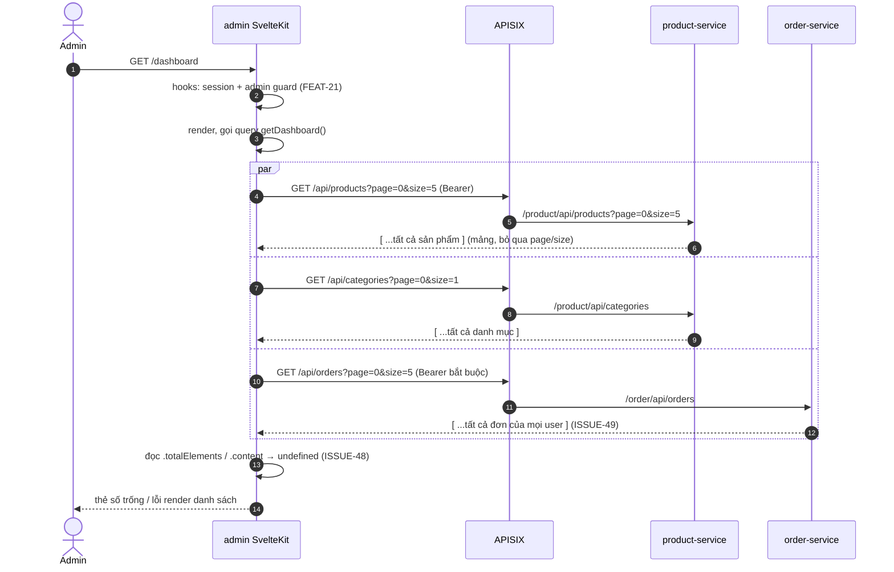

# FEAT-22 — Dashboard quản trị

> **Phiên bản:** 1.0 · **Trạng thái:** Final · **Cập nhật:** 2026-11-12 · **Phạm vi:** Ứng dụng (as-is)

| Thuộc tính | Giá trị |
| :--- | :--- |
| ID | FEAT-22 |
| Business Requirement | BR-22 |
| Trạng thái | 🟡 **Một phần** (đổi từ ✅) — UI dashboard hoàn chỉnh (3 thẻ số liệu + đơn gần đây + sản phẩm), nhưng dữ liệu đọc từ `.content`/`.totalElements` trong khi product-service/order-service trả **mảng thô** (ISSUE-48) → với backend thật số liệu trống và khối danh sách lỗi render; đồng thời trang không truy cập được do guard (ISSUE-100). Không có doanh thu/người dùng. |
| Actor | Admin |
| Ứng dụng / Service | `frontend/apps/admin` (route `/dashboard`), product-service, order-service qua APISIX |
| Issue liên quan | ISSUE-01, ISSUE-27, ISSUE-41, ISSUE-48, ISSUE-49, ISSUE-50, ISSUE-100, ISSUE-102 |

## 1. Mô tả & mục tiêu nghiệp vụ

Trang tổng quan đầu tiên sau khi admin đăng nhập (`/` redirect `/dashboard`): hiển thị nhanh số sản phẩm, số đơn hàng, số danh mục; 5 đơn hàng gần nhất và 5 sản phẩm (kèm tình trạng tồn kho), với liên kết sang trang quản lý tương ứng. Comment trong code ghi rõ doanh thu cần endpoint tổng hợp, chưa có (`frontend/apps/admin/src/routes/dashboard/dashboard.remote.ts:4-8`).

## 2. User stories

| ID | Là… | Tôi muốn… | Hiện trạng |
| :--- | :--- | :--- | :--- |
| US-22.1 | Admin | thấy tổng số sản phẩm, đơn hàng, danh mục | UI có; dựa trên `totalElements` (backend không trả) |
| US-22.2 | Admin | thấy 5 đơn gần đây (mã, ngày, tổng tiền) | UI có; "gần đây" thực tế là trang 0 theo thứ tự backend |
| US-22.3 | Admin | thấy 5 sản phẩm với giá, danh mục, tồn kho | UI có |
| US-22.4 | Admin | bấm thẻ/“Xem tất cả” để sang trang chi tiết | ✅ |
| US-22.5 | Admin | xem tổng doanh thu, số người dùng | ⛔ key i18n `dashboard_revenue`, `dashboard_users` có nhưng không dùng |

## 3. Tiền điều kiện / Hậu điều kiện

- Qua được guard admin (FEAT-21). Với backend hiện tại, guard chặn mọi người (ISSUE-100).
- Access token trong cookie được gắn vào request gateway (`frontend/apps/admin/src/lib/server/api.ts:8-11`). `/api/orders` yêu cầu Bearer; `/api/products`, `/api/categories` public (ISSUE-102).
- Hậu điều kiện: chỉ đọc, không thay đổi dữ liệu.

## 4. Luồng nghiệp vụ

### 4.1 Luồng chính

1. Trình duyệt mở `/dashboard` → SSR; component gọi remote query `getDashboard()` trong khối `{#await}` (`routes/dashboard/+page.svelte:27`).
2. `getDashboard` (server) gọi song song (`dashboard.remote.ts:9-24`):
   - `GET /api/products?page=0&size=5`
   - `GET /api/categories?page=0&size=1`
   - `GET /api/orders?page=0&size=5`
3. Trả `{ productCount: products.totalElements, categoryCount: categories.totalElements, orderCount: orders.totalElements, recentProducts: products.content, recentOrders: orders.content }`.
4. Trong lúc chờ: 3 skeleton thẻ + 1 skeleton bảng (`+page.svelte:28-33`).
5. Có dữ liệu: 3 thẻ link (`/products`, `/orders`, `/categories`) hiển thị số; bảng "Đơn hàng gần đây" (cột Mã đơn `Đơn #id`, Ngày đặt `formatDate`, Tổng tiền `formatPrice` VND); danh sách sản phẩm (ảnh 40px nếu có `imageUrl`, tên, danh mục hoặc "Chưa phân loại", giá, badge "N sp" nếu `quantity > 0`, ngược lại "Hết hàng") (`+page.svelte:35-134`).

### 4.2 Luồng thay thế

| # | Điều kiện | Hành vi |
| :--- | :--- | :--- |
| A1 | Không có đơn | "Chưa có đơn hàng" (`dashboard_noOrders`). |
| A2 | Không có sản phẩm | "Chưa có sản phẩm" (`dashboard_noProducts`). |
| A3 | Sản phẩm không có ảnh | Ô vuông nền xám. |
| A4 | Backend thật (mảng thô — ISSUE-48) | `totalElements` = `undefined` → thẻ số trống; `recentOrders = undefined` → `.length` ném lỗi khi render khối `{:then}` → trang lỗi / khối không hiển thị. |

### 4.3 Luồng ngoại lệ

| # | Tình huống | Kết quả |
| :--- | :--- | :--- |
| X1 | Một trong 3 request lỗi (401 token hết hạn, 5xx, mạng) | `Promise.all` reject → khối `{:catch}` hiển thị "Chưa có dữ liệu" (`common_noData`) màu đỏ — không phân biệt lỗi với rỗng. |
| X2 | Đơn có `orderDate` không hợp lệ | `formatDate` ném `RangeError` (Intl) → lỗi render. |

## 5. Sequence diagram

## 6. Màn hình & route (UI)

| Thành phần | Mô tả | Nguồn |
| :--- | :--- | :--- |
| Tiêu đề | "Dashboard" + phụ đề "Tổng quan hệ thống"; `<title>` = `Dashboard \| EzBuy Admin` | `+page.svelte:18-25` |
| 3 thẻ số | Sản phẩm (icon Package), Đơn hàng (ShoppingBag), Danh mục (Tags); click → trang tương ứng | `:11-15,35-54` |
| Đơn hàng gần đây | Bảng 3 cột + link "Xem tất cả →" | `:57-89` |
| Sản phẩm | Danh sách 5 dòng + link "Xem tất cả →" | `:91-133` |
| Responsive | Thẻ: 1 cột → 3 cột từ `sm`; 2 khối: xếp dọc → 2 cột từ `xl` | |

## 7. API sử dụng

| API (gateway) | Hàm client | Auth | Kỳ vọng frontend | Thực tế backend |
| :--- | :--- | :--- | :--- | :--- |
| `GET /api/products?page&size` | `api.products.list` (`frontend/packages/lib/src/server/api.ts:129`) | public | `PaginatedResponse<Product>` | `ProductDto[]` (`services/product-service/internal/handler/product_handler.go:149-156`) |
| `GET /api/categories?page&size` | `api.categories.list` (`:136`) | public | `PaginatedResponse<Category>` | `CategoryDto[]` (`product_handler.go:50-57`) |
| `GET /api/orders?page&size` | `api.orders.list` (`:143`) | Bearer | `PaginatedResponse<Order>` | `OrderDto[]` (`services/order-service/internal/handler/order_handler.go:197-204`); endpoint phân trang thật là `/api/orders/all` (`:189,206-219`) |

## 8. Dữ liệu

Chỉ đọc. Kiểu dùng: `Product` (`productId, productTitle, imageUrl, priceUnit, quantity, category.categoryTitle`), `Order` (`orderId, orderDate, orderFee`) — `frontend/packages/lib/src/types.ts:65-97`.

## 9. Business rules & validation

| # | Quy tắc | Nguồn |
| :--- | :--- | :--- |
| BR22-1 | Đếm = `totalElements` của endpoint phân trang (không có endpoint đếm riêng) | `dashboard.remote.ts:18-20` |
| BR22-2 | Danh mục chỉ cần `size=1` để lấy tổng | `:13` |
| BR22-3 | Tồn kho > 0 → badge "N sp", ngược lại "Hết hàng" (dựa `products.quantity`, không dùng inventory-service — ISSUE-26) | `+page.svelte:121-127` |
| BR22-4 | Tiền định dạng VND `vi-VN` cho mọi locale | `frontend/packages/lib/src/format.ts:1-6` |
| BR22-5 | Ngày định dạng `vi-VN` `dd/MM/yyyy HH:mm` cho mọi locale | `format.ts:8-16` |

## 10. Xử lý lỗi

Mọi lỗi gộp vào `{:catch}` → "Chưa có dữ liệu". Không retry, không toast, không log phía client.

## 11. i18n (key chính)

`dashboard_title`, `dashboard_subtitle`, `dashboard_metaTitle`, `dashboard_products`, `dashboard_orders`, `sidebar_categories`, `dashboard_recentOrders`, `dashboard_recentProducts`, `dashboard_noOrders`, `dashboard_noProducts`, `dashboard_order` (`Đơn #{id}`), `dashboard_inStock` (`{count} sp`), `dashboard_outOfStock`, `dashboard_uncategorized`, `common_viewAll`, `common_noData`, `orders_colId/colDate/colTotal`, `meta_template`. Không dùng: `dashboard_revenue`, `dashboard_users`.

## 12. Acceptance criteria (Given / When / Then — theo hành vi hiện tại)

| # | Given | When | Then |
| :--- | :--- | :--- | :--- |
| AC-22.1 | Admin hợp lệ, API trả Page (mock/BFF đúng hợp đồng) với 42 sản phẩm, 7 đơn, 10 danh mục | Mở `/dashboard` | Thẻ hiển thị 42 / 7 / 10; bảng 5 đơn; danh sách 5 sản phẩm |
| AC-22.2 | Như trên, sản phẩm `quantity = 0` | — | Badge đỏ "Hết hàng" |
| AC-22.3 | Backend thật trả mảng | Mở `/dashboard` | Thẻ số trống, khối danh sách lỗi render |
| AC-22.4 | `/api/orders` trả 401 | Mở `/dashboard` | "Chưa có dữ liệu" màu đỏ thay cho toàn bộ nội dung |
| AC-22.5 | Admin | Bấm thẻ "Đơn hàng" | Điều hướng `/orders` (giữ locale) |
| AC-22.6 | Locale `en` | Mở `/en/dashboard` | Nhãn tiếng Anh; giá vẫn `₫` VND, ngày vẫn kiểu vi-VN |

## 13. Giới hạn & vấn đề đã biết

- **ISSUE-48** (Critical): lệch hợp đồng Page vs mảng → dashboard không dùng được với backend thật.
- **ISSUE-100**: không ai vào được dashboard (guard).
- **ISSUE-49**: order-service trả đơn của mọi user (với admin là đúng ý đồ nhưng không phân trang/không lọc).
- Không có doanh thu, số người dùng, biểu đồ, khoảng thời gian; "đơn gần đây" không được sắp xếp theo ngày ở backend (`FindAllOrders`).
- **ISSUE-27**: tiền dạng float; **ISSUE-41**: không có trạng thái đơn.

## 14. Test hiện có

Không có test cho route dashboard. `frontend/packages/lib/src/server/api.test.ts` kiểm tra client chung; `format.test.ts` kiểm tra `formatPrice`/`formatDate` (ISSUE-46).

## 15. Tham chiếu source

- `frontend/apps/admin/src/routes/dashboard/dashboard.remote.ts:1-24`
- `frontend/apps/admin/src/routes/dashboard/+page.svelte:1-137`
- `frontend/apps/admin/src/routes/+page.server.ts:5-7`
- `frontend/apps/admin/src/lib/server/api.ts:8-11`
- `frontend/packages/lib/src/server/api.ts:127-146`, `types.ts:12-20,65-97`, `format.ts:1-16`
- `services/product-service/internal/handler/product_handler.go:50-57,149-156`
- `services/order-service/internal/handler/order_handler.go:186-219`
- `frontend/apps/admin/messages/vi.json`, `en.json` (prefix `dashboard_`)
