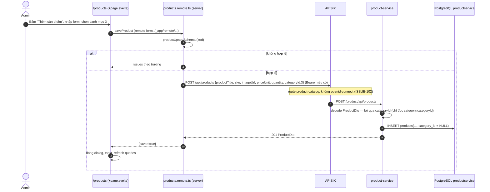
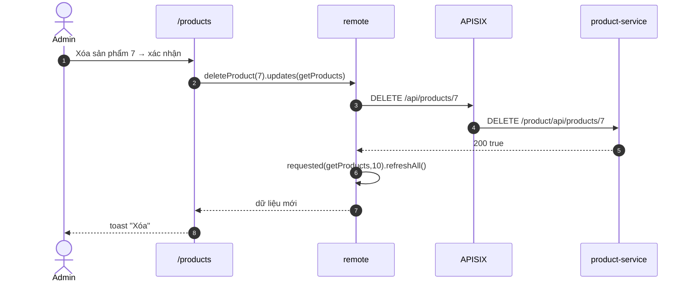

# FEAT-23 — Quản lý sản phẩm (admin)

> **Phiên bản:** 1.0 · **Trạng thái:** Final · **Cập nhật:** 2026-11-12 · **Phạm vi:** Ứng dụng (as-is)

| Thuộc tính | Giá trị |
| :--- | :--- |
| ID | FEAT-23 |
| Business Requirement | BR-23 |
| Trạng thái | 🟡 **Một phần** — UI CRUD đầy đủ (danh sách, tìm kiếm, phân trang, form thêm/sửa, xóa có xác nhận) nhưng: danh sách đọc Page trong khi backend trả mảng (ISSUE-48), tìm kiếm/phân trang bị backend bỏ qua, danh mục chọn trong form **không được lưu** (ISSUE-60), không có mô tả/brand/upload ảnh. |
| Actor | Admin |
| Ứng dụng / Service | `frontend/apps/admin` (route `/products`), product-service qua APISIX |
| Issue liên quan | ISSUE-01, ISSUE-27, ISSUE-35, ISSUE-48, ISSUE-50, ISSUE-60, ISSUE-68, ISSUE-83, ISSUE-100, ISSUE-102 |

## 1. Mô tả & mục tiêu nghiệp vụ

Cho phép quản trị viên duy trì danh mục hàng hóa: xem danh sách sản phẩm (ảnh, tên, SKU, danh mục, giá, tồn kho), tìm theo tên, thêm mới, chỉnh sửa và xóa sản phẩm.

## 2. User stories

| ID | Là… | Tôi muốn… | Hiện trạng |
| :--- | :--- | :--- | :--- |
| US-23.1 | Admin | xem danh sách sản phẩm phân trang 10/trang | UI có; backend không phân trang (ISSUE-48) |
| US-23.2 | Admin | tìm sản phẩm theo từ khóa | UI gửi `search`; backend bỏ qua |
| US-23.3 | Admin | thêm sản phẩm (tên, SKU, danh mục, giá, số lượng, URL ảnh) | ✅ tạo được; danh mục bị bỏ (ISSUE-60) |
| US-23.4 | Admin | sửa sản phẩm | ✅; mỗi lần sửa **xóa** danh mục hiện có |
| US-23.5 | Admin | xóa sản phẩm có xác nhận | ✅ |
| US-23.6 | Admin | nhập mô tả, brand, upload ảnh | ⛔ |

## 3. Tiền điều kiện / Hậu điều kiện

- Qua guard admin (FEAT-21). Gateway: `/api/products*` không yêu cầu token (ISSUE-102), không kiểm role (ISSUE-01).
- Hậu điều kiện: bản ghi `products` trong DB `productservice` được tạo/cập nhật/xóa; sau thao tác danh sách được làm mới.

## 4. Luồng nghiệp vụ

### 4.1 Luồng chính

**Danh sách & tìm kiếm** (`frontend/apps/admin/src/routes/products/+page.svelte:19-21,63-184`)
1. Đọc `?page` (mặc định 0, số âm/không hợp lệ → 0) và `?search` (trim, rỗng → undefined) từ URL.
2. Gọi remote query `getProducts({page, size: 10, search})` (`products.remote.ts:6-8`) — schema `productQuerySchema` (`frontend/packages/lib/src/schemas.ts:37-41`).
3. Server gọi `GET /api/products?page=&size=10&search=`.
4. Hiển thị "N sản phẩm", bảng 6 cột: Sản phẩm (ảnh 36px + tên, `line-clamp-1`), SKU (`—` nếu trống), Danh mục ("Chưa phân loại" nếu không có), Giá (`formatPrice` VND), Kho (số hoặc badge "Hết hàng" nếu ≤ 0), Thao tác (Sửa / Xóa).
5. Form tìm kiếm là `<form method="get">` → điều hướng `/products?search=...` (reset về trang 0).
6. Phân trang (khi `totalPages > 1`): nút Trước/Sau là link `?page=n`; nhãn "Trang x/y". Lưu ý: link phân trang **không giữ** tham số `search`.

**Thêm / sửa** (`+page.svelte:186-300`, `products.remote.ts:16-34`)
1. "Thêm sản phẩm" mở dialog trống; icon bút chì mở dialog với giá trị hiện tại (`editing`).
2. Form remote `saveProduct` (SvelteKit remote `form`, progressive enhancement) với các trường: hidden `productId`, `productTitle`, `sku`, `categoryId` (select nạp từ `getCategoryOptions` = `GET /api/categories?page=0&size=100` → `.content`), `priceUnit`, `quantity`, `imageUrl`.
3. Validate phía server bằng `productUpsertSchema` (xem §9); lỗi hiển thị dưới từng trường (`fields.X.issues()`).
4. Hợp lệ → payload `{ productTitle, sku, imageUrl: imageUrl || null, priceUnit, quantity, categoryId: categoryId ?? null }`; có `productId` → `PUT /api/products/{id}`, không → `POST /api/products`.
5. Thành công → đóng dialog, reset form, toast "Lưu"; SvelteKit làm mới các query trên trang.

**Xóa** (`+page.svelte:41-53,302-314`, `products.remote.ts:36-39`)
1. Icon thùng rác → dialog "Xóa sản phẩm này?".
2. "Xóa" → command `deleteProduct(productId)` (zod `int().positive()`) → `DELETE /api/products/{id}` → `requested(getProducts, 10).refreshAll()`; client gọi `.updates(getProducts)`.
3. Toast "Xóa"; dialog đóng.

### 4.2 Luồng thay thế

| # | Điều kiện | Hành vi |
| :--- | :--- | :--- |
| A1 | Không chọn danh mục | `categoryId: null` (backend vẫn bỏ qua). |
| A2 | Chọn danh mục | Gửi `categoryId` phẳng, product-service chỉ đọc `category.categoryId` → lưu `NULL` (ISSUE-60). |
| A3 | Sửa sản phẩm đang có danh mục | Update ghi `category_id = NULL` → mất danh mục. |
| A4 | Bỏ trống URL ảnh | Gửi `null` → lưu chuỗi rỗng. |
| A5 | Danh sách rỗng | EmptyState "Chưa có sản phẩm nào". |
| A6 | Đang tải danh mục trong select | Option "Đang tải...". |

### 4.3 Luồng ngoại lệ

| # | Tình huống | Kết quả |
| :--- | :--- | :--- |
| X1 | Validate thất bại | Thông báo dưới trường (tiếng Anh, hard-code — ISSUE-83), dialog giữ nguyên. |
| X2 | SKU trùng (UNIQUE) hoặc tên > 255 ký tự / URL ảnh > 255 | product-service 500 → `form.submit()` ném → toast lỗi "Chưa có dữ liệu" (thông điệp không phù hợp). |
| X3 | PUT id không tồn tại | product-service vẫn 200 (không kiểm rows affected). |
| X4 | Xóa lỗi (DB) | toast "Chưa có dữ liệu". |
| X5 | Backend trả mảng (ISSUE-48) | `result.totalElements` undefined, `result.content.length` ném lỗi → khối danh sách hỏng; select danh mục rỗng. |
| X6 | `getProducts` lỗi | `{:catch}` "Chưa có dữ liệu". |

## 5. Sequence diagram

## 6. Màn hình & route (UI)

| Route | Thành phần |
| :--- | :--- |
| `/products`, `/en/products` | Header: tiêu đề "Sản phẩm", ô tìm kiếm (w-52) + nút kính lúp, nút "Thêm sản phẩm" |
| | Bảng sản phẩm (TableSkeleton 6 dòng khi tải) |
| | Phân trang Trước/Sau |
| Dialog thêm/sửa | Tiêu đề "Thêm sản phẩm"/"Chỉnh sửa sản phẩm"; lưới 2 cột từ `sm`; nút Hủy / Lưu (hoặc Cập nhật), disable khi `pending` |
| Dialog xóa | "Xóa sản phẩm này?" + Hủy / Xóa (disable khi đang xóa) |

## 7. API sử dụng

| Thao tác | Gateway | Client lib | Service |
| :--- | :--- | :--- | :--- |
| List | `GET /api/products?page&size&search` | `api.products.list` | `ListProducts` → `FindAllProducts` (bỏ qua query, trả mảng) |
| Danh mục cho select | `GET /api/categories?page=0&size=100` | `api.categories.list` | `ListCategories` (mảng) |
| Tạo | `POST /api/products` | `api.products.create` | `CreateProduct` → 201 |
| Sửa | `PUT /api/products/{id}` | `api.products.update` | `UpdateProductByID` → 200 |
| Xóa | `DELETE /api/products/{id}` | `api.products.remove` | `DeleteProduct` → 200 `true` |

Nguồn: `frontend/packages/lib/src/server/api.ts:128-134`; `services/product-service/internal/handler/product_handler.go:141-237`; `deploy/apisix/apisix.yaml:71-82`.

## 8. Dữ liệu

| Trường form | Payload | Cột DB (`products`) | Ghi chú |
| :--- | :--- | :--- | :--- |
| `productTitle` | `productTitle` | `product_title VARCHAR(255) NOT NULL` | |
| `sku` | `sku` | `sku VARCHAR(100) UNIQUE` | |
| `categoryId` | `categoryId` | `category_id INT FK` | **Không được map** (ISSUE-60) |
| `priceUnit` | `priceUnit` (số nguyên) | `price_unit DECIMAL(12,2)` | Go `float64` (ISSUE-27) |
| `quantity` | `quantity` | `quantity INT` | Độc lập inventory-service (ISSUE-26) |
| `imageUrl` | `imageUrl` | `image_url VARCHAR(255)` | Text tự do, không qua media-service |
| — | — | không có `description` | ISSUE-50 |

Nguồn: `services/product-service/internal/repository/product_repo.go:45-55`, `internal/model/product.go:10-18`, `frontend/packages/lib/src/types.ts:143-151`.

## 9. Business rules & validation

`productFormSchema` + `productId` (`frontend/packages/lib/src/schemas.ts:66-81`):

| Trường | Quy tắc | Thông điệp |
| :--- | :--- | :--- |
| `productTitle` | trim, 1–200 ký tự | "Please enter a product name" |
| `sku` | trim, 1–64 ký tự, bắt buộc | "Please enter an SKU" |
| `imageUrl` | trim, tùy ý (không kiểm định dạng URL / độ dài) | — |
| `categoryId` | `''` / chuỗi số / số nguyên dương / bỏ trống | — |
| `priceUnit` | chuỗi chỉ gồm chữ số `^\d+$` (không thập phân, không âm), bắt buộc | "Please enter a price" |
| `quantity` | `^\d+$`, bắt buộc | "Please enter a quantity" |
| `productId` | như `categoryId`; có → update, không → create | — |

Backend product-service không validate gì thêm (ISSUE-35). `deleteProduct` yêu cầu số nguyên dương.

## 10. Xử lý lỗi

- Lỗi validate: hiển thị dưới trường.
- Lỗi API: toast lỗi dùng chung key `common_noData` ("Chưa có dữ liệu") — không phản ánh nguyên nhân (SKU trùng, 500…).
- Lỗi tải danh sách: dòng chữ đỏ "Chưa có dữ liệu".

## 11. i18n (key chính)

`products_title`, `products_metaTitle`, `products_count`, `products_searchPlaceholder`, `products_addBtn`, `products_col{Product,Sku,Category,Price,Stock,Actions}`, `products_uncategorized`, `products_outOfStock`, `products_noProducts`, `products_modalAddTitle`, `products_modalEditTitle`, `products_nameLabel`, `products_skuLabel`, `products_categoryLabel`, `products_selectCategory`, `products_priceLabel` ("Giá (VND) *"), `products_quantityLabel`, `products_imageLabel`, `products_deleteConfirm`, `common_{save,update,cancel,delete,edit,prev,next,page,search,loading,noData}`.

## 12. Acceptance criteria (Given / When / Then — theo hành vi hiện tại)

| # | Given | When | Then |
| :--- | :--- | :--- | :--- |
| AC-23.1 | Admin trên `/products` | Submit form trống | Lỗi dưới tên, SKU, giá, số lượng; không gọi API |
| AC-23.2 | — | Giá `12.5` hoặc `-1` | "Please enter a price" |
| AC-23.3 | Form hợp lệ, danh mục "Điện thoại" | Lưu | 201; sản phẩm tạo với `category = null`; toast "Lưu" |
| AC-23.4 | Sản phẩm có danh mục (tạo bằng API khác) | Sửa giá và lưu | Giá cập nhật; danh mục bị xóa |
| AC-23.5 | SKU đã tồn tại | Lưu | Toast "Chưa có dữ liệu"; dialog vẫn mở |
| AC-23.6 | — | Xóa sản phẩm, xác nhận | `DELETE` gọi; danh sách làm mới; toast "Xóa" |
| AC-23.7 | Backend trả mảng | Mở `/products` | Không hiển thị số lượng đúng; khối danh sách lỗi (ISSUE-48) |
| AC-23.8 | Đang ở `?search=abc` | Bấm "Sau" | URL `?page=1` (mất `search`) |
| AC-23.9 | Không đăng nhập | Gọi trực tiếp `POST /api/products` qua gateway | 201 (ISSUE-102) |

## 13. Giới hạn & vấn đề đã biết

- **ISSUE-48**: lệch hợp đồng Page; search/page/size bị bỏ qua.
- **ISSUE-60**: danh mục không được lưu, update xóa danh mục.
- **ISSUE-102 / ISSUE-01 / ISSUE-68**: ghi sản phẩm không cần token/role; remote function vượt guard.
- **ISSUE-100**: admin không vào được trang.
- **ISSUE-50 / ISSUE-35**: không có mô tả/brand/slug, backend không validate.
- **ISSUE-83**: thông điệp validate tiếng Anh hard-code; toast lỗi dùng sai key.
- Giá chỉ nhận số nguyên VND; không upload ảnh (FEAT-18); phân trang mất `search`; không sắp xếp/lọc theo danh mục.

## 14. Test hiện có

`frontend/packages/lib/src/schemas.test.ts:59-107` — `productFormSchema` (coerce số, từ chối rỗng/không phải số, giá âm, số lượng thập phân) và `productUpsertSchema` (id rỗng = create, coerce id). Không có test component/E2E (ISSUE-46). `services/product-service/main_test.go` gọi router với DB nil.

## 15. Tham chiếu source

- `frontend/apps/admin/src/routes/products/products.remote.ts:1-39`
- `frontend/apps/admin/src/routes/products/+page.svelte:1-314`
- `frontend/packages/lib/src/schemas.ts:8-30,37-41,66-81`, `server/api.ts:128-140`, `types.ts:65-74,143-151`, `format.ts:1-6`
- `services/product-service/internal/handler/product_handler.go:141-237`
- `services/product-service/internal/repository/product_repo.go:45-55,262-318`
- `services/product-service/internal/model/product.go:10-18`
- `deploy/apisix/apisix.yaml:71-82`
