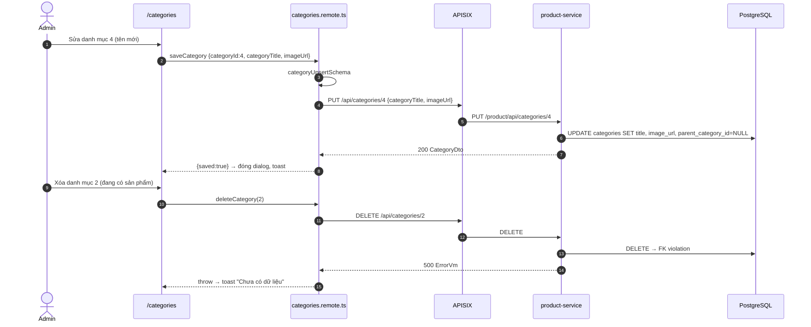
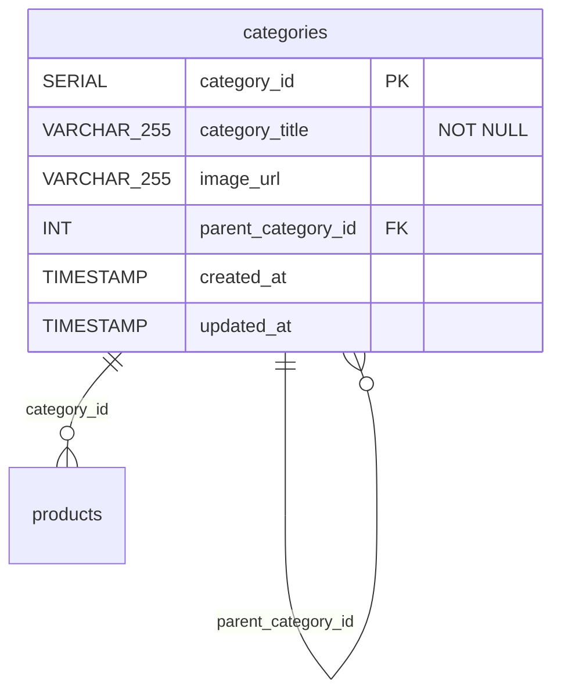

# FEAT-24 — Quản lý danh mục (admin)

> **Phiên bản:** 1.0 · **Trạng thái:** Final · **Cập nhật:** 2026-11-12 · **Phạm vi:** Ứng dụng (as-is)

| Thuộc tính | Giá trị |
| :--- | :--- |
| ID | FEAT-24 |
| Business Requirement | BR-24 |
| Trạng thái | 🟡 **Một phần** — UI dạng lưới thẻ với thêm/sửa/xóa và phân trang; nhưng danh sách đọc Page trong khi backend trả mảng (ISSUE-48), không quản lý danh mục cha/con (sửa còn **xóa** `parent_category_id`), xóa danh mục đang có sản phẩm lỗi 500; storefront không dùng danh mục động (ISSUE-44). |
| Actor | Admin |
| Ứng dụng / Service | `frontend/apps/admin` (route `/categories`), product-service qua APISIX |
| Issue liên quan | ISSUE-01, ISSUE-35, ISSUE-44, ISSUE-48, ISSUE-68, ISSUE-83, ISSUE-100, ISSUE-102 |

## 1. Mô tả & mục tiêu nghiệp vụ

Quản trị viên duy trì cây danh mục sản phẩm: xem, thêm, đổi tên/ảnh, xóa. Hiện UI chỉ quản lý **tên** và **URL ảnh**; quan hệ cha–con có trong DB (`parent_category_id`) nhưng không có trên UI.

## 2. User stories

| ID | Là… | Tôi muốn… | Hiện trạng |
| :--- | :--- | :--- | :--- |
| US-24.1 | Admin | xem danh mục dạng lưới 12/trang kèm tổng số | UI có; backend không phân trang |
| US-24.2 | Admin | thêm danh mục (tên, URL ảnh) | ✅ |
| US-24.3 | Admin | sửa danh mục | ✅; mất danh mục cha nếu có |
| US-24.4 | Admin | xóa danh mục có xác nhận | ✅ nếu không có sản phẩm tham chiếu |
| US-24.5 | Admin | chọn danh mục cha, sắp xếp | ⛔ |

## 3. Tiền điều kiện / Hậu điều kiện

- Qua guard admin (FEAT-21; hiện bị chặn bởi ISSUE-100). Gateway: `/api/categories*` public, không kiểm role (ISSUE-102, ISSUE-01).
- Hậu điều kiện: bảng `categories` (DB `productservice`) thay đổi; danh sách làm mới. Storefront header/footer **không** phản ánh thay đổi vì hard-code `categoryId=1..10` (ISSUE-44).

## 4. Luồng nghiệp vụ

### 4.1 Luồng chính

**Danh sách** (`frontend/apps/admin/src/routes/categories/+page.svelte:15-16,55-141`)
1. `?page` → `currentPage` (≥ 0); gọi `getCategories({page, size: 12})` (`categories.remote.ts:6-8`, schema `pageQuerySchema` — `size` 1..60).
2. Tiêu đề "Danh mục ({count})" — `count` từ `totalElements` (hiển thị `…` khi đang tải). Query được gọi hai lần trong template (tiêu đề và lưới) — SvelteKit gộp cùng tham số thành một request.
3. Lưới 1/2/3/4 cột (sm/lg/xl): mỗi thẻ có ảnh cao 112px (nếu `imageUrl`), tên (truncate), "ID: n", nút sửa/xóa.
4. Phân trang Trước/Sau khi `totalPages > 1`.

**Thêm / sửa** (`+page.svelte:143-199`, `categories.remote.ts:10-21`)
1. Dialog với hidden `categoryId`, `categoryTitle`, `imageUrl`.
2. `categoryUpsertSchema` validate; payload `{ categoryTitle, imageUrl: imageUrl || null }`.
3. Có id → `PUT /api/categories/{id}`; không → `POST /api/categories`.
4. Thành công → đóng dialog, reset, toast "Lưu".

**Xóa** (`+page.svelte:36-48,201-213`, `categories.remote.ts:23-26`)
1. Xác nhận "Xóa danh mục này?" → command `deleteCategory(id)` → `DELETE /api/categories/{id}` → `requested(getCategories, 5).refreshAll()`.
2. Toast "Xóa".

### 4.2 Luồng thay thế

| # | Điều kiện | Hành vi |
| :--- | :--- | :--- |
| A1 | Không có danh mục | "Chưa có dữ liệu". |
| A2 | Danh mục không có ảnh | Khung xám. |
| A3 | Sửa danh mục con | `UpdateCategory` ghi `parent_category_id = NULL` vì payload không có `parentCategory` (`services/product-service/internal/repository/product_repo.go:140-160`). |
| A4 | Bỏ trống URL ảnh | Lưu chuỗi rỗng. |

### 4.3 Luồng ngoại lệ

| # | Tình huống | Kết quả |
| :--- | :--- | :--- |
| X1 | Tên trống / > 120 ký tự | Lỗi dưới trường ("Please enter a category name" hoặc thông điệp max mặc định của zod, tiếng Anh — ISSUE-83) |
| X2 | Xóa danh mục đang có sản phẩm hoặc danh mục con | FK `products.category_id` / `categories.parent_category_id` → 500 → toast "Chưa có dữ liệu" |
| X3 | URL ảnh > 255 ký tự | 500 → toast lỗi |
| X4 | Backend trả mảng (ISSUE-48) | Tiêu đề "Danh mục (undefined)"; `result.content.length` lỗi |
| X5 | PUT id không tồn tại | 200 (backend không kiểm) |

## 5. Sequence diagram

## 6. Màn hình & route (UI)

| Route | Thành phần |
| :--- | :--- |
| `/categories`, `/en/categories` | Tiêu đề có đếm, nút "Thêm danh mục", lưới thẻ (skeleton 4 thẻ khi tải), phân trang |
| Dialog thêm/sửa | "Thêm danh mục" / "Chỉnh sửa"; trường "Tên danh mục *", "URL hình ảnh"; Hủy / Lưu-Cập nhật |
| Dialog xóa | "Xóa danh mục này?" |

## 7. API sử dụng

| Thao tác | Gateway | Service handler |
| :--- | :--- | :--- |
| List | `GET /api/categories?page&size=12` | `ListCategories` → mảng, bỏ qua query (`product_handler.go:50-57`) |
| Tạo | `POST /api/categories` | `CreateCategory` → 201 |
| Sửa | `PUT /api/categories/{id}` | `UpdateCategoryByID` → 200 |
| Xóa | `DELETE /api/categories/{id}` | `DeleteCategory` → 200 `true` |

Service còn có `GET /api/categories/paging` và `/paging-and-sorting` nhưng cũng trả mảng không phân trang (ISSUE-35), `PUT /api/categories` (id trong body), `GET /api/categories/{id}`.

## 8. Dữ liệu

Nguồn: `services/product-service/internal/repository/product_repo.go:35-42`. Frontend type `Category` (`frontend/packages/lib/src/types.ts:56-63`) có `subCategories`, `products` nhưng backend không trả.

## 9. Business rules & validation

| Trường | Quy tắc (`frontend/packages/lib/src/schemas.ts:75-82`) |
| :--- | :--- |
| `categoryTitle` | trim, 1–120 ký tự, bắt buộc |
| `imageUrl` | trim, tùy ý (không kiểm URL) |
| `categoryId` | rỗng → tạo; số nguyên dương → sửa |
| Xóa | id số nguyên dương; DB chặn nếu còn tham chiếu |

Tên danh mục không unique; không có slug.

## 10. Xử lý lỗi

Giống FEAT-23: lỗi validate dưới trường; mọi lỗi API → toast `common_noData`; lỗi tải → "Chưa có dữ liệu".

## 11. i18n (key chính)

`categories_title` (`Danh mục ({count})`), `categories_metaTitle`, `categories_addBtn`, `categories_modalAddTitle`, `categories_modalEditTitle`, `categories_nameLabel`, `categories_imageLabel`, `categories_idLabel`, `categories_deleteConfirm`, `common_*`.

## 12. Acceptance criteria (Given / When / Then — theo hành vi hiện tại)

| # | Given | When | Then |
| :--- | :--- | :--- | :--- |
| AC-24.1 | Admin | Lưu danh mục tên trống | Lỗi "Please enter a category name" |
| AC-24.2 | — | Lưu `{categoryTitle:"Laptop"}` | `POST /api/categories` 201; toast "Lưu"; danh sách làm mới |
| AC-24.3 | Danh mục 5 có cha 1 | Sửa tên | Tên mới; `parent_category_id` = NULL |
| AC-24.4 | Danh mục 2 có sản phẩm | Xóa | Toast lỗi; danh mục còn nguyên |
| AC-24.5 | API Page trả 30 danh mục | Mở `?page=1` | 12 thẻ, "Trang 2/3" |
| AC-24.6 | Backend thật | Mở `/categories` | Tiêu đề "(undefined)", khối lưới lỗi (ISSUE-48) |
| AC-24.7 | Tạo danh mục mới id 11 | Mở storefront | Menu vẫn chỉ `category_c1..c10` (ISSUE-44) |

## 13. Giới hạn & vấn đề đã biết

- **ISSUE-48**: lệch hợp đồng Page. **ISSUE-35**: endpoint paging giả.
- **ISSUE-102 / ISSUE-01 / ISSUE-68 / ISSUE-100**: bảo mật và truy cập.
- **ISSUE-44**: storefront hard-code danh mục.
- **ISSUE-83**: thông điệp validate tiếng Anh; toast lỗi không mô tả nguyên nhân.
- Không quản lý cha/con; sửa làm mất cha; không chặn xóa thân thiện (FK → 500); không upload ảnh.

## 14. Test hiện có

`frontend/packages/lib/src/schemas.test.ts:19-33` (`pageQuerySchema`). Không có test cho `categoryFormSchema`, route hay E2E (ISSUE-46).

## 15. Tham chiếu source

- `frontend/apps/admin/src/routes/categories/categories.remote.ts:1-26`
- `frontend/apps/admin/src/routes/categories/+page.svelte:1-213`
- `frontend/packages/lib/src/schemas.ts:32-35,75-82`, `server/api.ts:135-141`, `types.ts:56-63,153-156`
- `services/product-service/internal/handler/product_handler.go:39-137`
- `services/product-service/internal/repository/product_repo.go:35-42,80-172`
- `deploy/apisix/apisix.yaml:71-82`
