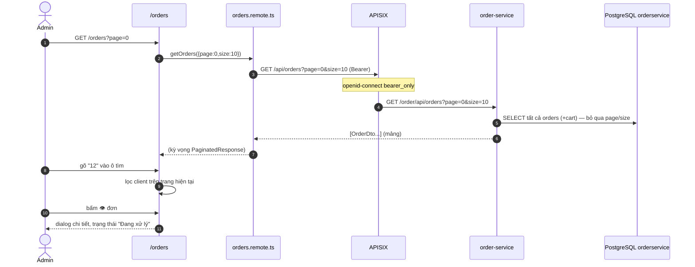

# FEAT-25 — Quản lý đơn hàng (admin)

> **Phiên bản:** 1.0 · **Trạng thái:** Final · **Cập nhật:** 2026-11-12 · **Phạm vi:** Ứng dụng (as-is)

| Thuộc tính | Giá trị |
| :--- | :--- |
| ID | FEAT-25 |
| Business Requirement | BR-25 |
| Trạng thái | 🟡 **Một phần** — chỉ **xem** danh sách đơn (phân trang 10/trang), lọc mã đơn phía client và dialog chi tiết; không đổi trạng thái/hủy/hoàn tiền; trạng thái luôn "Đang xử lý"; danh sách đọc Page trong khi `/api/orders` trả mảng (ISSUE-48). |
| Actor | Admin |
| Ứng dụng / Service | `frontend/apps/admin` (route `/orders`), order-service qua APISIX |
| Issue liên quan | ISSUE-01, ISSUE-20, ISSUE-27, ISSUE-40, ISSUE-41, ISSUE-45, ISSUE-48, ISSUE-49, ISSUE-100 |

## 1. Mô tả & mục tiêu nghiệp vụ

Cho phép quản trị viên tra cứu đơn hàng toàn hệ thống: mã đơn, ngày đặt, mô tả, tổng tiền, sản phẩm, giỏ hàng, người dùng. `frontend/apps/admin/README.md` mô tả "status filter và line-item detail" — **không có** (ISSUE-45): mỗi đơn chỉ có 1 `productId`, không có trạng thái (ISSUE-20).

## 2. User stories

| ID | Là… | Tôi muốn… | Hiện trạng |
| :--- | :--- | :--- | :--- |
| US-25.1 | Admin | xem danh sách đơn phân trang | UI có; backend trả mảng |
| US-25.2 | Admin | lọc theo mã đơn | Chỉ lọc trên trang hiện tại, phía client (ISSUE-40) |
| US-25.3 | Admin | xem chi tiết một đơn | Dialog từ dữ liệu hàng (không gọi API chi tiết) |
| US-25.4 | Admin | cập nhật trạng thái / hủy đơn | ⛔ |
| US-25.5 | Admin | lọc theo trạng thái, ngày, khách | ⛔ |

## 3. Tiền điều kiện / Hậu điều kiện

- Qua guard admin (FEAT-21; hiện bị chặn bởi ISSUE-100). `/api/orders` yêu cầu Bearer (`deploy/apisix/apisix.yaml:196-213`), không kiểm role (ISSUE-01).
- Chỉ đọc, không thay đổi dữ liệu.

## 4. Luồng nghiệp vụ

### 4.1 Luồng chính

1. `/orders?page=n` → `args = {page, size: 10}` → remote `getOrders` (`frontend/apps/admin/src/routes/orders/orders.remote.ts:5-7`) → `GET /api/orders?page=&size=10`.
2. Hiển thị "N đơn hàng" (`totalElements`) và bảng: Mã đơn (`#id`), Ngày đặt (`formatDate`), Mô tả (`orderDesc` hoặc `—`, truncate), Tổng tiền (`formatPrice(orderFee)`), Trạng thái (badge cố định "Đang xử lý"), Thao tác (icon mắt) (`+page.svelte:51-105`).
3. Ô "Tìm theo mã đơn hàng..." (`bind:value={filter}`) lọc `String(orderId).includes(filter)` trên các dòng đang hiển thị (`+page.svelte:26-29`) — tức khớp **chuỗi con** (gõ `1` khớp 1, 10, 21…).
4. Bấm icon mắt → dialog "Đơn hàng #id": Ngày đặt, Mô tả, Tổng tiền, Sản phẩm `#productId`, Giỏ hàng `#cart.cartId`, Người dùng `#cart.userId`, Trạng thái "Đang xử lý" (`+page.svelte:129-170`).
5. Phân trang Trước/Sau khi `totalPages > 1`.

### 4.2 Luồng thay thế

| # | Điều kiện | Hành vi |
| :--- | :--- | :--- |
| A1 | Filter không khớp dòng nào | EmptyState "Chưa có đơn hàng nào" (giống khi không có dữ liệu). |
| A2 | Đơn không có cart | Hiển thị `#—`. |
| A3 | Chuyển trang | Filter giữ nguyên (state client), áp dụng cho trang mới. |

### 4.3 Luồng ngoại lệ

| # | Tình huống | Kết quả |
| :--- | :--- | :--- |
| X1 | `/api/orders` 401/5xx | "Chưa có dữ liệu" đỏ |
| X2 | Backend trả mảng (ISSUE-48) | `visible(result.content)` với `undefined` → `.filter` lỗi khi filter có giá trị, `rows.length` lỗi → khối hỏng; "undefined đơn hàng" |
| X3 | `orderDate` rỗng/không hợp lệ | `formatDate` ném `RangeError` |

## 5. Sequence diagram

## 6. Màn hình & route (UI)

| Route | Thành phần |
| :--- | :--- |
| `/orders`, `/en/orders` | Tiêu đề "Đơn hàng", ô tìm (icon Search, w-60), đếm, bảng 6 cột (TableSkeleton khi tải), phân trang |
| Dialog chi tiết | 7 dòng thông tin + nút "Đóng" |

## 7. API sử dụng

| API | Kỳ vọng | Thực tế |
| :--- | :--- | :--- |
| `GET /api/orders?page&size` (`frontend/packages/lib/src/server/api.ts:143`) | `PaginatedResponse<Order>` | `FindAllOrders` → mảng toàn bộ đơn (`services/order-service/internal/handler/order_handler.go:197-204`) |
| (chưa dùng) `GET /api/orders/all?page&size&sortBy&sortOrder` | — | Trả `PageResponse` đúng định dạng (`order_handler.go:189,206-219`) |
| (chưa dùng) `GET /api/orders/{id}`, `PUT`, `DELETE` | — | Có ở service |

## 8. Dữ liệu

Bảng `orders(order_id, order_date, order_desc, order_fee DOUBLE PRECISION, product_id, cart_id FK)` và `carts(cart_id, user_id BIGINT)` (`services/order-service/internal/repository/order_repository.go:32-56`). Không có `status`, `order_items`, địa chỉ giao (ISSUE-20, ISSUE-22).

## 9. Business rules & validation

| # | Quy tắc | Nguồn |
| :--- | :--- | :--- |
| BR25-1 | `page` ≥ 0, `size` 1..60 (gửi 10) | `pageQuerySchema` (`frontend/packages/lib/src/schemas.ts:32-35`) |
| BR25-2 | Trạng thái hiển thị luôn `orders_processing` | `+page.svelte:83,162` (ISSUE-41) |
| BR25-3 | Lọc mã đơn: chuỗi con, client-side, trên trang hiện tại | `+page.svelte:26-29` (ISSUE-40) |
| BR25-4 | Tiền VND, ngày vi-VN | `format.ts` |

## 10. Xử lý lỗi

Mọi lỗi query → "Chưa có dữ liệu". Không có thao tác ghi nên không có toast.

## 11. i18n (key chính)

`orders_title`, `orders_metaTitle`, `orders_count`, `orders_searchPlaceholder`, `orders_col{Id,Date,Desc,Total,Status,Actions,Product,Cart,User}`, `orders_order`, `orders_processing`, `orders_view`, `orders_detailTitle`, `orders_noOrders`, `common_close`, `common_prev/next/page`.

## 12. Acceptance criteria (Given / When / Then — theo hành vi hiện tại)

| # | Given | When | Then |
| :--- | :--- | :--- | :--- |
| AC-25.1 | API Page trả 25 đơn | Mở `/orders` | 10 dòng, "25 đơn hàng", "Trang 1/3" |
| AC-25.2 | Trang hiện có đơn 5, 15, 21 | Gõ "1" | Hiển thị 15 và 21 |
| AC-25.3 | Đơn #30 ở trang 3 | Đứng trang 1, gõ "30" | "Chưa có đơn hàng nào" |
| AC-25.4 | Bất kỳ đơn | Mở chi tiết | Trạng thái "Đang xử lý" |
| AC-25.5 | Backend thật | Mở `/orders` | Danh sách lỗi/không hiển thị (ISSUE-48) |
| AC-25.6 | Token hết hạn, refresh lỗi | Mở `/orders` | Bị guard chuyển `/login` |

## 13. Giới hạn & vấn đề đã biết

- **ISSUE-48**: dùng `/api/orders` thay vì `/api/orders/all`.
- **ISSUE-20 / ISSUE-41**: không có trạng thái/dòng hàng; badge cố định.
- **ISSUE-40**: lọc client.
- **ISSUE-49**: endpoint trả đơn mọi user cho mọi token (ở admin là mong muốn, nhưng cũng lộ ra cho khách).
- **ISSUE-45**: README admin mô tả sai.
- **ISSUE-100 / ISSUE-01**.
- Không có hành động quản trị (đổi trạng thái, hủy, in hóa đơn), không xem thanh toán (payment-service) hay vận chuyển (FEAT-20).

## 14. Test hiện có

Không có test cho route `/orders` (ISSUE-46). `services/order-service/main_test.go` chỉ gọi router với DB nil.

## 15. Tham chiếu source

- `frontend/apps/admin/src/routes/orders/orders.remote.ts:1-7`
- `frontend/apps/admin/src/routes/orders/+page.svelte:1-170`
- `frontend/packages/lib/src/server/api.ts:142-146`, `types.ts:76-97`, `schemas.ts:32-35`
- `services/order-service/internal/handler/order_handler.go:186-219`
- `services/order-service/internal/repository/order_repository.go:32-56`
- `deploy/apisix/apisix.yaml:196-213`
