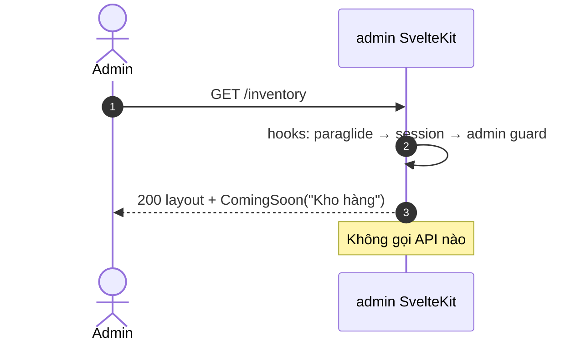
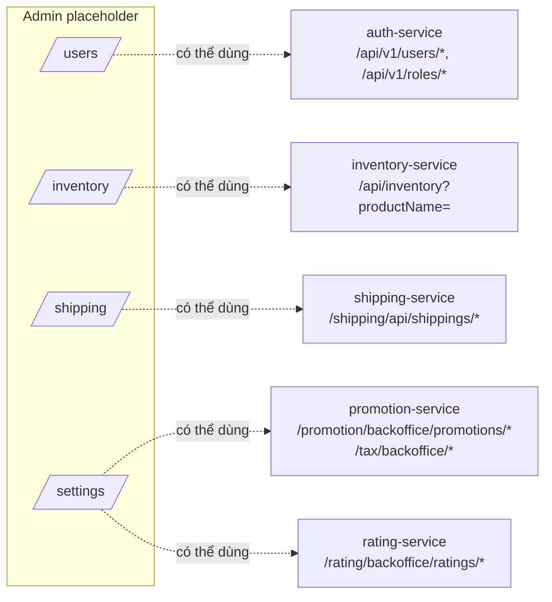

# FEAT-26 — Module Users / Inventory / Shipping / Settings (admin, placeholder)

> **Phiên bản:** 1.0 · **Trạng thái:** Final · **Cập nhật:** 2026-11-12 · **Phạm vi:** Ứng dụng (as-is)

| Thuộc tính | Giá trị |
| :--- | :--- |
| ID | FEAT-26 |
| Business Requirement | BR-26 |
| Trạng thái | ⛔ **Chưa có** — bốn mục sidebar dẫn tới trang placeholder "Tính năng đang phát triển"; không có remote function, không gọi API. Một số backend API đã tồn tại có thể dùng để hiện thực (xem §7). |
| Actor | Admin |
| Ứng dụng / Service | `frontend/apps/admin` (routes `/users`, `/inventory`, `/shipping`, `/settings`); backend tiềm năng: auth-service, inventory-service, shipping-service, promotion-service (tax/promotion), rating-service, notification-service, media-service |
| Issue liên quan | ISSUE-01, ISSUE-07, ISSUE-08, ISSUE-13, ISSUE-15, ISSUE-26, ISSUE-43, ISSUE-51, ISSUE-100 |

## 1. Mô tả & mục tiêu nghiệp vụ

Sidebar admin có 8 mục (`frontend/apps/admin/src/routes/+layout.svelte:39-48`); bốn mục cuối — **Người dùng**, **Kho hàng**, **Vận chuyển**, **Cài đặt** — chỉ render component `ComingSoon` (`frontend/apps/admin/src/lib/components/coming-soon.svelte:1-14`). Mục tiêu tài liệu: ghi nhận hiện trạng và chỉ ra API backend đã có để lập kế hoạch hiện thực.

## 2. User stories (mục tiêu — chưa hiện thực)

| ID | Module | Là Admin, tôi muốn… | Hiện trạng |
| :--- | :--- | :--- | :--- |
| US-26.1 | Users | xem danh sách người dùng, sửa, xóa, gán/thu hồi role | ⛔ UI; API có ở auth-service |
| US-26.2 | Inventory | xem/điều chỉnh tồn kho theo sản phẩm | ⛔ UI; API chỉ kiểm tra còn hàng theo tên |
| US-26.3 | Shipping | xem/cập nhật thông tin giao hàng của đơn | ⛔ UI; API chỉ CRUD order_items |
| US-26.4 | Settings | cấu hình thuế, khuyến mãi, thông báo… | ⛔ UI; API tax/promotion có |
| US-26.5 | Tất cả | thấy rõ module đang phát triển | ✅ placeholder |

## 3. Tiền điều kiện / Hậu điều kiện

- Qua guard admin (FEAT-21). Không có hậu điều kiện (chỉ hiển thị tĩnh).

## 4. Luồng nghiệp vụ

### 4.1 Luồng chính
1. Admin bấm mục sidebar (vd "Người dùng") → `localizeHref('/users')`; mục được đánh dấu active (`+layout.svelte:50-53`).
2. Trang đặt `<title>` = `meta_template({page: <module>_metaTitle})` (vd "Người dùng | EzBuy Admin").
3. Render `ComingSoon` với icon `Construction`, tiêu đề module và dòng `common_developing` "Tính năng đang phát triển".

### 4.2 Luồng thay thế
- Locale `en`: `/en/users`… với nhãn tiếng Anh ("Feature under development").
- Mobile: truy cập qua drawer (Sheet) bên trái.

### 4.3 Luồng ngoại lệ
- Không có (trang tĩnh). Chưa đăng nhập/không phải admin → guard xử lý như FEAT-21.

## 5. Sequence diagram

## 6. Màn hình & route (UI)

| Route | File | Title key | Nội dung |
| :--- | :--- | :--- | :--- |
| `/users` | `frontend/apps/admin/src/routes/users/+page.svelte:1-10` | `users_metaTitle` | `ComingSoon(users_title)` |
| `/inventory` | `routes/inventory/+page.svelte:1-10` | `inventory_metaTitle` | `ComingSoon(inventory_title)` |
| `/shipping` | `routes/shipping/+page.svelte:1-10` | `shipping_metaTitle` | `ComingSoon(shipping_title)` |
| `/settings` | `routes/settings/+page.svelte:1-10` | `settings_metaTitle` | `ComingSoon(settings_title)` |

## 7. API sử dụng (backend đã có, chưa được UI dùng)

**Users — auth-service** (gateway `auth-users`/`auth-roles`, Bearer, rewrite `/auth/...` — `deploy/apisix/apisix.yaml:142-177`; handler `services/auth-service/internal/handler/auth_handler.go:73-87`)

| Method | Path (gateway) | Mô tả | Lưu ý |
| :--- | :--- | :--- | :--- |
| GET | `/api/v1/users/all?page&size&sortBy&sortOrder` | Danh sách phân trang (envelope `ApiResponse<PageResponse>`) | Không chứa roles (ISSUE-100) |
| GET | `/api/v1/users/{id}` | Chi tiết | |
| GET | `/api/v1/users?username=` | Tìm theo username | |
| PUT | `/api/v1/users/{id}` | Cập nhật fullName/email/gender/phone/avatar | |
| DELETE | `/api/v1/users/{id}` | Xóa (cả Keycloak nếu có id) | |
| POST | `/api/v1/roles/users/{userId}/assign` | Body text = tên role | Chỉ DB, không đồng bộ Keycloak (ISSUE-08) |
| POST | `/api/v1/roles/users/{userId}/revoke` | Body text = tên role | |
| GET | `/api/v1/roles/users/{userId}` | Role của user | |
| PUT | `/api/v1/users/me/password` | Đổi mật khẩu | Stub (ISSUE-07) |

**Inventory — inventory-service** (gateway `inventory`, Bearer — `apisix.yaml:232-249`; `services/inventory-service/internal/handler/inventory_handler.go:25-32`)

| Method | Path | Mô tả | Lưu ý |
| :--- | :--- | :--- | :--- |
| GET | `/api/inventory?productName=` | Kiểm tra còn hàng | Định danh theo tên (ISSUE-26); client lib gửi `skuCode` (ISSUE-51) |
| GET | `/api/inventory/{products}` | Kiểm tra theo path | Chỉ đọc; không có nhập/xuất kho |

**Shipping — shipping-service** (gateway `shipping`, Bearer — `apisix.yaml:268-279`): CRUD `order_items` (xem FEAT-20); list/create/update 404 qua gateway (ISSUE-15).

**Settings — ứng viên**: promotion (FEAT-16), tax classes/rates (FEAT-17; upstream 13 lỗi — ISSUE-13), kiểm duyệt rating (FEAT-15), notification/email (FEAT-19), media (FEAT-18). Không có service "settings" chung.

Không có client nào trong `frontend/packages/lib/src/server/api.ts` cho các API trên (trừ `inventory.checkStock` không dùng — ISSUE-43).

## 8. Dữ liệu

Không có dữ liệu riêng. Dữ liệu tiềm năng: `users`, `roles`, `user_role` (authservice), `inventory` (inventoryservice), `order_items` (shippingservice), `promotion`, `tax_class`, `tax_rate` (promotionservice).

## 9. Business rules & validation

Không áp dụng (placeholder). Khi hiện thực cần bổ sung kiểm tra role tại backend (ISSUE-01).

## 10. Xử lý lỗi

Không áp dụng.

## 11. i18n (key chính)

`users_title`, `users_metaTitle`, `inventory_title`, `inventory_metaTitle`, `shipping_title`, `shipping_metaTitle`, `settings_title`, `settings_metaTitle`, `sidebar_users`, `sidebar_inventory`, `sidebar_shipping`, `sidebar_settings`, `common_developing`, `meta_template`.

## 12. Acceptance criteria (Given / When / Then — theo hành vi hiện tại)

| # | Given | When | Then |
| :--- | :--- | :--- | :--- |
| AC-26.1 | Admin đã qua guard | Bấm "Người dùng" | URL `/users`, mục active, hiển thị "Người dùng" + "Tính năng đang phát triển" |
| AC-26.2 | Locale en | Mở `/en/settings` | "Settings" + "Feature under development"; title "Settings | EzBuy Admin" |
| AC-26.3 | — | Mở bất kỳ trang placeholder | Không có request nào tới gateway |
| AC-26.4 | Chưa đăng nhập | Mở `/inventory` | 303 `/login?redirect=%2Finventory` |

## 13. Giới hạn & vấn đề đã biết

- Bốn module chưa có chức năng.
- API Users có sẵn nhưng: không kiểm role (ISSUE-01), role chỉ ở DB (ISSUE-08), profile không trả roles (ISSUE-100), đổi mật khẩu stub (ISSUE-07).
- Inventory backend không đủ cho quản lý kho (ISSUE-26, ISSUE-51).
- Shipping/tax: lỗi gateway (ISSUE-15, ISSUE-13).

## 14. Test hiện có

Không có.

## 15. Tham chiếu source

- `frontend/apps/admin/src/routes/{users,inventory,shipping,settings}/+page.svelte`
- `frontend/apps/admin/src/lib/components/coming-soon.svelte:1-14`
- `frontend/apps/admin/src/routes/+layout.svelte:39-53`
- `services/auth-service/internal/handler/auth_handler.go:44-87`
- `services/inventory-service/internal/handler/inventory_handler.go:20-33`
- `services/shipping-service/internal/handler/shipping_handler.go:23-42`
- `deploy/apisix/apisix.yaml:142-177,232-249,268-279,340-375`
