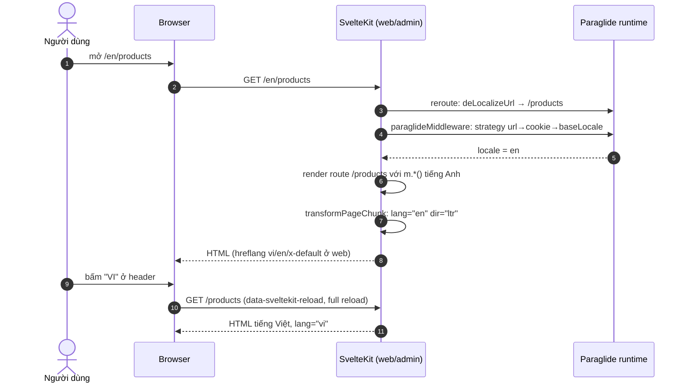
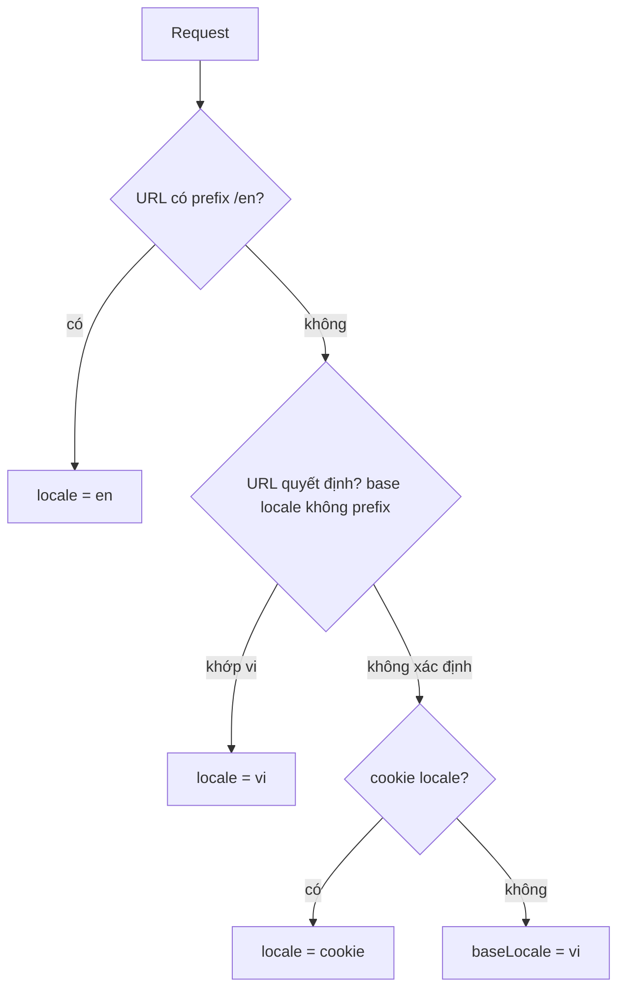

# FEAT-27 — Đa ngôn ngữ vi / en (i18n)

> **Phiên bản:** 1.0 · **Trạng thái:** Final · **Cập nhật:** 2026-11-12 · **Phạm vi:** Ứng dụng (as-is)

| Thuộc tính | Giá trị |
| :--- | :--- |
| ID | FEAT-27 |
| Business Requirement | BR-27 |
| Trạng thái | ✅ **Đã triển khai** — cả web và admin dùng Paraglide JS 2 với `vi` là ngôn ngữ gốc (không prefix) và `en` (prefix `/en`), chuyển ngôn ngữ ở header, `<html lang>` động, hreflang (web), kiểm tra parity key trong CI. Còn một số chuỗi chưa dịch (thông điệp validate, nội dung lỗi/backend, định dạng tiền/ngày cố định vi-VN) — ISSUE-83. |
| Actor | Guest, Customer, Admin |
| Ứng dụng / Service | `frontend/apps/web`, `frontend/apps/admin`, `frontend/scripts/locale-parity.ts`, CI `.github/workflows/ci.yml` |
| Issue liên quan | ISSUE-39, ISSUE-43, ISSUE-44, ISSUE-47, ISSUE-83 |

## 1. Mô tả & mục tiêu nghiệp vụ

Phục vụ người dùng Việt Nam mặc định bằng tiếng Việt và cho phép chuyển sang tiếng Anh; URL phản ánh ngôn ngữ để chia sẻ/SEO; lựa chọn được ghi nhớ.

## 2. User stories

| ID | Là… | Tôi muốn… | Hiện trạng |
| :--- | :--- | :--- | :--- |
| US-27.1 | Khách | mở site lần đầu thấy tiếng Việt, URL không prefix | ✅ |
| US-27.2 | Khách | bấm "EN" để xem bản tiếng Anh tại cùng trang | ✅ (`/en/...`, full reload) |
| US-27.3 | Khách | ngôn ngữ được nhớ khi quay lại | ✅ cookie (nhưng URL vẫn ưu tiên) |
| US-27.4 | Admin | backoffice cũng có vi/en | ✅ |
| US-27.5 | Dev | CI chặn khi thiếu key ở một ngôn ngữ | ✅ `bun run i18n:check` |
| US-27.6 | Khách en | giá/ngày theo định dạng tiếng Anh, thông báo lỗi bằng tiếng Anh | 🟡 tiền/ngày luôn vi-VN; validate luôn tiếng Anh kể cả ở vi |

## 3. Tiền điều kiện / Hậu điều kiện

- Paraglide được compile lúc build/dev bởi `paraglideVitePlugin` vào `src/lib/paraglide` (thư mục gitignore) (`frontend/apps/web/vite.config.ts:26-32`, `frontend/apps/admin/vite.config.ts:26-32`). Script `check` compile lại với cùng strategy (`frontend/apps/web/package.json`, script `check`).
- Hậu điều kiện: locale được xác định cho mỗi request; HTML có `lang`/`dir` đúng; cookie locale được ghi bởi runtime Paraglide khi đổi ngôn ngữ trên client.

## 4. Luồng nghiệp vụ

### 4.1 Luồng chính

**Cấu hình** (`frontend/apps/{web,admin}/project.inlang/settings.json`): `baseLocale: "vi"`, `locales: ["vi","en"]`, catalog `./messages/{locale}.json` (plugin `message-format`), plugin `m-function-matcher`.

**Strategy**: `['url', 'cookie', 'baseLocale']` — URL thắng, rồi cookie, cuối cùng `vi`. Với cấu hình mặc định của Paraglide 2 (không khai báo `urlPatterns`), locale gốc không có prefix, `en` có prefix `/en` (comment trong `vite.config.ts:29`). Cookie dùng tên mặc định của Paraglide (`PARAGLIDE_LOCALE`).

**Xử lý request (server)**
1. `reroute` (`src/hooks.ts:1-4` ở cả hai app): `deLocalizeUrl(request.url).pathname` → `/en/products` được route như `/products`.
2. `handleParaglide` (`frontend/apps/web/src/hooks.server.ts:14-25`, admin `:19-30`): `paraglideMiddleware` xác định `locale`, rồi `transformPageChunk` thay `%paraglide.lang%` và `%paraglide.dir%` trong `src/app.html:2` → `<html lang="vi" dir="ltr">`.
3. Component dùng `m.<key>()` từ `#lib/paraglide/messages.js` và `localizeHref(path)` cho link nội bộ.

**Chuyển ngôn ngữ (client)**
1. Header web (`frontend/apps/web/src/lib/components/header.svelte:63-77`) và header admin (`frontend/apps/admin/src/routes/+layout.svelte:123-137`) lặp `locales`: locale hiện tại hiển thị in đậm (`VI`), locale còn lại là link `localizeHref(page.url.pathname, { locale: l })` với `data-sveltekit-reload` (tải lại toàn trang).
2. Link không giữ query string (vd `/products?page=2` → `/en/products`).

### 4.2 Luồng thay thế

| # | Điều kiện | Hành vi |
| :--- | :--- | :--- |
| A1 | Truy cập `/` với cookie locale = en | Với `urlPatterns` mặc định, URL không prefix được hiểu là base locale `vi` nên strategy `url` đã quyết định → cookie thực tế hầu như không có tác dụng cho các URL của app (chỉ là dự phòng). Chưa có test E2E xác nhận hành vi này. |
| A2 | Link nội bộ không qua `localizeHref` (vd `product-card.svelte` `href="/products/{id}"`) | Người dùng en bị chuyển về vi (ISSUE-39). |
| A3 | Redirect server (`redirect(303, localizeHref(...))`) | Giữ locale hiện hành (admin guard, login, callback). |

### 4.3 Luồng ngoại lệ

| # | Tình huống | Kết quả |
| :--- | :--- | :--- |
| X1 | Thiếu key ở `en.json` | `bun run i18n:check` exit 1 → CI job `frontend-check` thất bại (`.github/workflows/ci.yml:177-179`) |
| X2 | Key tồn tại ở cả hai nhưng placeholder khác (vd `{count}` vs `{n}`) | Script không phát hiện (chỉ so key) — ISSUE-83 |
| X3 | Locale không hỗ trợ (vd `/fr/...`) | Không khớp pattern → coi là path thường → 404 |

## 5. Sequence diagram

## 6. Màn hình & route (UI)

| App | Vị trí switcher | Route có locale |
| :--- | :--- | :--- |
| web | Top bar của header (`header.svelte:63-77`) | Mọi route: `/`, `/products`, `/products/[id]`, `/cart`, `/checkout`, `/orders`, `/login`, `/auth/callback` và bản `/en/...`. `/sitemap.xml` liệt kê cả hai (FEAT-28) |
| admin | Header phải (`+layout.svelte:123-137`); trang bare (login/callback/access-denied) **không có** switcher | Mọi route + `/en/...` |

## 7. API sử dụng

Không gọi backend. Backend trả thông điệp tiếng Anh (vd `Invalid productId`) — không được dịch nhưng UI hầu như không hiển thị trực tiếp.

## 8. Dữ liệu

**Số lượng key** (đếm từ `messages/vi.json` và `messages/en.json`, hai file có cùng tập key):

| App | Tổng key | Phân bố theo prefix |
| :--- | :---: | :--- |
| web | **306** | `auth` 59 (phần lớn thừa — ISSUE-43), `home` 43, `footer` 37, `checkout` 36, `header` 25, `products` 22, `cart` 17, `productdetail` 17, `common` 13, `category` 12, `error` 7, `orders` 7, `productcard` 5, `lang` 3, `productgrid` 3 |
| admin | **127** | `products` 24, `orders` 18, `common` 17, `dashboard` 15, `sidebar` 13, `categories` 9, `error` 7, `auth` 5, `lang` 3, `login` 3, `meta` 3, `access` 2, `inventory` 2, `settings` 2, `shipping` 2, `users` 2 |

Catalog là JSON phẳng; placeholder dạng `{name}` (vd `orders_count: "{count} đơn hàng"`). Nhãn danh mục storefront hard-code `category_c1..c10` (ISSUE-44).

## 9. Business rules & validation

| # | Quy tắc | Nguồn |
| :--- | :--- | :--- |
| BR27-1 | `vi` là base locale, không prefix; `en` prefix `/en` | `project.inlang/settings.json`, `vite.config.ts:29` |
| BR27-2 | Thứ tự xác định locale: URL → cookie → base | `vite.config.ts:30` |
| BR27-3 | Mọi link nội bộ phải đi qua `localizeHref` | quy ước code; vi phạm ở ISSUE-39 |
| BR27-4 | Hai catalog phải có cùng tập key (vi là chuẩn) | `frontend/scripts/locale-parity.ts:19-38` |
| BR27-5 | Đổi ngôn ngữ dùng full reload | `data-sveltekit-reload` |
| BR27-6 | `dir` luôn `ltr` (hai ngôn ngữ đều LTR) | `getTextDirection` |

## 10. Xử lý lỗi

Script parity in danh sách `missing`/`extra` cho từng app và exit 1; thành công in `web: vi.json / en.json in sync (306 keys)`. Trang lỗi dùng key `error_*` theo locale (FEAT-28).

## 11. i18n (key chính)

`lang_vi`, `lang_en`, `lang_switchLabel` có ở cả hai app nhưng **không được dùng** (switcher in `l.toUpperCase()`, không có `aria-label`) — ISSUE-83.

## 12. Acceptance criteria (Given / When / Then — theo hành vi hiện tại)

| # | Given | When | Then |
| :--- | :--- | :--- | :--- |
| AC-27.1 | Không cookie | GET `/products` | HTML `lang="vi"`, nhãn tiếng Việt |
| AC-27.2 | — | GET `/en/products` | `lang="en"`, nhãn tiếng Anh, route giống `/products` |
| AC-27.3 | Đang ở `/en/cart` | Bấm "VI" | Full reload tới `/cart` |
| AC-27.4 | Admin ở `/en/orders` chưa đăng nhập | — | 303 `/en/login?redirect=%2Forders` |
| AC-27.5 | Xóa 1 key khỏi `admin/messages/en.json` | `bun run i18n:check` | Exit 1, in `admin: en.json differs from vi.json  missing: <key>` |
| AC-27.6 | Locale en, form sản phẩm admin để trống | Submit | Thông điệp tiếng Anh (đúng ngẫu nhiên); ở vi cũng là tiếng Anh |
| AC-27.7 | Locale en | Xem giá | Hiển thị `₫` theo `vi-VN` |
| AC-27.8 | Locale en, bấm thẻ sản phẩm (product-card) | — | Sang `/products/{id}` tiếng Việt (ISSUE-39) |

## 13. Giới hạn & vấn đề đã biết

- **ISSUE-83** (Low): thông điệp zod hard-code tiếng Anh (`frontend/packages/lib/src/schemas.ts:44-76`, vd "Please enter a product name"); `formatPrice`/`formatDate` cố định `vi-VN`/VND (`format.ts:1-16`); key `lang_*` không dùng, switcher thiếu `aria-label`; parity chỉ so key, không so placeholder; switcher mất query string.
- **ISSUE-39**: link không localize ở product-card. **ISSUE-44**: danh mục hard-code. **ISSUE-43**: ~59 key `auth_*` thừa ở web.
- **ISSUE-47**: phụ thuộc tính năng experimental SvelteKit.
- Thông báo lỗi từ backend (ApiError.message) bằng tiếng Anh nếu được hiển thị (vd checkout `error(401, 'Your session has expired...')`).
- Email (FEAT-19) chỉ tiếng Anh.

## 14. Test hiện có

- CI: `bun run i18n:check` trong job `frontend-check` (`.github/workflows/ci.yml:177-179`).
- `frontend/packages/lib/src/format.test.ts` khẳng định định dạng vi-VN.
- Không có test E2E cho định tuyến locale (ISSUE-46).

## 15. Tham chiếu source

- `frontend/apps/web/project.inlang/settings.json`, `frontend/apps/admin/project.inlang/settings.json`
- `frontend/apps/web/vite.config.ts:26-32`, `frontend/apps/admin/vite.config.ts:26-32`
- `frontend/apps/web/src/hooks.ts:1-4`, `hooks.server.ts:14-25`; `frontend/apps/admin/src/hooks.ts:1-4`, `hooks.server.ts:19-30`
- `frontend/apps/{web,admin}/src/app.html:2`
- `frontend/apps/web/src/lib/components/header.svelte:17,63-77`; `frontend/apps/admin/src/routes/+layout.svelte:35,123-137`
- `frontend/apps/{web,admin}/messages/{vi,en}.json`
- `frontend/scripts/locale-parity.ts:1-41`; `frontend/package.json` (script `i18n:check`)
- `frontend/packages/lib/src/schemas.ts`, `format.ts`
