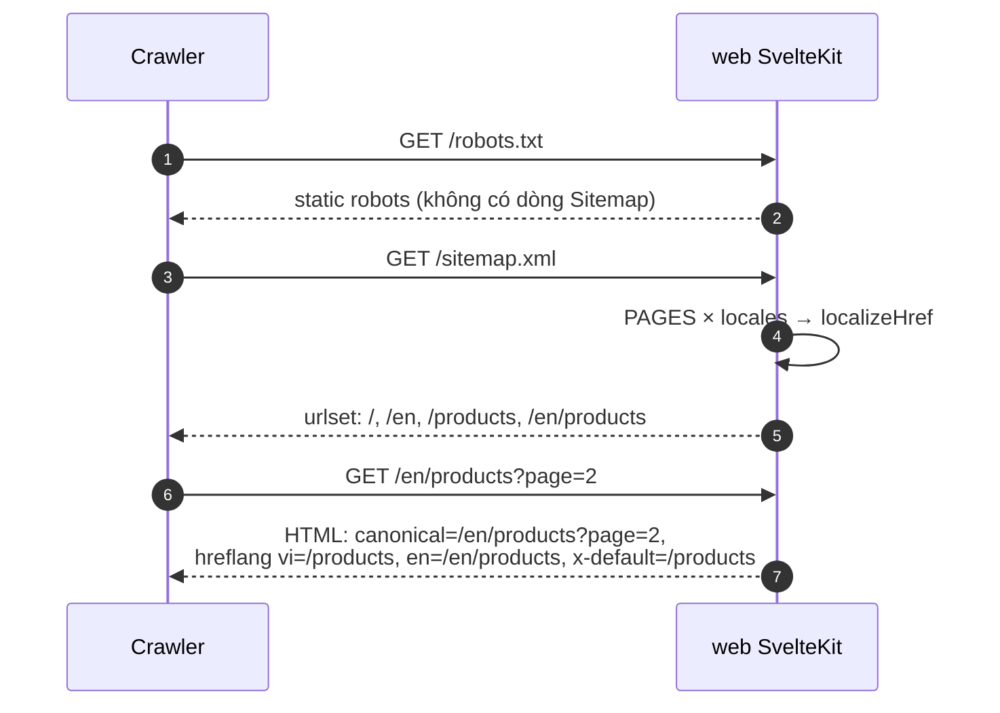
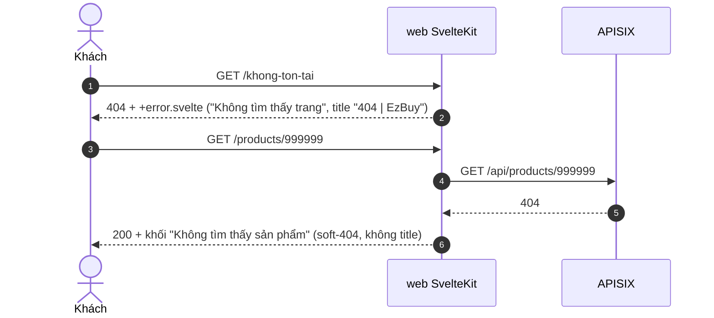
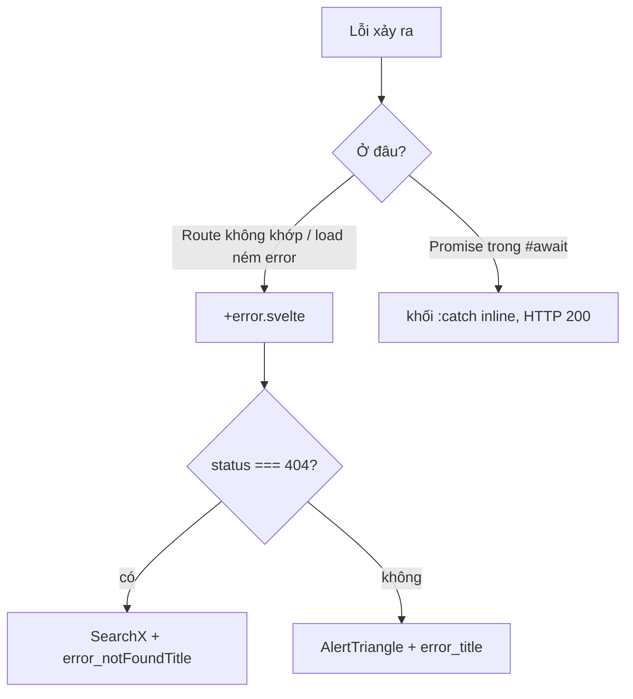

# FEAT-28 — SEO & trang lỗi

> **Phiên bản:** 1.0 · **Trạng thái:** Final · **Cập nhật:** 2026-11-12 · **Phạm vi:** Ứng dụng (as-is)

| Thuộc tính | Giá trị |
| :--- | :--- |
| ID | FEAT-28 |
| Business Requirement | BR-28 |
| Trạng thái | ✅ **Đã triển khai (mức cơ bản)** — web có `sitemap.xml` động (vi + en), `robots.txt`, canonical + hreflang ở layout, title/description cho các trang chính; admin chặn index hoàn toàn; cả hai app có `+error.svelte` phân biệt 404/lỗi khác. Thiếu: title cho trang chi tiết sản phẩm, soft-404, sitemap không có sản phẩm — ISSUE-82. |
| Actor | Guest, Search engine crawler, Admin |
| Ứng dụng / Service | `frontend/apps/web`, `frontend/apps/admin` |
| Issue liên quan | ISSUE-38, ISSUE-39, ISSUE-82, ISSUE-83 |

## 1. Mô tả & mục tiêu nghiệp vụ

- Giúp công cụ tìm kiếm lập chỉ mục storefront ở cả hai ngôn ngữ, tránh index các luồng riêng tư (giỏ hàng, checkout, đơn hàng, callback đăng nhập) và toàn bộ backoffice.
- Khi có lỗi (404, 5xx, lỗi render), người dùng thấy trang thân thiện, đa ngôn ngữ với lối về trang chủ và nút thử lại.

## 2. User stories

| ID | Là… | Tôi muốn… | Hiện trạng |
| :--- | :--- | :--- | :--- |
| US-28.1 | Crawler | đọc `/sitemap.xml` liệt kê trang công khai ở vi và en | ✅ chỉ `/` và `/products` |
| US-28.2 | Crawler | `robots.txt` cho biết vùng không index | ✅ web; admin `Disallow: /` |
| US-28.3 | Crawler | canonical + hreflang (vi, en, x-default) | ✅ web; canonical gồm cả query |
| US-28.4 | Khách | URL sai → trang "Không tìm thấy trang" | ✅ |
| US-28.5 | Khách | lỗi hệ thống → "Đã xảy ra lỗi" + Thử lại | ✅ |
| US-28.6 | Khách/crawler | trang sản phẩm có title/description riêng, sản phẩm không tồn tại trả 404 | ⛔ (ISSUE-82) |

## 3. Tiền điều kiện / Hậu điều kiện

- Không cần đăng nhập (web). Ở admin, `+error.svelte` hiển thị trong layout (có sidebar) với route được guard; `robots.txt` và file tĩnh có dấu `.` nên không bị guard chặn (`frontend/apps/admin/src/hooks.server.ts:63`).
- Không có hậu điều kiện dữ liệu.

## 4. Luồng nghiệp vụ

### 4.1 Luồng chính

**Sitemap** (`frontend/apps/web/src/routes/sitemap.xml/+server.ts:1-21`)
1. `GET /sitemap.xml` → với mỗi path trong `PAGES = ['/', '/products']` và mỗi locale (`vi`, `en`) tạo URL tuyệt đối `new URL(localizeHref(path, {locale}), url.origin)`.
2. Trả XML `urlset` (sitemaps.org 0.9) với 4 `<url><loc>`: `/`, `/en`, `/products`, `/en/products` (origin theo request); `content-type: application/xml`. Không có `lastmod`, `changefreq`, `priority`.

**robots.txt**
- Web (`frontend/apps/web/static/robots.txt:1-11`): `User-agent: *`, `Allow: /`, `Disallow: /cart`, `/checkout`, `/orders`, `/auth/` và bản `/en/...`. Không có dòng `Sitemap:`; `/login` không bị disallow.
- Admin (`frontend/apps/admin/static/robots.txt:1-3`): `Disallow: /`.

**Canonical & hreflang** (`frontend/apps/web/src/routes/+layout.svelte:17-35`)
- `<link rel="canonical" href={page.url.href}>` — URL đầy đủ **kèm query**.
- Với mỗi locale: `<link rel="alternate" hreflang="vi|en" href={origin + localizeHref(page.url.pathname, {locale})}>` (không kèm query) + `hreflang="x-default"` trỏ bản `vi`.
- Admin không có canonical/hreflang; layout admin đặt `<title>EzBuy Admin</title>` và `meta description` (`frontend/apps/admin/src/routes/+layout.svelte:68-71`).

**Title/description trang web**

| Route | `<title>` | description |
| :--- | :--- | :--- |
| `/` | `home_metaTitle` | `home_metaDesc` (`routes/+page.svelte:99-102`) |
| `/products` | `products_metaTitle` | — |
| `/products/[id]` | **không có** | — |
| `/cart`, `/checkout`, `/orders` | `cart_metaTitle`, `checkout_metaTitle`, `orders_metaTitle` | — |
| `/login`, `/auth/callback` | `auth_loginPageTitle` | — |
| lỗi | `error_metaTitle({status})` → "404 \| EzBuy" | — |

**Trang lỗi** (`frontend/apps/web/src/routes/+error.svelte:1-29`, admin `frontend/apps/admin/src/routes/+error.svelte:1-29` — nội dung giống nhau)
1. SvelteKit render `+error.svelte` khi load/route ném lỗi hoặc không khớp route.
2. `notFound = page.status === 404` → icon `SearchX`, tiêu đề "Không tìm thấy trang", gợi ý "Trang có thể đã được di chuyển hoặc bị xoá."; ngược lại icon `AlertTriangle`, "Đã xảy ra lỗi", "Dịch vụ có thể tạm thời không kết nối được. Vui lòng thử lại."
3. Hai nút: "Về trang chủ" (`localizeHref('/')`), "Thử lại" (`location.reload()`).

### 4.2 Luồng thay thế

| # | Điều kiện | Hành vi |
| :--- | :--- | :--- |
| A1 | Locale en | Sitemap không đổi; trang lỗi dùng chuỗi tiếng Anh ("Page not found"…). |
| A2 | Lỗi ở admin | "Về trang chủ" → `/` → redirect `/dashboard`. Title "500 \| EzBuy Admin". |
| A3 | Truy cập qua host khác (vd `ecommerce.local`) | Sitemap/canonical dùng origin của request. |

### 4.3 Luồng ngoại lệ

| # | Tình huống | Kết quả |
| :--- | :--- | :--- |
| X1 | `/products/999999` (không tồn tại) | Remote query ném `ApiError 404` trong `{#await}` → khối `{:catch}` "Không tìm thấy sản phẩm" với **HTTP 200** (soft-404), không có `<title>` riêng (ISSUE-82) |
| X2 | Lỗi API trong các trang dùng `{#await}` (catalog, admin list) | Hiển thị inline ("Chưa có dữ liệu"/thông báo lỗi), **không** qua `+error.svelte`, HTTP 200 |
| X3 | Lỗi render không bắt (vd `.length` của `undefined` — ISSUE-48) | `+error.svelte` với status 500 |
| X4 | Không có `+error.svelte` cho lỗi trong chính root layout | SvelteKit dùng trang lỗi tĩnh mặc định (`src/error.html` không tùy biến) |

## 5. Sequence diagram

## 6. Màn hình & route (UI)

| Route | App | Mô tả |
| :--- | :--- | :--- |
| `/sitemap.xml` | web | Endpoint `+server.ts` |
| `/robots.txt` | web, admin | File tĩnh |
| `+error.svelte` | web, admin | EmptyState căn giữa, `max-w-lg`, `mt-16` |
| `<svelte:head>` layout | web | favicon, canonical, hreflang |

## 7. API sử dụng

Không gọi backend (sitemap không đọc danh sách sản phẩm).

## 8. Dữ liệu

Không có. Danh sách trang trong sitemap hard-code `PAGES`.

## 9. Business rules & validation

| # | Quy tắc | Nguồn |
| :--- | :--- | :--- |
| BR28-1 | Chỉ `/` và `/products` được đưa vào sitemap, nhân với mọi locale | `sitemap.xml/+server.ts:5-10` |
| BR28-2 | Luồng riêng tư (cart, checkout, orders, auth) bị disallow ở cả hai ngôn ngữ | `web/static/robots.txt` |
| BR28-3 | Backoffice không bao giờ được index | `admin/static/robots.txt` |
| BR28-4 | `x-default` = bản tiếng Việt (base locale) | `+layout.svelte:23,32-34` |
| BR28-5 | Trang lỗi phân biệt 404 và các mã khác | `+error.svelte:9` |

## 10. Xử lý lỗi

Xem §4.3. Trang lỗi không hiển thị `page.error.message` (tránh lộ chi tiết) và không log phía client.

## 11. i18n (key chính)

`error_metaTitle` (`{status} | EzBuy` / `{status} | EzBuy Admin`), `error_notFoundTitle`, `error_notFoundHint`, `error_title`, `error_hint`, `error_backHome`, `error_retry` (7 key mỗi app); `home_metaTitle`, `home_metaDesc`, `products_metaTitle`, `cart_metaTitle`, `checkout_metaTitle`, `orders_metaTitle`, `auth_loginPageTitle`; admin `meta_title`, `meta_description`, `meta_template`.

## 12. Acceptance criteria (Given / When / Then — theo hành vi hiện tại)

| # | Given | When | Then |
| :--- | :--- | :--- | :--- |
| AC-28.1 | Host `http://localhost:3000` | GET `/sitemap.xml` | 200 `application/xml` với 4 loc: `/`, `/en`, `/products`, `/en/products` |
| AC-28.2 | — | GET web `/robots.txt` | Có `Disallow: /checkout` và `/en/checkout` |
| AC-28.3 | — | GET admin `/robots.txt` (chưa đăng nhập) | 200 `Disallow: /` (không bị redirect) |
| AC-28.4 | — | GET `/en/products?sort=x` | canonical `.../en/products?sort=x`; hreflang en `/en/products`, vi `/products`, x-default `/products` |
| AC-28.5 | — | GET `/abc` (web) | HTTP 404, "Không tìm thấy trang", title "404 \| EzBuy" |
| AC-28.6 | Locale en | GET `/en/abc` | "Page not found" |
| AC-28.7 | — | GET `/products/999999` | HTTP 200, khối "không tìm thấy sản phẩm", không có `<title>` riêng |
| AC-28.8 | Trang lỗi | Bấm "Thử lại" | `location.reload()` |

## 13. Giới hạn & vấn đề đã biết

- **ISSUE-82** (Low): trang chi tiết sản phẩm không có `<title>`/description/OG; soft-404 (HTTP 200) cho sản phẩm không tồn tại; canonical gồm query string (trang lọc/phân trang mỗi trang một canonical) trong khi hreflang bỏ query; `robots.txt` thiếu dòng `Sitemap:`; sitemap không có URL sản phẩm/danh mục, không `lastmod`; không có Open Graph/Twitter card/structured data.
- **ISSUE-38**: trang chủ dùng dữ liệu mock (nội dung index không phản ánh catalog thật).
- **ISSUE-39**: link product-card không localize → hreflang/điều hướng không nhất quán.
- Lỗi trong `{#await}` không đi qua trang lỗi chung → mã HTTP không phản ánh lỗi.

## 14. Test hiện có

Không có test cho sitemap, robots hay trang lỗi (ISSUE-46).

## 15. Tham chiếu source

- `frontend/apps/web/src/routes/sitemap.xml/+server.ts:1-21`
- `frontend/apps/web/static/robots.txt`, `frontend/apps/admin/static/robots.txt`
- `frontend/apps/web/src/routes/+layout.svelte:17-35`; `frontend/apps/admin/src/routes/+layout.svelte:68-71`
- `frontend/apps/web/src/routes/+error.svelte:1-29`; `frontend/apps/admin/src/routes/+error.svelte:1-29`
- `frontend/apps/web/src/routes/+page.svelte:99-102`, `products/+page.svelte:72-74`, `products/[id]/+page.svelte:36-168`
- `frontend/apps/{web,admin}/messages/{vi,en}.json` (prefix `error_`)
