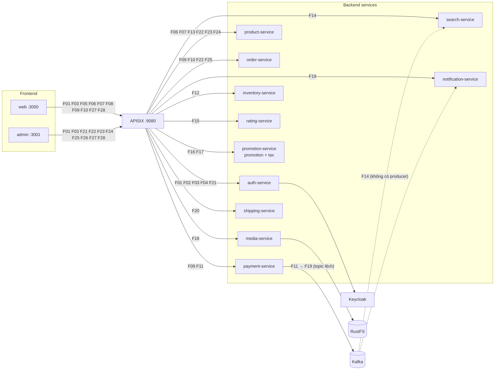
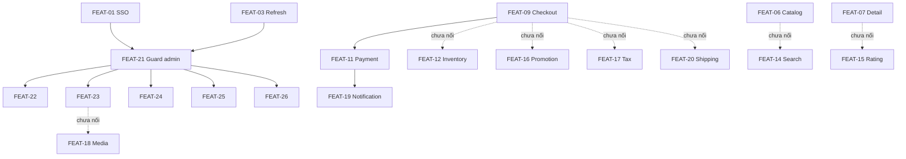

# 04 — Danh mục tính năng (Feature catalog)

> **Phiên bản:** 1.0 · **Trạng thái:** Final · **Cập nhật:** 2026-11-12 · **Phạm vi:** Ứng dụng (as-is)

> Mỗi tính năng `FEAT-xx` ánh xạ 1-1 với yêu cầu nghiệp vụ `BR-xx` (sổ đăng ký: [`conventions-and-ids.md`](../00-overview/conventions-and-ids.md#3-sổ-đăng-ký-business-requirement--feature)). Mọi tài liệu mô tả **hành vi của code hiện tại** (as-is); vấn đề được liên kết tới [`known-issues-tech-debt.md`](../07-plan/known-issues-tech-debt.md).
>
> Trạng thái: ✅ Đã triển khai · 🟡 Một phần · ⛔ Chưa có. Trạng thái dưới đây là kết luận trong từng tài liệu FEAT (có thể khác đánh giá ban đầu của registry — xem cột "Ghi chú").

## 1. Bảng tổng hợp

| FEAT | BR | Tên tính năng | Trạng thái | Actor | App / Service | Ghi chú | Tài liệu |
| :--- | :--- | :--- | :---: | :--- | :--- | :--- | :--- |
| FEAT-01 | BR-01 | Đăng nhập SSO / Đăng xuất | 🟡 | Guest, Customer, Admin | web, admin, auth-service, Keycloak | | [FEAT-01](FEAT-01-sso-login-logout.md) |
| FEAT-02 | BR-02 | Đăng ký tài khoản | 🟡 | Guest | auth-service | Chỉ API | [FEAT-02](FEAT-02-user-registration.md) |
| FEAT-03 | BR-03 | Duy trì & làm mới phiên | 🟡 | Customer, Admin | web, admin, auth-service | Đổi từ ✅ | [FEAT-03](FEAT-03-session-refresh.md) |
| FEAT-04 | BR-04 | Quản lý người dùng & vai trò (API) | 🟡 | Admin | auth-service | Chỉ API | [FEAT-04](FEAT-04-user-role-management.md) |
| FEAT-05 | BR-05 | Trang chủ storefront | 🟡 | Guest, Customer | web | Dữ liệu mock | [FEAT-05](FEAT-05-home-page.md) |
| FEAT-06 | BR-06 | Danh mục sản phẩm (lọc/sắp xếp/phân trang) | 🟡 | Guest, Customer | web, product-service | | [FEAT-06](FEAT-06-product-catalog.md) |
| FEAT-07 | BR-07 | Chi tiết sản phẩm | ✅ | Guest, Customer | web, product-service | | [FEAT-07](FEAT-07-product-detail.md) |
| FEAT-08 | BR-08 | Giỏ hàng | ✅ | Guest, Customer | web (client-side) | localStorage | [FEAT-08](FEAT-08-shopping-cart.md) |
| FEAT-09 | BR-09 | Checkout & đặt hàng | 🟡 | Customer | web, order-service, payment-service | | [FEAT-09](FEAT-09-checkout-place-order.md) |
| FEAT-10 | BR-10 | Lịch sử đơn hàng của khách | 🟡 | Customer | web, order-service | | [FEAT-10](FEAT-10-order-history.md) |
| FEAT-11 | BR-11 | Ghi nhận thanh toán | 🟡 | Hệ thống | payment-service | Chỉ API | [FEAT-11](FEAT-11-payment.md) |
| FEAT-12 | BR-12 | Kiểm tra tồn kho | 🟡 | Hệ thống | inventory-service | Chỉ API | [FEAT-12](FEAT-12-inventory-stock-check.md) |
| FEAT-13 | BR-13 | Sản phẩm yêu thích | 🟡 | Customer | product-service | Chỉ API | [FEAT-13](FEAT-13-favourites.md) |
| FEAT-14 | BR-14 | Tìm kiếm full-text & gợi ý | 🟡 | Guest, Customer | search-service | Chỉ API | [FEAT-14](FEAT-14-catalog-search-suggest.md) |
| FEAT-15 | BR-15 | Đánh giá sản phẩm | 🟡 | Customer, Admin | rating-service | Chỉ API | [FEAT-15](FEAT-15-ratings-reviews.md) |
| FEAT-16 | BR-16 | Quản lý khuyến mãi | 🟡 | Admin | promotion-service | Chỉ API, không áp dụng vào giá | [FEAT-16](FEAT-16-promotion-management.md) |
| FEAT-17 | BR-17 | Quản lý thuế | 🟡 | Admin, Hệ thống | promotion-service (`/tax`) | Chỉ API | [FEAT-17](FEAT-17-tax-management.md) |
| FEAT-18 | BR-18 | Quản lý media (upload/stream) | 🟡 | Admin, Hệ thống | media-service, RustFS | Chỉ API | [FEAT-18](FEAT-18-media-management.md) |
| FEAT-19 | BR-19 | Thông báo & email | 🟡 | Hệ thống | notification-service, Kafka, SMTP | Consumer sai topic | [FEAT-19](FEAT-19-notifications-email.md) |
| FEAT-20 | BR-20 | Dòng hàng vận chuyển | 🟡 | Hệ thống, Admin | shipping-service | Chỉ API | [FEAT-20](FEAT-20-shipping-order-items.md) |
| FEAT-21 | BR-21 | Kiểm soát truy cập backoffice | 🟡 | Admin | admin, auth-service | Guard chặn mọi người (ISSUE-100) | [FEAT-21](FEAT-21-admin-access-control.md) |
| FEAT-22 | BR-22 | Dashboard quản trị | 🟡 | Admin | admin, product-service, order-service | **Đổi từ ✅** | [FEAT-22](FEAT-22-admin-dashboard.md) |
| FEAT-23 | BR-23 | Quản lý sản phẩm (admin) | 🟡 | Admin | admin, product-service | | [FEAT-23](FEAT-23-admin-product-mgmt.md) |
| FEAT-24 | BR-24 | Quản lý danh mục (admin) | 🟡 | Admin | admin, product-service | | [FEAT-24](FEAT-24-admin-category-mgmt.md) |
| FEAT-25 | BR-25 | Quản lý đơn hàng (admin) | 🟡 | Admin | admin, order-service | Chỉ xem | [FEAT-25](FEAT-25-admin-order-mgmt.md) |
| FEAT-26 | BR-26 | Module Users / Inventory / Shipping / Settings | ⛔ | Admin | admin | Placeholder | [FEAT-26](FEAT-26-admin-placeholder-modules.md) |
| FEAT-27 | BR-27 | Đa ngôn ngữ vi / en | ✅ | Tất cả | web, admin | | [FEAT-27](FEAT-27-i18n.md) |
| FEAT-28 | BR-28 | SEO & trang lỗi | ✅ | Guest, Crawler | web, admin | Mức cơ bản | [FEAT-28](FEAT-28-seo-error-pages.md) |

**Thống kê**: ✅ 4 · 🟡 23 · ⛔ 1.

## 2. Nhóm theo miền (domain)

| Miền | Tính năng | Ghi chú |
| :--- | :--- | :--- |
| **Identity** (định danh & phiên) | FEAT-01, FEAT-02, FEAT-03, FEAT-04, FEAT-21 | Keycloak + auth-service + cookie BFF; role chỉ kiểm ở frontend admin |
| **Catalog** (hàng hóa & khám phá) | FEAT-05, FEAT-06, FEAT-07, FEAT-13, FEAT-14, FEAT-15, FEAT-18 | product-service là trung tâm; search/rating/media/favourite chưa có UI |
| **Ordering** (mua hàng & hậu mãi) | FEAT-08, FEAT-09, FEAT-10, FEAT-11, FEAT-12, FEAT-16, FEAT-17, FEAT-19, FEAT-20 | Checkout chỉ dùng order + payment; promotion/tax/inventory/shipping/notification chưa được nối vào luồng |
| **Admin** (backoffice) | FEAT-22, FEAT-23, FEAT-24, FEAT-25, FEAT-26 | Phụ thuộc FEAT-21 (guard) |
| **Platform** (xuyên suốt) | FEAT-27, FEAT-28 | i18n, SEO, trang lỗi |

## 3. Sơ đồ tính năng ↔ service

## 4. Ma trận truy vết (FEAT ↔ service ↔ route frontend ↔ issue chính)

| FEAT | Service backend | Route frontend | API gateway chính | Issue chính |
| :--- | :--- | :--- | :--- | :--- |
| FEAT-01 | auth-service, Keycloak | web & admin `/login`, `/auth/callback`; remote `logout` | `/api/v1/auth/login`, `/callback`, `/session`, `/logout` | ISSUE-04, 05, 06, 11, 66, 67, 100, 101 |
| FEAT-02 | auth-service | — | `POST /api/v1/auth/signup` | ISSUE-08, 101 |
| FEAT-03 | auth-service | `hooks.server.ts` (web, admin) | `POST /api/v1/auth/refresh` | ISSUE-06, 11, 66, 69 |
| FEAT-04 | auth-service | — (admin `/users` placeholder) | `/api/v1/users/*`, `/api/v1/roles/*` | ISSUE-01, 07, 08, 100 |
| FEAT-05 | — (mock) | web `/` | — | ISSUE-38, 39, 44 |
| FEAT-06 | product-service | web `/products` | `GET /api/products`, `/api/categories` | ISSUE-40, 44, 48, 102 |
| FEAT-07 | product-service | web `/products/[id]` | `GET /api/products/{id}` | ISSUE-39, 50, 82 |
| FEAT-08 | — (localStorage) | web `/cart` | — | ISSUE-38, 42 |
| FEAT-09 | order-service, payment-service | web `/checkout` | `POST /api/orders`, `POST /api/payments` | ISSUE-20, 21, 22, 23, 38 |
| FEAT-10 | order-service | web `/orders` | `GET /api/orders` | ISSUE-41, 48, 49 |
| FEAT-11 | payment-service, Kafka | — | `/api/payments` | ISSUE-17, 18, 25 |
| FEAT-12 | inventory-service | — | `/api/inventory` | ISSUE-26, 51 |
| FEAT-13 | product-service (favourite) | — | `/api/favourites` | ISSUE-13, 35 |
| FEAT-14 | search-service, OpenSearch, Kafka | — | `/storefront/catalog-search`, `/storefront/search_suggest` | ISSUE-19, 34 |
| FEAT-15 | rating-service | — | `/storefront/ratings*`, `/rating/backoffice/ratings/*` | ISSUE-01, 03, 15, 62 |
| FEAT-16 | promotion-service | — | `/promotion/backoffice/promotions/*` | ISSUE-15, 21, 30, 62 |
| FEAT-17 | promotion-service (`/tax`) | — | `/tax/backoffice/tax-classes/*`, `/tax-rates/*` | ISSUE-13, 31, 62 |
| FEAT-18 | media-service, RustFS | — (admin chỉ nhập URL ảnh) | `/media/medias/*` | ISSUE-15, 32, 63 |
| FEAT-19 | notification-service, Kafka, SMTP | — | `/notification/api/*` | ISSUE-09, 17, 33, 64, 65, 80 |
| FEAT-20 | shipping-service | — (admin `/shipping` placeholder) | `/shipping/api/shippings/*` | ISSUE-15, 20, 81 |
| FEAT-21 | auth-service (profile) | admin `hooks.server.ts`, `/login`, `/auth/callback`, `/access-denied` | `/api/v1/users/me` | ISSUE-01, 11, 66, 68, 100, 101 |
| FEAT-22 | product-service, order-service | admin `/dashboard` | `GET /api/products`, `/api/categories`, `/api/orders` | ISSUE-48, 49, 100 |
| FEAT-23 | product-service | admin `/products` | `/api/products*`, `GET /api/categories` | ISSUE-48, 60, 68, 102 |
| FEAT-24 | product-service | admin `/categories` | `/api/categories*` | ISSUE-44, 48, 102 |
| FEAT-25 | order-service | admin `/orders` | `GET /api/orders` | ISSUE-20, 40, 41, 48 |
| FEAT-26 | (tiềm năng) auth, inventory, shipping, promotion | admin `/users`, `/inventory`, `/shipping`, `/settings` | — | ISSUE-01, 08, 26 |
| FEAT-27 | — | toàn bộ route web & admin (`/` vi, `/en/...`) | — | ISSUE-39, 43, 44, 83 |
| FEAT-28 | — | web `/sitemap.xml`, `/robots.txt`, `+error.svelte`; admin `/robots.txt`, `+error.svelte` | — | ISSUE-38, 82 |

## 5. Phụ thuộc chéo đáng chú ý

Các vấn đề ảnh hưởng rộng nhất: **ISSUE-48** (hợp đồng Page ↔ mảng — FEAT-06/10/22/23/24/25), **ISSUE-100** (profile không có roles — chặn toàn bộ admin), **ISSUE-01/102** (thiếu phân quyền backend), **ISSUE-15/13** (route gateway thiếu path gốc / upstream không tồn tại — FEAT-13/15/16/17/18/19/20).
