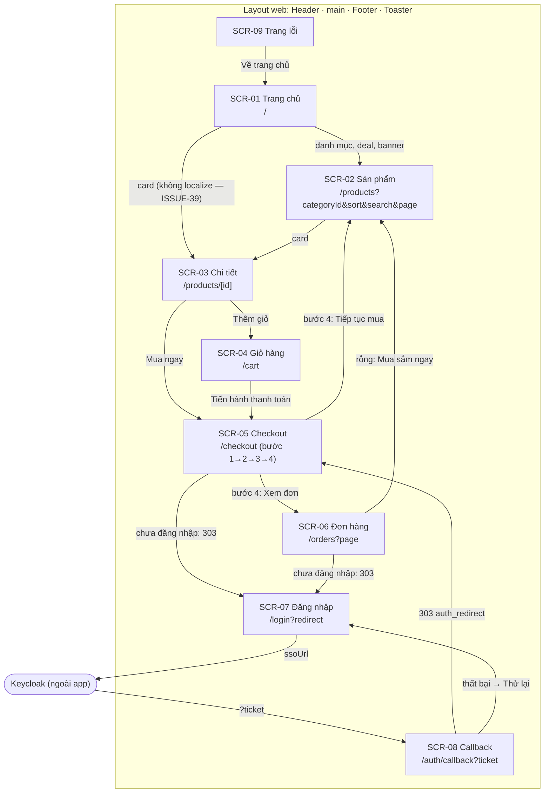
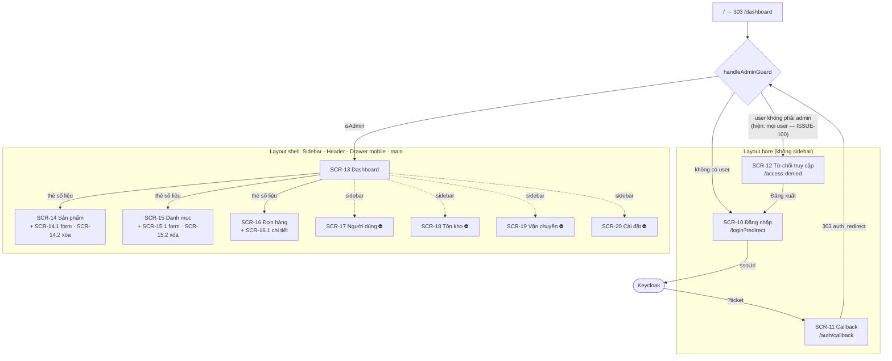
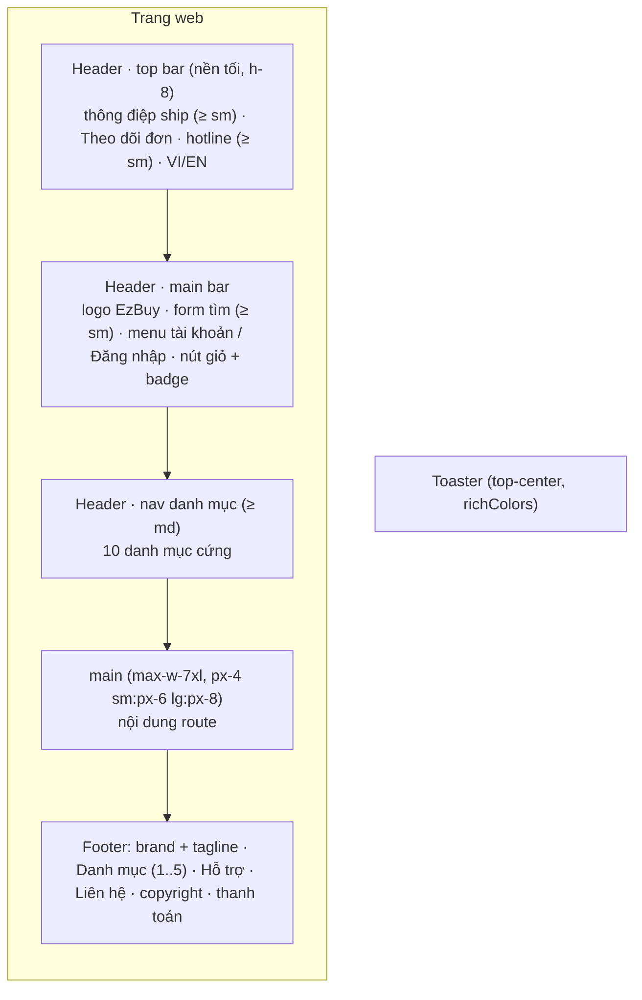

# Danh mục màn hình (Screen catalog)

> **Phiên bản:** 1.0 · **Trạng thái:** Final · **Cập nhật:** 2026-11-12 · **Phạm vi:** Ứng dụng (as-is)

> Kiểm kê **mọi màn hình** của storefront (`frontend/apps/web`, :3000) và backoffice (`frontend/apps/admin`, :3001) theo code hiện tại. Mỗi màn hình có mã `SCR-xx`, route (vi và `/en`), file, mục đích, quyền truy cập, dữ liệu nạp (remote function → API gateway), hành động, trạng thái UI, key i18n chính và tính năng liên quan. Chi tiết hành vi: tài liệu FEAT; chi tiết kỹ thuật: [frontend-web.md](../03-services/frontend-web.md), [frontend-admin.md](../03-services/frontend-admin.md), [frontend-packages.md](../03-services/frontend-packages.md). Use case: [use-cases.md](../01-brd/use-cases.md).

## 1. Quy ước

| Mục | Quy ước |
| :--- | :--- |
| Mã | `SCR-01` … `SCR-09` storefront; `SCR-10` … `SCR-21` backoffice. Hộp thoại / bước con dùng hậu tố `.n` (vd `SCR-05.2`, `SCR-14.1`). |
| Route | Locale `vi` không có prefix; `en` có prefix `/en` — cùng một file route nhờ `reroute = deLocalizeUrl(...)` (`frontend/apps/web/src/hooks.ts:4`, `frontend/apps/admin/src/hooks.ts:4`). |
| Quyền | **guest** = không cần đăng nhập · **customer** = cần `locals.user` (guard trong `+page.server.ts`) · **admin** = guard `handleAdminGuard` + `isAdmin` (`frontend/apps/admin/src/hooks.server.ts:58-77`) — hiện **không ai qua được** (ISSUE-100) · **public (admin)** = route bare không qua guard. |
| Dữ liệu | `query` / `command` / `form` = remote function SvelteKit (chạy server-side, `experimental.remoteFunctions`); API ghi theo path **qua gateway** APISIX. Trình duyệt không gọi gateway trực tiếp, trừ link SSO. |
| Trạng thái | **Loading** (skeleton trong `{#await}`), **Empty**, **Error** (`{:catch}` hoặc toast), **Success**. "—" = không áp dụng. |
| i18n | Key Paraglide trong `frontend/apps/<app>/messages/{vi,en}.json`, gọi dạng `m.<key>()`. |

## 2. Tổng hợp

### 2.1 Storefront (web)

| SCR | Màn hình | Route vi · en | Quyền | Dữ liệu chính | FEAT | UC | TT |
| :--- | :--- | :--- | :--- | :--- | :--- | :--- | :---: |
| SCR-01 | Trang chủ | `/` · `/en` | guest | Mock `home-mock.ts` | FEAT-05 | UC-08 | 🟡 |
| SCR-02 | Danh sách sản phẩm | `/products` · `/en/products` | guest | `getProducts`, `getCategories` | FEAT-06 | UC-09 | 🟡 |
| SCR-03 | Chi tiết sản phẩm | `/products/[id]` · `/en/products/[id]` | guest | `getProduct` | FEAT-07 | UC-10 | ✅ |
| SCR-04 | Giỏ hàng | `/cart` · `/en/cart` | guest | Store `cart` (localStorage) | FEAT-08 | UC-11 | ✅ |
| SCR-05 | Checkout (4 bước) | `/checkout` · `/en/checkout` | customer | Store `cart`; `placeOrder` | FEAT-09 | UC-12 | 🟡 |
| SCR-06 | Lịch sử đơn hàng | `/orders` · `/en/orders` | customer | `getOrders` | FEAT-10 | UC-13 | 🟡 |
| SCR-07 | Đăng nhập | `/login` · `/en/login` | guest (đã đăng nhập → redirect) | `load` dựng `ssoUrl` | FEAT-01, FEAT-02 | UC-01 | 🟡 |
| SCR-08 | SSO callback | `/auth/callback` · (`/en/auth/callback` hợp lệ nhưng SSO luôn trả về path không prefix) | guest | `load` đổi ticket + profile | FEAT-01 | UC-01 | 🟡 |
| SCR-09 | Trang lỗi | (mọi route) | guest | — | FEAT-28 | UC-15 | ✅ |

Tài nguyên không phải màn hình: `GET /sitemap.xml` (`frontend/apps/web/src/routes/sitemap.xml/+server.ts:7-21`), `/robots.txt` (`frontend/apps/web/static/robots.txt`) — FEAT-28, UC-16.

### 2.2 Backoffice (admin)

| SCR | Màn hình | Route vi · en | Quyền | Dữ liệu chính | FEAT | UC | TT |
| :--- | :--- | :--- | :--- | :--- | :--- | :--- | :---: |
| SCR-10 | Đăng nhập admin | `/login` · `/en/login` | public (admin) | `load` dựng `ssoUrl` | FEAT-01, FEAT-21 | UC-02 | 🟡 |
| SCR-11 | SSO callback admin | `/auth/callback` | public (admin) | `load` đổi ticket + profile | FEAT-01 | UC-02 | 🟡 |
| SCR-12 | Từ chối truy cập | `/access-denied` · `/en/access-denied` | public (admin) | — (command `logout`) | FEAT-21 | UC-02 | ✅ |
| SCR-13 | Dashboard | `/dashboard` · `/en/dashboard` (và `/` → 303) | admin | `getDashboard` | FEAT-22 | UC-17 | 🟡 |
| SCR-14 | Sản phẩm | `/products` · `/en/products` | admin | `getProducts`, `getCategoryOptions`, `saveProduct`, `deleteProduct` | FEAT-23 | UC-18 | 🟡 |
| SCR-15 | Danh mục | `/categories` · `/en/categories` | admin | `getCategories`, `saveCategory`, `deleteCategory` | FEAT-24 | UC-19 | 🟡 |
| SCR-16 | Đơn hàng | `/orders` · `/en/orders` | admin | `getOrders` | FEAT-25 | UC-20 | 🟡 |
| SCR-17 | Người dùng | `/users` · `/en/users` | admin | — | FEAT-26 | UC-21 | ⛔ |
| SCR-18 | Tồn kho | `/inventory` · `/en/inventory` | admin | — | FEAT-26 | UC-21 | ⛔ |
| SCR-19 | Vận chuyển | `/shipping` · `/en/shipping` | admin | — | FEAT-26 | UC-21 | ⛔ |
| SCR-20 | Cài đặt | `/settings` · `/en/settings` | admin | — | FEAT-26 | UC-21 | ⛔ |
| SCR-21 | Trang lỗi admin | (mọi route) | theo route gốc | — | FEAT-28 | UC-15 | ✅ |

Không phải màn hình: `/` → `redirect(303, localizeHref('/dashboard'))` (`frontend/apps/admin/src/routes/+page.server.ts:5-7`); `+page.svelte` gốc ("Welcome to SvelteKit") là dead code (ISSUE-43); `/robots.txt` = `Disallow: /`.

**Thống kê**: 21 màn hình (9 web, 12 admin) + 9 hộp thoại/bước con (SCR-05.1 … 05.4, 14.1, 14.2, 15.1, 15.2, 16.1). ✅ 5 · 🟡 12 · ⛔ 4.

---

## 3. Sitemap & điều hướng

### 3.1 Storefront

Điều hướng toàn cục (header/footer, có mặt ở mọi màn hình web): logo → `/`; form tìm → `/products?search=`; "Theo dõi đơn hàng" → `/orders`; "Đăng nhập" → `/login` (không kèm `redirect` — ISSUE-120); menu tài khoản → `/orders`, `/cart`, "Đăng xuất" → `/`; nút giỏ → `/cart`; nav 10 danh mục → `/products?categoryId=1..10` (ISSUE-44); footer → 5 danh mục, `/products`, `/orders`, `/cart`, `/login`; `VI/EN` → cùng path ở locale kia.

### 3.2 Backoffice

Sidebar (8 mục, `frontend/apps/admin/src/routes/+layout.svelte:39-48`): Dashboard, Sản phẩm, Đơn hàng, Danh mục, Người dùng, Tồn kho, Vận chuyển, Cài đặt; mục active khi pathname bằng hoặc bắt đầu bằng `localizeHref(href) + '/'` (`+layout.svelte:50-53`).

---

## 4. Vùng layout

### 4.1 Storefront — `frontend/apps/web/src/routes/+layout.svelte`

| Vùng | File:dòng | Nội dung | Ghi chú |
| :--- | :--- | :--- | :--- |
| `<head>` | `+layout.svelte:26-35` | favicon, canonical (`page.url.href`, gồm query), `hreflang` vi/en/x-default | ISSUE-82 |
| Header (sticky) | `frontend/apps/web/src/lib/components/header.svelte:48-164` | Top bar (`:49-80`), main bar (`:82-151`), nav danh mục (`:153-163`) | Form tìm ẩn dưới `sm` (`:88`), nav ẩn dưới `md` (`:153`); không có menu thay thế trên mobile (ISSUE-121) |
| Main | `+layout.svelte:39-41` | `{@render children()}` | `cart.hydrate()` khi mount (`:15`) |
| Footer | `frontend/apps/web/src/lib/components/footer.svelte` | 4 cột (`sm:2`, `lg:4`), thông tin liên hệ từ i18n | Danh mục hard-code `categoryId=1..5` (ISSUE-44) |
| Toaster | `+layout.svelte:45` | `svelte-sonner` | Dùng cho thêm giỏ, lỗi đặt hàng |

### 4.2 Backoffice — `frontend/apps/admin/src/routes/+layout.svelte`

| Vùng | File:dòng | Nội dung | Ghi chú |
| :--- | :--- | :--- | :--- |
| Chế độ bare | `+layout.svelte:27-34, 73-74` | `/login`, `/auth/callback`, `/access-denied` (và con) chỉ render nội dung | |
| `<head>` | `+layout.svelte:68-71` | `<title>` `meta_title`, description `meta_description`; trang con ghi đè bằng `meta_template({page})` | Không canonical/hreflang |
| Sidebar desktop | `+layout.svelte:77-108` | Brand `sidebar_brand`/`sidebar_brandSub`, 8 mục nav, nút đăng xuất | Chỉ hiện ≥ `lg` (`w-60`) |
| Header | `+layout.svelte:111-151` | Nút mở menu (< `lg`), brand (mobile), VI/EN, tên người dùng `fullName \|\| username`, nút đăng xuất | `fullName` luôn rỗng (ISSUE-100) |
| Drawer mobile | `+layout.svelte:153-189` | `Sheet` trái lặp lại nav + đăng xuất | Đóng khi chọn mục |
| Main | `+layout.svelte:191` | `p-4 lg:p-6` | Nền `#f9fafb` (`layout.css`) |
| Toaster | `+layout.svelte:198` | `svelte-sonner` | |

Không có footer ở backoffice.

---

## 5. Đặc tả màn hình — Storefront

#### SCR-01 — Trang chủ

| Thuộc tính | Giá trị |
| :--- | :--- |
| Route | `/` · `/en` |
| File | `frontend/apps/web/src/routes/+page.svelte`; dữ liệu `frontend/apps/web/src/lib/data/home-mock.ts` |
| Mục đích | Giới thiệu khuyến mãi, danh mục, sản phẩm nổi bật |
| Quyền | guest |
| Dữ liệu | Không gọi API; toàn bộ mock (ISSUE-38) |
| Hành động | Bấm banner/deal/danh mục/thương hiệu → SCR-02; bấm card → SCR-03; "Thêm vào giỏ" trên card → store `cart` + toast |
| Trạng thái | Loading — · Empty — · Error — · Success: 8 khối (hero, quick deals, icon danh mục, flash sale có đếm ngược, hot, điện thoại/laptop, thương hiệu, USP) |
| i18n chính | `home_metaTitle`, `home_metaDesc`, `home_slide{1..3}Title/Sub`, `home_deal{1..5}`, `home_flashSaleTitle`, `home_flashSaleEndsIn`, `home_hotProducts`, `home_featuredBrands`, `home_usp*`, `category_c1..c10`, `productcard_*` |
| Liên kết | FEAT-05 · UC-08 · ISSUE-38, 39, 44, 79(c) |

#### SCR-02 — Danh sách sản phẩm

| Thuộc tính | Giá trị |
| :--- | :--- |
| Route | `/products?page&categoryId&sort&search` · `/en/products?...` |
| File | `frontend/apps/web/src/routes/products/+page.svelte`; `products/catalog.remote.ts` |
| Mục đích | Duyệt, lọc danh mục, sắp xếp, lọc giá, tìm, phân trang |
| Quyền | guest |
| Dữ liệu | `getProducts` (query, `productQuerySchema`) → `GET /api/products?page&size=12&sort&categoryId&search` (`catalog.remote.ts:13`); `getCategories` (query) → `GET /api/categories?page=0&size=50` (`catalog.remote.ts:16-19`) |
| Hành động | Chọn danh mục (sidebar), chọn khoảng giá (5 mức, client-side), đổi sắp xếp (3 lựa chọn), tìm kiếm (form GET), phân trang (cửa sổ 5 trang), thêm nhanh vào giỏ, mở chi tiết |
| Trạng thái | Loading: skeleton lưới + sidebar · Empty: `products_notFound` + `products_clearFilter` (**luôn xảy ra** với backend hiện tại — ISSUE-48) · Error: `productgrid_loadError` + `common_retry`; sidebar lỗi → "—" · Success: lưới 2/3/4 cột + `products_count` |
| i18n chính | `products_title`, `products_searchResults`, `products_filtersTitle`, `products_categoriesTitle`, `products_allCategories`, `products_priceTitle`, `products_price1..5`, `products_sortNewest/PriceLow/PriceHigh`, `products_count`, `products_notFound/notFoundHint`, `productgrid_loadError` |
| Liên kết | FEAT-06 · UC-09 · ISSUE-40, 44, 48, 78 |

#### SCR-03 — Chi tiết sản phẩm

| Thuộc tính | Giá trị |
| :--- | :--- |
| Route | `/products/[id]` · `/en/products/[id]` |
| File | `frontend/apps/web/src/routes/products/[id]/+page.svelte`; `product.remote.ts` |
| Mục đích | Xem ảnh, giá, tồn, chọn số lượng, thêm giỏ / mua ngay |
| Quyền | guest |
| Dữ liệu | `getProduct(id)` (query, `z.coerce.number().int().positive()`) → `GET /api/products/{id}` (`product.remote.ts:5`) |
| Hành động | −/+ số lượng (1 … `quantity \|\| 99`), "Thêm vào giỏ" (toast), "Mua ngay" → SCR-05, breadcrumb → SCR-01/SCR-02 |
| Trạng thái | Loading: skeleton ảnh + 4 dòng · Empty — · Error: `productdetail_notFound` + `productdetail_backToList` (HTTP 200 — ISSUE-82) · Success: badge `productdetail_inStock`/`outOfStock`; hết hàng → nút disabled |
| i18n chính | `productdetail_breadcrumbHome/Products`, `productdetail_vatIncluded`, `productdetail_inStock/outOfStock`, `productdetail_quantityLabel`, `productdetail_addToCart`, `productdetail_buyNow`, `productdetail_added`, `productdetail_description`, `productdetail_freeShipping/warranty/freeReturn`, `productdetail_notFound` |
| Liên kết | FEAT-07 · UC-10 · ISSUE-50, 82, ISSUE-123 |

Ghi chú: không có `<title>` riêng (`productdetail_metaTitle` không dùng); khối mô tả chỉ hiện khi có `description` (không bao giờ — ISSUE-50).

#### SCR-04 — Giỏ hàng

| Thuộc tính | Giá trị |
| :--- | :--- |
| Route | `/cart` · `/en/cart` |
| File | `frontend/apps/web/src/routes/cart/+page.svelte`; store `frontend/apps/web/src/lib/stores/cart.svelte.ts` |
| Mục đích | Xem/sửa giỏ, xem tạm tính, phí ship, tổng |
| Quyền | guest |
| Dữ liệu | Không gọi API; `localStorage["ecommerce-cart"]` |
| Hành động | −/+ số lượng (về 0 thì xóa), xóa dòng, "Xóa tất cả" (không xác nhận), mở chi tiết, "Tiến hành thanh toán" → SCR-05 |
| Trạng thái | Loading: 3 skeleton tới khi `hydrated` · Empty: `cart_emptyTitle/Hint` + `cart_continueShopping` · Error — · Success: danh sách + tóm tắt, gợi ý `cart_shippingPromo` khi < 500.000 (RULE-02) |
| i18n chính | `cart_title`, `cart_clearAll`, `cart_orderSummary`, `cart_subtotal`, `cart_shippingFee`, `cart_freeShipping`, `cart_shippingPromo`, `cart_total`, `cart_checkout`, `cart_securePayment`, `cart_emptyTitle` |
| Liên kết | FEAT-08 · UC-11 · ISSUE-42, 79 |

#### SCR-05 — Checkout

| Thuộc tính | Giá trị |
| :--- | :--- |
| Route | `/checkout` · `/en/checkout` |
| File | `frontend/apps/web/src/routes/checkout/+page.svelte`, `+page.server.ts`, `checkout.remote.ts` |
| Mục đích | Đặt hàng 3 bước + màn thành công |
| Quyền | customer — `load` redirect `/login?redirect=` nếu thiếu `locals.user` (`+page.server.ts:5-11`) |
| Dữ liệu | Store `cart`; `placeOrder` (command, `checkoutSchema`) → `GET /api/products/{id}` × n, `POST /api/orders`, `POST /api/payments` (`checkout.remote.ts:13-44`) |
| Hành động | Nhập giao hàng → Tiếp tục; chọn COD/Chuyển khoản; Quay lại; "Đặt hàng ngay"; sau thành công: "Xem đơn hàng", "Tiếp tục mua sắm" |
| Trạng thái | Loading: nút "Đặt hàng" disabled + spinner (`placing`) · Empty: giỏ rỗng → `cart_emptyTitle` + `cart_continueShopping` · Error: bước 1 `checkout_validationErr`; mọi lỗi server → một toast `checkout_orderFailed` (ISSUE-122) · Success: bước 4 `checkout_successTitle`, `checkout_orderCode` |
| i18n chính | `checkout_title`, `checkout_step{Shipping,Payment,Confirm}`, `checkout_fullName/phone/address/city/district/note`, `checkout_cod/codDesc`, `checkout_bankTransfer/bankTransferDesc`, `checkout_placeOrder`, `checkout_yourOrder`, `checkout_subtotal/total`, `checkout_successTitle/successMsg`, `checkout_viewOrders` |
| Liên kết | FEAT-09 · UC-12 · RULE-02 … RULE-06 · ISSUE-20, 22, 23, 38, 75, 76, 79 |

| Bước con | Nội dung | Điều kiện chuyển |
| :--- | :--- | :--- |
| SCR-05.1 Giao hàng | 6 trường; client `shippingSchema.safeParse` (RULE-04); "Thành phố" là input text dù placeholder "Chọn…" | Hợp lệ → 05.2 |
| SCR-05.2 Thanh toán | COD / ONLINE ("Chuyển khoản ngân hàng", không chuyển cổng — ISSUE-75) | Tiếp tục → 05.3; Quay lại → 05.1 |
| SCR-05.3 Xác nhận | Tóm tắt người nhận, địa chỉ, phương thức | "Đặt hàng ngay" → `placeOrder` |
| SCR-05.4 Thành công | Mã đơn `#id`; giỏ đã xóa; tổng server **không** hiển thị (ISSUE-79) | — |

Sidebar tóm tắt (mọi bước) dùng giá snapshot trong giỏ (`+page.svelte:249-288`).

#### SCR-06 — Lịch sử đơn hàng

| Thuộc tính | Giá trị |
| :--- | :--- |
| Route | `/orders?page` · `/en/orders?page` |
| File | `frontend/apps/web/src/routes/orders/+page.svelte`, `+page.server.ts`, `orders.remote.ts` |
| Mục đích | Xem đơn đã đặt |
| Quyền | customer (`+page.server.ts:5-11`) |
| Dữ liệu | `getOrders({page, size: 10})` (query, `pageQuerySchema`) → `GET /api/orders?page&size` (`orders.remote.ts:6-8`) |
| Hành động | Phân trang Trước/Sau; "Mua sắm ngay" khi rỗng; "Thử lại" khi lỗi |
| Trạng thái | Loading: 3 skeleton card · Empty: `orders_emptyTitle/Hint` + `orders_shopNow` · Error: `common_error` + `common_retry` (**luôn xảy ra** với backend hiện tại — ISSUE-48) · Success: card mỗi đơn, badge cố định `orders_processing` (ISSUE-41) |
| i18n chính | `orders_title`, `orders_metaTitle`, `orders_orderLabel`, `orders_processing`, `orders_emptyTitle`, `orders_shopNow`, `common_prev/next/page` |
| Liên kết | FEAT-10 · UC-13 · ISSUE-41, 48, 49 |

#### SCR-07 — Đăng nhập

| Thuộc tính | Giá trị |
| :--- | :--- |
| Route | `/login?redirect` · `/en/login?redirect` |
| File | `frontend/apps/web/src/routes/login/+page.svelte`, `+page.server.ts` |
| Mục đích | Bắt đầu SSO; (danh nghĩa) đăng ký |
| Quyền | guest; đã đăng nhập → 303 tới `redirect` |
| Dữ liệu | `load`: `safeRedirect`, ghi cookie `auth_redirect` (600 s), trả `ssoUrl = API_PUBLIC_URL/api/v1/auth/login?redirect_uri=<origin>/auth/callback` (`+page.server.ts:9-27`) |
| Hành động | "Đăng nhập bằng SSO" → gateway/Keycloak; "Đăng ký qua SSO" → **cùng** `ssoUrl` (ISSUE-71) |
| Trạng thái | Loading — · Empty — · Error — (lỗi hiển thị ở SCR-08) · Success: chuyển sang Keycloak |
| i18n chính | `auth_loginPageTitle`, `auth_loginTitle`, `auth_loginSubtitle`, `auth_ssoLoginBtn`, `auth_ssoRedirectNote`, `auth_ssoWhy`, `auth_ssoFeature1..3`, `auth_registerSsoNote`, `auth_registerSsoBtn`, `auth_copyright` |
| Liên kết | FEAT-01, FEAT-02 · UC-01, UC-05 · ISSUE-05, 71 |

#### SCR-08 — SSO callback

| Thuộc tính | Giá trị |
| :--- | :--- |
| Route | `/auth/callback?ticket` (hoặc `?error`) |
| File | `frontend/apps/web/src/routes/auth/callback/+page.svelte`, `+page.server.ts` |
| Mục đích | Đổi ticket lấy phiên rồi quay lại trang đích |
| Quyền | guest |
| Dữ liệu | `load`: `GET /api/v1/auth/session?ticket=` (không bearer), `GET /api/v1/users/me` (Bearer), `setSession` (`+page.server.ts:10-40`) |
| Hành động | Lỗi → "Thử lại" → SCR-07 |
| Trạng thái | Loading: spinner `auth_callbackLoading` (hiếm thấy vì `load` redirect trước) · Error: `auth_callbackErrorTitle/Text` · Success: 303 tới `auth_redirect` |
| i18n chính | `auth_callbackLoading`, `auth_callbackErrorTitle`, `auth_callbackErrorText`, `auth_callbackRetry` |
| Liên kết | FEAT-01 · UC-01 · ISSUE-04, 06, 67, 100, 101 |

Ghi chú: profile lỗi → vẫn redirect như thành công nhưng người dùng vẫn là khách, **không** hiển thị lỗi (ISSUE-67).

#### SCR-09 — Trang lỗi

| Thuộc tính | Giá trị |
| :--- | :--- |
| Route | Bất kỳ route lỗi/không tồn tại |
| File | `frontend/apps/web/src/routes/+error.svelte` |
| Quyền | guest |
| Hành động | "Về trang chủ" (`localizeHref('/')`), "Thử lại" (`location.reload()`) |
| Trạng thái | 404 → icon `SearchX`, `error_notFoundTitle/Hint`; khác → `AlertTriangle`, `error_title/hint` |
| i18n chính | `error_metaTitle`, `error_notFoundTitle`, `error_notFoundHint`, `error_title`, `error_hint`, `error_backHome`, `error_retry` |
| Liên kết | FEAT-28 · UC-15 · ISSUE-82 |

---

## 6. Đặc tả màn hình — Backoffice

#### SCR-10 — Đăng nhập admin

| Thuộc tính | Giá trị |
| :--- | :--- |
| Route | `/login?redirect` · `/en/login?redirect` |
| File | `frontend/apps/admin/src/routes/login/+page.svelte`, `+page.server.ts` |
| Mục đích | Bắt đầu SSO cho backoffice |
| Quyền | public (admin, layout bare); đã có user → 303 tới `redirect` (guard xử lý tiếp) |
| Dữ liệu | `load` như SCR-07 (`login/+page.server.ts:8-24`) |
| Hành động | Nút `login_btn` → `ssoUrl` |
| Trạng thái | Chỉ Success (thẻ tĩnh) |
| i18n chính | `login_title`, `login_note`, `login_btn`, `sidebar_brand`, `meta_title` |
| Liên kết | FEAT-01, FEAT-21 · UC-02 |

#### SCR-11 — SSO callback admin

| Thuộc tính | Giá trị |
| :--- | :--- |
| Route | `/auth/callback?ticket` |
| File | `frontend/apps/admin/src/routes/auth/callback/+page.svelte`, `+page.server.ts` |
| Dữ liệu | `load`: `GET /api/v1/auth/session`, `GET /api/v1/users/me` (`auth/callback/+page.server.ts:9-34`) |
| Trạng thái | Như SCR-08; Keycloak `?error` luôn quay về **web** chứ không về admin (FEAT-01 E1) |
| i18n chính | `auth_callbackLoading`, `auth_callbackErrorTitle`, `auth_callbackErrorText`, `auth_callbackRetry` |
| Liên kết | FEAT-01 · UC-02 · ISSUE-100, 101 |

#### SCR-12 — Từ chối truy cập

| Thuộc tính | Giá trị |
| :--- | :--- |
| Route | `/access-denied` · `/en/access-denied` |
| File | `frontend/apps/admin/src/routes/access-denied/+page.svelte` |
| Mục đích | Thông báo người dùng đã đăng nhập nhưng không phải admin |
| Quyền | public (admin, layout bare) |
| Dữ liệu | command `logout` (`frontend/apps/admin/src/lib/remote/auth.remote.ts:6-19`) → `POST /api/v1/auth/logout` |
| Hành động | "Đăng xuất" → `invalidateAll()` → `goto(localizeHref('/login'))` (`access-denied/+page.svelte:11-21`) |
| Trạng thái | Success (tĩnh); HTTP 200 qua redirect 303, không phải 403 |
| i18n chính | `access_denied_title`, `access_denied_text`, `sidebar_logout` |
| Liên kết | FEAT-21 · UC-02, UC-03 · ISSUE-100 |

#### SCR-13 — Dashboard

| Thuộc tính | Giá trị |
| :--- | :--- |
| Route | `/dashboard` · `/en/dashboard` |
| File | `frontend/apps/admin/src/routes/dashboard/+page.svelte`, `dashboard.remote.ts` |
| Mục đích | Số liệu tổng quan và hoạt động gần đây |
| Quyền | admin |
| Dữ liệu | `getDashboard` (query) → song song `GET /api/products?page=0&size=5`, `GET /api/categories?page=0&size=1`, `GET /api/orders?page=0&size=5` (`dashboard.remote.ts:9-24`) |
| Hành động | Bấm thẻ Products/Orders/Categories → SCR-14/16/15; `common_viewAll` |
| Trạng thái | Loading: 3 skeleton thẻ + 1 khối (`+page.svelte:27-33`) · Empty: `dashboard_noOrders`, `dashboard_noProducts` · Error: `common_noData` màu đỏ (`:135`) — xảy ra với backend hiện tại (ISSUE-48) · Success: thẻ số, bảng đơn gần đây, danh sách sản phẩm gần đây với badge `dashboard_inStock/outOfStock` |
| i18n chính | `dashboard_title`, `dashboard_subtitle`, `dashboard_products`, `dashboard_orders`, `dashboard_recentOrders`, `dashboard_recentProducts`, `dashboard_uncategorized`, `orders_colId/colDate/colTotal` |
| Liên kết | FEAT-22 · UC-17 · ISSUE-48, 100 |

#### SCR-14 — Sản phẩm

| Thuộc tính | Giá trị |
| :--- | :--- |
| Route | `/products?page&search` · `/en/products?...` |
| File | `frontend/apps/admin/src/routes/products/+page.svelte`, `products.remote.ts` |
| Mục đích | Tìm, xem, thêm, sửa, xóa sản phẩm |
| Quyền | admin |
| Dữ liệu | `getProducts({page, size: 10, search})` → `GET /api/products` (`products.remote.ts:6-8`); `getCategoryOptions` → `GET /api/categories?page=0&size=100` (`:10-13`); `saveProduct` (form) → `POST /api/products` / `PUT /api/products/{id}` (`:16-34`); `deleteProduct` (command) → `DELETE /api/products/{id}` (`:36-39`) |
| Hành động | Tìm (form GET), phân trang (mất `search`), "Thêm sản phẩm", sửa, xóa |
| Trạng thái | Loading: `TableSkeleton rows=6` (`+page.svelte:81-82`) · Empty: `EmptyState` `products_noProducts` (`:156`) · Error: `common_noData` (`:182`); lỗi lưu/xóa → toast `common_noData` · Success: bảng 6 cột + `products_count`; toast `common_save`/`common_delete` |
| i18n chính | `products_title`, `products_count`, `products_searchPlaceholder`, `products_addBtn`, `products_col{Product,Sku,Category,Price,Stock,Actions}`, `products_uncategorized`, `products_outOfStock`, `products_noProducts` |
| Liên kết | FEAT-23 · UC-18 · RULE-09 · ISSUE-48, 60, 68, 83, 102 |

| Hộp thoại | Nội dung | Trạng thái |
| :--- | :--- | :--- |
| SCR-14.1 Thêm/sửa | Hidden `productId`; `productTitle`, `sku`, `<select categoryId>` (option `common_loading` khi nạp), `priceUnit`, `quantity` (chuỗi số nguyên), `imageUrl` (text URL — không upload, xem FEAT-18) | Lỗi validate hiển thị dưới trường bằng thông điệp Zod tiếng Anh (ISSUE-83); danh mục chọn bị backend bỏ (ISSUE-60) |
| SCR-14.2 Xác nhận xóa | `products_deleteConfirm`, Hủy / Xóa | Thành công → refresh `getProducts` |

#### SCR-15 — Danh mục

| Thuộc tính | Giá trị |
| :--- | :--- |
| Route | `/categories?page` · `/en/categories?page` |
| File | `frontend/apps/admin/src/routes/categories/+page.svelte`, `categories.remote.ts` |
| Mục đích | Thêm, sửa, xóa danh mục |
| Quyền | admin |
| Dữ liệu | `getCategories({page, size: 12})` → `GET /api/categories` (`categories.remote.ts:6-8`); `saveCategory` (form) → `POST /api/categories` / `PUT /api/categories/{id}` (`:10-21`); `deleteCategory` (command) → `DELETE /api/categories/{id}` (`:23-26`) |
| Hành động | "Thêm danh mục", sửa, xóa, phân trang |
| Trạng thái | Loading: skeleton thẻ (`+page.svelte:69-72`); tiêu đề hiển thị `…` · Empty / Error: `common_noData` (`:139`) · Success: lưới thẻ ảnh, tên, `categories_idLabel` |
| i18n chính | `categories_title`, `categories_addBtn`, `categories_modalAddTitle/EditTitle`, `categories_nameLabel`, `categories_imageLabel`, `categories_deleteConfirm`, `categories_idLabel` |
| Liên kết | FEAT-24 · UC-19 · ISSUE-44, 48, 102 |

Hộp thoại: **SCR-15.1** thêm/sửa (`categoryTitle`, `imageUrl`); **SCR-15.2** xác nhận xóa (`categories_deleteConfirm`; vi phạm FK → toast lỗi).

#### SCR-16 — Đơn hàng

| Thuộc tính | Giá trị |
| :--- | :--- |
| Route | `/orders?page` · `/en/orders?page` |
| File | `frontend/apps/admin/src/routes/orders/+page.svelte`, `orders.remote.ts` |
| Mục đích | Xem danh sách và chi tiết đơn (chỉ đọc) |
| Quyền | admin |
| Dữ liệu | `getOrders({page, size: 10})` → `GET /api/orders?page&size` (`orders.remote.ts:5-7`) |
| Hành động | Lọc theo mã đơn (client, trang hiện tại — ISSUE-40), phân trang, "Xem" chi tiết |
| Trạng thái | Loading: `TableSkeleton rows=6` (`+page.svelte:51-52`) · Empty: `EmptyState` `orders_noOrders` (`:103`) · Error: `common_noData` (`:125`) · Success: bảng mã/ngày/mô tả/tổng/trạng thái (`orders_processing` cố định — ISSUE-41) |
| i18n chính | `orders_title`, `orders_count`, `orders_searchPlaceholder`, `orders_col{Id,Date,Desc,Total,Status,Actions,Product,Cart,User}`, `orders_processing`, `orders_view`, `orders_detailTitle`, `orders_noOrders` |
| Liên kết | FEAT-25 · UC-20 · ISSUE-40, 41, 48, 49 |

Hộp thoại **SCR-16.1** chi tiết: ngày, mô tả, tổng, `#productId`, `#cart.cartId`, `#cart.userId`, trạng thái; nút `common_close`. Không có dòng hàng, không có cập nhật trạng thái.

#### SCR-17 … SCR-20 — Module chờ phát triển

| SCR | Route | File | `<title>` | Năng lực thay thế qua API |
| :--- | :--- | :--- | :--- | :--- |
| SCR-17 Người dùng | `/users` · `/en/users` | `frontend/apps/admin/src/routes/users/+page.svelte` | `meta_template({page: users_metaTitle})` | UC-06, UC-07 (FEAT-04) |
| SCR-18 Tồn kho | `/inventory` · `/en/inventory` | `frontend/apps/admin/src/routes/inventory/+page.svelte` | `inventory_metaTitle` | UC-23 (FEAT-12, chỉ đọc) |
| SCR-19 Vận chuyển | `/shipping` · `/en/shipping` | `frontend/apps/admin/src/routes/shipping/+page.svelte` | `shipping_metaTitle` | UC-32 (FEAT-20) |
| SCR-20 Cài đặt | `/settings` · `/en/settings` | `frontend/apps/admin/src/routes/settings/+page.svelte` | `settings_metaTitle` | — |

Chung: quyền admin; không gọi API; trạng thái duy nhất là `ComingSoon` (icon `Construction`, tiêu đề module, `common_developing`) — `frontend/apps/admin/src/lib/components/coming-soon.svelte`. FEAT-26 · UC-21 · ⛔.

#### SCR-21 — Trang lỗi admin

| Thuộc tính | Giá trị |
| :--- | :--- |
| File | `frontend/apps/admin/src/routes/+error.svelte` (nội dung giống SCR-09) |
| Hiển thị | Trong layout shell (có sidebar) khi lỗi ở route được guard; "Về trang chủ" → `/` → `/dashboard` |
| i18n chính | `error_metaTitle`, `error_notFoundTitle/Hint`, `error_title/hint`, `error_backHome`, `error_retry` |
| Liên kết | FEAT-28 · UC-15 |

---

## 7. Component dùng chung

### 7.1 `@ecommerce/ui` (`frontend/packages/ui/src/components/`) theo màn hình

Đếm theo import `@ecommerce/ui/<component>` trong file `.svelte` của từng app.

| Component | Web: dùng ở | Admin: dùng ở |
| :--- | :--- | :--- |
| `button` | Header, ProductCard, SCR-02, 03, 04, 05, 06, 07, 08, 09 | Layout, SCR-10, 11, 12, 14, 15, 16, 21 |
| `badge` | Header (giỏ), ProductCard, SCR-01, 03, 06 | SCR-13, 14, 16 |
| `input` | Header (tìm), SCR-02, 05 | SCR-14, 15, 16 |
| `label` | SCR-05 | SCR-14, 15 |
| `textarea` | SCR-05 (ghi chú) | — |
| `separator` | SCR-04, 05 | — |
| `skeleton` | SCR-02, 03, 04, 06 | SCR-13, 15 |
| `table-skeleton` | — | SCR-14, 16 |
| `empty-state` | SCR-06, 09 | SCR-14, 16, 21 |
| `dropdown-menu` | Header (menu tài khoản) | — |
| `dialog` | — | SCR-14.1/14.2, 15.1/15.2, 16.1 |
| `table` | — | SCR-13, 14, 16 |
| `sheet` | — | Layout (drawer mobile) |
| `sonner` (Toaster) | Layout | Layout |
| `alert-dialog`, `breadcrumb`, `card`, `pagination`, `select` | **không dùng** | **không dùng** |

> 5 component cuối có trong package nhưng không màn hình nào import (đã ghi nhận ở [known-issues "Phát hiện nhỏ"](../07-plan/known-issues-tech-debt.md)). Breadcrumb (SCR-03), phân trang (SCR-02, 06, 14, 15, 16) và xác nhận xóa (SCR-14.2, 15.2) đều tự dựng thay vì dùng component có sẵn.

### 7.2 Component riêng của từng app

| Component | File | Dùng ở | Ghi chú |
| :--- | :--- | :--- | :--- |
| `Header` | `frontend/apps/web/src/lib/components/header.svelte` | Layout web (mọi SCR web) | Props `user`; logout, đổi locale, tìm kiếm, badge giỏ |
| `Footer` | `frontend/apps/web/src/lib/components/footer.svelte` | Layout web | Liên kết tĩnh |
| `ProductCard` | `frontend/apps/web/src/lib/components/product-card.svelte` | SCR-01, SCR-02 | Thêm nhanh giỏ (ISSUE-42), link không localize (ISSUE-39) |
| `ComingSoon` | `frontend/apps/admin/src/lib/components/coming-soon.svelte` | SCR-17 … 20 | |

### 7.3 Helper `@ecommerce/lib` dùng trên màn hình

| Helper | Dùng ở |
| :--- | :--- |
| `formatPrice` (VND, RULE-01) | `ProductCard` (SCR-01, 02), SCR-03, 04, 05, 06, 13, 14, 16 |
| `formatDate` (`vi-VN`) | SCR-06, 13, 16 |
| `computeTotals`, `FREE_SHIPPING_THRESHOLD` (RULE-02) | SCR-04, SCR-05 (client + server) |
| `shippingSchema` / `checkoutSchema` (RULE-03, 04) | SCR-05 |
| `productQuerySchema`, `pageQuerySchema` | SCR-02, 06, 14, 15, 16 |
| `productUpsertSchema`, `categoryUpsertSchema` | SCR-14.1, 15.1 |
| `safeRedirect` (RULE-13) | SCR-07, 08, 10, 11 |

---

## 8. Ma trận màn hình ↔ API

| API (gateway) | Web | Admin |
| :--- | :--- | :--- |
| `GET /api/v1/auth/login` (trình duyệt) | SCR-07 | SCR-10 |
| `GET /api/v1/auth/session`, `GET /api/v1/users/me` | SCR-08 | SCR-11 |
| `POST /api/v1/auth/refresh` | hook (mọi SCR) | hook (mọi SCR) |
| `POST /api/v1/auth/logout` | Header | Layout, SCR-12 |
| `GET /api/products` | SCR-02 | SCR-13, 14 |
| `GET /api/products/{id}` | SCR-03, SCR-05 (`placeOrder`) | — |
| `POST/PUT/DELETE /api/products[/{id}]` | — | SCR-14 |
| `GET /api/categories` | SCR-02 | SCR-13, 14 (select), 15 |
| `POST/PUT/DELETE /api/categories[/{id}]` | — | SCR-15 |
| `GET /api/orders` | SCR-06 | SCR-13, 16 |
| `POST /api/orders`, `POST /api/payments` | SCR-05 | — |

Không màn hình nào gọi: search, rating, favourites, promotion/tax, media, notification, shipping, inventory, carts, users/roles (ngoài `/me`) — các năng lực này chỉ có qua API ([use-cases §4.4](../01-brd/use-cases.md#44-nhóm-api-only-tích-hợp-api)).

## 9. Vấn đề phát hiện khi lập danh mục

| ID đề xuất | Mức | Tóm tắt | Màn hình |
| :--- | :--- | :--- | :--- |
| ISSUE-120 | Low | Nút "Đăng nhập" ở header/footer không truyền `redirect` → sau SSO luôn về `/` | Header, Footer, SCR-07 |
| ISSUE-121 | Low | Storefront dưới `sm`/`md` ẩn ô tìm kiếm và nav danh mục, không có menu thay thế | Header (mọi SCR web) |
| ISSUE-122 | Low | Checkout gộp mọi lỗi server thành một toast; 401 không chuyển `/login` | SCR-05 |
| ISSUE-123 | Low | Bộ chọn số lượng ở PDP không reset khi chuyển sang sản phẩm khác | SCR-03 |

Định nghĩa đầy đủ do nhóm biên soạn chính đăng ký vào [known-issues-tech-debt.md](../07-plan/known-issues-tech-debt.md).
