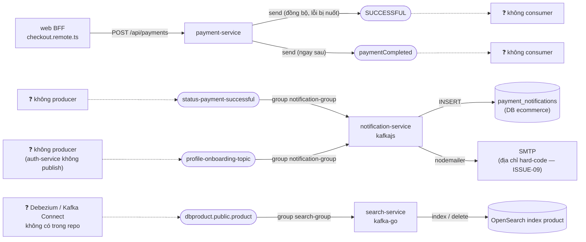

# Event Catalog — sự kiện Kafka

> **Phiên bản:** 1.0 · **Trạng thái:** Final · **Cập nhật:** 2026-11-12 · **Phạm vi:** Ứng dụng (as-is)

> Danh mục **mọi topic Kafka được code tham chiếu**, mô tả đúng hành vi hiện tại. Đặc tả máy đọc: [`asyncapi/kafka-events.yaml`](asyncapi/kafka-events.yaml). Bối cảnh kiến trúc: [`integration-messaging.md`](../02-architecture/system/integration-messaging.md). Issue: [`known-issues-tech-debt.md`](../07-plan/known-issues-tech-debt.md).

## 1. Tóm tắt

| Topic | Producer | Consumer (group) | Trạng thái | Issue chính |
| :--- | :--- | :--- | :--- | :--- |
| `SUCCESSFUL` | payment-service | — | ⚠️ Không ai consume | ISSUE-17, ISSUE-18 |
| `paymentCompleted` | payment-service | — | ⚠️ Không ai consume | ISSUE-17, ISSUE-18 |
| `status-payment-successful` | — | notification-service (`notification-group`) | ⚠️ Không ai produce | ISSUE-17, ISSUE-09, ISSUE-80 |
| `profile-onboarding-topic` | — | notification-service (`notification-group`) | ⚠️ Không ai produce | ISSUE-17 |
| `dbproduct.public.product` (`PRODUCT_TOPIC_NAME`) | (dự kiến Debezium — không có trong repo) | search-service (`search-group`) | ⚠️ Không có producer; schema lệch | ISSUE-19, ISSUE-114 |

**Kết luận:** producer và consumer **không dùng chung topic nào** → hiện **không có luồng sự kiện nào hoạt động đầu-cuối**: không email/thông báo thanh toán, không email chào mừng, index tìm kiếm luôn rỗng.



Nét đứt = liên kết **không tồn tại** trong code (thiếu producer hoặc consumer).

## 2. Đặc điểm chung

| Khía cạnh | Hiện trạng | Nguồn |
| :--- | :--- | :--- |
| Broker | `apache/kafka:3.9.0`, KRaft 1 node, `PLAINTEXT://kafka:9092`, replication 1 | `docker-compose.yml:41-67` |
| Bootstrap | `KAFKA_SERVERS` (mặc định code `localhost:9092`; compose `kafka:9092`) | `services/payment-service/main.go:74`, `services/search-service/main.go:31`, `services/notification-service/src/kafka.ts:6` |
| Định dạng | JSON trong `value`; **không key, không header**, không schema registry, không version | `services/payment-service/internal/service/kafka_producer.go:36-40` |
| Tạo topic | Không có bước tạo topic; writer của payment-service không bật `AllowAutoTopicCreation` | ISSUE-57 |
| Correlation id | Không truyền vào message | ISSUE-98 |
| Ordering | Không key → `LeastBytes` chọn partition; không bảo đảm thứ tự theo đơn/payment | `kafka_producer.go:20-25` |
| Delivery (producer) | Fire-and-forget: gửi đồng bộ trong request, lỗi bị bỏ (`_ =`), không outbox → có thể mất hoặc phát sự kiện cho giao dịch chưa commit xong ở hệ khác | `services/payment-service/internal/service/payment_service.go:110-113` |
| Delivery (consumer) | Thực tế **at-most-once**: lỗi xử lý chỉ log, offset vẫn commit; không retry, không DLQ, không idempotency | `services/notification-service/src/kafka.ts:57-59`; `services/search-service/internal/consumer/product_sync_consumer.go:54-82` |

---

## 3. Chi tiết từng topic

### 3.1 `SUCCESSFUL`

| Thuộc tính | Giá trị |
| :--- | :--- |
| Producer | payment-service — `PaymentService.Save` sau khi `INSERT payments` thành công (`services/payment-service/internal/service/payment_service.go:87-116`) |
| Trigger | Mọi `POST /api/payments` thành công, **bất kể `paymentStatus`** (COD `NOT_STARTED` cũng phát — ISSUE-18) |
| Consumer | Không có |
| Hằng số | `TopicPaymentSuccessful = "SUCCESSFUL"` (`payment_service.go:19`) |
| Payload | `model.KafkaPaymentDto` (`services/payment-service/internal/model/payment.go:28-34`) |
| Writer | `Balancer: LeastBytes`, `RequiredAcks: RequireOne`, `WriteTimeout: 3s`, `BatchTimeout` mặc định 1 s → `POST /api/payments` chậm thêm ~1 s mỗi lần gửi (ISSUE-57) (`kafka_producer.go:20-25`) |
| Trạng thái | ⚠️ Không ai consume |
| Issue | ISSUE-17, ISSUE-18, ISSUE-57, ISSUE-75, ISSUE-76, ISSUE-80 |

**Payload**

| Field | Kiểu JSON | Bắt buộc | Ghi chú |
| :--- | :--- | :---: | :--- |
| `paymentId` | integer | không (`omitempty`) | id vừa tạo |
| `isPayed` | boolean | không | Lấy từ client (BFF: `paymentMethod !== 'COD'` — ISSUE-75) |
| `paymentStatus` | string | không | Chuỗi rỗng bị **bỏ khỏi JSON** (`omitempty`); BFF gửi `NOT_STARTED` / `IN_PROGRESS` |
| `orderId` | integer | không | |
| `userId` | integer (int64) | không | BFF không gửi → thường vắng (ISSUE-76); kiểu số, khác `sub` UUID (ISSUE-49) |
| *(không có)* `amount` | — | — | Thiếu so với điều notification-service mong đợi (ISSUE-80) |

**Ví dụ** (checkout ONLINE từ `frontend/apps/web/src/routes/checkout/checkout.remote.ts:37-41`):

```json
{ "paymentId": 12, "isPayed": true, "paymentStatus": "IN_PROGRESS", "orderId": 34 }
```

### 3.2 `paymentCompleted`

| Thuộc tính | Giá trị |
| :--- | :--- |
| Producer | payment-service — gửi **ngay sau** `SUCCESSFUL` với **cùng** chuỗi JSON (`payment_service.go:112`) |
| Consumer | Không có |
| Payload | Như §3.1 |
| Trạng thái | ⚠️ Không ai consume; trùng lặp với `SUCCESSFUL` |
| Issue | ISSUE-17, ISSUE-18, ISSUE-57 |

### 3.3 `status-payment-successful`

| Thuộc tính | Giá trị |
| :--- | :--- |
| Producer | Không có (payment-service publish tên khác — ISSUE-17) |
| Consumer | notification-service, `kafkajs`, `clientId: notification-service`, `groupId = PAYMENT_KAFKA_CONSUMER_GROUP_ID \|\| "notification-group"`, `fromBeginning: false` (`services/notification-service/src/kafka.ts:6-23`) |
| Xử lý | `JSON.parse` → `INSERT payment_notifications` → gửi email tới **địa chỉ cá nhân hard-code** (ISSUE-09) với subject `Payment Successful in Order with userId: <userId>` (`kafka.ts:40-56`) |
| Default khi thiếu field | `paymentId/userId/orderId` → NULL; `amount` → `0`; `isPayed` → **`true`**; `paymentStatus` → **`"SUCCESS"`** (ISSUE-112) |
| Lỗi | Bắt mọi lỗi → `console.error`, offset vẫn commit (autoCommit mặc định kafkajs) → mất sự kiện (ISSUE-80) |
| Khởi động | `retry.retries: 2`, `initialRetryTime: 300`; Kafka chưa sẵn sàng → service chạy tiếp **không có consumer**, không reconnect (ISSUE-65b) (`kafka.ts:10-64`) |
| Trạng thái | ⚠️ Không ai produce |
| Issue | ISSUE-17, ISSUE-09, ISSUE-80, ISSUE-65, ISSUE-112 |

**Payload (mong đợi, suy ra từ code đọc)**

| Field | Kiểu | Default khi vắng | Đích |
| :--- | :--- | :--- | :--- |
| `paymentId` | integer | `null` | `payment_notifications.payment_id BIGINT` |
| `userId` | string/number | `null` | `user_id VARCHAR(255)` |
| `orderId` | integer | `null` | `order_id BIGINT` |
| `amount` | number | `0` | `amount NUMERIC` (lưu chuỗi) |
| `isPayed` | boolean | `true` | `is_payed BOOLEAN` |
| `paymentStatus` | string | `"SUCCESS"` | `payment_status VARCHAR(50)` |

```json
{ "paymentId": 12, "userId": "42", "orderId": 34, "amount": 250000, "isPayed": true, "paymentStatus": "COMPLETED" }
```

**Lệch hợp đồng nếu nối thẳng với `SUCCESSFUL`:** thiếu `amount` (luôn 0), `userId` số vs chuỗi, `paymentStatus` vắng → bị ghi `SUCCESS`, `isPayed` vắng → bị ghi `true` (ISSUE-112).

### 3.4 `profile-onboarding-topic`

| Thuộc tính | Giá trị |
| :--- | :--- |
| Producer | Không có — auth-service không có Kafka producer (đăng ký chỉ ghi Keycloak + DB) |
| Consumer | notification-service, cùng consumer/group với §3.3 (`kafka.ts:23`) |
| Xử lý | `sendEmail({recipient: recipient \|\| email \|\| "customer@ecommerce.local", subject \|\| "Welcome to Ecommerce!", msgBody \|\| "Thank you for onboarding!"})` (`kafka.ts:33-39`) |
| Trạng thái | ⚠️ Không ai produce |
| Issue | ISSUE-17, ISSUE-80 |

| Field | Kiểu | Default |
| :--- | :--- | :--- |
| `recipient` | string | fallback `email`, rồi `customer@ecommerce.local` |
| `email` | string | — |
| `subject` | string | `Welcome to Ecommerce!` |
| `msgBody` | string | `Thank you for onboarding!` |

```json
{ "recipient": "new.user@example.com", "subject": "Chào mừng", "msgBody": "Cảm ơn bạn đã đăng ký" }
```

### 3.5 `dbproduct.public.product`

| Thuộc tính | Giá trị |
| :--- | :--- |
| Producer | Dự kiến Debezium CDC từ Postgres — **không có connector / Kafka Connect** trong repo hay compose |
| Consumer | search-service, `kafka.NewReader{Brokers, Topic, GroupID: "search-group", MinBytes: 10e3, MaxBytes: 10e6}` (`services/search-service/main.go:59`; `services/search-service/internal/consumer/product_sync_consumer.go:30-41`) |
| Tên topic | `PRODUCT_TOPIC_NAME` (mặc định `dbproduct.public.product`, `services/search-service/main.go:32`) |
| Xử lý | `op == "d"` → `DeleteProduct(before.id)`; ngược lại nếu có `after` → `IndexProduct({id, name, slug, price, createdOn: now})` vào index `product` (`product_sync_consumer.go:59-83`) |
| Ghi đè document | Upsert thay **toàn bộ** document → `isPublished`, `brand`, `categories`… về zero value (`services/search-service/internal/model/search.go:5-19`) |
| Lỗi | Đọc lỗi → sleep 2 s, lặp; JSON lỗi/tombstone → bỏ qua; lỗi index/xóa → bỏ (`_ =`); `ReadMessage` tự commit |
| Trạng thái | ⚠️ Không có producer; schema lệch bảng `products` (ISSUE-19) và lệch envelope Debezium mặc định (ISSUE-114) |
| Issue | ISSUE-19, ISSUE-114, ISSUE-34 |

| Field | Kiểu đọc | Ghi chú |
| :--- | :--- | :--- |
| `op` | string | `d` = xóa; `c`/`u`/`r` (hoặc bất kỳ) = index |
| `before.id` | number | Chỉ dùng khi `op = d` |
| `after.id` | number | Bảng thật dùng `product_id` → không khớp (ISSUE-19) |
| `after.name` | string | Bảng thật dùng `product_title` |
| `after.slug` | string | Không tồn tại ở product-service (ISSUE-35) |
| `after.price` | number | Bảng thật `price_unit DECIMAL`; Debezium mặc định mã hóa decimal base64 → 0 (ISSUE-114) |

```json
{ "op": "u", "before": { "id": 5 }, "after": { "id": 5, "name": "Áo thun", "slug": "ao-thun", "price": 199000 } }
```

Lưu ý: consumer đọc `op/before/after` ở **gốc** message; Debezium với `JsonConverter` mặc định (`schemas.enable=true`) bọc trong `{"schema":…, "payload":{…}}` → kể cả khi có connector, mọi message bị bỏ qua nếu không cấu hình lại converter (ISSUE-114).

---

## 4. Consumer group

| Group | Service | Topic | Cấu hình | Commit |
| :--- | :--- | :--- | :--- | :--- |
| `notification-group` (đổi được qua `PAYMENT_KAFKA_CONSUMER_GROUP_ID`, compose không set) | notification-service | `profile-onboarding-topic`, `status-payment-successful` | `fromBeginning: false` | kafkajs autoCommit mặc định (sau khi `eachMessage` resolve — lỗi bị nuốt nên luôn resolve) |
| `search-group` (hard-code) | search-service | `PRODUCT_TOPIC_NAME` | `MinBytes 10KB`, `MaxBytes 10MB` | `ReadMessage` commit ngay khi đọc |

## 5. Ma trận lệch tên topic

| payment-service publish | notification-service subscribe | Khớp? |
| :--- | :--- | :---: |
| `SUCCESSFUL` | `status-payment-successful` | ❌ |
| `paymentCompleted` | `status-payment-successful` | ❌ |
| — | `profile-onboarding-topic` | ❌ (không producer) |

## 6. Issue liên quan

| ID | Mức độ | Tóm tắt |
| :--- | :--- | :--- |
| ISSUE-17 | High | Lệch tên topic payment ↔ notification; không ai produce onboarding |
| ISSUE-18 | High | Phát sự kiện "thành công" cho mọi payment; lỗi gửi bị nuốt |
| ISSUE-19 | High | Không có Debezium; field không khớp bảng `products` |
| ISSUE-09 | High | Email thanh toán gửi tới địa chỉ cá nhân hard-code |
| ISSUE-57 | Medium | Writer đồng bộ (BatchTimeout 1 s × 2), không auto-create topic |
| ISSUE-80 | Medium | Consumer nuốt lỗi, không DLQ; thiếu `amount` |
| ISSUE-65 | Low | (b) consumer không reconnect nếu Kafka chưa sẵn sàng |
| ISSUE-98 | Low | Không truyền correlation id qua message |
| ISSUE-112 | Low | Consumer mặc định `isPayed=true`, `paymentStatus=SUCCESS` khi field vắng (mới) |
| ISSUE-114 | Medium | search consumer giả định envelope Debezium không schema và decimal dạng số (mới) |

## 7. Tham chiếu source

- `services/payment-service/internal/service/payment_service.go:13-21,87-116`
- `services/payment-service/internal/service/kafka_producer.go:15-56`
- `services/payment-service/internal/model/payment.go:28-34`
- `services/payment-service/main.go:74-77`
- `services/notification-service/src/kafka.ts:1-65`, `src/schema.ts:14-23`
- `services/search-service/main.go:31-32,59-61`
- `services/search-service/internal/consumer/product_sync_consumer.go:30-87`
- `services/search-service/internal/service/search_service.go:241-274`
- `docker-compose.yml:41-67`
