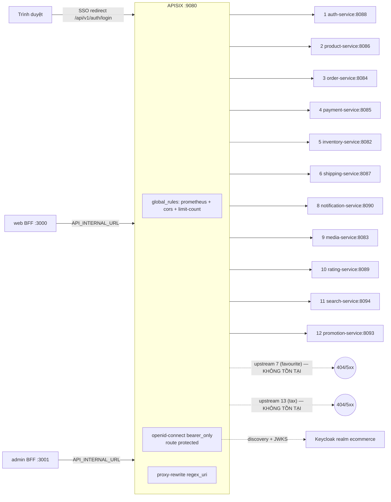
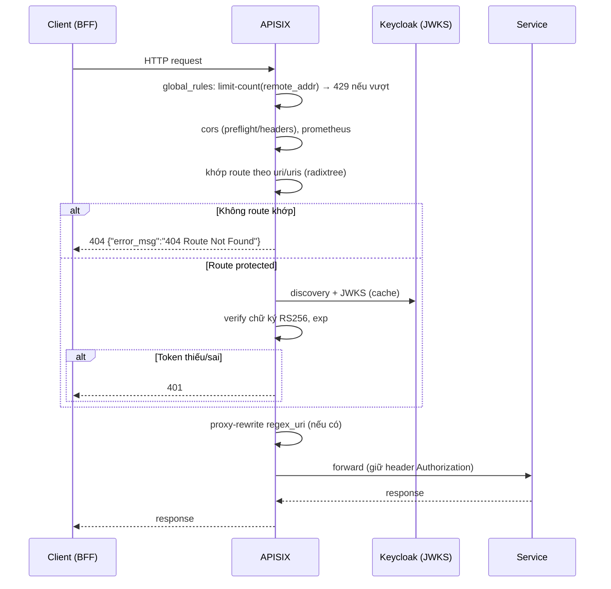

# API Gateway (APISIX) — Phân tích định tuyến

> **Phiên bản:** 1.0 · **Trạng thái:** Final · **Cập nhật:** 2026-11-12 · **Phạm vi:** Ứng dụng (as-is)

> Phạm vi: cấu hình **local docker compose** — `deploy/apisix/config.yaml` và `deploy/apisix/apisix.yaml`. Môi trường Kubernetes dùng APISIX Ingress Controller với CRD trong `deploy/k8s/gateway/` (chỉ nhắc tới khi có khác biệt đáng kể; tài liệu hạ tầng riêng sẽ mô tả chi tiết — P-7).
>
> Danh mục endpoint đầy đủ của từng service: [`api-catalog.md`](api-catalog.md).

## 1. Tổng quan

| Thuộc tính | Giá trị | Nguồn |
| :--- | :--- | :--- |
| Image | `apache/apisix:3.15.0-debian` | `docker-compose.yml:155` |
| Chế độ | `deployment.role: data_plane`, `config_provider: yaml` (standalone, **không etcd**) — cấu hình đọc từ file `apisix.yaml`, kết thúc bằng `#END` | `deploy/apisix/config.yaml:5-8`, `deploy/apisix/apisix.yaml:376` |
| Cổng proxy | `9080` (publish `9080:9080`) | `deploy/apisix/config.yaml:10`, `docker-compose.yml:158` |
| Prometheus exporter | `0.0.0.0:9091` (publish `9091:9091`) | `deploy/apisix/config.yaml:12-16`, `docker-compose.yml:159` |
| `enable_server_tokens` | `false` (ẩn version APISIX trong header `Server`) | `deploy/apisix/config.yaml:11` |
| Biến môi trường | `KEYCLOAK_CLIENT_SECRET` — được tham chiếu trong route bằng cú pháp `$env://KEYCLOAK_CLIENT_SECRET`; compose có giá trị fallback placeholder khi biến không set (không ghi ở đây) | `docker-compose.yml:160-161`, `deploy/apisix/apisix.yaml:150` |
| Phụ thuộc khởi động | `keycloak: service_healthy` | `docker-compose.yml:165-167` |

Ai gọi gateway:
- **BFF SvelteKit** (web `:3000`, admin `:3001`) gọi server-to-server qua `API_INTERNAL_URL=http://apisix:9080` (`docker-compose.yml:422,442`).
- **Trình duyệt** chỉ được chuyển hướng tới `API_PUBLIC_URL=http://localhost:9080/api/v1/auth/login?...` để bắt đầu SSO (`frontend/apps/web/src/routes/login/+page.server.ts:24`).

## 2. Upstreams

Tất cả `type: roundrobin`, một node, weight 1 (`deploy/apisix/apisix.yaml:1-45`). Không cấu hình health check, timeout hay retry → dùng mặc định APISIX.

| id | Node | Service | Ghi chú |
| :--- | :--- | :--- | :--- |
| 1 | `auth-service:8088` | auth-service | |
| 2 | `product-service:8086` | product-service | Cũng phục vụ favourites (`/favourite/api/favourites`) nhưng route favourite không trỏ vào đây |
| 3 | `order-service:8084` | order-service | |
| 4 | `payment-service:8085` | payment-service | |
| 5 | `inventory-service:8082` | inventory-service | |
| 6 | `shipping-service:8087` | shipping-service | |
| **7** | — | **không định nghĩa** | Được tham chiếu bởi route `favourite`, `openapi-favourite` (ISSUE-13) |
| 8 | `notification-service:8090` | notification-service | |
| 9 | `media-service:8083` | media-service | |
| 10 | `rating-service:8089` | rating-service | |
| 11 | `search-service:8094` | search-service | |
| 12 | `promotion-service:8093` | promotion-service | Phục vụ cả promotion lẫn tax |
| **13** | — | **không định nghĩa** | Được tham chiếu bởi `tax-classes`, `tax-rates`, `openapi-tax` (ISSUE-13). Trên k8s các route tax trỏ promotion-service (`deploy/k8s/gateway/02-routes.yaml:316-339`) |

## 3. Global rules

`global_rules[id=1]` áp dụng cho **mọi** route (`deploy/apisix/apisix.yaml:46-61`):

| Plugin | Cấu hình | Phân tích |
| :--- | :--- | :--- |
| `prometheus` | `{}` | Xuất metric request/latency/bandwidth theo route tại `:9091/apisix/prometheus/metrics` |
| `cors` | `allow_origins: http://localhost:3000, http://ecommerce.local, http://ecommerce.local:9090`; `allow_methods: GET,POST,PUT,DELETE,PATCH,OPTIONS`; `allow_headers: Authorization,Content-Type,X-Requested-With`; `max_age: 3600`; không `allow_credential` | Thiếu origin admin `localhost:3001` (ISSUE-14); không cho header `X-Correlation-Id` từ trình duyệt. Thực tế ít tác động vì trình duyệt không gọi API trực tiếp (chỉ redirect SSO). Mỗi service cũng tự bật CORS `*` (xem [api-catalog](api-catalog.md#1-quy-ước-chung)) |
| `limit-count` | `count: 1200`, `time_window: 60`, `key_type: var`, `key: remote_addr`, `policy: local`, `rejected_code: 429` | 1200 request/phút **theo IP nguồn**, đếm cục bộ trong mỗi worker/instance. Vì mọi lời gọi API đều đi từ container BFF, toàn bộ khách hàng dùng **chung một quota** của IP BFF (ISSUE-61) |

## 4. Plugin `openid-connect` (route protected)

Cấu hình giống hệt nhau trên mọi route protected (vd `deploy/apisix/apisix.yaml:148-155`):

| Khóa | Giá trị | Ý nghĩa |
| :--- | :--- | :--- |
| `client_id` | `ecommerce-client` | Client Keycloak (public client — ISSUE-12) |
| `client_secret` | `$env://KEYCLOAK_CLIENT_SECRET` (không ghi giá trị) | Không cần cho `bearer_only` + JWKS |
| `discovery` | `http://keycloak:8080/realms/ecommerce/.well-known/openid-configuration` | Lấy `jwks_uri`, issuer |
| `realm` | `ecommerce` | |
| `bearer_only` | `true` | Chỉ kiểm header `Authorization: Bearer`; thiếu/sai → **401**, không redirect login |
| `use_jwks` | `true` | Verify chữ ký JWT cục bộ bằng JWKS (không introspection) |
| `token_signing_alg_values_expected` | `RS256` | |

Không có `required_scopes`, không plugin kiểm role / `authz-keycloak` → **xác thực nhưng không phân quyền** (ISSUE-01). Plugin không cấu hình `set_userinfo_header`/`set_access_token_header` tường minh; service tự parse lại header `Authorization` mà không verify (ISSUE-02, ISSUE-03).

## 5. Bảng route đầy đủ

Cột "Rewrite": `^/(.*)` → `<prefix>/$1` qua `proxy-rewrite.regex_uri`. Không route nào giới hạn `methods` → **mọi HTTP method** đều khớp.

| # | Route id | URI(s) | Upstream | Auth | Rewrite | Path tới service | Dòng |
| :--- | :--- | :--- | :--- | :--- | :--- | :--- | :--- |
| 1 | `auth-public` | `/api/v1/auth/*` | 1 | **Public** | `/auth/$1` | `/auth/api/v1/auth/...` | `:63-70` |
| 2 | `product-catalog` | `/api/categories`, `/api/categories/*`, `/api/products`, `/api/products/*` | 2 | **Public — mọi method** (ISSUE-102) | `/product/$1` | `/product/api/...` | `:71-82` |
| 3 | `rating-storefront` | `/storefront/ratings`, `/storefront/ratings/*` | 10 | **Public — gồm POST** (ISSUE-03) | `/rating/$1` | `/rating/storefront/ratings...` | `:83-92` |
| 4 | `search-storefront` | `/storefront/catalog-search`, `/storefront/search_suggest` | 11 | Public | `/search/$1` | `/search/storefront/...` | `:93-102` |
| 5–17 | `openapi-{auth,product,order,payment,inventory,shipping,favourite,notification,media,rating,search,promotion,tax}` | `/<svc>/v3/api-docs/*` | 1,2,3,4,5,6,**7**,8,9,10,11,12,**13** | Public | — | nguyên path — **không service nào có handler** (ISSUE-16) | `:103-141` |
| 18 | `auth-roles` | `/api/v1/roles`, `/api/v1/roles/*` | 1 | Bearer | `/auth/$1` | `/auth/api/v1/roles/...` | `:142-159` |
| 19 | `auth-users` | `/api/v1/users`, `/api/v1/users/*` | 1 | Bearer | `/auth/$1` | `/auth/api/v1/users/...` | `:160-177` |
| 20 | `order-carts` | `/api/carts`, `/api/carts/*` | 3 | Bearer | `/order/$1` | `/order/api/carts...` | `:178-195` |
| 21 | `order-orders` | `/api/orders`, `/api/orders/*` | 3 | Bearer | `/order/$1` | `/order/api/orders...` | `:196-213` |
| 22 | `payment` | `/api/payments`, `/api/payments/*` | 4 | Bearer | `/payment/$1` | `/payment/api/payments...` | `:214-231` |
| 23 | `inventory` | `/api/inventory`, `/api/inventory/*` | 5 | Bearer | `/inventory/$1` | `/inventory/api/inventory...` | `:232-249` |
| 24 | `favourite` | `/api/favourites`, `/api/favourites/*` | **7** ❌ | Bearer | `/favourite/$1` | (không tới được — ISSUE-13) | `:250-267` |
| 25 | `shipping` | `/shipping/api/shippings/*` | 6 | Bearer | — | nguyên path | `:268-279` |
| 26 | `notif-email` | `/notification/api/email/*` | 8 | Bearer | — | nguyên path | `:280-291` |
| 27 | `notif-notifications` | `/notification/api/notifications/*` | 8 | Bearer | — | nguyên path | `:292-303` |
| 28 | `notif-payment` | `/notification/api/payment-notifications/*` | 8 | Bearer | — | nguyên path | `:304-315` |
| 29 | `media` | `/media/medias/*` | 9 | Bearer | — | nguyên path | `:316-327` |
| 30 | `rating-backoffice` | `/rating/backoffice/ratings/*` | 10 | Bearer | — | nguyên path | `:328-339` |
| 31 | `promotion-backoffice` | `/promotion/backoffice/promotions/*` | 12 | Bearer | — | nguyên path | `:340-351` |
| 32 | `tax-classes` | `/tax/backoffice/tax-classes/*` | **13** ❌ | Bearer | — | (ISSUE-13) | `:352-363` |
| 33 | `tax-rates` | `/tax/backoffice/tax-rates/*` | **13** ❌ | Bearer | — | (ISSUE-13) | `:364-375` |

Hai "phong cách" route cùng tồn tại:
- **Kiểu `/api/...` + rewrite** (route 1–4, 18–24): client gọi path ngắn, gateway thêm prefix context-root của service (`/auth`, `/product`, `/order`…). Mỗi service Go đăng ký route ở cả `/api/...` lẫn `/<ctx>/api/...` nên cả hai đều chạy (xem [api-catalog](api-catalog.md)).
- **Kiểu `/<svc>/...` không rewrite** (route 25–33): client phải gọi kèm prefix service; chỉ khớp khi có **ít nhất một ký tự sau dấu `/`** cuối → path gốc của collection không khớp (ISSUE-15).

### 5.1 Ví dụ rewrite

| Request tới gateway | Route | Request tới upstream |
| :--- | :--- | :--- |
| `GET /api/v1/auth/login?redirect_uri=...` | auth-public | `GET auth-service:8088/auth/api/v1/auth/login?redirect_uri=...` |
| `GET /api/products/5` | product-catalog | `GET product-service:8086/product/api/products/5` |
| `POST /storefront/ratings` | rating-storefront | `POST rating-service:8089/rating/storefront/ratings` |
| `GET /storefront/catalog-search?keyword=x` | search-storefront | `GET search-service:8094/search/storefront/catalog-search?keyword=x` |
| `GET /api/v1/users/me` + Bearer | auth-users | `GET auth-service:8088/auth/api/v1/users/me` |
| `DELETE /media/medias/3` + Bearer | media | `DELETE media-service:8083/media/medias/3` |
| `GET /media/medias?ids=1,2` | — | **404** (không route nào khớp) |
| `POST /promotion/backoffice/promotions` | — | **404** |
| `GET /api/favourites` + Bearer | favourite | lỗi: upstream 7 không tồn tại |

## 6. Ma trận public / protected

| Nhóm | Public (không cần token) | Protected (Bearer, verify JWKS) | Không đi được qua gateway |
| :--- | :--- | :--- | :--- |
| auth-service | `/api/v1/auth/*` (signup, login, callback, session, refresh, logout) | `/api/v1/users*`, `/api/v1/roles*` | — |
| product-service | `/api/products*`, `/api/categories*` **mọi method, kể cả POST/PUT/DELETE** (ISSUE-102) | — | `/api/favourites*` (ISSUE-13) |
| order-service | — | `/api/carts*`, `/api/orders*` | — |
| payment-service | — | `/api/payments*` | — |
| inventory-service | — | `/api/inventory*` | — |
| shipping-service | — | `/shipping/api/shippings/*` | `/shipping/api/shippings` (list/POST/PUT) |
| search-service | `/storefront/catalog-search`, `/storefront/search_suggest` | — | — |
| rating-service | `/storefront/ratings*` **kể cả POST** (ISSUE-03) | `/rating/backoffice/ratings/*` | `GET /rating/backoffice/ratings` |
| media-service | — | `/media/medias/*` (cả stream file) | `POST /media/medias`, `GET /media/medias?ids=` |
| notification-service | — | `/notification/api/{email,notifications,payment-notifications}/*` | `GET/POST /notification/api/notifications`, `GET/POST /notification/api/payment-notifications` |
| promotion-service | — | `/promotion/backoffice/promotions/*` | `GET/POST/PUT /promotion/backoffice/promotions`; mọi route `/tax/...` (ISSUE-13) |
| Health `/actuator/health` | — | — | Không có route |
| OpenAPI | `/<svc>/v3/api-docs/*` (route chết) | — | — |

## 7. Luồng xử lý request

## 8. Khác biệt với cấu hình Kubernetes (tham khảo)

| Điểm | Local (`apisix.yaml`) | K8s (`deploy/k8s/gateway/`) |
| :--- | :--- | :--- |
| Tax | upstream 13 không tồn tại | trỏ `promotion-service:8093` (`02-routes.yaml:316-339`) |
| Auth plugin | `openid-connect` khai báo inline mỗi route | `plugin_config_name: jwt-auth` (`00-plugin-config.yaml`) |
| Global rule | `limit-count policy: local` | Redis (`01-global-rule.yaml`, xem ISSUE-10) |

## 9. Vấn đề đã biết

| ID | Mức độ | Tóm tắt |
| :--- | :--- | :--- |
| ISSUE-01 | Critical | Chỉ xác thực token, không kiểm role |
| ISSUE-102 | Critical | Route `product-catalog` không giới hạn method, không `openid-connect` → POST/PUT/DELETE sản phẩm & danh mục **không cần đăng nhập** |
| ISSUE-03 | High | `POST /storefront/ratings` public |
| ISSUE-13 | High | Upstream 7 (favourite) và 13 (tax) không định nghĩa |
| ISSUE-12 | Low | `client_secret` cấu hình cho public client |
| ISSUE-14 | Medium | CORS thiếu `localhost:3001` |
| ISSUE-15 | Medium | Route dạng `/<svc>/.../*` không khớp path gốc collection |
| ISSUE-16 | Low | 13 route OpenAPI chết |
| ISSUE-61 | Medium | `limit-count` theo `remote_addr` trong khi mọi request đi từ BFF → quota chung cho mọi người dùng; `policy: local` không chia sẻ giữa instance |
| ISSUE-63 | Medium | Route media yêu cầu Bearer cả cho stream file → không nhúng ảnh trực tiếp từ trình duyệt |
| ISSUE-02 | High | Port service publish ra host, service không verify JWT → bỏ qua gateway hoàn toàn |

## 10. Tham chiếu source

- `deploy/apisix/config.yaml:1-16`
- `deploy/apisix/apisix.yaml:1-45` (upstreams), `:46-61` (global rules), `:62-376` (routes)
- `docker-compose.yml:154-169` (apisix), `:412-449` (frontend env)
- `deploy/k8s/gateway/00-plugin-config.yaml`, `01-global-rule.yaml`, `02-routes.yaml`
- `services/shared/middleware/middleware.go` (UserClaims không verify)
