# Data Dictionary

> **Phiên bản:** 1.0 · **Trạng thái:** Final · **Cập nhật:** 2026-11-12 · **Phạm vi:** Ứng dụng (as-is)

> Từ điển dữ liệu **as-is** cho toàn bộ kho dữ liệu mà backend sử dụng: các database PostgreSQL, index OpenSearch và bucket S3. Nguồn sự thật là DDL trong code (`InitSchema` của service Go, `initDb()` + `schema.ts` của service Bun) và `deploy/postgres/init/create-all-databases.sql`. Không có công cụ migration (ISSUE-28): bảng được tạo bằng `CREATE TABLE IF NOT EXISTS` khi service khởi động, nên **thay đổi DDL trong code không tự áp dụng lên bảng đã tồn tại**.

## 1. Tổng quan

### 1.1 Máy chủ & cách tạo database

- Một instance **PostgreSQL 16** dùng chung (`docker-compose.yml:5-23`), `POSTGRES_DB: ecommerce` → database mặc định `ecommerce` được tạo bởi image.
- Script khởi tạo `deploy/postgres/init/create-all-databases.sql:1-12` (mount vào `/docker-entrypoint-initdb.d`, chỉ chạy khi volume rỗng) tạo thêm 12 database.
- Mọi service dùng **chung một tài khoản** `${POSTGRES_USER}` (xem `.env`; không có user/quyền riêng theo service).
- Không có schema riêng — mọi bảng nằm trong schema `public`.

### 1.2 Bản đồ database ↔ service

| Database | Tạo bởi | Service sở hữu | Bảng | Trạng thái |
| :--- | :--- | :--- | :--- | :--- |
| `ecommerce` | image postgres (`POSTGRES_DB`) | notification-service (`docker-compose.yml:393-395`) | `notifications`, `payment_notifications` | Đang dùng — DB "chung", không theo quy ước DB-per-service (ISSUE-33) |
| `keycloak` | init SQL | Keycloak (`docker-compose.yml:129-134`) | Do Keycloak quản lý (~90 bảng nội bộ) | Đang dùng — ngoài phạm vi tài liệu |
| `authservice` | init SQL | auth-service | `users`, `roles`, `user_role` | Đang dùng |
| `productservice` | init SQL | product-service | `categories`, `products`, `favourites` | Đang dùng |
| `orderservice` | init SQL | order-service | `carts`, `orders` | Đang dùng |
| `paymentservice` | init SQL | payment-service | `payments` | Đang dùng |
| `shippingservice` | init SQL | shipping-service | `order_items` | Đang dùng |
| `inventoryservice` | init SQL | inventory-service | `inventory` | Đang dùng |
| `ratingservice` | init SQL | rating-service | `rating` | Đang dùng |
| `mediaservice` | init SQL | media-service | `media` | Đang dùng |
| `promotionservice` | init SQL | promotion-service | `promotion`, `tax_class`, `tax_rate` | Đang dùng (chứa cả bảng thuế) |
| `favouriteservice` | init SQL | – | – | **Không dùng** (favourites nằm trong `productservice`) |
| `taxservice` | init SQL | – | – | **Không dùng** (bảng thuế nằm trong `promotionservice` — ISSUE-31) |

Ngoài PostgreSQL:

| Kho | Service | Mục |
| :--- | :--- | :--- |
| OpenSearch index `product` | search-service | [§14](#14-opensearch-index-product-search-service) |
| S3 (RustFS) bucket `${STORAGE_BUCKET}` | media-service | [§15](#15-s3-bucket-media-service) |
| Redis | Không service ứng dụng nào dùng (chỉ gateway trên k8s) | – |
| In-memory (RAM) | auth-service: state/ticket SSO | [auth-service.md §8.1](../03-services/auth-service.md#81-luồng-sso-login--callback--ticket--session) |

### 1.3 Cách service xác định database

Mọi service (Go và Bun) dựng DSN theo cùng thứ tự ưu tiên: `DATABASE_URL` → parse `SPRING_DATASOURCE_URL` (`jdbc:postgresql://host:port/db`) → `POSTGRES_HOST/PORT/DB` với default tên DB của service. Ví dụ: `services/product-service/main.go:26-54`, `services/rating-service/src/db.ts:4-32`. notification-service không có `SPRING_DATASOURCE_URL` trong compose và default `POSTGRES_DB` = `ecommerce` (`services/notification-service/src/db.ts:13`).

### 1.4 Quy ước ghi trong bảng cột

- **Null?**: `NO` = `NOT NULL`, `YES` = cho phép NULL. Cột PK luôn `NO`.
- **Ghi bởi code**: cách service thực sự ghi giá trị (nhiều default trong DDL không bao giờ được dùng vì code luôn truyền giá trị).
- Không có quan hệ khóa ngoại **giữa** các database. Các tham chiếu chéo (vd `orders.product_id` → `products.product_id`) chỉ là logic, xem [§16](#16-quan-hệ-logic-giữa-các-database).

---

## 2. authservice (auth-service)

DDL: `services/auth-service/internal/repository/user_repository.go:35-63`.

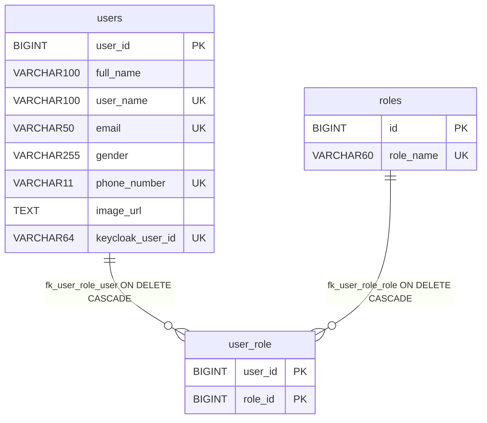

### 2.1 `users`

| Cột | Kiểu | Null? | Default | Ràng buộc | Ý nghĩa / ghi bởi code |
| :--- | :--- | :---: | :--- | :--- | :--- |
| `user_id` | `BIGINT` | NO | `GENERATED BY DEFAULT AS IDENTITY` | PK | Id nội bộ; JSON `id` |
| `full_name` | `VARCHAR(100)` | YES | – | – | Họ tên; JSON `fullname` |
| `user_name` | `VARCHAR(100)` | NO | – | UNIQUE | Username, trùng `preferred_username` trong Keycloak; dùng để tra `/users/me` |
| `email` | `VARCHAR(50)` | NO | – | UNIQUE | Email (không xác minh; không đồng bộ với Keycloak khi sửa) |
| `gender` | `VARCHAR(255)` | NO | – | – | Giới tính tự do (vd `MALE`); signup không gửi → `''` |
| `phone_number` | `VARCHAR(11)` | YES | – | UNIQUE | Số điện thoại; code ghi `''` khi không có → **chuỗi rỗng bị UNIQUE chặn** từ user thứ hai (ISSUE-55) |
| `image_url` | `TEXT` | YES | – | – | Avatar; JSON `avatar` |
| `keycloak_user_id` | `VARCHAR(64)` | YES | – | UNIQUE | UUID user Keycloak, hoặc giá trị giả `kc-<username>` (ISSUE-08) |

### 2.2 `roles`

| Cột | Kiểu | Null? | Default | Ràng buộc | Ý nghĩa |
| :--- | :--- | :---: | :--- | :--- | :--- |
| `id` | `BIGINT` | NO | IDENTITY | PK | |
| `role_name` | `VARCHAR(60)` | NO | – | UNIQUE | Tên role viết hoa |

Seed (`user_repository.go:60-62`, `ON CONFLICT (id) DO NOTHING`): `1 USER`, `2 PM`, `3 ADMIN`. Không có API tạo role. Role ở đây **không** phải realm role Keycloak (ISSUE-08).

### 2.3 `user_role`

| Cột | Kiểu | Null? | Ràng buộc | Ý nghĩa |
| :--- | :--- | :---: | :--- | :--- |
| `user_id` | `BIGINT` | NO | PK(`user_id`,`role_id`); FK → `users.user_id` ON DELETE CASCADE | |
| `role_id` | `BIGINT` | NO | FK → `roles.id` ON DELETE CASCADE | |

Index: chỉ các index ngầm của PK/UNIQUE (`users_pkey`, `users_user_name_key`, `users_email_key`, `users_phone_number_key`, `users_keycloak_user_id_key`, `roles_pkey`, `roles_role_name_key`, `pk_user_role`).

---

## 3. productservice (product-service)

DDL: `services/product-service/internal/repository/product_repo.go:34-64`.

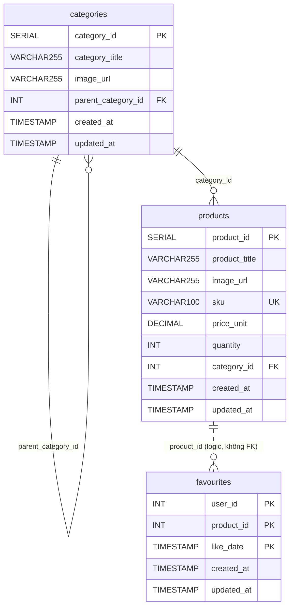

### 3.1 `categories`

| Cột | Kiểu | Null? | Default | Ràng buộc | Ý nghĩa / ghi bởi code |
| :--- | :--- | :---: | :--- | :--- | :--- |
| `category_id` | `SERIAL` (INT) | NO | sequence | PK | JSON `categoryId` |
| `category_title` | `VARCHAR(255)` | NO | – | – | Tên danh mục (không UNIQUE; `''` được chấp nhận) |
| `image_url` | `VARCHAR(255)` | YES | – | – | Ảnh; code luôn ghi (chuỗi rỗng nếu không gửi) |
| `parent_category_id` | `INT` | YES | – | FK → `categories.category_id` (không ON DELETE) | Danh mục cha; ghi khi `parentCategory.categoryId > 0`; **không bao giờ được đọc ra API** |
| `created_at` | `TIMESTAMP` | YES | `CURRENT_TIMESTAMP` | – | Code ghi `NOW()` |
| `updated_at` | `TIMESTAMP` | YES | `CURRENT_TIMESTAMP` | – | Code ghi `NOW()` khi tạo/sửa |

### 3.2 `products`

| Cột | Kiểu | Null? | Default | Ràng buộc | Ý nghĩa / ghi bởi code |
| :--- | :--- | :---: | :--- | :--- | :--- |
| `product_id` | `SERIAL` | NO | sequence | PK | JSON `productId` |
| `product_title` | `VARCHAR(255)` | NO | – | – | Tên sản phẩm |
| `image_url` | `VARCHAR(255)` | YES | – | – | URL ảnh (chuỗi tự do, không liên kết media-service) |
| `sku` | `VARCHAR(100)` | YES | – | UNIQUE | Mã SKU; code ghi `''` khi không gửi → chỉ một sản phẩm được phép không có SKU (ISSUE-55) |
| `price_unit` | `DECIMAL(12,2)` | YES | `0.0` | – | Đơn giá (VND); đọc ra `float64` (ISSUE-27); không chặn âm |
| `quantity` | `INT` | YES | `0` | – | Tồn kho theo product-service (tách biệt `inventory` — ISSUE-26) |
| `category_id` | `INT` | YES | – | FK → `categories.category_id` | Danh mục; xóa category đang dùng → lỗi FK |
| `created_at` | `TIMESTAMP` | YES | `CURRENT_TIMESTAMP` | – | `NOW()` |
| `updated_at` | `TIMESTAMP` | YES | `CURRENT_TIMESTAMP` | – | `NOW()` |

Không có cột `description`, `brand`, `slug`, `is_published` (ISSUE-35, ISSUE-50).

### 3.3 `favourites`

| Cột | Kiểu | Null? | Default | Ràng buộc | Ý nghĩa |
| :--- | :--- | :---: | :--- | :--- | :--- |
| `user_id` | `INT` | NO | – | PK (1/3) | Id người dùng do **client gửi** (không từ token; không tương thích UUID Keycloak — ISSUE-56) |
| `product_id` | `INT` | NO | – | PK (2/3) | Sản phẩm (không FK) |
| `like_date` | `TIMESTAMP` | NO | – | PK (3/3) | Thời điểm thích; parse từ chuỗi, sai → `now()` |
| `created_at` | `TIMESTAMP` | YES | `CURRENT_TIMESTAMP` | – | Không được code ghi trực tiếp |
| `updated_at` | `TIMESTAMP` | YES | `CURRENT_TIMESTAMP` | – | Cập nhật khi upsert trùng khóa |

Index: chỉ PK/UNIQUE ngầm. Không có index trên `products.category_id` hay `favourites.user_id`.

---

## 4. orderservice (order-service)

DDL: `services/order-service/internal/repository/order_repository.go:36-54`.

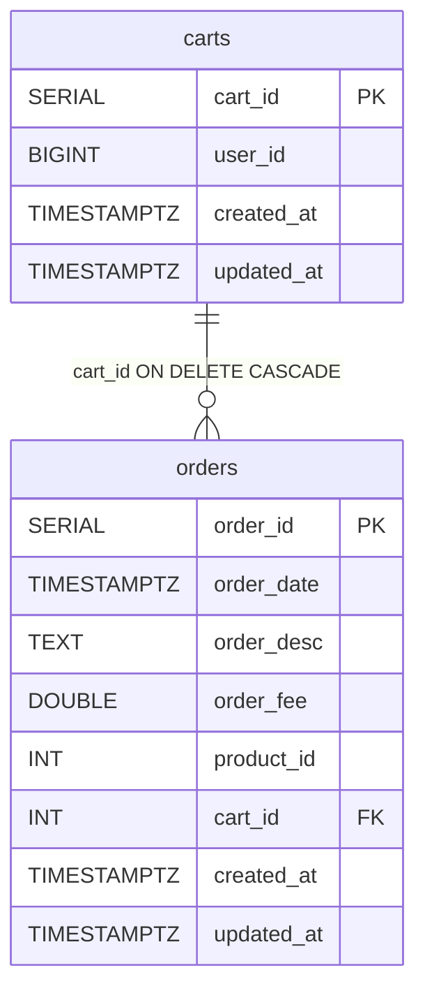

### 4.1 `carts`

| Cột | Kiểu | Null? | Default | Ràng buộc | Ý nghĩa |
| :--- | :--- | :---: | :--- | :--- | :--- |
| `cart_id` | `SERIAL` | NO | sequence | PK | JSON `cartId` |
| `user_id` | `BIGINT` | YES | – | – | Chủ giỏ — số nguyên do client gửi; không khớp `sub` UUID Keycloak (ISSUE-49) |
| `created_at` | `TIMESTAMPTZ` | YES | `CURRENT_TIMESTAMP` | – | |
| `updated_at` | `TIMESTAMPTZ` | YES | `CURRENT_TIMESTAMP` | – | Cập nhật khi PUT |

### 4.2 `orders`

| Cột | Kiểu | Null? | Default | Ràng buộc | Ý nghĩa / ghi bởi code |
| :--- | :--- | :---: | :--- | :--- | :--- |
| `order_id` | `SERIAL` | NO | sequence | PK | JSON `orderId` |
| `order_date` | `TIMESTAMPTZ` | YES | `CURRENT_TIMESTAMP` | – | Ngày đặt; client gửi, không parse được → now; đọc ra qua `to_char` (mất múi giờ) |
| `order_desc` | `TEXT` | YES | – | – | Ghi chú (BFF dùng ghi chú giao hàng hoặc `EzBuy order`) |
| `order_fee` | `DOUBLE PRECISION` | YES | – | – | Tổng tiền do client gửi (ISSUE-21, ISSUE-27) |
| `product_id` | `INT` | YES | – | – | **Một** sản phẩm/đơn (ISSUE-20); logic → `productservice.products` |
| `cart_id` | `INT` | YES | – | FK → `carts.cart_id` ON DELETE CASCADE | BFF không gửi → NULL → đơn không gắn user |
| `created_at` | `TIMESTAMPTZ` | YES | `CURRENT_TIMESTAMP` | – | |
| `updated_at` | `TIMESTAMPTZ` | YES | `CURRENT_TIMESTAMP` | – | |

Không có cột trạng thái, số lượng, địa chỉ, phương thức thanh toán (ISSUE-20, ISSUE-22). Không có index trên `orders.cart_id`.

---

## 5. paymentservice (payment-service)

DDL: `services/payment-service/internal/repository/payment_repository.go:34-44`.

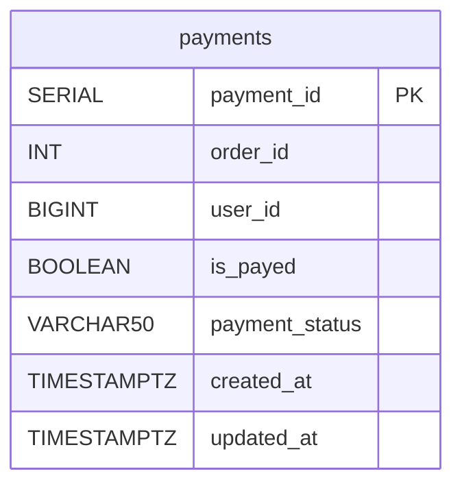

| Cột | Kiểu | Null? | Default | Ràng buộc | Ý nghĩa / ghi bởi code |
| :--- | :--- | :---: | :--- | :--- | :--- |
| `payment_id` | `SERIAL` | NO | sequence | PK | |
| `order_id` | `INT` | YES | – | không FK, không UNIQUE | Logic → `orderservice.orders.order_id` |
| `user_id` | `BIGINT` | YES | – | – | BFF không gửi → NULL |
| `is_payed` | `BOOLEAN` | YES | `FALSE` | – | Đã thanh toán (client tự khai báo); `COALESCE(x, FALSE)` khi insert |
| `payment_status` | `VARCHAR(50)` | YES | `'NOT_STARTED'` | – | Chuỗi tự do: `NOT_STARTED` (COD), `IN_PROGRESS` (khác COD) do BFF gửi; client bỏ trống → `''` (ISSUE-59) |
| `created_at` | `TIMESTAMPTZ` | YES | `CURRENT_TIMESTAMP` | – | |
| `updated_at` | `TIMESTAMPTZ` | YES | `CURRENT_TIMESTAMP` | – | |

Không có cột số tiền, phương thức, mã giao dịch cổng (ISSUE-25).

---

## 6. shippingservice (shipping-service)

DDL: `services/shipping-service/internal/repository/shipping_repo.go:32-41`.

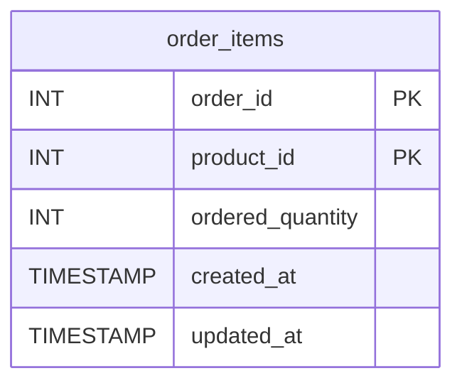

| Cột | Kiểu | Null? | Default | Ràng buộc | Ý nghĩa |
| :--- | :--- | :---: | :--- | :--- | :--- |
| `order_id` | `INT` | NO | – | PK (1/2) | Logic → `orderservice.orders` |
| `product_id` | `INT` | NO | – | PK (2/2) | Logic → `productservice.products` |
| `ordered_quantity` | `INT` | YES | `1` | – | Số lượng; code luôn ghi giá trị client (0 nếu bỏ trống) |
| `created_at` | `TIMESTAMP` | YES | `CURRENT_TIMESTAMP` | – | `NOW()` |
| `updated_at` | `TIMESTAMP` | YES | `CURRENT_TIMESTAMP` | – | `NOW()` khi upsert |

Bảng không được order-service hay frontend ghi (ISSUE-20).

---

## 7. inventoryservice (inventory-service)

DDL: `services/inventory-service/internal/repository/inventory_repo.go:28-34`.

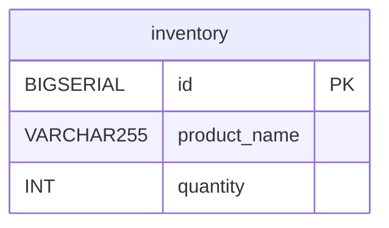

| Cột | Kiểu | Null? | Default | Ràng buộc | Ý nghĩa |
| :--- | :--- | :---: | :--- | :--- | :--- |
| `id` | `BIGSERIAL` | NO | sequence | PK | |
| `product_name` | `VARCHAR(255)` | NO | – | **không UNIQUE, không index** | Khóa tra cứu tồn kho (so khớp chính xác) — ISSUE-26 |
| `quantity` | `INT` | YES | `0` | – | Số lượng còn |

Không có API ghi; dữ liệu phải chèn tay. Không liên kết `products`.

---

## 8. ratingservice (rating-service)

DDL: `services/rating-service/src/db.ts:48-61`; Drizzle schema `services/rating-service/src/schema.ts:4-16`.

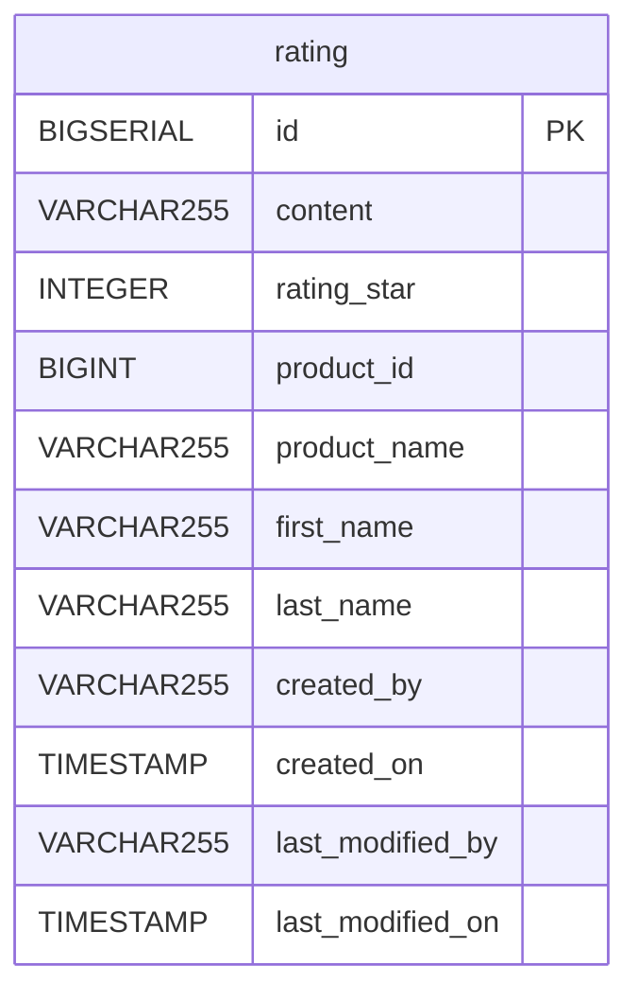

| Cột | Kiểu | Null? | Default | Ý nghĩa / ghi bởi code |
| :--- | :--- | :---: | :--- | :--- |
| `id` | `BIGSERIAL` | NO | sequence | PK |
| `content` | `VARCHAR(255)` | YES | – | Nội dung đánh giá (zod default `""`) |
| `rating_star` | `INTEGER` | NO | – | Số sao; zod chặn 1–5 (`services/rating-service/src/types.ts:5`), DB không có CHECK |
| `product_id` | `BIGINT` | YES | – | Sản phẩm (logic → `products.product_id`, không kiểm tồn tại) |
| `product_name` | `VARCHAR(255)` | YES | – | Tên sản phẩm denormalize do client gửi |
| `first_name` | `VARCHAR(255)` | YES | – | Từ claim `given_name`/`name` của token (không xác minh — ISSUE-03), mặc định `Customer` |
| `last_name` | `VARCHAR(255)` | YES | – | Từ `family_name`, mặc định `''` |
| `created_by` | `VARCHAR(255)` | YES | – | `sub` của token hoặc `anonymous` (ISSUE-03) |
| `created_on` | `TIMESTAMP` | YES | `CURRENT_TIMESTAMP` | |
| `last_modified_by` | `VARCHAR(255)` | YES | – | Không bao giờ được ghi |
| `last_modified_on` | `TIMESTAMP` | YES | `CURRENT_TIMESTAMP` | Không được cập nhật (không có API sửa) |

Không có index trên `product_id` (truy vấn theo sản phẩm quét toàn bảng); không có UNIQUE (một user đánh giá nhiều lần).

---

## 9. mediaservice (media-service)

DDL: `services/media-service/src/db.ts:48-55`; schema `services/media-service/src/schema.ts:4-10`.

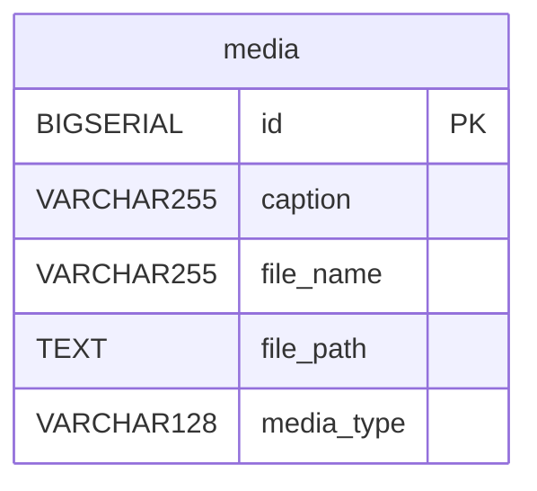

| Cột | Kiểu | Null? | Default | Ý nghĩa / ghi bởi code |
| :--- | :--- | :---: | :--- | :--- |
| `id` | `BIGSERIAL` | NO | sequence | PK; xuất hiện trong URL `/medias/{id}/file/{fileName}` |
| `caption` | `VARCHAR(255)` | YES | – | Chú thích |
| `file_name` | `VARCHAR(255)` | YES | – | Tên file hiển thị (override hoặc tên gốc, mặc định `upload.bin`); phải khớp (không phân biệt hoa thường) khi tải file |
| `file_path` | `TEXT` | YES | – | **Object key** trong bucket S3: `<uuid>-<tên đã làm sạch>` (`services/media-service/src/service.ts:27-30`) |
| `media_type` | `VARCHAR(128)` | YES | – | MIME type từ upload, mặc định `application/octet-stream` |

Không có cột kích thước, chủ sở hữu, thời gian tạo.

---

## 10. promotionservice (promotion-service)

DDL: `services/promotion-service/src/db.ts:48-87`; schema `services/promotion-service/src/schema.ts:4-39`.

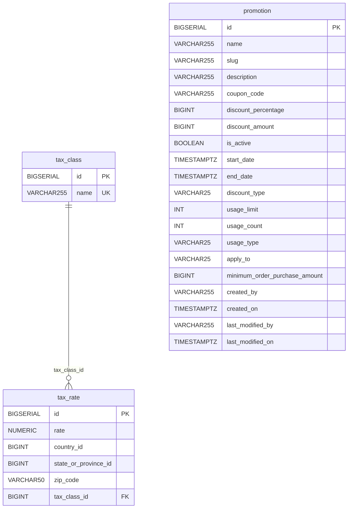

### 10.1 `promotion`

| Cột | Kiểu | Null? | Default | Ý nghĩa / ghi bởi code |
| :--- | :--- | :---: | :--- | :--- |
| `id` | `BIGSERIAL` | NO | sequence | PK |
| `name` | `VARCHAR(255)` | NO | – | Tên (zod `min(1)`) |
| `slug` | `VARCHAR(255)` | NO | – | Client gửi hoặc tự sinh từ `name`; **không UNIQUE** |
| `description` | `VARCHAR(255)` | YES | – | |
| `coupon_code` | `VARCHAR(255)` | YES | – | Mã coupon; không UNIQUE, không kiểm trùng (ISSUE-30) |
| `discount_percentage` | `BIGINT` | NO | `0` | % giảm (số nguyên, không chặn >100) |
| `discount_amount` | `BIGINT` | NO | `0` | Số tiền giảm |
| `is_active` | `BOOLEAN` | NO | `TRUE` | |
| `start_date` | `TIMESTAMPTZ` | YES | – | Không kiểm `start <= end` (ISSUE-30) |
| `end_date` | `TIMESTAMPTZ` | YES | – | |
| `discount_type` | `VARCHAR(25)` | NO | `'PERCENTAGE'` | "Enum" dạng chuỗi tự do |
| `usage_limit` | `INT` | YES | `100` | |
| `usage_count` | `INT` | NO | `0` | **Không bao giờ tăng** (ISSUE-30) |
| `usage_type` | `VARCHAR(25)` | NO | `'UNLIMITED'` | Chuỗi tự do |
| `apply_to` | `VARCHAR(25)` | NO | `'ALL'` | Chuỗi tự do; không có bảng liên kết brand/category/product |
| `minimum_order_purchase_amount` | `BIGINT` | YES | `0` | **Không được code ghi** (ISSUE-30) |
| `created_by` | `VARCHAR(255)` | YES | – | Không được ghi |
| `created_on` | `TIMESTAMPTZ` | YES | `CURRENT_TIMESTAMP` | |
| `last_modified_by` | `VARCHAR(255)` | YES | – | Không được ghi |
| `last_modified_on` | `TIMESTAMPTZ` | YES | `CURRENT_TIMESTAMP` | Set `CURRENT_TIMESTAMP` khi update |

### 10.2 `tax_class`

| Cột | Kiểu | Null? | Ràng buộc | Ý nghĩa |
| :--- | :--- | :---: | :--- | :--- |
| `id` | `BIGSERIAL` | NO | PK | |
| `name` | `VARCHAR(255)` | NO | UNIQUE | Tên lớp thuế |

### 10.3 `tax_rate`

| Cột | Kiểu | Null? | Ràng buộc | Ý nghĩa |
| :--- | :--- | :---: | :--- | :--- |
| `id` | `BIGSERIAL` | NO | PK | |
| `rate` | `NUMERIC(10,4)` | NO | – | Thuế suất (%); ghi dạng chuỗi, đọc `Number()` |
| `country_id` | `BIGINT` | NO | – | Id quốc gia (không có bảng country) |
| `state_or_province_id` | `BIGINT` | YES | – | Bị bỏ qua khi tính thuế (ISSUE-31) |
| `zip_code` | `VARCHAR(50)` | YES | – | Bị bỏ qua khi tính thuế (ISSUE-31) |
| `tax_class_id` | `BIGINT` | YES | FK → `tax_class.id` (không ON DELETE) | Xóa tax class đang dùng → lỗi FK |

---

## 11. ecommerce (notification-service)

DDL: `services/notification-service/src/db.ts:48-70`; schema `services/notification-service/src/schema.ts:4-23`. notification-service dùng DB mặc định `ecommerce` (`docker-compose.yml:393-395`) thay vì một DB riêng (ISSUE-33).

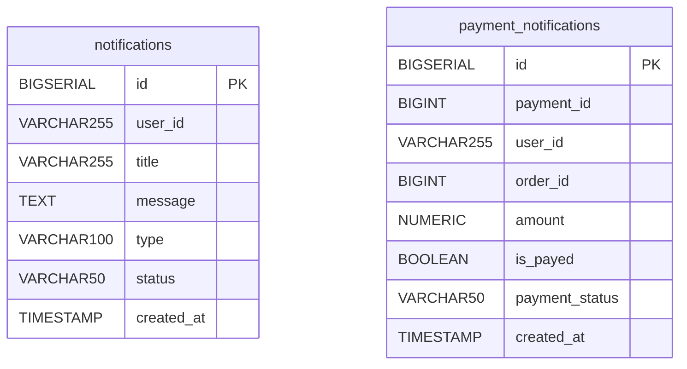

### 11.1 `notifications`

| Cột | Kiểu | Null? | Default | Ý nghĩa / ghi bởi code |
| :--- | :--- | :---: | :--- | :--- |
| `id` | `BIGSERIAL` | NO | sequence | PK |
| `user_id` | `VARCHAR(255)` | YES | – | Người nhận (chuỗi, có thể là UUID); POST không gửi → `''`; **không dùng để lọc** khi đọc (ISSUE-33) |
| `title` | `VARCHAR(255)` | YES | – | |
| `message` | `TEXT` | YES | – | |
| `type` | `VARCHAR(100)` | YES | – | Mặc định code `INFO` |
| `status` | `VARCHAR(50)` | YES | `'UNREAD'` | Không có API đánh dấu đã đọc |
| `created_at` | `TIMESTAMP` | YES | `CURRENT_TIMESTAMP` | |

### 11.2 `payment_notifications`

| Cột | Kiểu | Null? | Default | Ý nghĩa / ghi bởi code |
| :--- | :--- | :---: | :--- | :--- |
| `id` | `BIGSERIAL` | NO | sequence | PK |
| `payment_id` | `BIGINT` | YES | – | Logic → `paymentservice.payments.payment_id` |
| `user_id` | `VARCHAR(255)` | YES | – | |
| `order_id` | `BIGINT` | YES | – | Logic → `orderservice.orders.order_id` |
| `amount` | `NUMERIC` | YES | – | Ghi `String(amount \|\| 0)`; payload payment-service không có `amount` → luôn `0` |
| `is_payed` | `BOOLEAN` | YES | – | Code mặc định `true` nếu thiếu |
| `payment_status` | `VARCHAR(50)` | YES | – | Code mặc định `SUCCESS` |
| `created_at` | `TIMESTAMP` | YES | `CURRENT_TIMESTAMP` | |

Ghi bởi: consumer Kafka topic `status-payment-successful` (`services/notification-service/src/kafka.ts:40-48`; không ai produce topic này — ISSUE-17) và `POST /api/payment-notifications`.

---

## 12. keycloak

Database của Keycloak 26 (`docker-compose.yml:122-149`), schema do Keycloak tự quản lý qua Liquibase. Không service ứng dụng nào truy cập trực tiếp; auth-service chỉ dùng REST API. Realm `ecommerce` được import từ `deploy/keycloak/import/` (không chép nội dung secret vào tài liệu).

---

## 13. Database được tạo nhưng không dùng

| Database | Lý do | Ghi chú |
| :--- | :--- | :--- |
| `favouriteservice` | Chức năng favourites đã gộp vào product-service; bảng `favourites` nằm trong `productservice` (`services/product-service/internal/repository/product_repo.go:56-63`). Route gateway `/favourite/...` vẫn tồn tại (ISSUE-13). | DB rỗng |
| `taxservice` | Bảng `tax_class`, `tax_rate` nằm trong `promotionservice`. | DB rỗng (ISSUE-31) |

---

## 14. OpenSearch index `product` (search-service)

- Cụm: OpenSearch 3.9 single-node, security plugin tắt (`docker-compose.yml:69-97`).
- Index `product` **không được tạo trước**, không có mapping/settings khai báo; tạo tự động khi consumer index document đầu tiên (dynamic mapping). Vì không có nguồn sự kiện (ISSUE-19), index thường **không tồn tại** → search trả rỗng.
- `_id` = `id` sản phẩm dạng chuỗi.

| Field | Kiểu Go (`services/search-service/internal/model/search.go:5-19`) | Mapping dynamic dự kiến | Dùng trong truy vấn | Giá trị thực tế ghi bởi consumer |
| :--- | :--- | :--- | :--- | :--- |
| `id` | `int64` | `long` | trả về | `after.id` |
| `name` | `string` | `text` + `keyword` | `multi_match` (`name^3`), `match_phrase_prefix` (suggest) | `after.name` |
| `slug` | `string` | `text` + `keyword` | trả về | `after.slug` |
| `price` | `float64` | `float`/`long` | `range` (minPrice/maxPrice) | `after.price` |
| `isPublished` | `bool` | `boolean` | trả về | `false` |
| `isVisibleIndividually` | `bool` | `boolean` | trả về | `false` |
| `isAllowedToOrder` | `bool` | `boolean` | trả về | `false` |
| `isFeatured` | `bool` | `boolean` | trả về | `false` |
| `thumbnailMediaId` | `*int64` | `long` | trả về (`thumbnailId`) | không ghi |
| `brand` | `string` | `text` + `brand.keyword` | `multi_match` (`brand^2`), `term brand.keyword` | `""` |
| `categories` | `[]string` | `text` + `keyword` | `multi_match`, `term categories` (ISSUE-58) | `null` |
| `attributes` | `[]string` | `text` + `keyword` | `term attributes` (ISSUE-58) | `null` |
| `createdOn` | `time.Time` | `date` | không | thời điểm consumer xử lý |

Chi tiết DSL: [search-service.md §7.2](../03-services/search-service.md#72-query-dsl-thực-tế).

---

## 15. S3 bucket (media-service)

| Thuộc tính | Giá trị | Nguồn |
| :--- | :--- | :--- |
| Máy chủ | RustFS (tương thích S3), `rustfs:9000` trong compose | `docker-compose.yml:99-120` |
| Client | `Bun.S3Client`, path-style (`virtualHostedStyle: false`) | `services/media-service/src/storage.ts:9-16` |
| Biến | `STORAGE_ENDPOINT` (default `http://localhost:9000`), `STORAGE_REGION` (default `us-east-1`), `STORAGE_ACCESS_KEY`, `STORAGE_SECRET_KEY` (secret — default hard-code trong code, giá trị thật trong `.env`), `STORAGE_BUCKET` (default `ecommerce-media`) | `storage.ts:3-7`, `docker-compose.yml:330-333` |
| Bucket | Một bucket duy nhất `${STORAGE_BUCKET}`; **không được tạo tự động** — khởi động chỉ `list` thử và cảnh báo (compose không có service `storage-init` — ISSUE-32) | `storage.ts:18-31` |
| Object key | `<crypto.randomUUID()>-<fileName với ký tự ngoài [a-zA-Z0-9._-] thay bằng _>`; không có thư mục/prefix | `services/media-service/src/service.ts:27-30` |
| Content-Type | MIME từ upload (`file.type`) | `service.ts:35-39` |
| Liên kết DB | `mediaservice.media.file_path` = object key | §9 |
| Thao tác | `write` khi upload (đọc toàn bộ file vào RAM — ISSUE-32), `unlink` khi xóa (lỗi chỉ log), `exists` + `stream` khi tải | `storage.ts:33-51` |
| Quyền truy cập | Bucket không public; file được phục vụ qua media-service `/medias/{id}/file/{fileName}` với URL gốc `PUBLIC_URL` (default `http://localhost:8083`, không set trong compose — ISSUE-32) | `service.ts:21-25` |

Không có lifecycle, versioning, giới hạn dung lượng hay quét virus.

---

## 16. Quan hệ logic giữa các database

Không có FK xuyên database; mọi tham chiếu dưới đây **không được kiểm tra** bởi bất kỳ service nào.

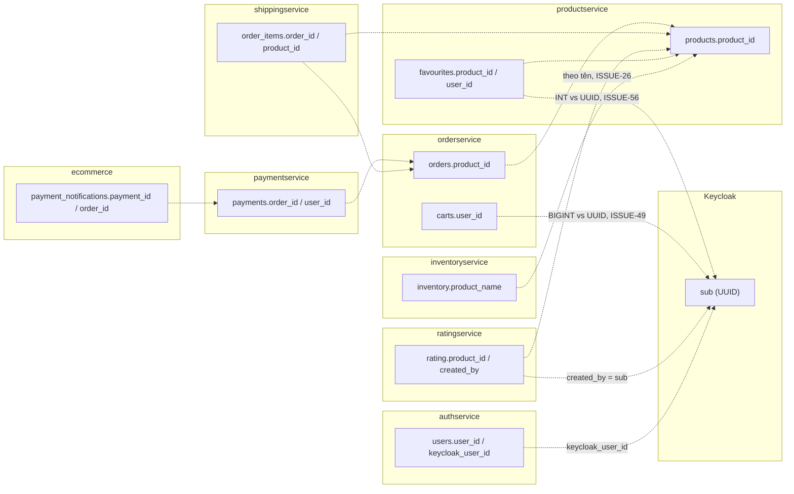

| Tham chiếu | Kiểu nguồn → đích | Ghi chú |
| :--- | :--- | :--- |
| `orders.product_id` → `products.product_id` | INT → SERIAL | Không kiểm |
| `payments.order_id` → `orders.order_id` | INT → SERIAL | Không kiểm; `getOrder` stub |
| `order_items.(order_id, product_id)` | INT → SERIAL | Không ai ghi bảng này |
| `rating.product_id` → `products.product_id` | BIGINT → SERIAL | Không kiểm |
| `inventory.product_name` → `products.product_title` | VARCHAR → VARCHAR | So khớp theo tên (ISSUE-26) |
| `carts.user_id`, `payments.user_id`, `favourites.user_id` → người dùng | số nguyên | Không tương thích `sub` UUID; không có service nào điền từ token (ISSUE-49, ISSUE-56) |
| `rating.created_by`, `notifications.user_id` → `sub` | VARCHAR | Đúng kiểu UUID |
| `users.keycloak_user_id` → Keycloak user id | VARCHAR(64) | Có thể là giá trị giả `kc-…` (ISSUE-08) |

## 17. Vấn đề dữ liệu đã biết

| ID | Tóm tắt |
| :--- | :--- |
| ISSUE-08 | `keycloak_user_id` giả; role chỉ ở DB |
| ISSUE-19 | Index OpenSearch không bao giờ được nạp |
| ISSUE-20 | `orders` không status, một product |
| ISSUE-22 | Không lưu địa chỉ giao |
| ISSUE-26 | Hai nguồn tồn kho; `inventory` theo tên |
| ISSUE-27 | Tiền tệ `DECIMAL(12,2)` / `DOUBLE PRECISION` / `BIGINT` / `NUMERIC` lẫn lộn |
| ISSUE-28 | Không migration; DDL lúc khởi động |
| ISSUE-30 | Cột promotion không được ghi/tăng; enum là varchar |
| ISSUE-31 | DB `taxservice` thừa; bỏ qua state/zip |
| ISSUE-32 | Bucket không tự tạo; `PUBLIC_URL` |
| ISSUE-33 | notification dùng DB `ecommerce` chung; không lọc user |
| ISSUE-49 | `user_id` integer vs UUID |
| ISSUE-55 | `''` ghi vào cột UNIQUE (`products.sku`, `users.phone_number`) |
| ISSUE-56 | `favourites.user_id` do client gửi |
| ISSUE-58 | Không khai báo mapping index `product` |
| ISSUE-59 | Chuỗi rỗng ghi đè `order_desc` / `payment_status` |

## 18. Tham chiếu source

- `deploy/postgres/init/create-all-databases.sql:1-12`
- `docker-compose.yml:5-23`, `69-149`, `171-407`
- `services/auth-service/internal/repository/user_repository.go:31-66`
- `services/product-service/internal/repository/product_repo.go:30-68`
- `services/order-service/internal/repository/order_repository.go:32-57`
- `services/payment-service/internal/repository/payment_repository.go:30-47`
- `services/shipping-service/internal/repository/shipping_repo.go:28-45`
- `services/inventory-service/internal/repository/inventory_repo.go:24-38`
- `services/rating-service/src/db.ts:46-67`, `src/schema.ts:4-19`
- `services/media-service/src/db.ts:46-61`, `src/schema.ts:4-12`, `src/storage.ts:1-51`, `src/service.ts:21-57`
- `services/promotion-service/src/db.ts:46-92`, `src/schema.ts:4-43`
- `services/notification-service/src/db.ts:46-75`, `src/schema.ts:4-26`, `src/kafka.ts:40-48`
- `services/search-service/internal/model/search.go:5-19`, `internal/service/search_service.go:241-274`
