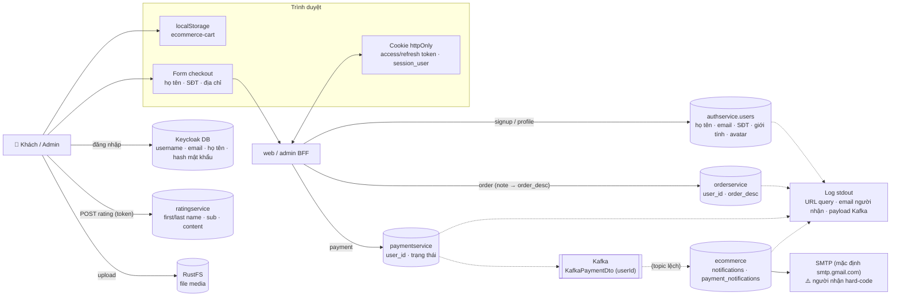

# Dữ liệu cá nhân & dữ liệu nhạy cảm (PII Inventory)

> **Phiên bản:** 1.0 · **Trạng thái:** Final · **Cập nhật:** 2026-11-12 · **Phạm vi:** Ứng dụng (as-is)

> Kiểm kê **mọi nơi** ứng dụng lưu, truyền hoặc ghi log dữ liệu cá nhân và dữ liệu nhạy cảm: cột DB của mọi database, cookie, `localStorage`, payload Kafka, log, email, object S3, Keycloak. Với mỗi mục: phân loại, nơi lưu, ai truy cập được **thực tế** (theo [actors-and-permissions.md](../01-brd/actors-and-permissions.md)), hành vi lưu giữ / xóa **như code đang làm**, rủi ro lộ lọt (ISSUE). Phần cuối liệt kê các **khoảng trống** so với Nghị định 13/2023/NĐ-CP.
>
> ⚠️ Tài liệu kỹ thuật, **không phải tư vấn pháp lý**. Việc xác định nghĩa vụ cụ thể cần bộ phận pháp chế. Chi tiết cột: [data-dictionary.md](data-dictionary.md). Mối đe dọa liên quan: [threat-model.md](../02-architecture/system/threat-model.md).

## 1. Thang phân loại

| Mã | Phân loại | Định nghĩa dùng trong tài liệu | Ví dụ |
| :--- | :--- | :--- | :--- |
| **PII-B** | Dữ liệu cá nhân cơ bản | Thông tin gắn với/nhận diện một cá nhân (tương ứng nhóm "dữ liệu cá nhân cơ bản" — NĐ 13 Điều 2 khoản 3) | Họ tên, email, SĐT, giới tính, địa chỉ, ảnh đại diện, username |
| **PII-S** | Dữ liệu cá nhân nhạy cảm | Nhóm "dữ liệu cá nhân nhạy cảm" (NĐ 13 Điều 2 khoản 4) — vd thông tin tài khoản/giao dịch ngân hàng, vị trí | Hiện **không có** trong code (không xử lý thẻ/tài khoản ngân hàng, không định vị) |
| **PSEUDO** | Định danh bí danh | Id kỹ thuật liên kết được tới một người khi kết hợp dữ liệu khác | `sub` Keycloak (UUID), `user_id` số nguyên, `keycloak_user_id` |
| **BEHAV** | Dữ liệu hành vi / giao dịch | Lịch sử mua, thanh toán, yêu thích, đánh giá gắn với người | `orders`, `payments`, `favourites`, `rating` |
| **FIN** | Tài chính (không nhạy cảm theo NĐ 13) | Số tiền, trạng thái thanh toán | `order_fee`, `is_payed`, `payment_status`, `amount` |
| **CRED** | Credential / bí mật | Cho phép xác thực hoặc chiếm phiên | Mật khẩu, access/refresh token, ticket SSO, secret hạ tầng |
| **FREE** | Văn bản tự do | Trường người dùng nhập tự do, **có thể** chứa PII | `order_desc`, `rating.content`, `notifications.message`, `media.caption` |
| **PUB** | Công khai | Không phải dữ liệu cá nhân | Catalog, khuyến mãi, thuế, tồn kho |

## 2. Bản đồ dòng dữ liệu cá nhân

## 3. Kiểm kê chi tiết

### 3.1 PostgreSQL — `authservice` (auth-service)

| Trường | Phân loại | Ghi bởi | Ai truy cập được (thực tế) | Lưu giữ / xóa (as-is) | Rủi ro / ISSUE |
| :--- | :--- | :--- | :--- | :--- | :--- |
| `users.full_name` | PII-B | `POST /api/v1/auth/signup` (public), `PUT /api/v1/users/{id}` | **Mọi user có token** qua `/users/all`, `/users/{id}`, `/users?username=`; mọi người có `POSTGRES_USER` | Vô thời hạn; xóa cứng qua `DELETE /api/v1/users/{id}` | ISSUE-01, ISSUE-138 |
| `users.user_name` | PII-B | signup | Như trên | Như trên | Liệt kê user; thông báo lỗi signup trả lại username/email/SĐT đã tồn tại (`services/auth-service/internal/service/user_service.go:40,48,57`) |
| `users.email` | PII-B | signup, update | Như trên | Như trên; **không đồng bộ** với Keycloak khi sửa | ISSUE-01 |
| `users.gender` | PII-B | signup, update | Như trên | Như trên | — |
| `users.phone_number` | PII-B | signup, update | Như trên | Như trên | ISSUE-55 |
| `users.image_url` | PII-B (ảnh/URL ảnh) | signup, update | Như trên | Như trên | — |
| `users.keycloak_user_id` | PSEUDO | signup | Chỉ trong DB (không trả ra API — `services/auth-service/internal/model/user.go:15-23`) | Như trên | ISSUE-08 (id giả `kc-<username>`) |
| `user_role.*` | PSEUDO + quyền | assign/revoke | Mọi user có token (`/api/v1/roles/users/{id}`) | `ON DELETE CASCADE` theo `users` | ISSUE-01, ISSUE-53 |

Nguồn DDL: `services/auth-service/internal/repository/user_repository.go:31-64`.

### 3.2 Keycloak (DB `keycloak`, realm `ecommerce`)

| Dữ liệu | Phân loại | Ghi bởi | Ai truy cập | Lưu giữ / xóa | Rủi ro / ISSUE |
| :--- | :--- | :--- | :--- | :--- | :--- |
| Username, email, first/last name | PII-B | Trang login/Keycloak admin; auth-service `CreateUser` (`services/auth-service/internal/service/keycloak_client.go:177-239`) | Admin Keycloak; auth-service (admin realm `master`); claim trong JWT tới **mọi service** | Đến khi xóa; auth-service xóa best-effort khi xóa user DB (`user_service.go:101-115`) | ISSUE-136 |
| Hash mật khẩu | CRED | Keycloak; auth-service gửi mật khẩu rõ qua Admin API khi signup | Keycloak | — | Không password policy / brute-force protection (ISSUE-133) |
| `emailVerified` | — | auth-service đặt `true` khi tạo user (`keycloak_client.go:188`) mà không xác minh | — | — | ISSUE-136 |
| Phiên SSO, refresh token | CRED | Keycloak | Keycloak | Theo mặc định Keycloak (realm import không đặt `ssoSessionIdleTimeout`/`ssoSessionMaxLifespan`) | — |
| Sự kiện đăng nhập | — | **Không ghi** — realm không bật `eventsEnabled` | — | — | Không có audit (T-30) |
| Seed user `testuser`, `adminuser` | CRED (mật khẩu trong file import) | `deploy/keycloak/import/ecommerce-realm.json` | Ai đọc được repo | Theo DB Keycloak | ISSUE-12 |

### 3.3 PostgreSQL — dữ liệu giao dịch

| DB.bảng.cột | Phân loại | Ghi bởi | Ai truy cập (thực tế) | Lưu giữ / xóa | Rủi ro / ISSUE |
| :--- | :--- | :--- | :--- | :--- | :--- |
| `orderservice.carts.user_id` | PSEUDO | client gửi | Mọi user có token (`/api/carts*`) | Vô thời hạn; xóa cart → `CASCADE` xóa orders | ISSUE-49 |
| `orderservice.orders.order_desc` | FREE (BFF ghi **ghi chú giao hàng** của khách — `frontend/apps/web/src/routes/checkout/checkout.remote.ts:32`) | BFF checkout | Mọi user có token (`GET /api/orders`) | Vô thời hạn | ISSUE-49; ghi chú có thể chứa SĐT/địa chỉ |
| `orderservice.orders.order_fee`, `order_date`, `product_id` | BEHAV / FIN | BFF | Mọi user có token | Vô thời hạn | ISSUE-49, ISSUE-76 (không gắn người đặt) |
| `paymentservice.payments.user_id` | PSEUDO | client (BFF không gửi → NULL) | Mọi user có token | Vô thời hạn | ISSUE-76 |
| `paymentservice.payments.is_payed`, `payment_status` | FIN | client | Mọi user có token | Vô thời hạn | ISSUE-75 |
| `productservice.favourites.user_id`, `product_id`, `like_date` | PSEUDO + BEHAV | client | Mọi user có token (route hỏng local — ISSUE-13); trực tiếp `:8086` không token | Vô thời hạn | ISSUE-56 |
| `ratingservice.rating.first_name`, `last_name` | PII-B | Từ claim token chưa verify (`services/rating-service/src/index.ts:39-58`) | **Công khai** qua `GET /storefront/ratings/products/{id}` | Vô thời hạn; xóa qua backoffice | ISSUE-03, ISSUE-137 |
| `ratingservice.rating.created_by` | PSEUDO (`sub` Keycloak) | Như trên | **Công khai** (trường `createdBy` trong `RatingVm`) | Như trên | ISSUE-137 |
| `ratingservice.rating.content` | FREE | Người đánh giá | Công khai | Như trên | — |
| `ecommerce.notifications.user_id`, `title`, `message` | PSEUDO + FREE | `POST /api/notifications` | **Mọi user có token** (không lọc — ISSUE-33) | Vô thời hạn | ISSUE-33 |
| `ecommerce.payment_notifications.user_id`, `order_id`, `amount`, `is_payed`, `payment_status` | PSEUDO + FIN | Kafka consumer, API | Mọi user có token | Vô thời hạn | ISSUE-33, ISSUE-65 |
| `mediaservice.media.caption`, `file_name` | FREE | Uploader | Mọi user có token | Đến khi `DELETE /medias/{id}` | Không có cột chủ sở hữu → không xóa được "dữ liệu của tôi" |
| `shippingservice.order_items`, `inventoryservice.inventory`, `promotionservice.*`, `productservice.products/categories` | PUB / BEHAV không định danh | — | — | — | Không chứa PII (cột `promotion.created_by` tồn tại nhưng không được ghi) |

### 3.4 Kho dữ liệu khác

| Kho | Dữ liệu cá nhân | Phân loại | Ai truy cập | Lưu giữ / xóa | Rủi ro / ISSUE |
| :--- | :--- | :--- | :--- | :--- | :--- |
| RustFS bucket `ecommerce-media` | File người dùng tải lên (có thể là ảnh người) | FREE / PII-B tiềm năng | Mọi user có token (stream qua media-service); ai có S3 key/console `:9001` | Không lifecycle; xóa object khi xóa media (lỗi chỉ log — `services/media-service/src/storage.ts:37-43`) | ISSUE-32, ISSUE-65f, ISSUE-134 |
| OpenSearch index `product` | Không có PII | PUB | Ai truy cập `:9200` (security tắt) | — | ISSUE-134 |
| Redis | Không dùng | — | — | — | — |
| `SsoSessionStore` (RAM auth-service) | Token Keycloak (chứa claim email, họ tên) | CRED + PII-B | Tiến trình auth-service | State 5', ticket 2', purge mỗi phút (`services/auth-service/internal/service/sso_store.go:30-63`) | ISSUE-06, ISSUE-131 |

### 3.5 Trình duyệt — cookie & `localStorage`

| Tên | Nội dung | Phân loại | Thuộc tính | Thời hạn | Rủi ro / ISSUE |
| :--- | :--- | :--- | :--- | :--- | :--- |
| `access_token` | JWT Keycloak (claim `sub`, `email`, `preferred_username`, `given_name`, `family_name`, `realm_access.roles`) | CRED + PII-B | `httpOnly`, `SameSite=Lax`, `path=/`, không `secure` tường minh | `expires_in` (fallback 300 s) — `frontend/packages/lib/src/server/session.ts:33-37` | ISSUE-11 |
| `refresh_token` | Refresh token | CRED | như trên | `refresh_expires_in` (fallback 1800 s) | ISSUE-11 |
| `session_user` | JSON `{id, username, fullName, email, roles}` **không ký, không mã hóa** | PII-B | như trên | như refresh; không gia hạn khi refresh (ISSUE-69) | ISSUE-66 |
| `session_expires` | Epoch hết hạn | — | như trên | như refresh | — |
| `auth_redirect` | Path quay lại sau login | — | `httpOnly`, 600 s | 10 phút | ISSUE-130 |
| Cookie locale Paraglide | `vi`/`en` | — | Paraglide (strategy `cookie`) | Theo Paraglide | — |
| `localStorage['ecommerce-cart']` | `{state:{items:[{productId, productTitle, priceUnit, imageUrl, quantity…}]}, version:0}` | BEHAV không định danh (lộ ý định mua trên máy dùng chung) | JS đọc được | Đến khi checkout thành công hoặc người dùng xóa (`frontend/apps/web/src/lib/stores/cart.svelte.ts:4-91`) | ADR-008 |
| Dữ liệu trang SSR | `locals.user` trả về qua `+layout.server.ts` (gồm email) → nhúng vào HTML/JSON trang | PII-B | Chỉ người dùng đó | Theo phiên | — |

Hai app web/admin dùng chung tên cookie → trên cùng host, phiên (và PII trong `session_user`) dùng chung giữa storefront và backoffice (ISSUE-11).

### 3.6 Dữ liệu checkout (thu thập nhưng không lưu)

| Trường | Phân loại | Xử lý (as-is) | Ghi chú |
| :--- | :--- | :--- | :--- |
| `shipping.fullName`, `phone`, `address`, `city`, `district` | PII-B | Validate bằng Zod (`frontend/packages/lib/src/schemas.ts` `shippingSchema`) ở BFF rồi **bỏ đi**, không gửi tới service nào (`checkout.remote.ts:30-41`) | Ít rủi ro lưu trữ nhưng không giao được hàng (ISSUE-22); vẫn có thể xuất hiện trong log hạ tầng nếu có |
| `shipping.note` | FREE | Ghi vào `orders.order_desc` | Khách thường ghi SĐT/địa chỉ vào ghi chú → PII nằm trong cột "tự do" đọc được bởi mọi user có token (ISSUE-49) |

### 3.7 Kafka

| Topic | Payload | Phân loại | Producer → Consumer | Lưu giữ | Rủi ro |
| :--- | :--- | :--- | :--- | :--- | :--- |
| `SUCCESSFUL`, `paymentCompleted` | `KafkaPaymentDto {paymentId, isPayed, paymentStatus, orderId, userId}` (`services/payment-service/internal/model/payment.go:28-34`) | PSEUDO + FIN | payment → (không ai) | Mặc định broker (compose không đặt `log.retention.*`) | ISSUE-17, ISSUE-134 |
| `status-payment-successful` | `{paymentId, userId, orderId, amount, isPayed, paymentStatus}` | PSEUDO + FIN | (không ai) → notification | Như trên | ISSUE-17 |
| `profile-onboarding-topic` | `{recipient\|email, subject, msgBody}` | PII-B (email) | (không ai) → notification | Như trên | Bất kỳ ai produce được → email tùy ý (ISSUE-134) |
| `dbproduct.public.product` | Catalog | PUB | — → search | Như trên | — |

Broker PLAINTEXT, không mã hóa, không ACL (`docker-compose.yml:44-54`).

### 3.8 Log ứng dụng

| Nguồn | Dữ liệu cá nhân/nhạy cảm bị ghi | Bằng chứng | ISSUE |
| :--- | :--- | :--- | :--- |
| chi `middleware.Logger` (7 service Go) | URL đầy đủ kèm query: `code`, `state` (callback), `ticket` (`/auth/session`), `username` (`/users?username=`), từ khóa tìm kiếm | `services/auth-service/main.go:96`; `auth_handler.go:136-183` | ISSUE-132 |
| notification `mailer` | Địa chỉ email người nhận + tiêu đề (tiêu đề thanh toán chứa `userId`) | `services/notification-service/src/mailer.ts:28`; `src/kafka.ts:53` | ISSUE-132, ISSUE-09 |
| notification consumer | **Toàn bộ payload** Kafka | `services/notification-service/src/kafka.ts:31` | ISSUE-132 |
| payment `EventProducer` | Nội dung message (gồm `userId`) khi Kafka tắt | `services/payment-service/internal/service/kafka_producer.go:31-33` | ISSUE-132 |
| Response lỗi 500 | Lỗi SQL thô (có thể chứa giá trị vi phạm UNIQUE như email/SĐT); body lỗi Keycloak khi signup | `auth_handler.go:118`; `keycloak_client.go:228-230` | ISSUE-93 |
| APISIX access log | Request line đầy đủ (vd `/notification/api/email/sendMail?to=…&body=…`) | `deploy/apisix/config.yaml` (log mặc định) | ISSUE-132 |

Compose không cấu hình `logging` → log container theo driver mặc định, **không có chính sách lưu giữ/xoay vòng** trong phạm vi ứng dụng.

### 3.9 Email

| Luồng | Nội dung | Người nhận | Rủi ro |
| :--- | :--- | :--- | :--- |
| Thanh toán (consumer) | `userId`, `isPayed`, `paymentStatus`, thời gian | **Một địa chỉ email cá nhân hard-code** (không phải khách) — `services/notification-service/src/kafka.ts:51-55` | Chuyển dữ liệu giao dịch cho bên thứ ba (ISSUE-09) |
| Onboarding (consumer) | Tùy payload | `recipient`/`email` trong message | Không có producer hợp lệ |
| API email | Tùy request | Tùy request | Open relay (ISSUE-64) |
| Kênh truyền | SMTP STARTTLS/TLS tới `MAIL_HOST` (mặc định `smtp.gmail.com`) | — | Nhà cung cấp SMTP ở nước ngoài → chuyển dữ liệu ra nước ngoài (§6) |

## 4. Ma trận truy cập dữ liệu cá nhân (thực tế)

| Dữ liệu | Guest | Customer (token `USER`) | Admin | Ai có `POSTGRES_USER` | Ai vào được mạng compose/host |
| :--- | :---: | :---: | :---: | :---: | :---: |
| Hồ sơ user (`authservice.users`) | ❌ | ✅ **mọi user** | ✅ | ✅ | ✅ (gọi `:8088` không token) |
| Đơn hàng / giỏ / ghi chú giao hàng | ❌ | ✅ **mọi đơn** | ✅ | ✅ | ✅ |
| Thanh toán, payment notification | ❌ | ✅ mọi bản ghi | ✅ | ✅ | ✅ |
| Thông báo | ❌ | ✅ mọi bản ghi | ✅ | ✅ | ✅ |
| Họ tên + `sub` người đánh giá | ✅ công khai | ✅ | ✅ | ✅ | ✅ |
| File media | ❌ | ✅ | ✅ | — | ✅ (S3 `:9000`, console `:9001`) |
| Keycloak user | ❌ | Chỉ của mình (claim token) | Qua Keycloak console | ✅ (DB `keycloak` dùng chung user) | ✅ (`:8080`) |
| Log | ❌ | ❌ | ❌ | — | Người vận hành host |

Nguyên nhân gốc: không phân quyền theo role và không lọc theo chủ sở hữu ở backend (ISSUE-01, ISSUE-49, ISSUE-33); service và kho dữ liệu publish port (ISSUE-02, ISSUE-134); một user DB chung ([data-architecture.md §1](../02-architecture/system/data-architecture.md)).

## 5. Lưu giữ & xóa — tổng hợp hành vi hiện tại

| Khía cạnh | Hiện trạng | Bằng chứng |
| :--- | :--- | :--- |
| Thời hạn lưu giữ | **Không có** TTL/chính sách cho bất kỳ bảng nào; dữ liệu tồn tại vô thời hạn | Không có job dọn dẹp ngoài `SsoSessionStore.purge` (`sso_store.go:38-63`) |
| Xóa tài khoản | `DELETE /api/v1/users/{id}`: xóa Keycloak (best-effort, lỗi bị bỏ qua) rồi xóa `users` + `user_role` (cascade) | `services/auth-service/internal/service/user_service.go:101-115` |
| Xóa dây chuyền | **Không** — orders/carts/payments (user_id số nguyên), rating (`sub` + họ tên), notifications (`user_id` chuỗi), favourites vẫn còn sau khi xóa user | Không có liên kết khóa thống nhất ([data-architecture.md §3](../02-architecture/system/data-architecture.md)) |
| Tự xóa / tự xuất dữ liệu (chủ thể) | Không có UI/API "xóa tài khoản của tôi" hay "tải dữ liệu của tôi"; chỉ `GET /users/me` | `auth_handler.go:73-81` |
| Sửa dữ liệu (chủ thể) | Có `PUT /api/v1/users/{id}` (API, không UI); không đồng bộ email sang Keycloak; đổi mật khẩu là stub | ISSUE-07 |
| Phiên | Cookie hết hạn theo token; logout xóa cookie và revoke refresh token best-effort | `session.ts:51-55`; `auth.remote.ts:6-19` |
| Giỏ hàng | `localStorage` không hết hạn | `cart.svelte.ts` |
| Kafka | Retention mặc định broker | `docker-compose.yml:41-60` |
| Object S3 | Không lifecycle/versioning | [data-dictionary.md §15](data-dictionary.md#15-s3-bucket-media-service) |
| Log | Không chính sách | §3.8 |
| Backup | Không có trong phạm vi ứng dụng | — |

## 6. Đối chiếu Nghị định 13/2023/NĐ-CP — khoảng trống (gap)

> Bảng dưới liệt kê **khoảng trống kỹ thuật** quan sát được trong code so với các nghĩa vụ chính của NĐ 13/2023 về bảo vệ dữ liệu cá nhân. Đây không phải đánh giá tuân thủ pháp lý. Lưu ý: Luật Bảo vệ dữ liệu cá nhân năm 2025 (hiệu lực từ 01/01/2026) có thể thay thế/bổ sung các quy định này — pháp chế cần xác nhận văn bản áp dụng hiện hành.

| # | Nghĩa vụ (tóm tắt) | Điều khoản tham chiếu | Hiện trạng trong code | Khoảng trống | Liên quan |
| :--- | :--- | :--- | :--- | :--- | :--- |
| G-01 | Có sự đồng ý của chủ thể trước khi xử lý (rõ ràng, tự nguyện, theo mục đích) | Điều 11 | Signup/checkout không có bước đồng ý; không bảng/trường lưu bằng chứng đồng ý | Không thu thập, không lưu, không chứng minh được sự đồng ý | — |
| G-02 | Rút lại sự đồng ý | Điều 12 | Không có cơ chế | Thiếu luồng rút đồng ý | — |
| G-03 | Thông báo xử lý (mục đích, loại dữ liệu, bên nhận, thời gian lưu) | Điều 13 | Key i18n `footer_privacy`/`footer_terms` có trong `frontend/apps/web/messages/vi.json:166,177` nhưng **không có trang/link** chính sách | Không có thông báo/chính sách quyền riêng tư | — |
| G-04 | Quyền truy cập, chỉnh sửa dữ liệu của chủ thể | Điều 9, 14, 15 | Chỉ `GET /users/me`; sửa qua API không UI | Thiếu chức năng tự phục vụ; không xuất được đơn/đánh giá/thông báo của chính mình | ISSUE-07, ISSUE-76 |
| G-05 | Xóa / hủy dữ liệu khi hết mục đích hoặc theo yêu cầu | Điều 9, 16 | Xóa user không lan sang dữ liệu khác; không TTL | Dữ liệu tồn tại vô thời hạn; xóa không đầy đủ | §5 |
| G-06 | Bảo vệ dữ liệu: kiểm soát truy cập, ghi nhật ký, mã hóa phù hợp | Điều 26, 27 | Không phân quyền backend; PII đọc được bởi mọi user có token; kênh nội bộ HTTP/`sslmode=disable`; log chứa PII | Thiếu RBAC, thiếu lọc chủ sở hữu, thiếu audit, PII trong log | ISSUE-01, ISSUE-49, ISSUE-33, ISSUE-132, ISSUE-134 |
| G-07 | Biện pháp bổ sung cho dữ liệu nhạy cảm | Điều 28 | Không xử lý PII-S | Không áp dụng hiện tại; cần đánh giá lại khi tích hợp cổng thanh toán/định vị | — |
| G-08 | Thông báo vi phạm cho cơ quan chuyên trách (trong 72 giờ) | Điều 23 | Không có audit log/cảnh báo để phát hiện vi phạm | Không phát hiện được truy cập trái phép | T-30 |
| G-09 | Lập hồ sơ đánh giá tác động xử lý dữ liệu cá nhân | Điều 24 | Không có trong repo | Thiếu hồ sơ DPIA (tài liệu này có thể làm đầu vào) | — |
| G-10 | Chuyển dữ liệu cá nhân ra nước ngoài (hồ sơ đánh giá tác động chuyển dữ liệu) | Điều 25 | SMTP mặc định `smtp.gmail.com` (`services/notification-service/src/mailer.ts:4`); email thanh toán gửi tới hộp thư Gmail cá nhân hard-code | Có khả năng chuyển dữ liệu ra nước ngoài mà không có hồ sơ; gửi dữ liệu cho bên thứ ba không có cơ sở | ISSUE-09 |
| G-11 | Tối thiểu hóa & đúng mục đích | Điều 3 | API công khai trả `createdBy` + họ tên người đánh giá; `/users/all` trả đủ SĐT, giới tính | Trả dư dữ liệu | ISSUE-137, ISSUE-138 |
| G-12 | Chính xác dữ liệu | Điều 3 | Email ở `authservice` và Keycloak không đồng bộ khi sửa; `emailVerified=true` không xác minh | Hai nguồn sự thật lệch nhau | ISSUE-08, ISSUE-136 |
| G-13 | Xử lý dữ liệu trẻ em (xác minh tuổi, đồng ý của người giám hộ) | Điều 20 | Không thu thập ngày sinh | Không xác định được độ tuổi khách | — |

## 7. Khuyến nghị ưu tiên (kỹ thuật)

1. **Kiểm soát truy cập PII**: RBAC + lọc theo chủ sở hữu ở auth/order/payment/notification (ISSUE-01, ISSUE-49, ISSUE-33); không publish port service/kho dữ liệu (ISSUE-134).
2. **Loại PII khỏi log**: bỏ log payload Kafka/email người nhận, che query nhạy cảm (ISSUE-132).
3. **Sửa luồng email**: người nhận từ hồ sơ khách, bỏ địa chỉ hard-code, đóng open relay (ISSUE-09, ISSUE-64).
4. **Định danh thống nhất**: dùng `sub` cho mọi bảng có `user_id` để có thể xuất/xóa dữ liệu theo chủ thể (ISSUE-76, ISSUE-56).
5. **Chính sách lưu giữ**: TTL cho notifications/log, lifecycle S3, quy trình xóa tài khoản lan truyền.
6. **Đồng ý & thông báo**: trang chính sách quyền riêng tư, checkbox đồng ý khi đăng ký/checkout, lưu bằng chứng đồng ý.
