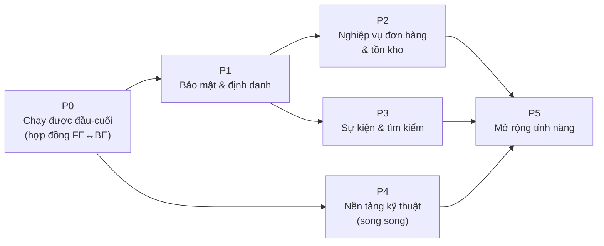

# Project Plan — Lộ trình hoàn thiện ứng dụng

> **Phiên bản:** 1.0 · **Trạng thái:** Final · **Cập nhật:** 2026-11-12 · **Phạm vi:** Ứng dụng (as-is)

> Kế hoạch được xây dựng **từ khoảng trống của code hiện tại** ([known-issues-tech-debt.md](known-issues-tech-debt.md), trạng thái FEAT trong [04-features](../04-features/README.md)). Không dựa trên kiến trúc đích trong `docs/ARCHITECTURE.md`. Các giai đoạn được định nghĩa bằng **tiêu chí hoàn thành**; ước lượng kích thước dùng thang tương đối S (≤ 2 ngày), M (≤ 1 tuần), L (> 1 tuần) cho 1 dev.
>
> Phạm vi: ứng dụng. Việc hạ tầng (k8s, CI/CD, secret management, observability) lập kế hoạch riêng.

## 1. Tóm tắt hiện trạng

| Khía cạnh | Hiện trạng |
| :--- | :--- |
| UI | Storefront đầy đủ màn hình; backoffice có 4 màn hình thật + 4 placeholder |
| Chạy đầu-cuối | **Chưa**: lệch hợp đồng FE↔BE (ISSUE-48, 60, 100) khiến catalog/admin không hiển thị dữ liệu và admin không đăng nhập được |
| Bảo mật | 5 lỗi Critical (ISSUE-01, 04, 05, 100, 102) + nhiều High |
| Nghiệp vụ | CRUD tối giản; chưa có vòng đời đơn, tồn kho, giá/khuyến mãi phía server |
| Sự kiện | Không luồng Kafka nào khớp |
| Kiểm thử | Unit mức router/lib; không integration/E2E |

## 2. Lộ trình

P4 chạy song song từ sau P0 (migration, chuẩn hóa response, test) vì nó giảm rủi ro cho P2/P3.

---

### P0 — Chạy được đầu-cuối (ổn định hợp đồng FE ↔ BE)

**Mục tiêu:** luồng duyệt → giỏ → đăng nhập → đặt hàng → xem đơn, và đăng nhập backoffice → CRUD catalog hoạt động trên `docker compose` với backend thật.

| # | Hạng mục | Issue | Kích thước |
| :--- | :--- | :--- | :---: |
| P0-1 | Endpoint phân trang + filter (`page,size,sort,categoryId,search`) trả `Page<T>` cho products, categories; orders dùng endpoint phân trang | ISSUE-48 | M |
| P0-2 | `/users/me` trả `fullName` + `roles[{id,name}]`; JIT tạo user `authservice` khi đăng nhập lần đầu | ISSUE-100, ISSUE-101 | M |
| P0-3 | Sửa `redirect_uri` khi đổi code; bỏ mock token | ISSUE-04 | S |
| P0-4 | Callback khi profile lỗi không xóa phiên; gia hạn `session_user` khi refresh | ISSUE-67, ISSUE-69 | S |
| P0-5 | Thống nhất payload `categoryId` của sản phẩm | ISSUE-60 | S |
| P0-6 | Thêm/bỏ `description` sản phẩm cho thống nhất | ISSUE-50 | S |
| P0-7 | Sửa upstream 7/13 và path gốc trong `apisix.yaml` | ISSUE-13, ISSUE-15 | S |
| P0-8 | Trang chủ: dùng sản phẩm thật cho các khối sản phẩm hoặc chặn add-to-cart cho mock | ISSUE-38 | M |
| P0-9 | Tạo bucket media trong compose | ISSUE-32 (một phần) | S |

**Tiêu chí hoàn thành:** E2E-01…04, 06 trong [test-plan.md](test-plan.md) chạy xanh thủ công; contract test cho mọi endpoint frontend gọi.

### P1 — Bảo mật & định danh

**Mục tiêu:** đóng toàn bộ lỗ hổng Critical/High về xác thực và phân quyền.

| # | Hạng mục | Issue | Kích thước |
| :--- | :--- | :--- | :---: |
| P1-1 | Phân quyền theo role tại gateway (route admin) và middleware `RequireRole` ở service | ISSUE-01 | M |
| P1-2 | Route ghi catalog yêu cầu token + ADMIN | ISSUE-102 | S |
| P1-3 | Lọc order/cart/payment/notification theo user từ token; thống nhất định danh user (UUID `sub` ↔ id nội bộ) | ISSUE-49, ISSUE-33 | M |
| P1-4 | Allowlist `redirect_uri`; chuyển SSO store sang Redis | ISSUE-05, ISSUE-06 | S |
| P1-5 | Ký/mã hóa cookie `session_user` hoặc suy từ JWT; sửa miễn trừ `/_app/`; kiểm role trong remote function admin | ISSUE-66, ISSUE-68 | M |
| P1-6 | Cookie `secure` + tên cookie riêng từng app | ISSUE-11 | S |
| P1-7 | Verify JWT ở service (hoặc đảm bảo service không truy cập được trực tiếp) | ISSUE-02, ISSUE-03 | M |
| P1-8 | Notification: không expose email API ra ngoài; người nhận lấy từ dữ liệu user | ISSUE-64, ISSUE-09 | S |
| P1-9 | Đổi mật khẩu thật; đồng bộ role sang Keycloak; bỏ id giả | ISSUE-07, ISSUE-08 | M |
| P1-10 | Rate limit theo client thật / user | ISSUE-61 | S |
| P1-11 | Làm rõ loại Keycloak client; tách seed dev | ISSUE-12 | S |

**Tiêu chí hoàn thành:** test phân quyền ([test-plan §4](test-plan.md#4-test-phân-quyền-security-regression)) xanh; không còn issue Critical.

### P2 — Nghiệp vụ đơn hàng & tồn kho

**Mục tiêu:** đơn hàng có nhiều dòng, có trạng thái, địa chỉ giao, tổng tiền tính phía server, không bán quá tồn kho.

| # | Hạng mục | Issue | Kích thước |
| :--- | :--- | :--- | :---: |
| P2-1 | `order_items` trong order-service (gom từ shipping-service), `order_status` + state machine tối thiểu (PENDING → CONFIRMED → SHIPPED → DELIVERED / CANCELLED) | ISSUE-20, ISSUE-41 | L |
| P2-2 | Lưu địa chỉ giao hàng, phương thức thanh toán vào đơn | ISSUE-22 | S |
| P2-3 | Endpoint "place order" phía order-service tính tổng từ giá sản phẩm, idempotency key | ISSUE-21, ISSUE-23 | M |
| P2-4 | Một nguồn tồn kho theo `product_id`/SKU; API nhập/trừ/giữ hàng; kiểm tồn khi đặt | ISSUE-26, ISSUE-51 | L |
| P2-5 | Kiểu tiền thống nhất | ISSUE-27 | M |
| P2-6 | payment: mã lỗi 409, không ghi đè status rỗng | ISSUE-25 | S |
| P2-7 | Lọc phía server cho giá (catalog) và mã đơn (admin) | ISSUE-40 | S |
| P2-8 | Transaction khi lưu cart + order | ISSUE-24 | S |

**Tiêu chí hoàn thành:** E2E-04, 05 xanh với đơn nhiều sản phẩm; integration test order/inventory.

### P3 — Sự kiện & tìm kiếm

| # | Hạng mục | Issue | Kích thước |
| :--- | :--- | :--- | :---: |
| P3-1 | Thống nhất topic thanh toán; chỉ publish khi thanh toán thành công; outbox hoặc xử lý lỗi gửi | ISSUE-17, ISSUE-18 | M |
| P3-2 | auth-service publish sự kiện onboarding sau đăng ký | ISSUE-17 | S |
| P3-3 | product-service publish sự kiện catalog; search-service consume đúng schema; backfill index | ISSUE-19 | M |
| P3-4 | Search: sort, aggregations, trả lỗi thật | ISSUE-34 | M |
| P3-5 | Notification: idempotent consumer, reconnect Kafka | ISSUE-65 | S |

**Tiêu chí hoàn thành:** integration test Kafka xanh; tạo sản phẩm → tìm thấy trên search; thanh toán → email + thông báo đúng người.

### P4 — Nền tảng kỹ thuật (song song)

| # | Hạng mục | Issue | Kích thước |
| :--- | :--- | :--- | :---: |
| P4-1 | Công cụ migration (goose/atlas cho Go, drizzle-kit cho Bun); fail-fast khi DB lỗi | ISSUE-28 | M |
| P4-2 | Chuẩn hóa định dạng response/lỗi toàn hệ thống | ISSUE-29, ISSUE-65 | M |
| P4-3 | Health/readiness kiểm phụ thuộc | ISSUE-36 | S |
| P4-4 | Validate input ở service Go & Bun | ISSUE-35, ISSUE-62 | M |
| P4-5 | Test integration + contract + E2E Playwright | ISSUE-46 | L |
| P4-6 | Dọn env thừa, dead code, cập nhật README gốc trỏ về `docs-all/` | ISSUE-37, ISSUE-43, ISSUE-45 | S |
| P4-7 | Theo dõi tính năng experimental SvelteKit | ISSUE-47 | S |
| P4-8 | Media: giới hạn size/MIME, streaming upload, URL public qua gateway | ISSUE-32, ISSUE-63 | M |

### P5 — Mở rộng tính năng

| # | Hạng mục | FEAT | Kích thước |
| :--- | :--- | :--- | :---: |
| P5-1 | UI đánh giá sản phẩm trên trang chi tiết (chỉ Customer đã mua) | FEAT-15 | M |
| P5-2 | UI yêu thích | FEAT-13 | S |
| P5-3 | Ô tìm kiếm dùng search-service + gợi ý | FEAT-14 | M |
| P5-4 | Áp mã khuyến mãi & thuế khi checkout | FEAT-16, FEAT-17 | L |
| P5-5 | Backoffice: Users, Inventory, Shipping, Settings, Promotions, Ratings | FEAT-26 | L |
| P5-6 | Upload ảnh sản phẩm qua media-service | FEAT-18, FEAT-23 | M |
| P5-7 | Menu danh mục động; nội dung trang chủ quản trị được | FEAT-05 | M |
| P5-8 | Thông báo in-app cho khách | FEAT-19 | M |
| P5-9 | Sửa i18n còn sót (link không giữ locale, định dạng theo locale) | FEAT-27 | S |

### Phân bổ các issue phát hiện bổ sung (ISSUE-52+)

| Giai đoạn | Issue bổ sung |
| :--- | :--- |
| P0 | ISSUE-60 (categoryId), ISSUE-67, ISSUE-69 (phiên), ISSUE-71 (đường đăng ký), ISSUE-79 (giỏ ↔ checkout) |
| P1 | ISSUE-52 (state OIDC), ISSUE-53 (signup tự gán role), ISSUE-56 (favourites theo user), ISSUE-61 (rate limit), ISSUE-64 (open relay email), ISSUE-66, ISSUE-68 (cookie/guard admin), ISSUE-93 (lộ lỗi nội bộ) |
| P2 | ISSUE-55 (UNIQUE với chuỗi rỗng), ISSUE-59 (COALESCE), ISSUE-75 (ONLINE ghi đã trả), ISSUE-76 (đơn không có user), ISSUE-81 (shipping validate) |
| P3 | ISSUE-57 (Kafka writer đồng bộ), ISSUE-58 (query search), ISSUE-78 (storefront dùng search), ISSUE-80 (consumer retry/DLQ, amount) |
| P4 | ISSUE-62 (validate Bun), ISSUE-63 (URL media), ISSUE-65, ISSUE-94 (xử lý lỗi Bun), ISSUE-74 (favourites PK), ISSUE-96 (timeout server), ISSUE-97 (dev workflow), ISSUE-98 (correlation id) |
| P5 | ISSUE-82 (SEO), ISSUE-83 (i18n) |

## 3. Rủi ro kế hoạch

| Rủi ro | Giảm thiểu |
| :--- | :--- |
| Sửa hợp đồng API làm vỡ client khác (Postman, script) | Versioning hoặc giữ endpoint cũ trong thời gian chuyển tiếp |
| Thay đổi schema khi chưa có migration | Làm P4-1 trước P2 |
| Hai nguồn user (Keycloak/authservice) gây lệch | Quyết định nguồn sự thật cho role ngay trong P0-2 (ADR mới) |
| Phạm vi P5 lớn | Ưu tiên theo [backlog.md](backlog.md) |

## 4. Theo dõi

- Backlog chi tiết: [backlog.md](backlog.md)
- Khi đóng một issue: cập nhật [known-issues-tech-debt.md](known-issues-tech-debt.md) và trạng thái FEAT tương ứng.
