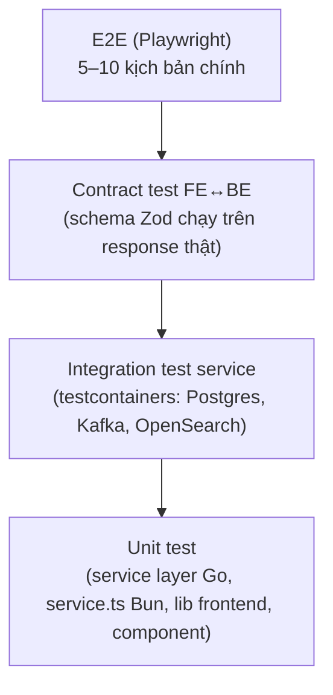

# Test Plan

> **Phiên bản:** 1.0 · **Trạng thái:** Final · **Cập nhật:** 2026-11-12 · **Phạm vi:** Ứng dụng (as-is)

> Phần 1 mô tả **hiện trạng kiểm thử** trong repo. Phần 2–5 là **kế hoạch kiểm thử đề xuất** để đóng các khoảng trống, gắn với [project-plan.md](project-plan.md). Acceptance criteria chi tiết của từng tính năng nằm trong tài liệu FEAT tương ứng.

## 1. Hiện trạng

### 1.1 Backend Go (`go test`, chạy qua `make go-test` / `make check`)

Mỗi service có một file `main_test.go` dựng router với **pool DB `nil`** và gọi route bằng `httptest`. Không có test DB thật, Kafka, OpenSearch, Keycloak. Module `services/shared` không có test.

| Service | Số test | Tên test |
| :--- | :---: | :--- |
| auth-service | 4 | `TestHealthCheck`, `TestSSOFlow`, `TestSignupValidation`, `TestSSOSessionStore` |
| product-service | 4 | `TestHealthCheck`, `TestCategoryEndpoints`, `TestProductEndpoints`, `TestFavouriteRoutes` |
| order-service | 3 | `TestHealthCheck`, `TestCartsEndpoints`, `TestOrdersEndpoints` |
| payment-service | 2 | `TestHealthCheck`, `TestPaymentsEndpoints` |
| inventory-service | 3 | `TestHealthCheck`, `TestIsInStockQuery`, `TestIsInStockPath` |
| shipping-service | 2 | `TestHealthCheck`, `TestShippingEndpoints` |
| search-service | 3 | `TestHealthCheck`, `TestCatalogSearch`, `TestSearchSuggest` |
| **Tổng** | **21** | |

### 1.2 Backend Bun (`bun test`, chạy qua `make bun-test`)

Mỗi service có `src/index.test.ts` gọi `app.fetch` trực tiếp; chủ yếu kiểm health và nhánh validation 400. Một số case đi tới tầng DB/logic (vd "should list promotions with paging parameters", "should list tax classes paging", "should calculate average star for product", "should handle sendSimpleMail", "should list notifications") nhưng **không mock DB** — kết quả phụ thuộc DB có sẵn hay không (service trả rỗng/0 khi lỗi).

| Service | Số case |
| :--- | :---: |
| promotion-service | 7 |
| rating-service | 6 |
| media-service | 5 |
| notification-service | 5 |
| **Tổng** | **23** |

### 1.3 Frontend (`bun test`, chạy qua `make web-test`)

60 unit test, **chỉ cho `frontend/packages/lib`**:

| File | Số test | Phạm vi |
| :--- | :---: | :--- |
| `format.test.ts` | 7 | `formatPrice`, `formatDate`, `truncateText`, `getInitials` |
| `schemas.test.ts` | 18 | Zod schema (page, product query, shipping, checkout, product/category form) |
| `cart.test.ts` | 5 | `computeTotals`, ngưỡng free ship |
| `server/api.test.ts` | 10 | API client (fetch được stub), unwrap envelope, `ApiError` |
| `server/session.test.ts` | 17 | Cookie phiên, `shouldRefresh`, `isAdmin`, `toSessionUser` |
| `server/redirect.test.ts` | 3 | `safeRedirect` |

Không có test component Svelte, không có E2E (Playwright).

### 1.4 Kiểm tra tĩnh

| Lệnh | Nội dung |
| :--- | :--- |
| `make go-fmt-check`, `make go-vet` | gofmt, go vet |
| `make web-check` | Paraglide compile + `svelte-kit sync` + `svelte-check` |
| `make web-lint` | Prettier + ESLint |
| `bun run i18n:check` (frontend) | Parity key `vi.json` ↔ `en.json` |

### 1.5 Khoảng trống chính

| Khoảng trống | Hệ quả | Issue |
| :--- | :--- | :--- |
| Không test hợp đồng FE ↔ BE | Lệch Page vs mảng, `users/me` thiếu roles không bị phát hiện | ISSUE-48, ISSUE-100 |
| Không test với DB thật | SQL, constraint, InitSchema không được kiểm | ISSUE-28 |
| Không test messaging | Lệch topic Kafka không bị phát hiện | ISSUE-17, ISSUE-19 |
| Không test phân quyền | Lỗ hổng role/ownership | ISSUE-01, ISSUE-49, ISSUE-102 |
| Không E2E | Luồng mua hàng chưa từng được kiểm đầu-cuối | ISSUE-46 |

## 2. Chiến lược kiểm thử đề xuất

| Mức | Công cụ | Phạm vi | Môi trường |
| :--- | :--- | :--- | :--- |
| Unit | `go test` + testify; `bun test` | Logic service/repository (mock repo), helper frontend, component Svelte (`@testing-library/svelte` hoặc tương đương) | CI |
| Integration | `testcontainers-go`; Bun + container Postgres | Repository SQL thật, InitSchema, Kafka producer/consumer, OpenSearch query | CI (Docker) |
| Contract | Zod schema từ `packages/lib` validate response thật của service | Mọi endpoint frontend gọi ([api-catalog](../05-api/api-catalog.md)) | CI với compose rút gọn |
| Security | Test tự động gọi API với token USER / không token | Ma trận [actors-and-permissions](../01-brd/actors-and-permissions.md) | CI |
| E2E | Playwright | Kịch bản ở §3 | docker compose đầy đủ |

## 3. Kịch bản E2E ưu tiên

| ID | Kịch bản | FEAT | Kết quả mong đợi |
| :--- | :--- | :--- | :--- |
| E2E-01 | Guest duyệt `/products`, lọc danh mục, sắp xếp giá, phân trang | FEAT-06 | Danh sách đúng, tổng trang đúng |
| E2E-02 | Thêm 2 sản phẩm vào giỏ, đổi số lượng, tải lại trang | FEAT-08 | Giỏ giữ nguyên; phí ship đổi khi vượt 500.000 |
| E2E-03 | Vào `/checkout` khi chưa đăng nhập → SSO → quay lại checkout | FEAT-01, FEAT-09 | Quay về `/checkout`, cookie httpOnly được đặt |
| E2E-04 | Đặt hàng COD | FEAT-09, FEAT-11 | Order + payment `NOT_STARTED` được tạo; giỏ trống |
| E2E-04b | Đặt hàng ONLINE | FEAT-09, FEAT-11 | Payment **không** được ghi `isPayed=true` trước khi có xác nhận (hiện **fail** — ISSUE-75) |
| E2E-05 | `/orders` chỉ hiển thị đơn của chính user | FEAT-10 | Không thấy đơn user khác (hiện **fail** — ISSUE-49) |
| E2E-06 | Admin đăng nhập backoffice, tạo/sửa/xóa sản phẩm | FEAT-21, FEAT-23 | Thành công (hiện **fail** — ISSUE-100) |
| E2E-07 | User thường vào backoffice | FEAT-21 | `/access-denied` |
| E2E-08 | Đổi ngôn ngữ vi ↔ en trên mọi trang chính | FEAT-27 | URL và nội dung đúng locale (ISSUE-39) |
| E2E-09 | Phiên hết hạn → refresh tự động | FEAT-03 | Không bị đăng xuất |
| E2E-10 | Đăng xuất | FEAT-01 | Cookie bị xóa, header về trạng thái guest |
| E2E-11 | Admin tạo/sửa/xóa danh mục | FEAT-24 | Thành công; danh mục mới xuất hiện ở storefront |
| E2E-12 | Admin xem danh sách & chi tiết đơn | FEAT-25 | Thấy đơn vừa đặt ở E2E-04 |
| E2E-13 | Dashboard hiển thị đúng số liệu | FEAT-22 | Tổng sản phẩm/đơn/danh mục khớp DB |
| E2E-14 | Sitemap & robots | FEAT-28 | `/sitemap.xml` hợp lệ; `/products/<id không tồn tại>` trả 404 (hiện **fail** — ISSUE-82) |

Các tính năng chỉ có API (FEAT-12…20) được kiểm ở mức **API/contract test** (§2) thay vì E2E giao diện, cho tới khi có UI.

## 4. Test phân quyền (security regression)

Với mỗi route trong [gateway-routing.md](../05-api/gateway-routing.md), gọi với: (a) không token, (b) token USER, (c) token ADMIN; so với cột "Nên là" trong [actors-and-permissions.md §4](../01-brd/actors-and-permissions.md#4-ma-trận-quyền--api-qua-gateway-thực-tế). Trọng tâm: ISSUE-01, ISSUE-03, ISSUE-49, ISSUE-102.

## 5. Tiêu chí hoàn thành theo giai đoạn

| Giai đoạn ([project-plan](project-plan.md)) | Tiêu chí test |
| :--- | :--- |
| P0 — Ổn định hợp đồng | Contract test xanh cho mọi endpoint frontend gọi; E2E-01, 02, 03 xanh |
| P1 — Bảo mật | Test phân quyền §4 xanh; E2E-05, 06, 07 xanh |
| P2 — Nghiệp vụ đơn hàng | Integration test order/payment/inventory; E2E-04 với nhiều dòng hàng |
| P3 — Sự kiện | Integration test Kafka payment→notification, product→search |
| P4 — Hoàn thiện | Coverage service layer ≥ 70%; toàn bộ E2E xanh |
